# Requirements (DRG and DRD)

## Introduction

The decision requirements level of a decision model in **DMN** consists of a Decision Requirements Graph (DRG) depicted in one or more Decision Requirements Diagrams (DRDs).

A DRG models a domain of decision-making, showing the most important elements involved in it and the dependencies between them. The elements modeled are decisions, areas of business knowledge, sources of business knowledge, input data and decision services:

- A **Decision** element denotes the act of determining an output from a number of inputs, using decision logic which may reference one or more Business Knowledge Models.

- A **Business Knowledge Model** element denotes a function encapsulating business knowledge, e.g., as business rules, a decision table, or an analytic model.

- An **Input Data** element denotes information used as an input by one or more Decisions.

- A **Knowledge Source** element denotes an authority for a Business Knowledge Model or Decision.

- A **Decision Service** element denotes a set of reusable decisions that can be invoked internally or externally.

The dependencies between these elements express three kinds of requirements: information, knowledge, and authority:

- An **Information Requirement** denotes Input Data or Decision output being used as input to a Decision.

- A **Knowledge Requirement** denotes the invocation of a Business Knowledge Model or Decision Service by the decision logic of a Decision.

- An **Authority Requirement** denotes the dependence of a DRG element on another DRG element that acts as a source of guidance or knowledge.

DRDs may also contain any number of artifacts representing annotations of the diagram:

- A Text Annotation is modeler-entered text used for comment or explanation.

- An Association is a dotted connector used to link a Text Annotation to a DRG Element

- A Group is a visual mechanism to group elements of a diagram informally.

These components are summarized in [DRD components](#table-drd-components) and described in more detail in clause [Notation](#notation).

A DRG is a graph composed of elements connected by requirements and is self-contained in the sense that all the modeled requirements for any Decision in the DRG (its immediate sources of information, knowledge, and authority) are present in the same DRG. It is important to distinguish this complete definition of the DRG from a DRD presenting any particular view of it, which may be a partial or filtered display: see clause [Partial views and hidden information](#partial-views-and-hidden-information).

## Notation

The notation for all components of a DRD is summarized in [DRD components](#table-drd-components) and described in more detail below.

###### Table: DRD components

| **Component** |  | **Description** | **Notation** |
|-------------|-------------|------------------------|------------------------|
| Elements | Decision | A decision denotes the act of determining an output from a number of inputs, using decision logic which may reference one or more business knowledge models. | 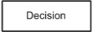 |
|  | Business Knowledge Model | A business knowledge model denotes a function encapsulating business knowledge, e.g., as business rules, a decision table, or an analytic model. | 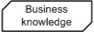 |
|  | Input Data | An input data element denotes information used as an input by one or more decisions. When enclosed within a knowledge model, it denotes the parameters to the knowledge model. The default representation of the Input Data is an oval symbol. For visual coherence with BPMN and CMMN, the representation as a paper symbol with folded corner is possible. This specification uses the default representation in all examples. |  or alternatively 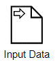 |
|  | Knowledge Source | A knowledge source denotes an authority for a business knowledge model or decision. |  |
|  | Decision Service (expanded) | A decision service may enclose a set of reusable decisions (not shown in the element to the right) that can be invoked internally by another decision or externally, e.g., by a **BPMN** process. | 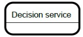 |
|  | Decision Service (collapsed) | A decision service denotes a set of reusable decisions (that may be hidden using the element to the right). |  |
| Requirements | Information Requirement | An information requirement denotes input data, or a decision output being used as one of the inputs of a decision. |  |
|  | Knowledge Requirement | A knowledge requirement denotes the invocation of a business knowledge model. | 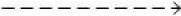 |
|  | Authority Requirement | An authority requirement denotes the dependence of a DRD element on another DRD element that acts as a source of guidance or knowledge. | 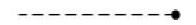 |
| Artifacts | Text Annotation | A Text Annotation consists of a square bracket followed by modeler-entered explanatory text or comment. |  |
|  | Association | An Association connector links a Text Annotation to the DRG Element it explains or comments on. |  |
|  | Group | A Group consists of a rounded corner rectangle drawn with a solid dashed line that groups element together informally. |  |

### DRD Elements

#### Decision notation

A Decision is represented in a DRD as a rectangle, normally drawn with solid lines, as shown in [DRD components](#table-drd-components). The Name of the Decision MUST be displayed inside the shape unless it is overridden by the text attribute of the associated DMNDI:DMNLabel element, which MUST be displayed instead.

If the Listed Input Data option is exercised (see [Input Data notation](#input-data-notation)), all the Decision’s requirements for Input Data SHALL be listed beneath the Decision’s Name and separated from it by a horizontal line, as shown in [Decision with Listed Input Data option](Images/decision-with-listed-input-data-option.svg). The listed Input Data names SHALL be clearly inside the shape of the DRD element.

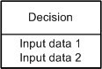

The properties of a Decision are listed and described in [Artifact metamodel](#artifact-metamodel).

#### Business Knowledge Model notation

A Business Knowledge Model is represented in a DRD as a rectangle with two clipped corners, normally drawn with solid lines, as shown in [DRD components](#table-drd-components). The Name of the Business Knowledge Model MUST be displayed inside the shape unless it is overridden by the text attribute of the associated DMNDI:DMNLabel element, which MUST be displayed instead.

The properties of a Business Knowledge Model are listed and described in [Business Context Element metamodel](#business-context-element-metamodel).

#### Input Data notation

An Input Data element is represented in a DRD as a shape with two parallel straight sides and two semi-circular ends, normally drawn with solid lines, as shown in [DRD components](#table-drd-components). The Name of the Input Data element MUST be displayed inside the shape unless it is overridden by the text attribute of the associated DMNDI:DMNLabel element, which MUST be displayed instead.

An alternative compliant way to display requirements for Input Data, especially useful when DRDs are large or complex, is that Input Data are not drawn as separate notational elements in the DRD but are instead listed on those Decision elements which require them. For convenience in this specification this is called the “Listed Input Data” option. Implementations MAY offer this option. [The Listed Input Data option](Images/the-listed-input-data-option.svg) shows two equivalent DRDs, one drawing Input Data elements, the other exercising the Listed Input Data option. Note that if an Input Data element is not displayed it SHALL be listed on all Decisions which require it (unless it is deliberately hidden as discussed in [Partial views and hidden information](#partial-views-and-hidden-information)).

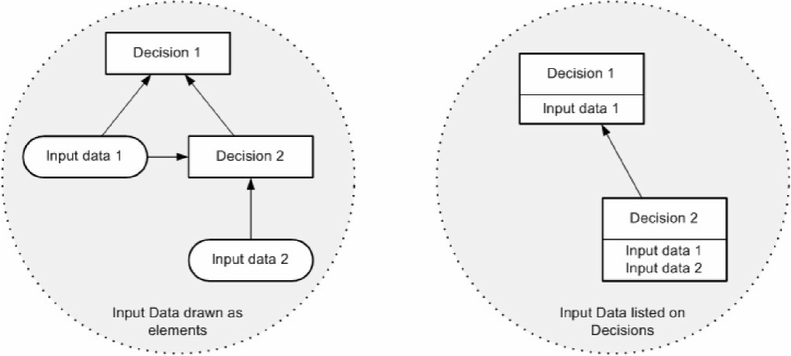

The properties of an Input Data element are listed and described in [Input Data metamodel](#input-data-metamodel).

#### Knowledge Source notation

A Knowledge Source is represented in a DRD as a shape with three straight sides and one wavy one, normally drawn with solid lines, as shown in [DRD components](#table-drd-components). The Name of the Knowledge Source MUST be displayed inside the shape unless it is overridden by the text attribute of the associated DMNDI:DMNLabel element, which MUST be displayed instead.

The properties of a Knowledge Source element are listed and described in [Knowledge Source metamodel](#knowledge-source-metamodel).

### DRD Requirements

#### Information Requirement notation

Information Requirements may be drawn from Input Data elements to Decisions, and from Decisions to other Decisions. They represent the dependency of a Decision on information from input data or the results of other Decisions. They may also be interpreted as data flow: a DRD displaying only Decisions, Input Data and Information Requirements is equivalent to a dataflow diagram showing the communication of information between those elements at evaluation time. The Information Requirements of a valid DRG form a directed acyclic graph.

An Information Requirement is represented in a DRD as an arrow drawn with a solid line and a solid arrowhead, as shown in [DRD components](#table-drd-components). The arrow is drawn in the direction of information flow, i.e., towards the Decision that requires the information.

#### Knowledge Requirement notation

Knowledge Requirements may be drawn from invocable elements (Business Knowledge Models or Decision Services) to Decisions and from invocable elements to Business Knowledge Models. They represent the invocation of an invocable element when making a decision. If *e* is a decision or a BKM in some DRD, and *e* contains a knowledge requirement on some invocable element *b*, then the logic of *e* must contain an invocation expression of *b*, including expressions for each of *b*'s parameters.

A Knowledge Requirement is represented in a DRD as an arrow drawn with a dashed line and an open arrowhead, as shown in [DRD components](#table-drd-components). The arrows are drawn in the direction of the information flow of the result of evaluating the function, i.e., toward the element that requires the business knowledge.

#### Authority Requirement notation

Authority Requirements may be used in two ways:

a\) They may be drawn from Knowledge Sources to Decisions, Business Knowledge Models, and other Knowledge Sources, where they represent the dependence of the DRD element on the knowledge source. This might be used to record the fact that a set of business rules must be consistent with a published document (e.g., a piece of legislation or a statement of business policy), or that a specific person or organizational group is responsible for defining some decision logic, or that a decision is managed by a person or group. An example of this use of Knowledge Sources is shown in [Knowledge Sources representing authorities](Images/knowledge-sources-representing-authorities.svg): in this case the Business Knowledge Model requires two sources of authority – a policy document and legislation – and the policy document requires the authority of a policy group.

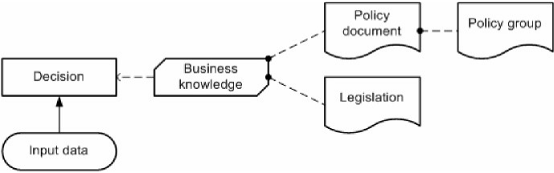

b\) They may be drawn from Input Data and Decisions to Knowledge Sources, where, in conjunction with use (a), they represent the derivation of Business Knowledge Models from instances of Input Data and Decision results, using analytics. The Knowledge Source typically represents the analytic model (or modeling process); the Business Knowledge Model represents the executable logic generated from or dependent on the model. An example of this use of a Knowledge Source is shown in [Knowledge source representing predictive analytics](Images/knowledge-source-representing-predictive-analytics.svg): in this case a business knowledge model is based on an analytic model which is derived from input data and the results of a dependent decision.

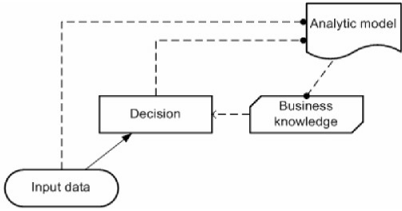

However, the figures above are only examples. There are many other possible use cases for Authority Requirements (and since Knowledge Sources and Authority Requirements have no execution semantics their interpretation is necessarily vague), so this specification leaves the details of their application to the implementer.

An Authority Requirement is represented in a DRD as an arrow drawn with a dashed line and a filled circular head, as shown in [DRD components](#table-drd-components). The arrows are drawn from the source of authority to the element governed by it.

### Connection rules

The rules governing the permissible ways of connecting elements with requirements in a DRD are described in Clause [DRD Requirements](#drd-requirements) above and summarized in [Requirements connection rules](#table-requirements-connection-rules). For clarity, a simple DRD is shown for each permissible connection. In each of these diagrams, the upper (“to”) element requires the lower (“from”) element.

Note that no requirements may be drawn terminating in Input Data, that is, input data may have no requirements. Note also that the type of the requirement is uniquely determined by the types of the two elements connected.

###### Table: Requirements connection rules

| **From** | **To (Required by)** | **Requirement** | **Diagram** |
|------------------|------------------|------------------|------------------|
| Decision | Decision | Information | 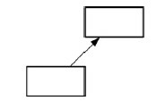 |
| Decision | Knowledge Source | Authority | 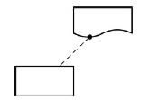 |
| Business Knowledge Model | Decision | Knowledge | 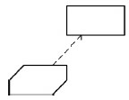 |
| Business Knowledge Model | Business Knowledge Model | Knowledge | 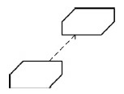 |
| Decision Service | Decision | Knowledge | 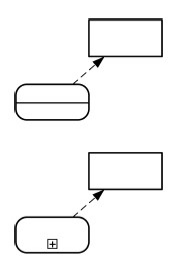 |
| Decision Service | Business Knowledge Model | Knowledge | 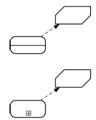 |
| Input data | Decision | Information | 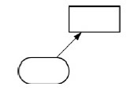 |
| Input data | Knowledge Source | Authority | 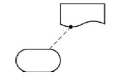 |
| Knowledge Source | Decision | Authority | 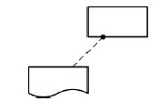 |
| Knowledge Source | Business Knowledge Model | Authority | 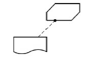 |
| Knowledge Source | Knowledge Source | Authority | 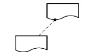 |

### Partial views and hidden information

The metamodel (see [Metamodel](#metamodel)) provides properties for each of the DRG elements which would not normally be displayed on the DRD but provide additional information about their nature or function.

For example, for a Decision these include properties specifying which **BPMN** processes and tasks make use of the Decision. Implementations SHALL provide facilities for specifying and displaying such properties.

For any significant domain of decision-making a DRD representing the complete DRG may be a large and complex diagram. Implementations MAY provide facilities for displaying DRDs which are partial or filtered views of the DRG, e.g., by hiding categories of elements, or hiding or collapsing areas of the network.

DRG Elements with requirements not displayed on the current DRD SHOULD be notated with an ellipsis (...) to show that this is the case. For example, see [DRD for Review application decision point](Images/drd-for-review-application-decision-point.svg).

Two examples of DRDs providing partial views of a DRG are shown in [DRDs as partial views of a DRG](Images/drds-as-partial-views-of-a-drg.svg): DRD 1 shows only the immediate requirements of a single decision; DRD 2 shows only Information Requirements and the elements they connect.

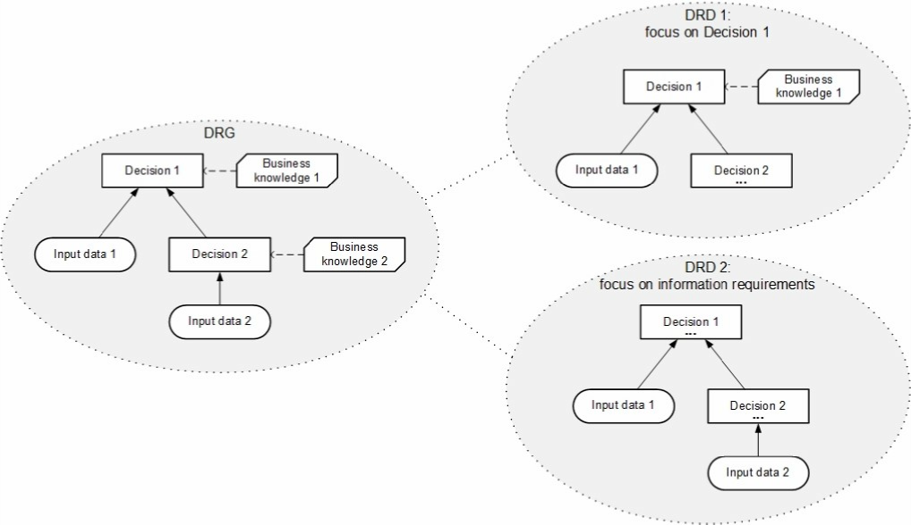

DRDs can be interchanged using the Diagram Interchange mechanism defined in [DMN Diagram Interchange (DMN DI)](14_DMN_Diagram_Interchange_DMN_DI.md#dmn-diagram-interchange-dmn-di).

### Decision service

A Decision Service is represented in a DRD as rectangle with rounded corners, drawn with a heavy solid border. The Name of the Decision Service MUST be displayed inside the shape unless it is overridden by the text attribute of the associated DMNDI:DMNLabel element, which MUST be displayed instead. The border SHALL enclose all the encapsulated decisions, and no other decisions or input data. The border MAY enclose other DRG elements, but these will not form part of the definition of the Decision Service.

If the set of output decisions is smaller than the set of encapsulated decisions, the Decision Service SHALL be divided into two parts with a straight solid line. One part SHALL enclose only the output decisions and the Decision Service's Name; the other part SHALL enclose all the encapsulated decisions which are not in the set of output decisions. Either part MAY enclose other DRG elements, but these will not form part of the definition of the Decision Service.

[Decision Service notation](Images/decision-service-notation.svg) shows a Decision Service with two output decisions; other examples (with a single output decision) are shown in [A decision service](Images/a-decision-service.svg) and [A decision service taking a decision as input](Images/a-decision-service-taking-a-decision-as-input.svg).

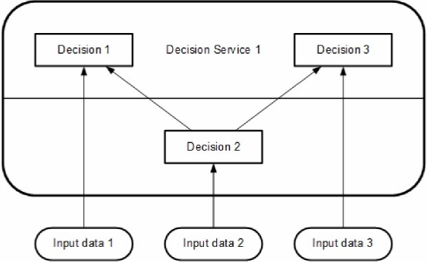

A decision service may be defined in one DRD and then shown in a different DRD when invoked internally within the decision model by another decision. In the case of a decision service invocation internal to the decision model, a decision service may also be shown without the details of its definition, as in a “collapsed state”. [A decision service in expanded and collapsed form](Images/a-decision-service-in-expanded-and-collapsed-form.svg) consists of two separate diagrams: DRD 1 shows the definition of Decision service 1. In DRD 2, the same Decision service 1 is shown as invoked by Decision 5. In DRD 2, Decision service 1 is shown in a collapsed form.

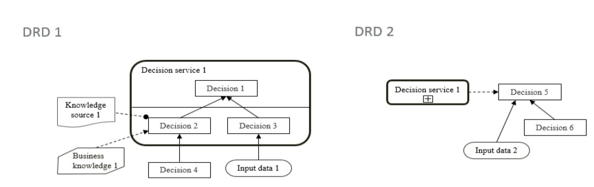

DRD 1 in [A decision service in expanded and collapsed form](Images/a-decision-service-in-expanded-and-collapsed-form.svg) shows that Decision service 1 has 2 inputs: Decision 4 and Input data 1. It is therefore inferred that Decision Service 1 has 2 input parameters with matching characteristics to Decision 4 and Input data 1. DRD 2 in [A decision service in expanded and collapsed form](Images/a-decision-service-in-expanded-and-collapsed-form.svg) shows that Decision 5 has 2 dependencies but whether these are mapped as parameters for the invocation of Decision Service 1 cannot be determined from the diagram.

The information and authority requirements defined on Decision 2 in DRD 1 are not depicted in the collapsed form of Decision Service 1 shown in DRD 2.

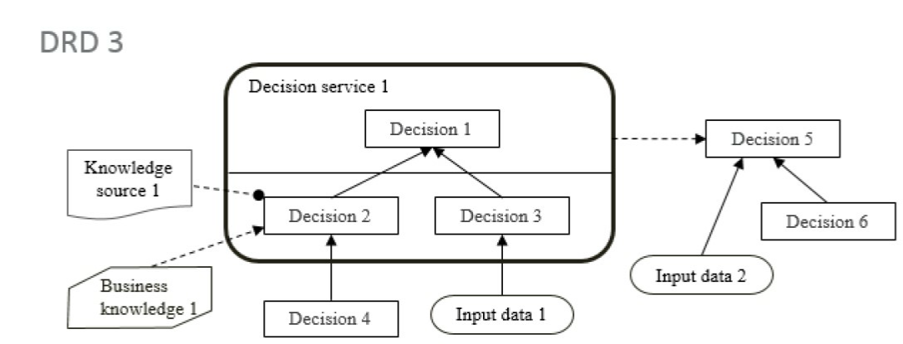

DRDs 1 and 2 in [A decision service in expanded and collapsed form](Images/a-decision-service-in-expanded-and-collapsed-form.svg) and DRD 3 in [A decision service invoked in an expanded form](Images/a-decision-service-invoked-in-an-expanded-form.svg) are all congruent within the same DRG. They all show different aspects of Decision Service 1. DRD 3 shows an expanded form Decision service 1 being invoked by Decision 5.

The constraint imposed on the rendering of decision services within a DRD is that the same decision service MUST NOT be rendered both expanded and collapsed within the same DRD. This stems from the general restriction disallowing the same DMN Element to be present twice in the same diagram.

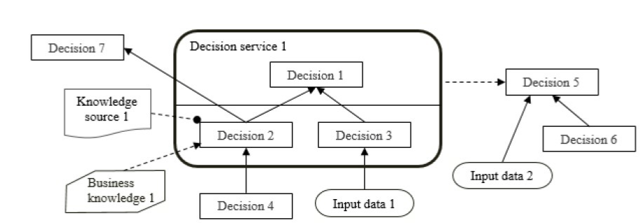

Decision services are defined as overlays and therefore do not encapsulate the decisions within them. Therefore, the richness of connections depicted in [A decision service defined as an overlay](Images/a-decision-service-defined-as-an-overlay.svg) is allowed. In this DRD, Decision 7 is dependent on Decision 2.

### Identifying Collections

Decisions and Input Data elements on a DRD can represent collections of elements. Implementations MAY show this with the addition of \|\|\| in the shape. Implementations SHALL show this on all such DRD elements within a DRG OR on no DRD elements.

A Decision is considered to represent a collection if the Decision's decisionOutput InformationItem references an ItemDefinition with isCollection = TRUE.

An InputData is considered to represent a collection if the InputData's variable InformationItem references an ItemDefinition with isCollection = TRUE.

Two examples, a Decision and an Input Data, are shown in [Decision and Input Data showing collection marker](Images/decision-and-input-data-showing-collection-marker.svg).

## Metamodel

### DMN Element metamodel

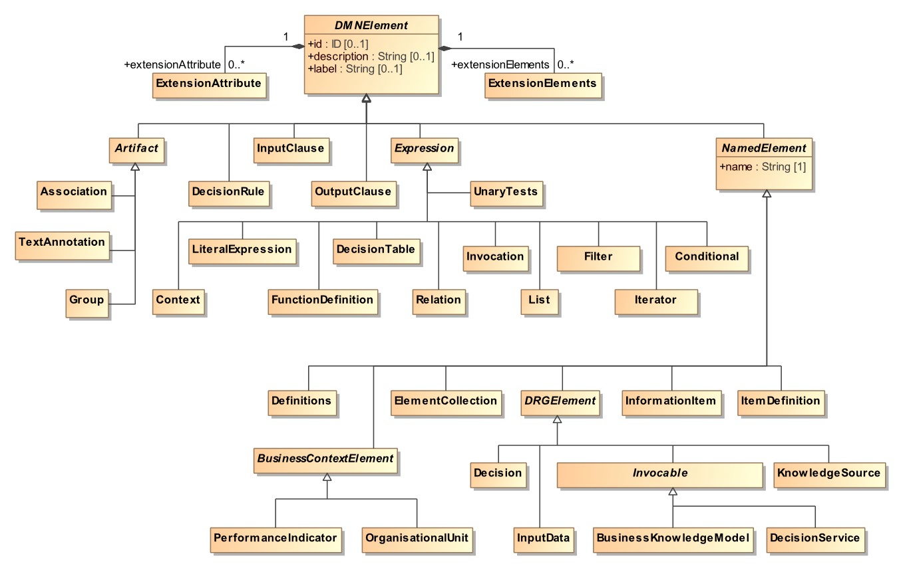

DMNElement is the abstract superclass for the decision model elements. It provides the optional attributes id, description and label, which are Strings which other elements will inherit. The id of a DMNElement is further restricted to the syntax of an XML ID (<https://www.w3.org/TR/2004/REC-xmlschema-2-20041028/datatypes.html#ID>), and SHALL be unique within the decision model.

DMNElement has abstract specializations NamedElement and Expression NamedElement adds the required attribute name, and includes the abstract specializations BusinessContextElement and DRGElement, as well as concrete specializations Definitions, ItemDefinition, InformationItem, ElementCollection and DecisionService.

[DMNElement attributes and model associations](#table-dmnelement-attributes-and-model-associations) presents the attributes and model associations of the DMNElement element.

###### Table: DMNElement attributes and model associations

| **Attribute** | **Description** |
|------------------------------------|------------------------------------|
| **id:** ID \[0..1\] | Optional identifier for this element. SHALL be unique within its containing Definitions element. |
| **description**: String \[0.. 1\] | A description of this element. |
| **label:** String \[0.. 1\] | An alternative short description of this element. It should primarily be used on elements that do not have a name attribute, e.g., an Input Expression. Similar to the description attribute, it has no notation defined and is neither related to the DMNLabel element that is used in Diagram Interchange nor to the outputLabel attribute of a Decision Table. |
| **extensionElements:** ExtensionElement \[0..1\] | This attribute is used as a container to attach additional elements to any DMN Element. See [Extensibility](#extensibility) for additional information on extensibility. |
| **extensionAttributes:** ExtensionAttribute \[0..\*\] | This attribute is used to attach named extended attributes and model associations. This association is not applicable when the XML schema interchange is used, since the XSD mechanism for supporting "anyAttribute" from other namespaces already satisfies this requirement. See [Extensibility](#extensibility) for additional information on extensibility. |

###### Table: NamedElement attributes and model associations

| **Attribute**    | **Description**          |
|------------------|--------------------------|
| **Name:** string | The name of this element |

### Definitions metamodel

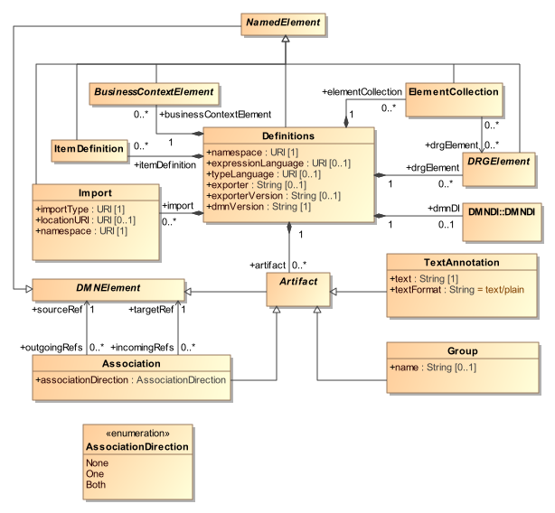

The Definitions class is the outermost containing object for all elements of a **DMN** decision model. It defines the scope of visibility and the namespace for all contained elements. Elements that are contained in an instance of Definitions have their own defined life-cycle and are not deleted with the deletion of other elements. The interchange of **DMN** files will always be through one or more Definitions.

Definitions is a kind of NamedElement, from which an instance of Definitions inherits the name and optional id, description, and label attributes, which are Strings.

An instance of Definitions has a namespace, which is a String. The namespace identifies the default target namespace for the elements in the Definitions and follows the convention established by XML Schema.

An instance of Definitions may specify an expressionLanguage, which is a URI that identifies the default expression language used in elements within the scope of this Definitions. This value may be overridden on each individual LiteralExpression. The language SHALL be specified in a URI format. The default expression language is FEEL ([Expression Language (FEEL)](10_Expression_Language_FEEL.md#expression-language-feel)), indicated by the URI: "https://www.omg.org/spec/DMN/FEEL/". If FEEL is used in other languages, e.g. as an expression language in a **BPMN** process model, a version number MUST be added to the URL, i.e. "https://www.omg.org/spec/DMN/FEEL/1.7". The simple expression language S-FEEL ([Simple Expression Language (S-FEEL)](09_Simple_Expression_Language_S-FEEL.md#simple-expression-language-s-feel)), being a subset of FEEL, is indicated by the same URI. **DMN** provides a URI for expression languages that are not meant to be interpreted automatically (e.g., pseudo-code that may resemble FEEL but is not): "http://www.omg.org/spec/DMN/uninterpreted/20140801".

An instance of Definitions may specify a typeLanguage, which is a URI that identifies the default type language used in elements within the scope of this Definitions. For example, a typeLanguage value of

“http://www.w3.org/2001/XMLSchema” indicates that the data structures defined within that Definitions are, by default, in the form of XML Schema types. If unspecified, the default typeLanguage is FEEL. This value may be overridden on each individual ItemDefinition.

The typeLanguage SHALL be specified in a URI format (the URI for FEEL is “https://www.omg.org/spec/DMN/20230324/FEEL/”; the URI

"http://www.omg.org/spec/DMN/uninterpreted/20140801" can be used to indicate that a type definition is not meant to be interpreted)).

An instance of Definitions may specify an exporter and exporterVersion, which are Strings naming

the tool and version used to create the XML serialization. In standards such as **BPMN**, this has been found to aid in model interchange between tools.

An instance of Definitions is composed of zero or more drgElements, which are instances of

DRGElement, zero or more elementCollections, which are instances of ElementCollection, zero or more itemDefinitions, which are instances of ItemDefinition and of zero or more businessContextElements, which are instances of BusinessContextElement.

It may contain any number of associated import, which are instances of Import. Imports are used to import elements defined outside of this Definitions, e.g., in other Definitions elements, and to make them available for use by elements in this Definitions.

Definitions inherits all the attributes and model associations from NamedElement. [Definitions attributes and model associations](#table-definitions-attributes-and-model-associations) presents the additional attributes and model associations of the Definitions element.

###### Table: Definitions attributes and model associations

| **Attribute** | **Description** |
|-----------------------------------|-------------------------------------|
| **namespace**: anyURI \[1\] | This attribute identifies the namespace associated with this Definitions and follows the convention established by XML Schema. |
| **dmnVersion:** string \[1\] | This attribute identifies the concrete DMN version used in this Definitions (see clause [Document Structure](13_Exchange_Formats.md#document-structure) for its use in the XML serialization). |
| **expressionLanguage**: anyURI \[0.. 1\] | This attribute identifies the expression language used in LiteralExpressions within the scope of this Definitions. The Default is FEEL ([Expression Language (FEEL)](10_Expression_Language_FEEL.md#expression-language-feel)). This value MAY be overridden on each individual LiteralExpression. The language SHALL be specified in a URI format. |
| **typeLanguage**: anyURI \[0.. 1\] | This attribute identifies the type language used in LiteralExpressions within the scope of this Definitions. The Default is FEEL ([Expression Language (FEEL)](10_Expression_Language_FEEL.md#expression-language-feel)). This value MAY be overridden on each individual ItemDefinition. The language SHALL be specified in a URI format. |
| **exporter**: string \[0..1\] | This attribute names the tool used to export the XML serialization. |
| **exporterVersion**: string \[0.. 1\] | This attribute names the version of the tool used to export the XML serialization. |
| **itemDefinition**: ItemDefinition \[\*\] | This attribute lists the instances of ItemDefinition that are contained in this Definitions. |
| **drgElement**: DRGElement \[\*\] | This attribute lists the instances of DRGElement that are contained in this Definitions. |
| **businessContextElement**: BusinessContextElement \[\*\] | This attribute lists the instances of BusinessContextElement that are contained in this Definitions. |
| **elementCollection:** ElementCollection \[\*\] | This attribute lists the instances of ElementCollection that are contained in this Definitions. |
| **import**: Import \[\*\] | This attribute is used to import externally defined elements and make them available for use by elements in this Definitions. |
| **artifact:** Artifact \[0..\*\] | Artifacts include text annotations, groups, and associations among DMN elements. |
| **dmnDI**: DMNDI \[0..1\] | This attribute contains the Diagram Interchange information contained within this Definitions (see [Exchange Formats](13_Exchange_Formats.md#exchange-formats) for more information on the DMN Diagram Interchange). |

### Import metamodel

The Import class is used when referencing external elements, either **DMN** DRGElement or ItemDefinition instances contained in other Definitions elements, or non-**DMN** elements, such as an XML Schema or a PMML file. Imports SHALL be explicitly defined.

An instance of Import has an importType, which is a String that specifies the type of import associated with the element. For example, a value of “http://www.w3.org/2001/XMLSchema” indicates that the imported element is an XML schema. The **DMN** namespace indicates that the imported element is a **DMN** Definitions element.

The location of the imported element may be specified by associating an optional locationURI with an instance of Import. The locationURI is a URI.

An instance of Import has a namespace, which is a URI that identifies the namespace of the imported element, and also a name, inherited from NamedElement, which is a string that serves as a prefix in namespace-qualified names, such as typeRefs specifying imported ItemDefinitions and expressions referencing imported InformationItems. The namespace value should be globally unique, but the import name, which is typically a short business-friendly name, must be distinct from the names of other imports, decisions, input data, business knowledge models, decision services, and item definitions within the importing model only. Multiple imports with empty import names are allowed in the default namespace and their precedence is resolved according to their definition order.

When the import name attribute is an empty string, the elements are imported in the default namespace of the model. When a name collision occurs between an element in the default namespace and an imported element, the imported element does not replace the one already in the default namespace while the elements without name collision are imported.

[Import attributes and model associations](#table-import-attributes-and-model-associations) presents the attributes and model associations of the Import element.

###### Table: Import attributes and model associations

| **Attribute** | **Description** |
|-----------------------------------|-------------------------------------|
| **importType**: anyURI | Specifies the style of import associated with this Import. |
| **locationURI**: anyURI \[0.. 1\] | Identifies the location of the imported element. |
| **namespace**: anyURI | Identifies the namespace of the imported element. |

### Element Collection metamodel

The ElementCollection class is used to define named groups of DRGElement instances. ElementCollections may be used for any purpose relevant to an implementation, for example:

- To identify the requirements subgraph of a set one or more decisions (i.e., all the elements in the closure of the requirements of the set).

- To identify the elements to be depicted on a DRD.

ElementCollection is a kind of NamedElement, from which an instance of ElementCollection inherits the name and optional id, description, and label attributes, which are Strings. The id of an ElementCollection element SHALL be unique within the containing instance of Definitions.

An ElementCollection element has any number of associated drgElements, which are the instances of DRGElement that this ElementCollection defines together as a group. Notice that an ElementCollection element must reference the instances of DRGElement that it collects, not contain them: instances of DRGElement can only be contained in Definitions elements.

ElementCollection inherits all the attributes and model associations from NamedElement. [ElementCollection attributes and model associations](#table-elementcollection-attributes-and-model-associations) presents the additional attributes and model associations of the ElementCollection element.

###### Table: ElementCollection attributes and model associations

| **Attribute** | **Description** |
|------------------------------------|------------------------------------|
| **drgElement**: DRGElement \[\*\] | This attribute lists the instances of DRGElement that this ElementCollection groups. |

### DRG Element metamodel

DRGElement is the abstract superclass for all **DMN** elements that are contained within Definitions and that have a graphical representation in a DRD. All the elements of a **DMN** decision model that are not contained directly in a Definitions element (specifically: all three kinds of requirement, bindings, clause and decision rules, import, and objective) SHALL be contained in an instance of DRGElement, or in a model element that is contained in an instance of DRGElement, recursively.

The specializations of DRGElement are Decision, InputData, Invocable, and KnowledgeSource. Invocable is further specialized into BusinessKnowledgeModel and DecisionService.

DRGElement is a specialization of NamedElement, from which it inherits the name and optional id, description, and label attributes. The id of a DRGElement element SHALL be unique within the containing instance of Definitions.

A **Decision Requirements Diagram** (**DRD**) is the diagrammatic representation of one or more instances of DRGElement and their information, knowledge, and authority requirement relations. The instances of DRGElement

are represented as the vertices in the diagram; the edges represent instances of InformationRequirement,

KnowledgeRequirement or AuthorityRequirement (see clauses [Information Requirement metamodel](#information-requirement-metamodel), [Knowledge Requirement metamodel](#knowledge-requirement-metamodel), and [Authority Requirement metamodel](#authority-requirement-metamodel)). The connection rules are specified in [Connection rules](#connection-rules)).

DRGElement inherits all the attributes and model associations of NamedElement. It does not define additional attributes and model associations of the DRGElement element.

### Artifact metamodel

Artifacts are used to provide additional information about a Decision Model. DMN provides two standard Artifacts: Association and Text Annotation. Associations can be used to link Artifacts to any DMNElement.

#### Association

An Association is used to link information and Artifacts with DMN graphical elements. Text Annotations and other Artifacts can be associated with the graphical elements. An arrowhead on the Association indicates a direction of flow (e.g., data), when appropriate.

The Association element inherits the attributes and model associations of DMNElement (see [DMNElement attributes and model associations](#table-dmnelement-attributes-and-model-associations)). [Association attributes and model associations](#table-association-attributes-and-model-associations) presents the additional attributes and model associations for an Association.

###### Table: Association attributes and model associations

| **Attribute** | **Description** |
|------------------------------------|------------------------------------|
| **associationDirection:** AssociationDirection = None {None \| One \| Both} | associationDirection is an attribute that defines whether or not the Association shows any directionality with an arrowhead. The default is None (no arrowhead). A value of One means that the arrowhead SHALL be at the Target Object. A value of Both means that there SHALL be an arrowhead at both ends of the Association line. |
| **sourceRef:** DMNElement \[1\] | The DMNElement that the Association is connecting from. |
| **targetRef:** DMNElement \[1\] | The DMNElement that the Association is connecting to. |

#### Group

The **Group** object is an Artifact that provides a visual mechanism to group elements of a diagram informally. **Groups** are often used to highlight certain sections of a Diagram without adding additional constraints for performance. The highlighted (grouped) section of the Diagram can be separated for reporting and analysis purposes. **Groups** do not affect the execution of the Decisions.

As an Artifact, a **Group** is not a DRGElement, and, therefore, cannot be connected to/from an Information Requirement, Knowledge Requirement, or Authority Requirement. It can only be connected to/from an Association.

The Group element inherits the attributes and model associations of Artifact. [Group model associations](#table-group-model-associations) presents the additional attributes and model associations for a Group.

###### Table: Group model associations

| **Attribute**             | **Description**                      |
|---------------------------|--------------------------------------|
| **Name:** String\[0.. 1\] | The descriptive name of the element. |

#### Text Annotation

Text Annotations are a mechanism for a modeler to provide additional text information for the reader of a DMN Diagram.

The TextAnnotation element inherits the attributes and model associations of DMNElement (see [DMNElement attributes and model associations](#table-dmnelement-attributes-and-model-associations)). [TextAnnotation attributes](#table-textannotation-attributes) presents the additional attributes for a TextAnnotation.

###### Table: TextAnnotation attributes

| **Attribute** | **Description** |
|------------------------------------|------------------------------------|
| **text:** string | Text is an attribute that is text that the modeler wishes to communicate to the reader of the Diagram. |
| **textFormat:** string = "text/plain" | This attribute identifies the format of the text. It SHALL follow the mime-type format. The default is "text/plain." |

### Decision metamodel

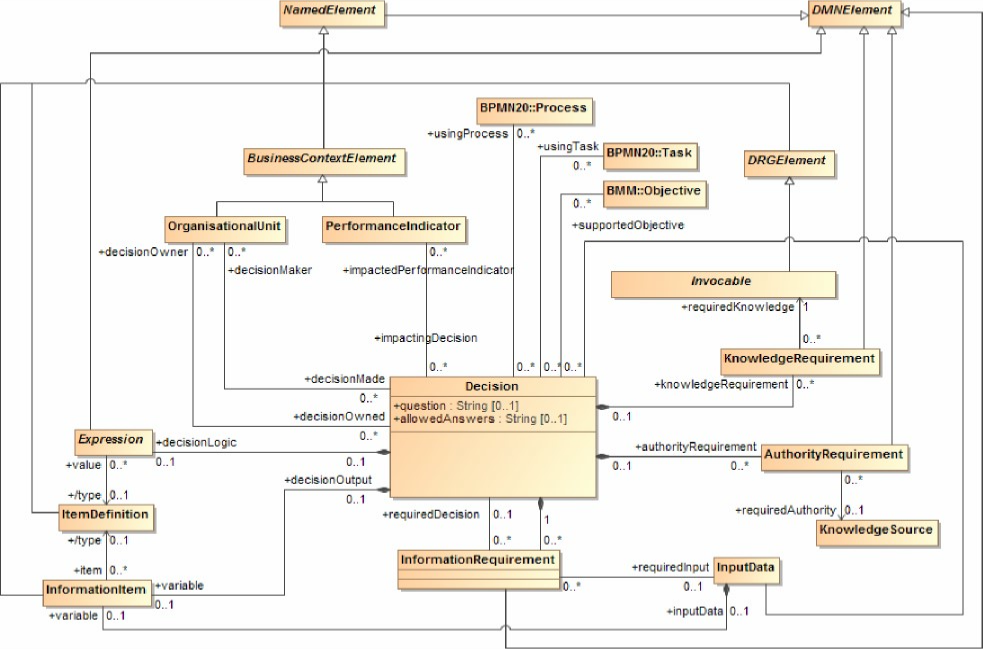

The class Decision is used to model a decision.

Decision is a concrete specialization of DRGElement and it inherits the name and optional id, description and label attributes from NamedElement The name of a Decision must be different from the name of any other invocable, input data, decision, or import in the decision model.

In addition, it may have a question and allowedAnswers, which are all strings. The optional description attribute is meant to contain a brief description of the decision-making embodied in the Decision. The optional question attribute is meant to contain a natural language question that characterizes the Decision such that the output of the Decision is an answer to the question. The optional allowedAnswers attribute is meant to contain a natural language description of the answers allowed for the question such as Yes/No, a list of allowed values, a range of numeric values etc.

In a DRD, an instance of Decision is represented by a **decision** diagram element.

A Decision element is composed of an optional decisionLogic, which is an instance of Expression, and of zero or more informationRequirement, knowledgeRequirement and authorityRequirement elements, which are instances of InformationRequirement, KnowledgeRequirement and AuthorityRequirement, respectively.

In addition, a Decision defines an InformationItem representing its output. This InformationItem may include an optional typeRef, which references an ItemDefinition or other type definition specifying the datatype of the possible outcomes of the Decision.

The **requirement subgraph** of a Decision element is the directed graph composed of the Decision element itself, its informationRequirements, its knowledgeRequirements, and the union of the requirement subgraphs of each requiredDecision or requiredKnowledge element: that is, the requirement subgraph of a Decision element is the closure of the informationRequirement, requiredInput, requiredDecision, knowledgeRequirement and requiredKnowledge associations starting from that Decision element.

An instance of Decision – that is, the model of a decision – is said to be **well-formed** if and only if all of its informationRequirement and knowledgeRequirement elements are well-formed, That condition entails, in particular, that the requirement subgraph of a Decision element SHALL be acyclic, that is, that a Decision element SHALL not require itself, directly or indirectly.

Besides its logical components, information requirements, decision logic etc, the model of a decision may also document a business context for the decision (see clause [Business Context Element metamodel](#business-context-element-metamodel) and [BusinessContextElement class diagram](Images/businesscontextelement-class-diagram.svg)).

The business context for an instance of Decision is defined by its association with any number of supportedObjectives, which are instances of Objective as defined in OMG BMM, any number of impactedPerformance Indicators, which are instances of Performance Indicator, any number of decisionMaker and any number of decisionOwner, which are instances of OrganisationalUnit.

In addition, an instance of Decision may reference any number of usingProcess, which are instances of Process as defined in OMG **BPMN 2.0**, and any number of usingTask, which are instances of Task as defined in OMG **BPMN 2.0**, and which are the Processes and Tasks that use the Decision element.

Decision inherits all the attributes and model associations from DRGElement. [Decision attributes and model associations](#table-decision-attributes-and-model-associations) presents the additional attributes and model associations of the Decision class.

###### Table: Decision attributes and model associations

| **Attribute** | **Description** |
|------------------------------------|------------------------------------|
| **question**: string \[0..1\] | A natural language question that characterizes the Decision such that the output of the Decision is an answer to the question. |
| **allowedAnswers**: string \[0..1\] | A natural language description of the answers allowed for the question such as Yes/No, a list of allowed values, a range of numeric values etc. |
| **variable**: InformationItem | The instance of InformationItem that stores the result of this Decision. |
| **decisionLogic**: Expression \[0..1\] | The instance of Expression that represents the decision logic for this Decision. |
| **informationRequirement**: InformationRequirement \[\*\] | This attribute lists the instances of InformationRequirement that compose this Decision. |
| **knowledgeRequirement**: KnowledgeRequirement \[\*\] | This attribute lists the instances of KnowledgeRequirement that compose this Decision. |
| **authorityRequirement**: AuthorityRequirement \[\*\] | This attribute lists the instances of AuthorityRequirement that compose this Decision. |
| **supportedObjective**: BMM::Objective \[\*\] | This attribute lists the instances of BMM::Objective that are supported by this Decision. |
| **impactedPerformanceIndicator**: PerformanceIndicator \[\*\] | This attribute lists the instances of PerformanceIndicator that are impacted by this Decision. |
| **decisionMaker**: OrganisationalUnit \[\*\] | The instances of OrganisationalUnit that make this Decision. |
| **decisionOwner**: OrganisationalUnit \[\*\] | The instances of OrganisationalUnit that own this Decision. |
| **usingProcesses**: **BPMN**::process \[\*\] | This attribute lists the instances of **BPMN**::process that require this Decision to be made. |
| **usingTasks**: **BPMN**::task \[\*\] | This attribute lists the instances of **BPMN**::task that make this Decision. |

### Business Context Element metamodel

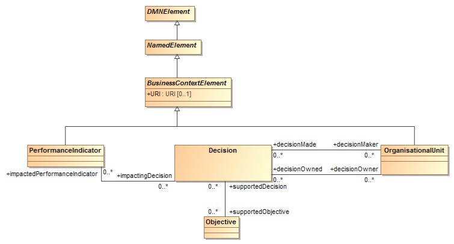

The abstract class BusinessContextElement, and its concrete specializations PerformanceIndicator and OrganizationUnit are placeholders, anticipating a definition to be adopted from other OMG meta-models, such as OMG OSM when it is further developed.

BusinessContextElement is a specialization of NamedElement, from which it inherits the name and optional id, description, and label attributes.

In addition, instances of BusinessContextElements may have a URI, which is a URI, and

- an instance of PerformanceIndicator references any number of impactingDecision, which are the Decision elements that impact it;

- an instance of OrganisationalUnit references any number of decisionMade and of decisionOwned, which are the Decision elements that model the decisions that the organization unit makes or owns.

BusinessContextElement inherits all the attributes and model associations from NamedElement. [BusinessContextElement attributes and model associations](#table-businesscontextelement-attributes-and-model-associations) presents the additional attributes and model associations of the BusinessContextElement class.

###### Table: BusinessContextElement attributes and model associations

| **Attribute**            | **Description**                         |
|--------------------------|-----------------------------------------|
| **URI**: anyURI \[0..1\] | The URI of this BusinessContextElement. |

PerformanceIndicator inherits all the attributes and model associations from

BusinessContextElement. [PerformanceIndicator attributes and model associations](#table-performanceindicator-attributes-and-model-associations) presents the additional attributes and model associations of the PerformanceIndicator class.

###### Table: PerformanceIndicator attributes and model associations

| **Attribute** | **Description** |
|-----------------------------------|-------------------------------------|
| **impactingDecision:** Decision \[\*\] | This attribute lists the instances of Decision that impact this PerformanceIndicator. |

OrganisationalUnit inherits all the attributes and model associations from BusinessContextElement. [OrganisationalUnit attributes and model associations](#table-organisationalunit-attributes-and-model-associations) presents the additional attributes and model associations of the OrganisationalUnit class.

###### Table: OrganisationalUnit attributes and model associations

| **Attribute** | **Description** |
|-----------------------------------|-------------------------------------|
| **decisionMade**: Decision \[\*\] | This attribute lists the instances of Decision that are made by this OrganisationalUnit. |
| **decisionOwned**: Decision \[\*\] | This attribute lists the instances of Decision that are owned by this OrganisationalUnit. |

### Business Knowledge Model metamodel

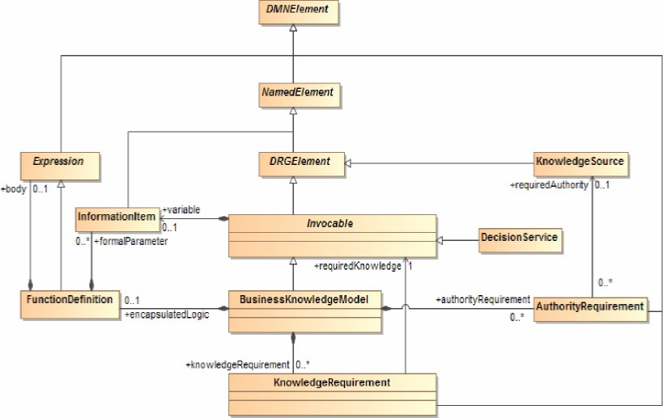

A business knowledge model has an abstract part, representing reusable, invocable decision logic, and a concrete part, which mandates that the decision logic must be a single FEEL boxed function definition. A decision service is also an invocable element and thus can be invoked as required knowledge from other decisions and business knowledge models.

The class Invocable is used to model an invocable element and the class BusinessKnowledgeModel is used to model a business knowledge model.

Invocable is a specialization of DRGElement and it inherits the name and optional id, description, and label attributes from NamedElement. The name of an Invocable must be different from the name of any other invocable, input data, decision, or import in the decision model. BusinessKnowledgeModel is a specialization of Invocable from which it additionally inherits the variable attribute.

A BusinessKnowledgeModel element may have zero or more knowledgeRequirement, which are instance of KnowledgeRequirement, and zero or more authorityRequirement, which are instances of AuthorityRequirement. These model elements are described below.

The **requirement subgraph** of a BusinessKnowledgeModel element is the directed graph composed of the

BusinessKnowledgeModel element itself, its knowledgeRequirement elements, and the union of the requirement subgraphs of all the requiredKnowledge elements that are referenced by its knowledgeRequirements.

An instance of BusinessKnowledgeModel is said to be **well-formed** if and only if, either it does not have any knowledgeRequirement, or all of its knowledgeRequirement elements are well-formed. That condition entails, in particular, that the requirement subgraph of a BusinessKnowledgeModel element SHALL be acyclic, that is, that a BusinessKnowledgeModel element SHALL not require itself, directly or indirectly.

At the decision logic level, a BusinessKnowledgeModel element contains a FunctionDefinition, which is an instance of Expression containing zero or more parameters, which are instances of Information Item. The FunctionDefinition that is contained in a BusinessKnowledgeModel element is the reusable module of decision logic that is represented by this BusinessKnowledgeModel element. An Invocable element contains an InformationItem that holds an invocable reference to the abstract business knowledge, which allows a Decision to invoke it by name. The name of that InformationItem SHALL be the same as the name of the Invocable element. Invocable inherits all the attributes and model associations from DRGElement.

[Invocable attributes and model associations](#table-invocable-attributes-and-model-associations) presents the additional attributes and model associations of the Invocable class. [BusinessKnowledgeModel attributes and model associations](#table-businessknowledgemodel-attributes-and-model-associations) presents the additional attributes and model associations of the BusinessKnowledgeModel class.

###### Table: Invocable attributes and model associations

| **Attribute** | **Description** |
|------------------------------------|------------------------------------|
| **variable:** InformationItem | This attribute defines a variable that is bound to the function defined by the FunctionDefinition, allowing decision logic to invoke the function by name. |

###### Table: BusinessKnowledgeModel attributes and model associations

| **Attribute** | **Description** |
|------------------------------------|------------------------------------|
| **encapsulatedLogic:** FunctionDefinition \[0.. 1\] | The function that encapsulates the logic encapsulated by this BusinessKnowledgeModel. |
| **knowledgeRequirement**: KnowledgeRequirement \[\*\] | This attribute lists the instances of KnowledgeRequirement that compose this BusinessKnowledgeModel. |
| **authorityRequirement**: AuthorityRequirement \[\*\] | This attribute lists the instances of AuthorityRequirement that compose this BusinessKnowledgeModel. |

### Decision service metamodel

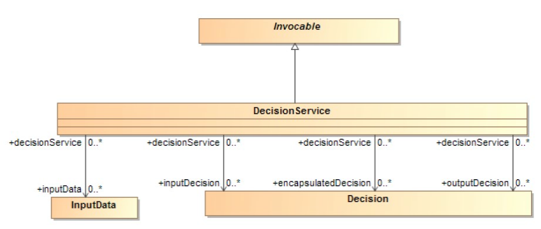

The DecisionService class is used to define named decision services against the decision model contained in an instance of Definitions.

DecisionService is a kind of Invocable element, from which an instance of DecisionService inherits the name and optional id, description, and label attributes, which are Strings, and a variable, which is an InformationItem. The id of a DecisionService element SHALL be unique within the containing instance of Definitions.

The name of the variable and the name of the DecisionService SHALL be the same. This name may be used to invoke a DecisionService from the decision logic of another decision or business knowledge model.

A DecisionService element has one or more associated outputDecisions, which are the instances of Decision required to be output by this DecisionService, i.e., the Decisions whose results the Decision Service must return when called.

A DecisionService element has zero or more encapsulatedDecisions, which are the instances of Decision required to be encapsulated by this DecisionService, i.e., the Decisions to be evaluated by the Decision Service when it is called.

A DecisionService element has zero or more inputDecisions, which are the instances of Decision required as input by this DecisionService, i.e., the Decisions whose results will be provided to the Decision Service when it is called.

A DecisionService element has zero or more inputData, which are the instances of InputData required as input by this DecisionService, i.e., the Input Data which will be provided to the Decision Service when it is called.

The encapsulatedDecisions, inputDecisions and inputData attributes are optional. At least one of the encapsulatedDecisions and inputDecisions attributes SHALL be specified.

The **requirement subgraph** of a DecisionService element is the directed graph composed of the DecisionService element itself and the union of the requirement subgraphs of all the Decision elements that are referenced by its encapsulatedDecisions and outputDecisions.

An instance of DecisionService is said to be **well-formed** if and only if its requirement subgraph is acyclic, that is, that a DecisionService element SHALL not require itself, directly or indirectly.

DecisionService inherits all the attributes and model associations from Invocable. [DecisionService attributes and model associations](#table-decisionservice-attributes-and-model-associations) presents the additional attributes and model associations of the DecisionService element.

###### Table: DecisionService attributes and model associations

| **Attribute** | **Description** |
|------------------------------------|------------------------------------|
| **outputDecisions**: Decision \[1..\*\] | This attribute lists the instances of Decision required to be output by this DecisionService. |
| **encapsulatedDecisions**: Decision \[0..\*\] | If present, this attribute lists the instances of Decision to be encapsulated in this DecisionService |
| **inputDecisions**: Decision \[0..\*\] | If present, this attribute lists the instances of Decision required as input by this DecisionService. |
| **inputData**: InputData \[0..\*\] | If present, this attribute lists the instances of InputData required as input by this DecisionService |

### Input Data metamodel

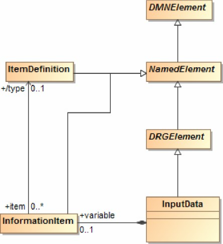

**DMN** uses the class InputData to model the inputs of a decision whose values are defined outside of the decision model.

InputData is a concrete specialization of DRGElement and it inherits the name and optional id, description and label attributes from NamedElement. The name of an InputData must be different

from the name of any other decision, input data, business knowledge model, decision service, or import in the decision model.

An instance of InputData defines an InformationItem that stores its value. This InformationItem may include a typeRef that specifies the type of data that is this InputData represents, either an ItemDefinition, base type in the specified expressionLanguage, or imported type.

In a DRD, an instance of InputData is represented by an **input data** diagram element. An InputData element does not have a **requirement subgraph**, and it is always **well-formed.**

InputData inherits all the attributes and model associations from DRGElement. [InputData attributes and model associations](#table-inputdata-attributes-and-model-associations) presents the additional attributes and model associations of the InputData class.

###### Table: InputData attributes and model associations

| **Attribute** | **Description** |
|------------------------------------|------------------------------------|
| **variable**: InformationItem | The instance of InformationItem that stores the result of this InputData. |

### Knowledge Source metamodel

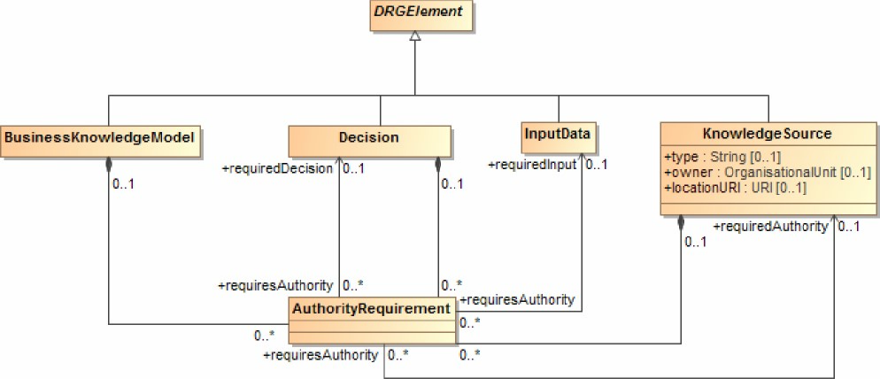

The class KnowledgeSource is used to model authoritative knowledge sources in a decision model. In a DRD, an instance of KnowledgeSource is represented by a **knowledge source** diagram element.

KnowledgeSource is a concrete specialization of DRGElement, and thus of NamedElement, from which it inherits the name and optional id, description, and label attributes. In addition, a KnowledgeSource has a locationURI, which is a URI. It has a type, which is a string, and an owner, which is an instance of

OrganisationalUnit. The type is intended to identify the kind of the authoritative source, e.g., Policy Document, Regulation, Analytic Insight.

A KnowledgeSource element is also composed of zero or more authorityRequirement elements, which are instances of AuthorityRequirement.

KnowledgeSource inherits all the attributes and model associations from DRGElement. [KnowledgeSource attributes and model associations](#table-knowledgesource-attributes-and-model-associations) presents the attributes and model associations of the KnowledgeSource class.

###### Table: KnowledgeSource attributes and model associations

| **Attribute** | **Description** |
|------------------------------------|------------------------------------|
| **locationURI**: anyURI \[0.. 1\] | The URI where this KnowledgeSource is located. The locationURI SHALL be specified in a URI format. |
| **type**: string \[0..1\] | The type of this Knowledge Source. |
| **owner**: OrganisationalUnit \[0..1\] | The owner of this KnowledgeSource. |
| **authorityRequirement**: AuthorityRequirement \[\*\] | This attribute lists the instances of AuthorityRequirement that contribute to this KnowledgeSource. |

### Information Requirement metamodel

The class InformationRequirement is used to model an **information requirement**, as represented by a plain arrow in a DRD. InformationRequirement is a specialization of DMNElement, from which it inherits the optional id, description, and label attributes.

An InformationRequirement element is a component of a Decision element, and it associates that requiring Decision element with a requiredDecision element, which is an instance of Decision, or a requiredInput element, which is an instance of InputData.

An InformationRequirement element references an instance of either a Decision or InputData, which defines a variable. That variable, which is an instance of InformationItem, represents the InformationRequirement element at the decision logic level.

Notice that an InformationRequirement element must reference the instance of Decision or InputData that it associates with the requiring Decision element, not contain it: instances of Decision or InputData can only be contained in Definitions elements.

An instance of InformationRequirement is said to be **well-formed** if and only if all of the following are true:

- It references a requiredDecision or a requiredInput element, but not both.

- The referenced requiredDecision or requiredInput element is well-formed.

- The Decision element that contains the instance of InformationRequirement is not in the requirement subgraph of the referenced requiredknowledge element, if this InformationRequirement element references one.

- The referenced requiredDecision or requiredInput element is defined in the same decision model or in an imported decision model.

[InformationRequirement attributes and model associations](#table-informationrequirement-attributes-and-model-associations) presents the attributes and model associations of the InformationRequirement element.

###### Table: InformationRequirement attributes and model associations

| **Attribute** | **Description** |
|-----------------------------------|-------------------------------------|
| **requiredDecision**: Decision \[0..1\] | The instance of Decision that this InformationRequirement associates with its containing Decision element. |
| **requiredInput**: InputData \[0..1\] | The instance of InputData that this InformationRequirement associates with its containing Decision element. |

### Knowledge Requirement metamodel

The class KnowledgeRequirement is used to model a **knowledge requirement**, as represented by a dashed arrow in a DRD. KnowledgeRequirement is a specialization of DMNElement, from which it inherits the optional id, description, and label attributes.

A KnowledgeRequirement element is a component of a Decision element or of a

BusinessKnowledgeModel element, and it associates that requiring Decision or BusinessKnowledgeModel element with a requiredKnowledge element, which is an instance of Invocable.

Notice that a KnowledgeRequirement element must reference the instance of Invocable that it associates with the requiring Decision or BusinessKnowledgeModel element, not contain it: instances of BusinessKnowledgeModel can only be contained in Definitions elements.

An instance of KnowledgeRequirement is said to be **well-formed** if and only if all of the following are true:

- It references a requiredKnowledge element.

- The referenced requiredKnowledge element is well-formed.

- If the KnowledgeRequirement element is contained in an instance of BusinessKnowledgeModel, that BusinessKnowledgeModel element is not in the requirement subgraph of the referenced requiredKnowledge element.

- The referenced requiredKnowledge element is defined in the same decision model or in an imported decision model.

[KnowledgeRequirement attributes and model associations](#table-knowledgerequirement-attributes-and-model-associations) presents the attributes and model associations of the KnowledgeRequirement element.

###### Table: KnowledgeRequirement attributes and model associations

| **Attribute** | **Description** |
|------------------------------------|------------------------------------|
| **requiredKnowledge**: Invocable | The instance of Invocable that this KnowledgeRequirement associates with its containing Decision or BusinessKnowledgeModel element. |

### Authority Requirement metamodel

The class AuthorityRequirement is used to model an **authority requirement**, as represented by an arrow drawn with a dashed line and a filled circular head in a DRD. AuthorityRequirement is a specialization of DMNElement, from which it inherits the optional id, description, and label attributes.

An AuthorityRequirement element is a component of a Decision, BusinessKnowledgeModel or

KnowledgeSource element, and it associates that requiring Decision, BusinessKnowledgeModel or KnowledgeSource element with a requiredAuthority element, which is an instance of KnowledgeSource, a requiredDecision element, which is an instance of Decision, or a requiredInput element, which is an instance of InputData.

Notice that an AuthorityRequirement element must reference the instance of KnowledgeSource, Decision or InputData that it associates with the requiring element, not contain it: instances of Knowledge Source, Decision or InputData can only be contained in Definitions elements.

[AuthorityRequirement attibutes and model associations](#table-authorityrequirement-attibutes-and-model-associations) presents the attributes and model associations of the AuthorityRequirement element.

###### Table: AuthorityRequirement attibutes and model associations

| **Attribute** | **Description** |
|-----------------------------------|-------------------------------------|
| **requiredAuthority**: KnowledgeSource \[0.. 1\] | The instance of KnowledgeSource that this AuthorityRequirement associates with its containing KnowledgeSource, Decision or BusinessKnowledgeModel element. |
| **requiredDecision**: Decision \[0..1\] | The instance of Decision that this AuthorityRequirement associates with its containing KnowledgeSource element. |
| **requiredInput**: InputData \[0.. 1\] | The instance of InputData that this AuthorityRequirement associates with its containing KnowledgeSource element. |

### Extensibility

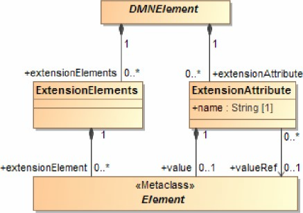

The **DMN** metamodel is aimed to be extensible. This allows **DMN** adopters to extend the specified metamodel in a way that allows them to be still **DMN**-compliant. It provides a set of extension elements, which allows **DMN** adopters to attach additional attributes and elements to standard and existing **DMN** elements. This approach results in more interchangeable models because the standard elements are still intact and can still be understood by other **DMN** adopters. It's only the additional attributes and elements that MAY be lost during interchange.

A **DMN** extension can be done using two different elements:

1.  ExtensionElements

2.  ExtensionAttribute

ExtensionElements is a container for attaching arbitrary elements from other metamodels to any **DMN** element. ExtensionAttribute allows these attachments to also have name. This allows **DMN** adopters to integrate any metamodel into the **DMN** metamodel and reuse already existing model elements.

#### ExtensionElements

The ExtensionElements element is a container to aggregate elements from other metamodels inside any DMNElement. [ExtensionElements attributes and model associations](#table-extensionelements-attributes-and-model-associations) presents the attributes and model associations for the ExtensionElements element.

###### Table: ExtensionElements attributes and model associations

| **Attribute** | **Description** |
|--------------------------|----------------------------------------------|
| **extensionElement:** Element \[0..\*\] | The contained Element. This association is not applicable when the XML schema interchange is used, since the XSD mechanism for supporting "any" elements from other namespaces already satisfies this requirement. |

The ExtensionAttribute element contains an Element or a reference to an Element from another metamodel. An ExtensionAttribute also has a name to define the role or purpose of the associated element. This type is not applicable when the XML schema interchange is used, since the XSD mechanism for supporting "anyAttribute" from other namespaces already satisfies this requirement. [ExtensionAttribute attributes and model associations](#table-extensionattribute-attributes-and-model-associations) presents the model associations for the ExtensionAttribute element.

###### Table: ExtensionAttribute attributes and model associations

| **Attribute** | **Description** |
|-------------------|-----------------------------------------------------|
| **name:** string | The name of the extension attribute. |
| **value:** Element \[0..1\] | The contained Element. This attribute SHALL NOT be used together with valueRef. |
| **valueRef:** Element \[0..1\] | A reference to the associated Element. This attribute SHALL NOT be used together with value. |

## Examples

Examples of DRDs are provided in clause [The decision requirements level](12_DMN_Examples.md#the-decision-requirements-level).

The page intentionally left blank
