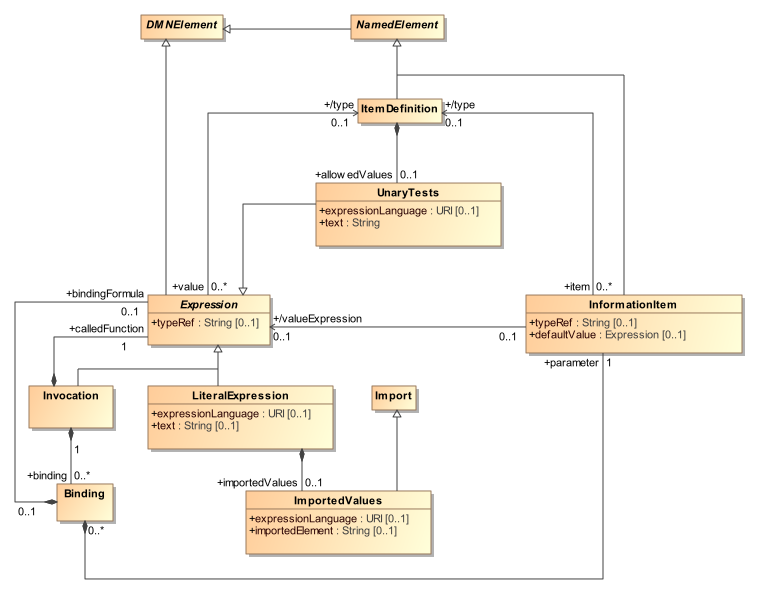
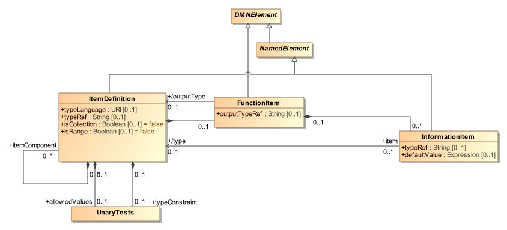

# Relating Decision Logic to Decision Requirements

## Introduction

[Requirements (DRG and DRD)](06_Requirements_DRG_and_DRD.md#requirements-drg-and-drd) described how the decision requirements level of a decision model – a DRG represented in one or more DRDs – may be used to model the structure of an area of decision making. However, the details of how each decision's outcome is derived from its inputs must be modeled at the decision logic level. This section introduces the principles by which decision logic may be associated with elements in the DRG. Specific representations of decision logic (decision tables and FEEL expressions) are then defined in clauses [Decision Table](08_Decision_Table.md#decision-table), [Simple Expression Language (S-FEEL)](09_Simple_Expression_Language_S-FEEL.md#simple-expression-language-s-feel) and [Expression Language (FEEL)](10_Expression_Language_FEEL.md#expression-language-feel).

The decision logic level of a decision model in **DMN** consists of one or more value expressions. The elements of decision logic modeled as value expressions include tabular expressions such as decision tables and invocations, and literal (text) expressions such as `age > 30`.

- A **literal expression** represents decision logic as text that describes how an output value is derived from its input values. The expression language may, but need not, be formal or executable: examples of literal expressions include a plain English description of the logic of a decision, a first order logic proposition, a Java computer program and a PMML document or ONNX file. Clause[Expression Language (FEEL)](10_Expression_Language_FEEL.md#expression-language-feel) specifies an executable expression language called **FEEL**. [Simple Expression Language (S-FEEL)](09_Simple_Expression_Language_S-FEEL.md#simple-expression-language-s-feel) specifies a subset of FEEL (S-FEEL) that is the default language for literal expressions in **DMN** decision tables ([Decision Table](08_Decision_Table.md#decision-table)).

- A **decision table** is a tabular representation of decision logic, based on a discretization of the possible values of the inputs of a decision, and organized into rules that map discretized input values onto discrete output values (see [Decision Table](08_Decision_Table.md#decision-table)).

- An **invocation** is a tabular representation of how decision logic that is represented by a business knowledge model or a decision service is invoked by a decision, or by another business knowledge model. An invocation may also be represented as a literal expression, but usually the tabular representation will be more understandable.

Tabular representations of decision logic are called *boxed expressions* in the remainder of this specification.

All three **DMN** conformance levels include all the above expressions. At **DMN** Conformance Level 1, literal expressions are not interpreted and, therefore, free. At **DMN** Conformance Level 2, literal expressions are restricted to S-FEEL. [Expression Language (FEEL)](10_Expression_Language_FEEL.md#expression-language-feel) specifies additional boxed expressions available at **DMN** Conformance Level 3.

Decision logic is added to a decision model by including a value expression component in some of the decision model elements in the DRG:

- From a decision logic viewpoint, a decision is a piece of logic that defines how a given question is answered, based on the input data. As a consequence, each **decision** element in a decision model may include a value expression that describes how a decision outcome is derived from its required input, possibly invoking a business knowledge model;

- From a decision logic viewpoint, a business knowledge model is a piece of decision logic that is defined as a function allowing it to be re-used in multiple decisions. As a consequence, each **business knowledge model** element may include a value expression, which is the body of that function.

Another key component of the decision logic level is the **variable**: Variables are used to store values of Decisions and InputData for use in value expressions. InformationRequirements specify variables in scope via reference to those Decisions and InputData, so that value expressions may reference these variables. Variables link information requirements in the DRG to the value expressions at the decision logic level:

- From a decision logic viewpoint, an information requirement is a requirement for an externally provided value to be assigned to a free variable in the decision logic, so that a decision can be evaluated. As a consequence, each **information requirement** in a decision model points to a Decision or InputData, which in turn defines a variable that represents the associated data input in the decision’s expression.

- The variables that are used in the body of the function defined by a business knowledge model element in the DRG must be bound to the information sources in each of the requiring decisions. As a consequence, each **business knowledge model** includes zero or more variables that are the parameters of the function.

The third key element of the decision logic level are the **item definitions** that describe the types and structures of data items in a decision model: **input data** elements in the DRG, and **variables** and **value expressions** at the decision logic level, may reference an associated item definition that describes the type and structure of the data expected as input, assigned to the variable or resulting from the evaluation of the expression.

Notice that **knowledge sources** are not represented at the decision logic level: knowledge sources are part of the documentation of the decision logic, not of the decision logic itself.

The dependencies between decisions, required information sources and business knowledge models, as represented by the information and knowledge requirements in a DRG, constrain how the value expressions associated with these elements relate to each other.

As explained above, every decision, input data, and business knowledge model at the DRG level is associated with a variable used at the decision logic level. Each variable that is referenced by a decision’s expression must be associated with a required decision, required input data, or required knowledge. Also, each variable associated with the required decisions, required input data, and required knowledge SHOULD be referenced in the decision’s expression.

- If a decision requires another decision, the value expression of the required decision assigns the value to the variable for use in evaluating the requiring decision. This is the generic mechanism in **DMN** for composing decisions at the decision logic level.

- If a decision requires an input data, the value of the variable is assigned the value of the data source attached to the input data at execution time. This is the generic mechanism in **DMN** for instantiating the data requirements for a decision.

The input variables of a decision's decision logic must not be used outside that value expression or its component value expressions: the decision element defines the lexical scope of the input variables for its decision logic. To avoid name collisions and ambiguity, the name of a variable must be unique within its scope. When DRG elements are mapped to FEEL, the name of a variable is the same as the (possibly qualified) name of its associated input data or decision, which guarantees its uniqueness.

When DRG elements are mapped to FEEL, all the decisions and input data in a DRG define a *context*, which is the literal expression that represents the logic associated with the decision element and that represents that scope (see [Context](10_Expression_Language_FEEL.md#context)). The information requirement elements in a decision are *context entries* in the associated context, where the *key* is the name of the variable that the information requirement defines, and where the *expression* is the *context* that is associated with the required decision or input data element that the information requirement references. The value expression that is associated with the decision as its decision logic is the *expression* in the *context entry* that specifies what is the result of the *context*.

In the same way, a business knowledge model element defines the lexical scope of its parameters, that is, of the input variables for its body.

In FEEL, the literal expression and scoping construct that represents the logic associated with a business knowledge model element is a *function definition* (see [Functions Semantics](10_Expression_Language_FEEL.md#functions-semantics)), where the *formal parameters* are the names of the parameters in the business knowledge model element, and the expression is the value expression that is the body of the business knowledge model element.

If a business knowledge model element requires one or more other business knowledge models, it SHOULD have an explicit value expression that describes how the required business knowledge models are invoked and their results combined or otherwise elaborated.

## Notation

### Expressions

We define a graphical notation for decision logic called **boxed expressions**. This notation serves to decompose the decision logic model into small pieces that can be associated with DRG artifacts. The DRD plus the boxed expressions form a complete, mostly graphical language that completely specifies Decision Models.

In addition to the generic notation of **boxed expression**, this section specifies two kinds of boxed expressions:

- **boxed literal expression**

- **boxed invocation**

The boxed expression for a decision table is defined in [Decision Table](08_Decision_Table.md#decision-table). Further types of boxed expressions are defined for FEEL, in [Expression Language (FEEL)](10_Expression_Language_FEEL.md#expression-language-feel).

Boxed expressions are defined recursively, *i.e.,* boxed expressions can contain other boxed expressions. The top-level boxed expression corresponds to the decision logic of a single DRG artifact. This boxed expression SHALL have a name box that contains the name of the DRG artifact. The name box may be attached in a single box on top, as shown in [Boxed Expression](#table-boxed-expression):

###### Table: Boxed Expression

<table class="dmn-boxed-expression">
<thead><tr><th>Name</th></tr></thead>
<tbody>
<tr><td>top-level boxed expression</td></tr>
</tbody>
</table>

Alternatively, the name box and expression box can be separated by white space and connected on the left side with a line, as shown in [Boxed expression with separated name and expression boxes](#table-boxed-expression-with-separated-name-and-expression-boxes):

###### Table: Boxed expression with separated name and expression boxes

<table class="dmn-boxed-expression">
<thead><tr><th>Name</th></tr></thead>
<tbody>
<tr><td class="gap"></td></tr>
<tr><td>top-level boxed expression</td></tr>
</tbody>
</table>

Name is the only visual link defined between DRD elements and boxed expressions. Graphical tools are expected to support appropriate graphical links, for example, clicking on a decision shape opens a decision table. How the boxed expression is visually associated with the DRD element is left to the implementation.

### Boxed literal expression

In a boxed expression, a literal expression is represented by its text. However, two notational conventions are provided to improve the readability of boxed literal expressions: typographical string literals and typographical date and time literals.

#### Typographical string literals

A string literal such as `"DECLINED"` can be represented alternatively as the italicized literal *DECLINED*. For example, [Decision table with italicized literals](#table-decision-table-with-italicized-literals) is equivalent to [Decision table with string literals](#table-decision-table-with-string-literals):

###### Table: Decision table with italicized literals

<table class="dmn-decision-table">
<colgroup><col class="hit-policy"><col class="input"><col class="output"></colgroup>
<thead>
<tr><th colspan="3">Credit contingency factor table</th></tr>
<tr><th>U</th><th>Risk Category</th><th>Credit Contingency Factor</th></tr>
</thead>
<tbody>
<tr><td>1</td><td><em>HIGH, DECLINE</em></td><td>0.6</td></tr>
<tr><td>2</td><td><em>MEDIUM</em></td><td>0.7</td></tr>
<tr><td>3</td><td><em>LOW, VERY LOW</em></td><td>0.8</td></tr>
</tbody>
</table>

###### Table: Decision table with string literals

<table class="dmn-decision-table">
<colgroup><col class="hit-policy"><col class="input"><col class="output"></colgroup>
<thead>
<tr><th colspan="3">Credit contingency factor table</th></tr>
<tr><th>U</th><th>Risk Category</th><th>Credit Contingency Factor</th></tr>
</thead>
<tbody>
<tr><td>1</td><td>"HIGH", "DECLINE"</td><td>0.6</td></tr>
<tr><td>2</td><td>"MEDIUM"</td><td>0.7</td></tr>
<tr><td>3</td><td>"LOW", "VERY LOW"</td><td>0.8</td></tr>
</tbody>
</table>

To avoid having to discern whether (e.g.,) *HIGH, DECLINE* is `"HIGH"`, `"DECLINE"`, or `"HIGH, DECLINE"`, typographical string literals SHALL be free of commas ("," characters). FEEL typographical string literals SHALL conform to grammar [division](10_Expression_Language_FEEL.md#rule-division) (name).

#### Typographical date and time literals

A date, time, date and time, or duration expression such as `date("2013-08-09")` can be represented alternatively as the bold italicized literal ***2013-08-09*.** The literal SHALL obey the syntax specified in clauses [time](10_Expression_Language_FEEL.md#time), [date](10_Expression_Language_FEEL.md#date), and [days and time duration](10_Expression_Language_FEEL.md#days-and-time-duration).

### Boxed invocation

An invocation is a container for the parameter bindings that provide the context for the evaluation of the body of a business knowledge model.

The representation of an invocation is the name of the business knowledge model with the parameters’ bindings explicitly listed.

As a boxed expression, an invocation is represented by a box containing the name of the business knowledge model to be invoked, and boxes for a list of bindings, where each binding is represented by two boxed expressions on a row: the box on the left contains the name of a parameter, and the box on the right contains the binding expression, that is the expression whose value is assigned to the parameter for the purpose of evaluating the invoked business knowledge model (see [Boxed invocation](#table-boxed-invocation)).

###### Table: Boxed invocation

<table class="dmn-boxed-expression">
<thead><tr><th colspan="2">Name</th></tr></thead>
<tbody>
<tr><td colspan="2">invoked business knowledge model</td></tr>
<tr><td class="name">parameter 1</td><td>Binding expression 1</td></tr>
<tr><td colspan="2">...</td></tr>
<tr><td class="name">parameter 2</td><td>Binding expression 2</td></tr>
<tr><td class="name">parameter <em>n</em></td><td>Binding expression <em>n</em></td></tr>
</tbody>
</table>

The invoked business knowledge model is represented by the name of the business knowledge model. Any other visual linkage is left to the implementation.

## Metamodel

An important characteristic of decisions and business knowledge models is that they may contain an expression that describes the logic by which a modeled decision shall be made, or pieces of that logic.

The class Expression is the abstract superclass for all expressions that are used to describe complete or parts of decision logic in **DMN** models and that return a single value when interpreted (clause [Expression metamodel](#expression-metamodel)). Here “single value” possibly includes structured data, such as a decision table with multiple output clauses.

**DMN** defines three concrete kinds of Expression: LiteralExpression, DecisionTable (see [Decision Table](08_Decision_Table.md#decision-table)) and Invocation.

An expression may reference variables, such that the value of the expression, when interpreted, depends on the values assigned to the referenced variables. The class InformationItem is used to model variables in expressions.

The value of an expression, like the value assigned to a variable, may have a structure and a range of allowable values. The class ItemDefinition is used to model data structures and ranges.

### Expression metamodel

An important characteristic of decisions and business knowledge models is that they may contain an expression that describes the logic by which a modeled decision shall be made, or pieces of that logic.

Expression is an abstract specialization of DMNElement, from which it inherits the optional id, description, and label attributes.

An instance of Expression is a component of a Decision element, of a BusinessKnowledgeModel element, or of an ItemDefinition element, or it is a component of another instance of Expression, directly or indirectly.

An Expression references zero or more variables implicitly by using their names in its expression text. These variables, which are instances of InformationItem, are lexically scoped, depending on the Expression type. If the Expression is the logic of a Decision, the scope includes that Decision's requirements. If the Expression is the body of the encapsulatedLogic of a BusinessKnowledgeModel, the scope includes the FunctionDefinition's parameters and the BusinessKnowledgeModel's requirements. If the Expression is the value of a ContextEntry, the scope includes the previous entries in the Context. An instance of Expression references an optional typeRef, which points to either a base type in the default typeLanguage, a custom type specified by an ItemDefinition, or an imported type. The referenced type specifies the Expression's range of possible values. If an instance of Expression that defines the output of a Decision element includes a typeRef, the referenced type SHALL be the same as the type of the containing Decision element.

An instance of Expression can be interpreted to derive a single value from the values assigned to its variables. How the value of an Expression element is derived from the values assigned to its variablesdepends on the concrete kind of the Expression. The ItemDefinition element specializes NamedElement and it inherits its attributes and model associations. [ItemDefinition attributes and model associations](#table-itemdefinition-attributes-and-model-associations) presents the additional attributes and model associations of the ItemDefinition element.

Expression inherits from the attributes and model associations of DMNElement.

### UnaryTests Metamodel

The class UnaryTests is used to model a boolean test where the argument to be tested is implicit or denoted with a `?`, and whose value is specified by text in some specified expression language.

UnaryTests is a concrete subclass of Expression.

An instance of UnaryTests inherits an optional typeRef from Expression, which SHALL NOT be used. An instance of UnaryTests also has an optional text, which is a String, and an optional expressionLanguage, which is a String that identifies the expression language of the text. If no expressionLanguage is specified, the expression language of the text is the expressionLanguage that is associated with the containing instance of Definitions. The expressionLanguage SHALL be specified in a URI format. The default expression language is FEEL. When the expression language is FEEL, the text must conform to grammar [unary tests](10_Expression_Language_FEEL.md#rule-unary-tests) in section [Grammar rules](10_Expression_Language_FEEL.md#grammar-rules).

A UnaryTests is satisfied if and only if one of the following alternatives is true:

a\) One of the expressions in the UnaryTests evaluates to a value, and the implicit value is equal to that value.

b\) One of the expressions in the UnaryTests evaluates to a list of values, and the implicit value is equal to at least one of the values in that list.

c\) One of the expressions in the UnaryTests evaluates to true when the implicit value is applied to it.

d\) One of the expressions in the UnaryTests is a boolean expression using the special `?` variable and that expression evaluates to true when the implicit value is assigned to `?`.

[UnaryTests attributes and model associations](#table-unarytests-attributes-and-model-associations) presents additional attributes and model associations of the UnaryTests element.

###### Table: UnaryTests attributes and model associations

<table>
<tr><th>

Attribute

</th><th>

Description

</th></tr>
<tr><td>text: string[0..1]</td><td>The text of this UnaryTests. It SHALL be a valid expression in the expressionLanguage</td></tr>
<tr><td>expressionLanguage: anyURI[0..1]</td><td>

This attribute identifies the expression language used in this UnaryTests. This value overrides the expression language specified for the containing instance of

DecisionRequirementDiagram. The language SHALL be specified in a URI format.

</td></tr>
</table>

### ItemDefinition metamodel

The inputs and output of decisions, business knowledge models, and decision services, and the output of input data (all DRGElements) are data items whose value, at the logic level, is assigned to variables or represented by

Expressions.

An important characteristic of data items in decision models is their structure. **DMN** does not require a particular format for this data structure, but it does designate a subset of FEEL as its default.

The class ItemDefinition is used to model the structure and the range of values of the input and the outcome of decisions.

As a concrete specialization of NamedElement, an instance of ItemDefinition has a name and an optional id and description. The name of an ItemDefinition element SHALL be distinct from the names of other ItemDefinitions and Imports within the same model.

The default type language for all elements can be specified in the Definitions element using the typeLanguage attribute. For example, a typeLanguage value of [http://www.w3.org/2001/XMLSchema”](http://www.w3.org/2001/XMLSchema) indicates that the data structures used by elements within that Definitions are in the form of XML Schema types. If unspecified, the default is FEEL.

Notice that the data types that are built-in in the typeLanguage that is associated with an instance of Definitions need not be redefined by ItemDefinition elements contained in that Definitions element: they are considered imported and can be referenced in **DMN** elements within the Definitions element.

The type language can be overridden locally using the typeLanguage attribute in the ItemDefinition element.

Notice, also, that the data types and structures that are defined at the top level in a data model that is imported using an Import element that is associated with an instance of Definitions need not be redefined by ItemDefinition elements contained in that Definitions element: they are considered imported and can be referenced in **DMN** elements within the Definitions element.

An ItemDefinition element MAY have a typeRef, which is a string that references, as a qualified name, either an ItemDefinition in the current instance of Definitions or a built-in type in the specified typeLanguage or a type defined in an imported DMN, XSD, or other document. In the latter case, the external document SHALL be imported in the Definitions element that contains the instance of ItemDefinition, using an Import element specifying both the namespace value and its name when used a qualifier. For example, in the case of data structures contributed by an XML schema, an Import would be used to specify the file location of that schema, and the typeRef attribute would reference the type or element definition in the imported schema. If the type language is FEEL the built-in types are the FEEL built-in data types: `number`, `string`, `boolean`, `days and time duration`, `years and months duration`, `date`, `time`, `date and time` and `Any`. A typeRef referencing a built-in type SHALL omit the prefix.

An ItemDefinition element may restrict the values that are allowed from typeRef, using the allowedValues attribute. allowedValues is an instance of UnaryTests that constrains the domain of the typeRef. If an ItemDefinition element does not contain allowedValues, its range of allowed values is the full range of the referenced typeRef. When an ItemDefinition has sibling itemComponents, their values are available in the evaluation context of the UnaryTests of the allowedValues. In cases where the isCollection attribute of an ItemDefinition is true, each element of the collection must satisfy the UnaryTests of the allowedValues, i.e. the allowedValues are projected onto the collection elements. The default value of isCollection is false. The allowedValues attribute has been deprecated as of DMN 1.5 and replaced with the typeConstraint attribute. The typeConstraint attribute differs from allowedValues by not projecting onto collection elements but directly constraining the collection.

An alternative way to define an instance of ItemDefinition is as a composition of ItemDefinition elements. An instance of ItemDefinition may contain zero or more itemComponent, which are themselves

ItemDefinitions. Each itemComponent may be defined by either a typeRef, allowedValues, and typeConstraint or a nested itemComponent. In this way, complex types may be defined within DMN. The name of an itemComponent (nested ItemDefinition) must be unique within its containing ItemDefinition or itemComponent.

An alternative way to define an instance of ItemDefinition is by specifying a FunctionItem element, which defines the signature of a function: the parameters and the output of the function. An instance of ItemDefinition may contain at most one FunctionItem. A FunctionItem may contain zero or more parameters defined as InformationItems and one output type defined as a typeRef. The names of the parameters of a FunctionItem are unique.

An ItemDefinition element SHALL be defined using only one of the alternative ways:

- reference to a built-in or imported typeRef, possibly restricted with allowedValues

- composition of ItemDefinition elements

- function signature element.

The ItemDefinition element specializes NamedElement and it inherits its attributes and model associations. [ItemDefinition attributes and model associations](#table-itemdefinition-attributes-and-model-associations) presents the additional attributes and model associations of the ItemDefinition element.

###### Table: ItemDefinition attributes and model associations

| Attribute | Description |
|------------------------------|------------------------------------------|
| **typeRef**: String \[1\] | This attribute identifies by namespace-prefixed name the base type of this ItemDefinition. |
| **typeLanguage**: String \[0..1\] | This attribute identifies the type language used to specify the base type of this ItemDefinition. This value overrides the type language specified in the Definitions element. The language SHALL be specified in a URI format. |
| **allowedValues**: UnaryTests \[0..1\] | This attribute is a UnaryTests that restricts the values in the base type that are allowed in this ItemDefinition. In case of a collection, it is projected on the collection elements. (deprecated) |
| **itemComponent**: ItemDefinition \[\*\] | This attribute defines zero or more nested ItemDefinitions that compose this ItemDefinition. |
| **isCollection: Boolean \[0..1\]** | Setting this flag to *true* indicates that the actual values defined by this ItemDefinition are collections of allowed values. The default is *false*. |
| **isRange: Boolean \[0..1\]** | Setting this flag to *true* indicates that the actual values defined by this ItemDefinition are ranges of allowed values. The default is *false*. The attributes isCollection and isRange are mutually exclusive |
| **functionItem**: FunctionItem \[0..1\] | This attribute describes an optional FunctionItem that compose this ItemDefinition. |
| **typeConstraint:** UnaryTests \[0..1\] | This attribute is a UnaryTests that restricts the values in the base type that are allowed in this ItemDefinition. In case of a collection, it directly constrains the collection and is not projected on the collection elements. |

###### Table: FunctionItem attributes and model associations

| Attribute | Description |
|------------------------------------|------------------------------------|
| **outputTypeRef**: String \[0..1\] | Reference to output type of function |
| **parameters**: InformationItem \[0. .\*\] | Function parameters as InformationItems |

### InformationItem metamodel

The class InformationItem is used to model variables at the decision logic level in decision models.

InformationItem is a concrete subclass of NamedElement, from which it inherits the id, and optional name, description, and label attributes, except that an InformationItem element SHALL have a name attribute, which is the name that is used to represent it in other Expression elements. The name of an InformationItem element SHALL be unique within its scope.

Variables represent values that result from a decision, are assigned to input data by an external data source or are passed to a module of decision logic that is defined as a function (and that is represented by a business knowledge model element). In the first or second case, a variable may be referenced by other dependent decisions by means of their information requirements. In the third case, a variable is one of the parameters of the function that is the realization, at the decision logic level, of a business knowledge model element.

A variable representing an instance of Decision or InputData referenced by aInformationRequirement

SHOULD be referenced by the value expression of the decision logic in the Decision element that contains the InformationRequirement element. A parameter in an instance of BusinessKnowledgeModel SHOULD be a variable in the value expression of that BusinessKnowledgeModel element.

The ItemInformation elements are assigned values as follows:

- An InformationItem element contained in a Decision is assigned the value of the Decision's value expression.

- An InformationItem element that is a parameter in a FunctionDefinition is assigned a value by a Binding element as part of an instance of Invocation.

- An InformationItem element contained in an InputData is assigned a value by an external data source that is attached at runtime. If no value is provided, **null** is assigned to the InformationItem. When an InputData is imported several times via transitive imports, the contained InformationItem is assigned only once and holds the same value.

- An InformationItem element contained in a ContextEntry is assigned a value by the ContextEntry's value expression.

- An InformationItem element contained in an Invocable can never be assigned.

- An InformationItem element contained in an Invocable cannot have a defaultValue.

- If the value to be assigned is not specified or is null, and the InformationItem has a defaultValue (see [InformationItem attributes and model associations](#table-informationitem-attributes-and-model-associations)), then the corresponding InformationItem is assigned the value of Expression specified in the defaultValue attribute.

In any case, the datatype indicated by the typeRef that is associated with an instance of InformationItem SHALL be compatible with the datatype that is associated with the **DMN** model element from which it takes its value. InformationItem inherits all of the attributes and model associations of NamedElement. [InformationItem attributes and model associations](#table-informationitem-attributes-and-model-associations) presents the additional attributes and model associations of the InformationItem element.

###### Table: InformationItem attributes and model associations

| Attribute | Description |
|--------------------------------|----------------------------------------|
| **/valueExpression**: Expression \[0..1\] | The Expression whose value is assigned to this InformationItem. This is a derived attribute. |
| **typeRef**: String \[1\] | Qualified name of the type of this InformationItem. |
| **defaultValue:** Expression \[0..1\] | This attribute specifies an instance of Expression that is selected when the value of the associated variable is not provided. The Expression must be a constant expression |

### Literal expression metamodel

The class LiteralExpression is used to model a value expression whose value is specified by text in some specified expression language.

LiteralExpression is a concrete subclass of Expression, from which it inherits the id and typeRef attributes.

An instance of LiteralExpression has an optional text, which is a String, and an optional expressionLanguage, which is a String that identifies the expression language of the text. If no expressionLanguage is specified, the expression language of the text is the expressionLanguage that is associated with the containing instance of Definitions. The expressionLanguage SHALL be specified in a URI format. The default expression language is FEEL.

As a subclass of Expression, each instance of LiteralExpression has a value. The text in an instance of LiteralExpression determines its value, according to the semantics of the LiteralExpression’s expressionLanguage. The semantics of **DMN** decision models as described in this specification applies only if the text of all the instances of LiteralExpression in the model are valid expressions in their associated expression language.

An instance of LiteralExpression may include importedValues, which is an instance of a subclass Import that identifies where the text of the LiteralExpression is located. importedValues is an expression that selects text from an imported document. An instance of LiteralExpression SHALL NOT have both a text and importedValues. The importType of the importedValues identifies the type of document containing the imported text and SHALL be consistent with the expressionLanguage of the LiteralExpression element. The expressionLanguage of the importedValues element identifies how the imported text is selected from the imported document. For example, if the importType indicates an XML document, the expressionLanguage of importedValues could be XPATH 2.0.

LiteralExpression inherits of all the attributes and model associations of Expression. [LiteralExpression attributes and model associations](#table-literalexpression-attributes-and-model-associations) presents the additional attributes and model associations of the LiteralExpression element.

###### Table: LiteralExpression attributes and model associations

<table>
<tr><th>

Attribute

</th><th>

Description

</th></tr>
<tr><td>

**text:** string \[0..1\]

</td><td>The text of this LiteralExpression. It SHALL be a valid expression in the express ionLanguage.</td></tr>
<tr><td>

**expressionLanguage:** anyURI \[0.. 1\]

</td><td>

This attribute identifies the expression language used in this LiteralExpression. This value overrides the expression language specified for the containing instance of

DecisionRequirementDiagram. The language SHALL be specified in a URI format.

</td></tr>
<tr><td>

**importedValues:** ImportedValues \[0..1\]

</td><td>The instance of ImportedValues that specifies where the text of this LiteralExpression is located.</td></tr>
</table>

### Invocation metamodel

Invocation is a mechanism that permits the evaluation of one value expression – the invoked expression *–* inside another value expression – the invoking expression – by binding locally the input variables of the invoked expression to values inside the invoking expression. In an invocation, the input variables of the invoked expression are usually called: *parameters*. Invocation permits the same value expression to be re-used in multiple expressions, without having to duplicate it as a sub-expression in all the using expressions.

The class Invocation is used to model invocations as a kind of Expression: Invocation is a concrete specialization of Expression.

An instance of Invocation is made of zero or more binding, which are instances of Binding, and model how the bindingFormulas are bound to the formalParameters of the invoked function. The formalParameters of a FunctionDefinition are InformationItems and the parameters of the Bindings are InformationItems. The binding is by matching the InformationItem names.

An Invocation contains a calledFunction, an Expression, which must evaluate to a function. Most commonly, it is a LiteralExpression naming a BusinessKnowledgeModel.

The value of an instance of Invocation is the value of the associated calledFunction's body, with its formalParameters assigned values at runtime per the bindings in the Invocation.

Invocation MAY be used to model invocations in decision models, when a Decision element has exactly one knowledgeRequirement element, and when the decisionLogic in the Decision element consists only in invoking the BusinessKnowledgeModel element that is referenced by that requiredKnowledge and a more complex value expression is not required.

Using Invocation instances as the decisionLogic in Decision elements permits the re-use of the encapsulatedLogic of a BusinessKnowledgeModel as the logic for any instance of Decision that requires that BusinessKnowledgeModel, where each requiring Decision element specifies its own bindings for the encapsulatedLogic's parameters.

The calledFunction that is associated with the Invocation element SHALL BE the encapsultedLogic of the BusinessKnowledgeModel element that is required by the Decision element that contains the Invocation. The Invocation element SHALL have exactly one binding for each parameter in the BusinessKnowledgeModel's encapsulatedLogic.

Invocation inherits of all the attributes and model associations of Expression. [Invocation attributes and model associations](#table-invocation-attributes-and-model-associations) presents the additional attributes and model associations of the Invocation element.

###### Table: Invocation attributes and model associations

| Attribute | Description |
|-----------------------------|-------------------------------------------|
| **calledFunction:** Expression \[1\] | An expression whose value is a function. |
| **binding:** Binding \[\*\] | This attribute lists the instances of Binding used to bind the formalParameters of the calledFunction in this Invocation. |

### Binding metamodel

The class Binding is used to model, in an Invocation element, the binding of the calledFunction's formalParameters to values.

A Binding is made of one bindingFormula, which is an Expression, and of one parameter, which is an InformationItem.

The parameter names in the Binding elements SHALL be a subset of the formalParameters of the calledFunction.

When the Invocation element is executed, each InformationItem element that is referenced as a parameter by a binding in the Invocation element is assigned, at runtime, the value of the bindingFormula.

[Binding attributes and model associations](#table-binding-attributes-and-model-associations) presents the attributes and model associations of the Binding element.

###### Table: Binding attributes and model associations

| Attribute | Description |
|-----------------------------|-------------------------------------------|
| **parameter:** InformationItem | The InformationItem on which the calledFunction of the owning instance of Invocation depends that is bound by this Binding. |
| **bindingFormula:** Expression \[0..1\] | The instance of Expression to which the parameter in this Binding is bound when the owning instance of Invocation is evaluated. |

### Error Handling

When the evaluation of a DMN expression (see section [Expressions](#expressions)) encounters a semantic error (e.g. type mismatch or duplicate keys in a context), the evaluation MUST report or log diagnostic information and SHALL return **null**.

There are two modes for error handling in DMN: lenient and strict. The error handling mode is configured during the initiation of the decision model evaluation. The default error handling mode is lenient. A given DMN model can be evaluated in lenient or strict mode, i.e. the error handling mode is not a property of a DMN model.

In lenient error mode, if an error is detected, it is collected, and the execution continues. For instance, errors detected in child DRG Elements are accumulated for the parent element.

When the error mode is set to strict, the model evaluation halts upon detecting the first error, reports the error, and returns **null**.

The configured error handling mode also applies to the handling of errors during the evaluation of literal expressions (e.g. FEEL expressions).
