# Decision Table

## Introduction

One of the ways to express the decision logic corresponding to the DRD decision
artifact is as a decision table. A decision table is a tabular representation of
a set of related input and output expressions, organized into rules indicating
which output entry applies to a specific set of input entries. The decision
table contains all (and only) the inputs required to determine the output.
Moreover, a complete table contains all possible combinations of input values
(all the rules).

Decision tables and decision table hierarchies have a proven track record in
decision logic representation. It is one of the purposes of **DMN** to
standardize different forms and types of decision tables.

A decision table consists of:

- An information item name: the name of an InformationItem, if any, for which
  the decision table is its value expression. This will usually be the name of
  the Decision or Business Knowledge Model for which the decision table provides
  the decision logic.

- A list of input clauses (zero or more). Each input clause is made of an input
  expression and optional allowed values for the input entries that correspond
  to the clause. The input entries are contained in the rules, and the *i*th
  input entry corresponds to the *i*th input clause.

- A list of output clauses (one or more). Each output clause is made of a name
  and optional allowed values for the output entries that correspond to the
  clause. The output entries are contained in the rules, and the *i*th output
  entry corresponds to the *i*th output clause. A single output clause has no
  name. Two or more output clauses describe a decision table that returns a
  context for each hit with an entry for each output clause. Each of the
  multiple output clauses SHALL be named.

- A set of outputs (one or more). A single output has no name, only a value. Two
  or more outputs are called output components. Each output component SHALL be
  named. Each output (component) SHALL specify an output entry for each rule.
  The specification of output component name (if multiple outputs) and all
  output entries is referred to as an output clause.

- A list of annotation clauses (zero or more). Each annotation clause is made of
  a name. Each annotation SHALL be named as part of a rule annotation clause.
  The annotation entries are contained in the rules, and the ith annotation
  entry corresponds to the ith annotation clause.

- A list of rules (one or more) in rows or columns of the table (depending on
  orientation), where each rule is composed of the specific input entries,
  output entries and optional rule annotations of the table row (or column). If
  the rules are expressed as rows, the columns are clauses, and vice versa.

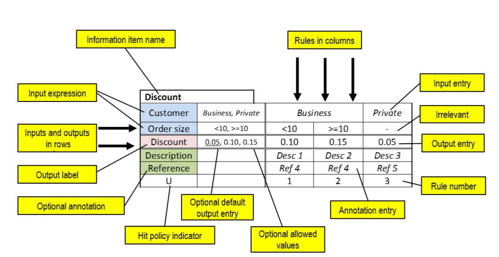

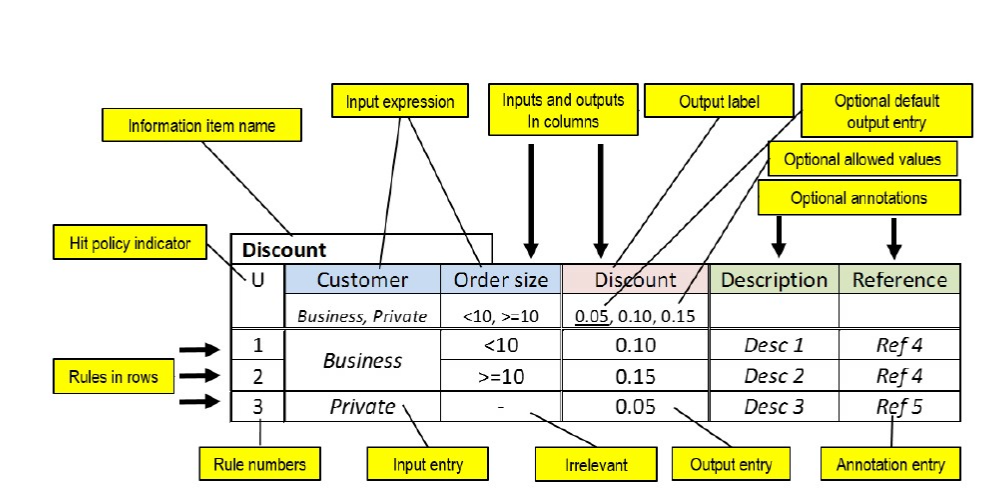

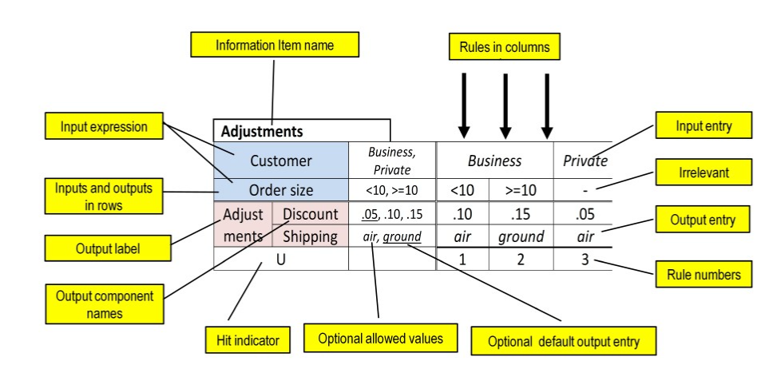

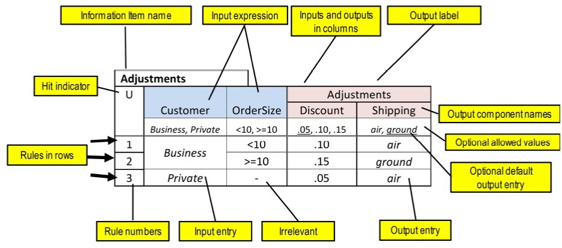

The decision table shows the rules in a shorthand notation by arranging the
entries in table cells. This shorthand notation shows all inputs in the same
order in every rule and therefore has a number of readability and verification
advantages.

For example:

| Customer   | OrderSize | Discount |
|------------|-----------|----------|
| *Business* | \<10      | 0.10     |

reads as:

**If** Customer = “Business” **and** OrderSize \< 10 **then** Discount = 0.10 In
general, this is expressed as:

| input expression 1 | input expression 2 | Output label   |
|--------------------|--------------------|----------------|
| input entry a      | input entry b      | output entry c |

The three highlighted cells in the decision table fragment above represent the
following rule:

**If** the value of input expression 1 satisfies input entry a

**and** the value of input expression 2 satisfies input entry b

**then** the rule *matches* and the result of the decision table is output entry
c.

An input expression value *satisfies* an input entry if the value is equal to
the input entry or belongs to the list of values indicated by the input entry
(e.g., a list or a range), or one of the expressions in the input entry
evaluates to true. For the complete specification of the input entry
satisfaction conditions, please refer to section [Decision Rule
metamodel](#decision-rule-metamodel). If the input entry is ‘-’ (meaning
*irrelevant*), every value of the input expression satisfies the input entry,
and that particular input is irrelevant in the specified rule.

A rule *matches* if the value of every input expression satisfies the
corresponding input entry. If there are no input entries, any rule matches.

The list of rules expresses the logic of the decision. For a given set of input
values, the matching rule (or rules) indicate the resulting value for the output
name. If rules *overlap*, multiple rules can match, and a *hit policy* indicates
how to handle the multiple matches.

If two input entries of the same input expression share no values, the entries
(cells) are called *disjoint*. If there is an intersection, the entries are
called *overlapping* (or even equal). ‘Irrelevant’ (‘-’) overlaps with any input
entry of the input expression.

Two rules are overlapping if all corresponding input entries are *overlapping*.
A specific configuration of input data may then match the two rules.

Two rules are *disjoint* (non-overlapping) if at least one pair of corresponding
input expressions is disjoint. No specific configuration of input data will
match the two rules.

If tables are allowed to contain overlapping rules, the table hit policy
indicates how overlapping rules have to be handled and which is the resulting
value(s) for the output name, in order to avoid inconsistency.

## Notation

This section builds on the generic notation for decision logic and boxed
expressions defined in clause
[Notation](09_Relating_Decision_Logic_to_Decision_Requirements.md#notation). A
decision table representation standardizes:

- The orientation (rules as rows, columns, or crosstab), as shown by the table.

- Placement of inputs, outputs and (optional) allowed values in standard
  locations on a grid of cells. Each input expression is optionally associated
  with unary tests restricting the allowed input values. In this text the
  optional cells with allowed values are indicated in inverse. Each output
  (component) is optionally associated with allowed values. In this text the
  optional allowed output values are indicated in inverse.

- Line style and optional use of color.

- The contents of specific rule input and output entry cells.

- The hit policy, indicating how to interpret overlapping input combinations.

- Placement of information item name, hit policy (H) and rule numbers as
  indicated in
  [Rules as rows - schematic layout](Images/rules-as-rows-schematic-layout.svg),
  [Rules as columns - schematic layout](Images/rules-as-columns-schematic-layout.svg)
  and
  [Rules as crosstab - schematic layout (optional input and output values not shown)](Images/rules-as-crosstab-schematic-layout-optional-input-and.svg).
  Rule numbers are consecutive natural numbers starting at 1. Rule numbering is
  required for tables with hit indicator F (first) or R (rule order) because the
  meaning depends on rule sequence. Crosstab tables have no rule numbers. Rule
  numbering is optional for other table types.

Input expressions, input values, output values, input entries and output entries
can be any text (e.g., natural language, formal language, pseudo-code).
Implementations claiming level 2 or 3 conformance SHALL support (S-)FEEL syntax.
Implementations claiming level 1 conformance are not required to interpret the
expressions. To avoid misinterpretation (e.g., when expressions are not meant to
be valid (S-)FEEL but may conflict with the look and feel of (S-)FEEL syntax),
conformant implementations SHOULD indicate when the input expression is not
meant to be interpreted by using the URI:
"https://www.omg.org/spec/DMN/uninterpreted/20140801["](http://www.omg.org/spec/DMN/uninterpreted/20140801).

### Line style and color

Line style is normative. There is a double line between the input clauses and
output clauses, continuing between the input entries and the output entries.
There is also a double line between the output clauses and the annotation
clauses, continuing between the output entries and the annotation entries. These
two double lines are parallel to each other. There is a third double line, that
intersects at right angles with the previous two, between input clauses and the
input entries, continuing between the output clauses and the output entries, and
continuing between the annotation clauses and the annotation entries. All other
cells are separated by a single line.

Color is suggested but does not influence the meaning. It is considered good
practice to use different colors for the input clauses, the output clauses, and
the annotation clauses, and another (or no) color for the input, output, and
annotation entries.

### Table orientation

Depending on size, a decision table can be presented horizontally (rules as
rows), vertically (rules as columns), or crosstab (rules composed from two input
dimensions). Crosstab tables can only have the default hit policy (see later).

Decision table inputs and outputs should not be mixed. In a horizontal table,
all input columns SHALL be represented on the left of all output columns. In a
vertical table, all the input rows SHALL be represented above all output rows.
In a crosstab, all the output cells SHALL be in the bottom-right part of the
table.

The table SHALL be arranged in one of the following ways (see
[Rules as rows - schematic layout](Images/rules-as-rows-schematic-layout.svg),
[Rules as columns - schematic layout](Images/rules-as-columns-schematic-layout.svg),
[Rules as crosstab - schematic layout (optional input and output values not shown)](Images/rules-as-crosstab-schematic-layout-optional-input-and.svg)).
Cells indicated in inverse are optional.

The input cell entry ‘-’ means ‘irrelevant’. HC is a placeholder for hit policy
indicator (e.g., U, A, F, ...).

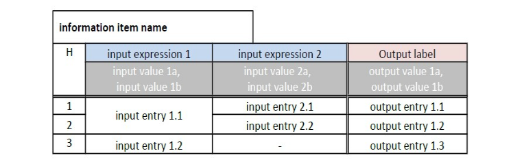

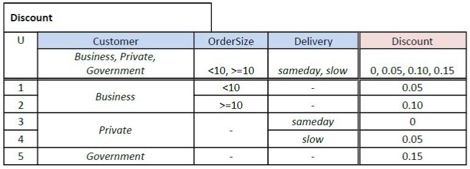

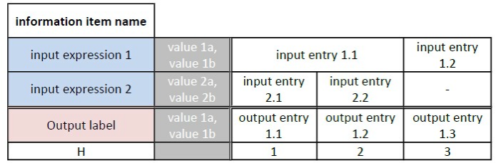

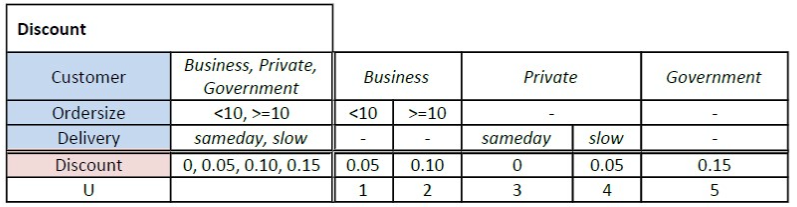

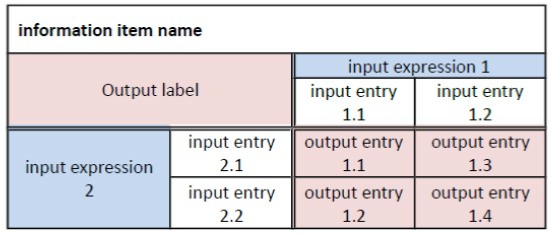

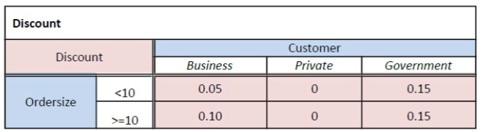

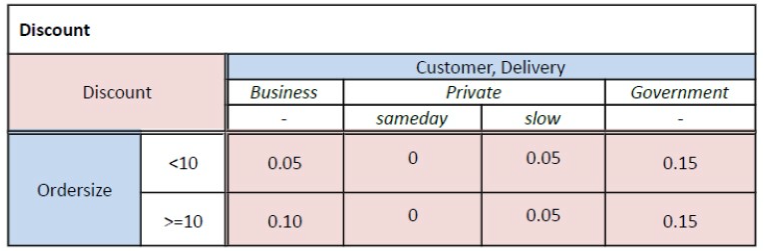

Crosstab tables with more than two inputs are possible (as shown in
[Rules as crosstab - example with three inputs](Images/rules-as-crosstab-example-with-three-inputs.svg)).

### Input expressions

Input expressions are usually simple, for example, a name (e.g., CustomerStatus)
or a test (e.g., Age\<25). The order of input expressions is not related to any
execution order in implementation.

### Input values

Input expressions may be expected to result in a limited number or a limited
range of values. It is important to model these expected input values because a
decision table will be considered complete if its rules cover all combinations
of expected input values for all input expressions.

Regardless of how the expected input values are modeled, input values SHOULD be
exclusive and complete. Exclusive means that input values are disjoint. Complete
means that all relevant input values from the domain are present.

For example, the following two input value ranges overlap: \<5, \<10. The
following two ranges are incomplete: \<5, \>5. The list of input values is
optional. If provided, it is a list of unary tests that must be satisfied by the
corresponding input.

### Information Item names, output labels, and output component names

A decision table with multiple output components SHALL specify a name for each
output component.

A decision table that is the value expression of an InformationItem (e.g., a
Decision's logic or a boxed Invocation's binding formula) SHALL specify the name
of the InformationItem as its Information Item name. A decision table that is
not contained in another boxed expression shall place the Information Item name
in a name box just above and adjoining the table.

A decision table that is contained in another boxed expression may use the
containing expression for its

Information Item name. For example, the Information Item name for a decision
table bound to a function parameter is the name of the function parameter. Or,
to save space, the Information Item name box may be omitted, and the Output
label used instead.

### Output values

The output entries of a decision table are often drawn from a list of output
values.

The list of output values is optional. If provided, it is a list restricting
output entries to the given list of values.

When the hit policy is P (priority), meaning that multiple rules can match, but
only one hit should be returned, the ordering of the list of output values is
used to specify the (decreasing) priority.

The ordering of the list of output values is also used when the hit policy is
output order.

### Multiple outputs

The decision table can show a compound output (see
[Horizontal table with multiple output components](Images/horizontal-table-with-multiple-output-components.svg),
[Vertical table with multiple output components](Images/vertical-table-with-multiple-output-components.svg),
and
[Crosstab with multiple output components](Images/crosstab-with-multiple-output-components.svg)).

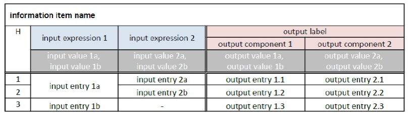

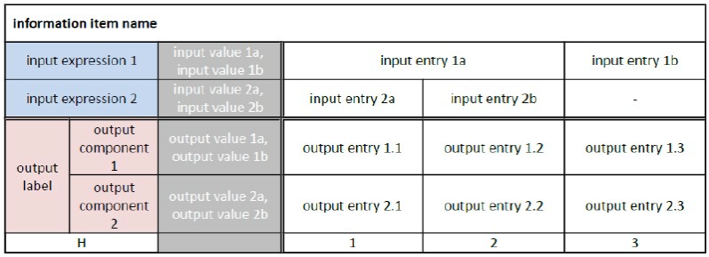

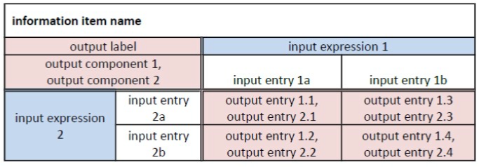

### Input entries

Rule input entries are unary tests (grammar rule 15).

A dash symbol (‘-’) can be used to mean any input value, *i.e.,* the input is
irrelevant for the containing rule.

The input entries in a unary test SHOULD be ‘-’ or a subset of the input values
specified. For example, if the input values for input ‘Age’ are specified as
*\[0..120\]*, then an input entry of *\<0* SHOULD be reported as invalid.

Tables containing at least one ‘-’ input entry are called *contracted* tables.
The others are called *expanded*.

Tables where every input entry is *true, false, or ‘-*’ are historically called
*limited-entry* tables, but there is no need to maintain this restriction.

Evaluation of the input expressions in a decision table does not produce
side-effects that influence the evaluation of other input expressions. This
means that evaluating an expression or executing a rule should not change the
evaluation of other expressions or rules of the same table. This is particularly
important in first hit tables where the rules are evaluated in a predefined
sequence: evaluating or executing a rule should not influence other rules.

### Merged input entry cells

Adjacent input entry cells from different rules, with the same content and same
(or no) prior cells can be merged, as shown in
[Merged rule input cells allowed](Images/merged-rule-input-cells-allowed.svg)
and
[Merged rule input cells not allowed](Images/merged-rule-input-cells-not-allowed.svg).
Rule output cells cannot be merged (except in crosstabs).

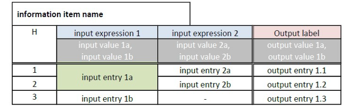

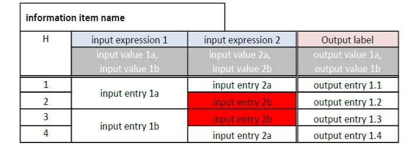

### Output entry

A rule output entry is an expression.

Rule output cells cannot be merged (except in crosstabs, where adjacent output
cells with the same content can be merged).

#### Shorthand notation

In vertical (rules as columns) tables with a single output name (equal to the
information item name), a shorthand notation may be used to indicate: output
value applies (‘X’) or does not apply (‘-’), as is common practice in decision
tables.

Because there can be only one output entry for an output name, every rule must
indicate no more than one ‘X’. The other output entries must contain ‘-’.

The table in
[Shorthand notation for vertical tables (rules as columns)](Images/shorthand-notation-for-vertical-tables-rules-as-columns.svg)
is shorthand notation for the table in
[Full notation for vertical tables (rules as columns)](Images/full-notation-for-vertical-tables-rules-as-columns.svg).
It is called shorthand, because the output entries need not be (re-)written in
every column but are indicated with a one-character notation (‘X’ or ‘-’),
thereby saving space in vertical tables, which tend to expand in width as the
number of rules increases. The output values are written only once, before the
rules, in the output expression part.

If an information item name is provided, and there is only one output name
(which has to be equal to the information item name), the output name is
optional.

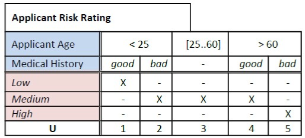

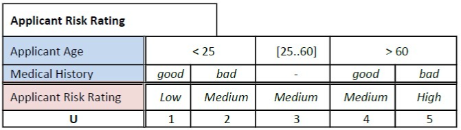

### Hit policy

A decision table normally has several rules. As a default, rules do not overlap.
If rules overlap, meaning that more than one rule may match a given set of input
values, the hit policy indicator is required in order to recognize the table
type and unambiguously understand the decision logic. The hit policy can be used
to check correctness at design-time.

The hit policy specifies what the result of the decision table is in cases of
overlapping rules, i.e., when more than one rule matches the input data. For
clarity, the hit policy is summarized using a single character in a particular
decision table cell. In horizontal tables this is the top-left cell
([Decision table example (horizontal orientation: rules as rows)](Images/decision-table-example-horizontal-orientation-rules-as-rows.svg))
and in vertical tables this is the bottom-left cell
([Decision table example (vertical orientations: rules as columns)](Images/decision-table-example-vertical-orientations-rules-as.svg)).

The character is the initial letter of the defined hit policy (**U**nique,
**A**ny, **P**riority, **F**irst, **C**ollect, **O**utput order or **R**ule
order). Crosstab tables are always Unique and need no indicator.

The hit policy SHALL default to Unique, in which case the hit indicator is
optional. Decision tables with the Unique hit policy SHALL NOT contain
overlapping rules.

Tools may support only a nonempty subset of hit policies, but the table type
SHALL be clear and therefore the hit policy indication is mandatory, except for
the default unique tables. Unique tables SHALL always be supported.

#### Single and multiple hit tables

A single hit table shall return the output of one rule only; a multiple hit
table may return the output of multiple rules (or a function of the outputs,
e.g., sum of values). If rules are allowed to overlap, the hit policy indicates
how overlapping rules have to be interpreted.

The initial letter for hit policy also identifies if a table is single hit or
multiple hits.

A single hit table may or may not contain overlapping rules but returns the
output of one rule only. In case of overlapping rules, the hit policy indicates
which of the matching rules to select. Some restrictions apply to tables with
compound outputs.

Regardless of whether a single or multiple hit policy is used, some columns in a
decision table may be designated as *rule annotations*. Rule Annotations contain
text that is not returned as part of the expression results, and they are
ignored for purposes of the hit policy validations described below. Although
there is no standard mechanism to access the annotations of the matched rules in
a decision table at execution time, implementations may use the annotations for
auditing, debugging, logging, documentation, analytics, consumption by
down-stream systems, or for other purposes.

**Single hit policies** for single output decision tables are:

1.  **U**nique: no overlap is possible, and all rules are disjoint. Only a
    single rule can be matched. This is the default.

2.  **A**ny: there may be overlap, but all the matching rules show equal output
    entries for each output (ignoring rule annotations), so any match can be
    used. If the output entries are non-equal (ignoring rule annotations), the
    hit policy is incorrect, and the result is undefined.

3.  **P**riority: multiple rules can match, with different output entries. This
    policy returns the matching rule with the highest output priority. Output
    priorities are specified in the ordered list of output values, in decreasing
    order of priority. Note that priorities are independent from rule sequence.

4.  **F**irst: multiple (overlapping) rules can match, with different output
    entries. The first hit by rule order is returned (and evaluation can halt).
    This is still a common usage because it resolves inconsistencies by forcing
    the first hit. However, first hit tables are not considered good practice
    because they do not offer a clear overview of the decision logic. It is
    important to distinguish this type of table from others because the meaning
    depends on the order of the rules. The last rule is often the
    catch-remainder. Because of this order, the table is hard to validate
    manually and therefore has to be used with care.

A multiple hit table may return output entries from multiple rules. The result
will be a list of rule outputs or a simple function of the outputs.

**Multiple hit policies** for single output decision tables can be:

5.  **O**utput order: returns all hits in decreasing output priority order.
    Output priorities are specified in the ordered list of output values in
    decreasing order of priority.

6.  **R**ule order: returns all hits in rule order. Note: the meaning may depend
    on the sequence of the rules.

7.  **C**ollect: returns either all hits in arbitrary order, or the result of
    applying a simple function to them. An operator ('+', '\<', '\>', '#') can
    be added. If no operator is present, the result is the list of the output
    entries of all the rules matched.  
      
    If an operator is present, the result is a singleton value resulting from
    applying the function denoted by the selected operator to the list of the
    output entries of all the rules matched. Collect operators are:

    a\) + (sum): the result of the decision table is the sum of all the outputs.

    b\) \< (min): the result of the decision table is the smallest value of all
    the outputs.

    c\) \> (max): the result of the decision table is the largest value of all
    the outputs.

    d\) \# (count): the result of the decision table is the number of outputs.

Other policies, such as more complex manipulations on the outputs, can be
performed by post-processing the output list (outside the decision table).

Decision tables with compound outputs support only the following hit policies:
Unique, Any, Priority, First, Output order, Rule order and Collect without
operator, because the collect operator is undefined over multiple outputs. This
restriction ignores rule annotations of which there may be multiple regardless
of the hit policy specified.

For the Priority and Output order hit policies, priority is decided in compound
output tables over all the outputs for which output values have been provided
(ignoring rule annotations). The priority for each output is specified in the
ordered list of output values in decreasing order of priority, and the overall
priority is established by considering the ordered outputs from left to right in
horizontal tables (i.e., columns to the left take precedence over columns to the
right), or from top to bottom in vertical tables. Outputs for which no output
values are provided are not considered in the ordering, although their output
entries are included in the ordered compound output.

So, for example, if called with Age = 17, Risk category = “HIGH” and Debt review
= true, the Routing rules table in
[Output order with compound output](Images/output-order-with-compound-output.svg)
would return the outputs of all four rules, in the order 2, 4, 3, 1.

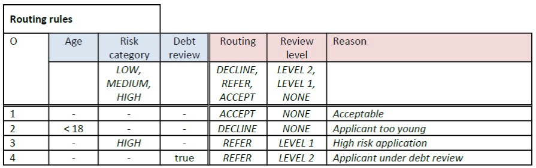

**Note 1**

Crosstab tables are unique and complete by definition and therefore do not need
a hit policy.

#### Note 2

The sequence of the rules in a decision table does not influence the meaning,
except in **F**irst tables (single hit) and **R**ule order tables (multiple
hit). These tables should be used with care.

### Default output values

Tables may specify a default output. The default value is underlined in the list
of output values.

## Metamodel

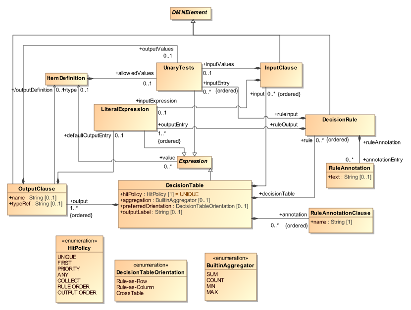

### Decision Table metamodel

The class DecisionTable is used to model a decision table.

DecisionTable is a concrete specialization of Expression.

An instance of DecisionTable contains a list of rules which are instances of
DecisionRule, a list of inputs which are instances of InputClause, a list of
outputs which are instances of OutputClause, and a list of annotations which are
instances of RuleAnnotationClause.

It has a preferredOrientation, which SHALL be one of the enumerated

DecisionTableOrientation: Rule-as-Row, Rule-as-Column or CrossTable. An instance
of DecisionTable SHOULD BE represented as specified by its preferredOrientation,
as defined in clause [Table orientation](#table-orientation).

An instance of DecisionTable has an associated hitPolicy, which SHALL be one of
the enumerated HitPolicy: UNIQUE, FIRST, PRIORITY, ANY, COLLECT, RULE ORDER,
OUTPUT ORDER. The default value for the hitPolicy attribute is: UNIQUE. In the
diagrammatic representation of an instance of DecisionTable, the hitPolicy is
represented as specified in clause [Hit policy](#hit-policy).

The semantics that is associated with an instance of DecisionTable depends on
its associated hitPolicy, as specified below and in clause [Hit
policy](#hit-policy). The hitPolicy attribute of an instance of DecisionTable is
represented as specified in clause [Hit policy](#hit-policy).

If the hitPolicy associated with an instance of DecisionTable is FIRST or RULE
ORDER, the rules that are associated with the DecisionTable SHALL be ordered.
The ordering is represented by the explicit numbering of the rules in the
diagrammatic representation of the DecisionTable.

If the hitPolicy associated with an instance of DecisionTable is PRIORITY or
OUTPUT ORDER, the outputValue s determine the result as specified in clause [Hit
policy](#hit-policy).

If the hitPolicy that is associated with an instance of DecisionTable is
COLLECT, the DecisionTable MAY have an associated aggregation, which is one of
the enumerated BuiltinAggregator (see clause [Hit policy](#hit-policy)).

As a kind of Expression, an instance of DecisionTable has a value, which depends
on the outputs of the associated rules, the associated hitPolicy and the
associated aggregation, if any. The value of an instance of DecisionTable is
determined according to the specification in clause [Decision
Table](12_Expression_Language_FEEL.md#decision-table).

DecisionTable inherits all the attributes and model associations from
Expression.
[DecisionTable attributes and model associations](#table-decisiontable-attributes-and-model-associations)
presents the additional attributes and model associations of the DecisionTable
element.

###### Table: DecisionTable attributes and model associations

| **Attribute** | **Description** |
|----------------------------------|----------------------------------------------|
| **input**: InputClause \[\*\] | This attributes lists the instances of InputClause that compose this DecisionTable. |
| **output**: OutputClause \[\*\] | This attributes lists the instances of OutputClause that compose this DecisionTable. |
| **annotation**: RuleAnnotationClause \[\*\] | This attribute lists the instances of RuleAnnotationClause that compose this DecisionTable. |
| **rule**: DecisionRule \[\*\] | This attributes lists the instances of DecisionRule that compose this DecisionTable. |
| **hitPolicy:** HitPolicy | The hit policy that determines the semantics of this DecisionTable. Default is: UNIQUE. |
| **aggregation:** BuiltinAggregator | If present, this attribute specifies the aggregation function to be applied to the unordered set of values of the applicable rules to determine the value of this DecisionTable when the hitPolicy is COLLECT. |
| **preferredOrientation:** Decis ionTableOrientation \[0.. 1\] | The preferred orientation for the diagrammatic representation of this DecisionTable. This DecisionTable SHOULD BE represented as specified by this attribute. |
| **outputLabel:** string\[0..1\] | This attribute gives a description of the decision table output and is often the same as the name of the InformationItem for which the decision table is the value expression. |

### Decision Table Input and Output metamodel

In a DecisionTable, an input specifies an inputExpression (the subject) and a
number of inputEntries. An output specifies the name and the domain of
definition of an output value, a number of outputEntries.

The class InputClause is used to model a decision table input, and the class
OutputClause is used to model a decision table output, and the class
RuleAnnotationClause is used to model a decision table annotation.

An instance of InputClause is made of an optional inputExpression and an ordered
list of inputEntry, which are instances of UnaryTests. An instance of
OutputClause optionally references a typeRef, specifying its datatype, and it is
made of an ordered list of outputEntry, which are instances of
LiteralExpression, and an optional defaultOutputEntry, which is also an instance
of LiteralExpression. An instance of RuleAnnotationClause contains a name of
type String.

When a DecisionTable contains more than one OutputClause, each OutputClause
SHALL have a name. When a DecisionTable has a single OutputClause, the
OutputClause SHALL NOT have a name. A RuleAnnotationClause SHALL have a name.

[InputClause attributes and model associations](#table-inputclause-attributes-and-model-associations),
[OutputClause attributes and model associations](#table-outputclause-attributes-and-model-associations)
and
[RuleAnnotationClause attributes and model associations](#table-ruleannotationclause-attributes-and-model-associations)
present the attributes and model associations of InputClause, OutputClause and
RuleAnnotationClause respectively.

###### Table: InputClause attributes and model associations

| **Attribute** | **Description** |
|----------------------------------------|----------------------------------------|
| **inputExpression:** Expression \[0..1\] | The subject of this InputClause. |
| **inputValues:** UnaryTests \[0..1\] | This attribute contains UnaryTests that constrain the result of the inputExpression of this InputClause. |

###### Table: OutputClause attributes and model associations

| **Attribute** | **Description** |
|----------------------------------------|----------------------------------------|
| **typeRef: String** \[1\] | The OutputClause of a single output decision table SHALL NOT specify a typeRef. OutputClauses of a multiple output decision table MAY specify a typeRef. A typeRef is the name of the datatype of the output, either an ItemDefinition, a base type in the specified expressionLanguage, or an imported type. |
| **name:** string \[0..1\] | The OutputClause of a single output decision table SHALL NOT specify a name. OutputClauses of a multiple output decision table SHALL specify a name. |
| **outputValues:** UnaryTests \[0..1\] | This attribute contains UnaryTests that constrain the result of the outputEntrys of the DecisionRules corresponding to this OutputClause. |
| **defaultOutputEntry: Literal**Expression \[0..1\] | In an Incomplete table, this attribute lists an instance of LiteralExpression that is selected when no rules match for the decision table. |

###### Table: RuleAnnotationClause attributes and model associations

| **Attribute** | **Description** |
|----------------------------------------|----------------------------------------|
| **name**: string \[1\] | RuleAnnotationClause SHALL specify a name that is used as the name of the rule annotation column of the containing decision table. |

### Decision Rule metamodel

The class DecisionRule is used to model the rules in a decision table (see
[Notation](#notation)).

An instance of DecisionRule has an ordered list of inputEntry instances which
are instances of UnaryTests, an ordered list of outputEntry instances, which are
instances of LiteralExpression, and an ordered list of ruleAnnotations.

In a tabular representation of the containing instance of DecisionTable, the
representation of an instance of

DecisonRule depends on the orientation of the decision table. For instance, if
the decision table is represented horizontally (rules as row, see [Table
orientation](#table-orientation)), instances of DecisionRule are represented as
rows, with all the inputEntrys represented on the left of all the outputEntrys,
and all the ruleAnnotations represented to their right.

By definition, a DecisionRule element that has no inputEntrys is always
applicable. Otherwise, an instance of DecisionRule is said to be *applicable* if
and only if, all of the DecisionTable’s inputExpression values satisfy their
corresponding inputEntry.

The inputEntrys are matched in arbitrary order.

The inputEntry elements SHALL be in the same order as the containing
DecisionTable's inputs.

The *ith* inputExpression must satisfy the *ith* inputEntry for all inputEntrys
in order for the DecisionRule to *match*, as defined in section
[Introduction](#introduction).

The outputEntry elements SHALL be in the same order as the containing
DecisionTable's outputs. The *ith* outputEntry SHALL be consistent with the
typeRef of the *ith* OutputClause.

The ruleAnnotation elements SHALL be in the same order as the containing
DecisionTable's annotations. The *ith* ruleAnnotation refers to the *ith*
RuleAnnotationClause.

[DecisionRule attributes and model associations](#table-decisionrule-attributes-and-model-associations)
presents the attributes and model associations of the DecisionRule element;
[DecisionRule attributes and model associations](#table-decisionrule-attributes-and-model-associations)
presents the attributes and model associations of the RuleAnnotation element.

###### Table: DecisionRule attributes and model associations

| **Attribute** | **Description** |
|----------------------------------------|----------------------------------------|
| **inputEntry:** UnaryTests\[0..\*\] | The instances of UnaryTests that specify the input conditions that this DecisionRule must match for the corresponding (by index) inputExpression. |
| **outputEntry:** LiteralExpression \[1..\*\] | A list of the instances of LiteralExpression that compose the output components of this DecisionRule. |
| **annotationEntry**: RuleAnnotation \[0..\*\] | A list of the instances of RuleAnnotation that compose the annotations of this DecisionRule and match the corresponding (by index) instances of RuleAnnotationClause. |

###### Table: RuleAnnotation attributes and model associations

| **Attribute**         | **Description**                |
|-----------------------|--------------------------------|
| text: string \[0..1\] | The text of the RuleAnnotation |

## Examples

[Examples of decision tables](#table-examples-of-decision-tables) provides
examples for the various types of decision table discussed in this section.
Further examples may be found in clause [The decision logic
level](14_DMN_Examples.md#the-decision-logic-level), in the context of a
complete example of a **DMN** decision model.

###### Table: Examples of decision tables

| Single Hit **U**nique         | 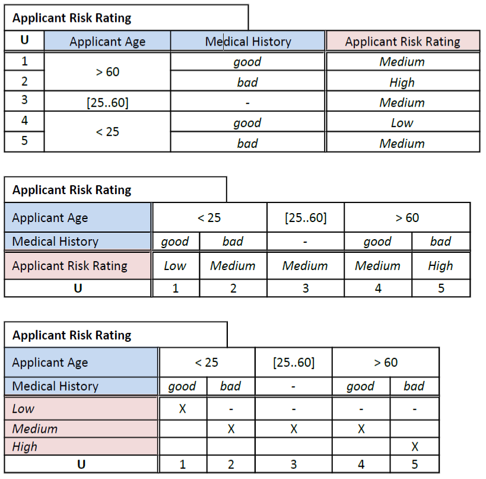         |
|-------------------------------|--------------------------------------------------|
| Single Hit **A**ny            | 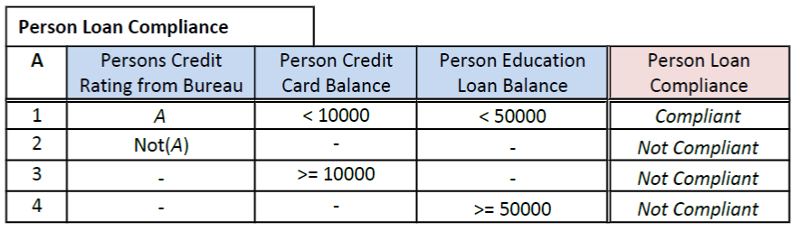            |
| Single Hit **P**riority       | 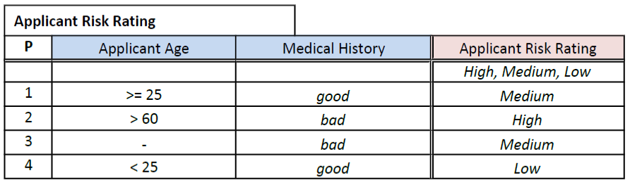       |
| Single Hit **F**irst          | 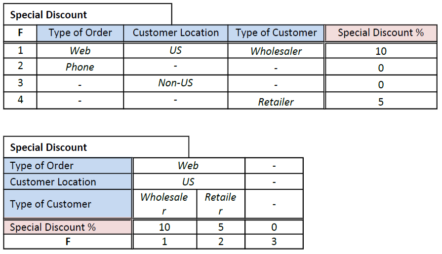          |
| Multiple Hit **N**o order     | 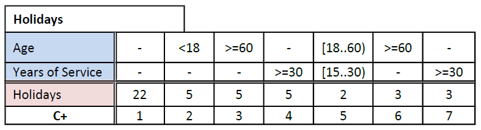     |
| Multiple Hit **O**utput order | 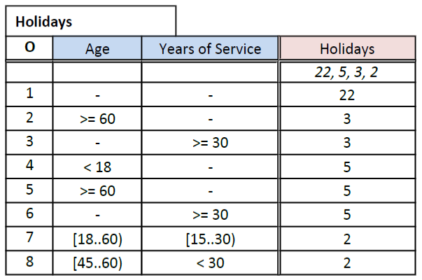 |
| Multiple Hit **R**ule order   | 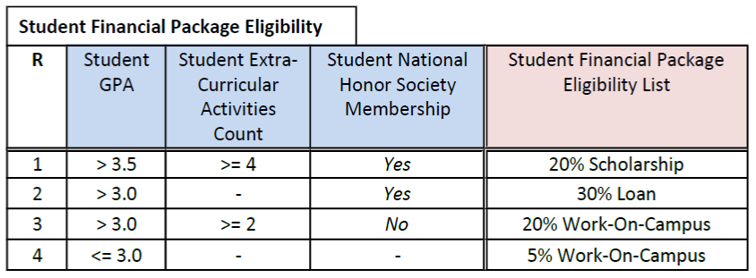   |
