# DMN Examples

## Example 1: Originations

### Introduction

In this clause we present an example of the use of **DMN** to model and execute decision-making in a simple business process modeled in **BPMN**, including decisions to be automated in decision services called from the business process management system.

### The business process model

[Example business process](Images/example-business-process.svg) shows a simple process for loan originations, modeled in **BPMN 2.0**. The process handles as application for a loan, obtaining data from a credit bureau only if required for the case, and automatically deciding whether the application should be accepted, declined, or referred for human review. If referred, documents are collected from the applicant and a credit officer adjudicates the case. It consists of the following components:

- The **Collect application data** task collects data describing the Requested product and the Applicant (e.g., through an on-line application form).

- The Decide **bureau Strategy** task calls a decision service, passing Requested product and Applicant data. The service returns two decisions: Strategy and Bureau call type.

- A **gateway** uses the value of Strategy to route the case to Decline application, Collect bureau data or Decide routing.

- The **Collect bureau data** task collects data from a credit bureau according to the Bureau call type decision, then the case is passed to Decide routing.

- The **Decide routing** task calls a decision service, passing Requested product, Applicant data and Bureau data (if the Collect bureau data task was not performed, the Bureau data are set to null). The service returns a single decision: Routing.

- A **gateway** uses the value of Routing to route the case to Accept application, Review application or Decline application.

- The **Collect documents** task requests and uploads documents from the applicant in support of their application.

- The **Review application** task allows a credit officer to review the case and decide whether it should be accepted or declined.

- A **gateway** uses the credit officer’s Adjudication to route the case to Accept application or Decline application.

- The **Accept application** task informs the applicant that their application is accepted and initiates the product.

- The **Decline application** task informs the applicant that their application is declined.

Note that in this example two decision points (automated as calls to decision services) are represented in **BPMN 2.0** as business rule tasks; the third decision point (which is human decision-making) is represented as a user task.

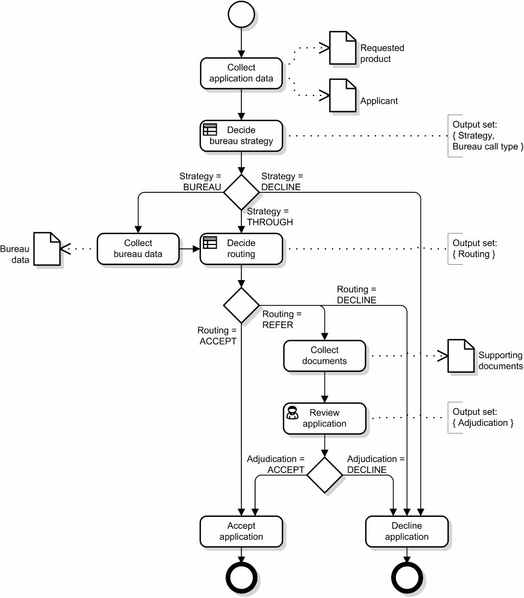

### The decision requirements level

The examples in this chapter were developed using a software that adds icons to the elements. Although adding these icons is allowable by this document it is not normative.

#### Decision Requirements Diagrams

[DRD of all automated decision-making](Images/drd-of-all-automated-decision-making.svg) shows a DRD of all the decision-making in this business process. There are four sources of input data for the decision-making (Requested product, Applicant data, Bureau data and Supporting documents), and four decisions whose results are used in the business process (Strategy, Bureau call type, Routing and Adjudication). Between the two are intermediate decisions: evaluations of risk, affordability, and eligibility.

Notable features of this DRD include:

- It covers both automated and human decision-making.

- Some decisions (e.g., Pre-bureau risk category) and input data (e.g., Applicant data) are required by multiple decisions, i.e., the information requirements network is not a tree.

- Business knowledge models (see Affordability calculation) may be invoked by multiple decisions.

- Business knowledge models (see Credit contingency factor) may be invoked by other business knowledge models.

- Some decisions do not have associated business knowledge models.

Knowledge sources may provide authority for multiple decisions and/or business knowledge models.

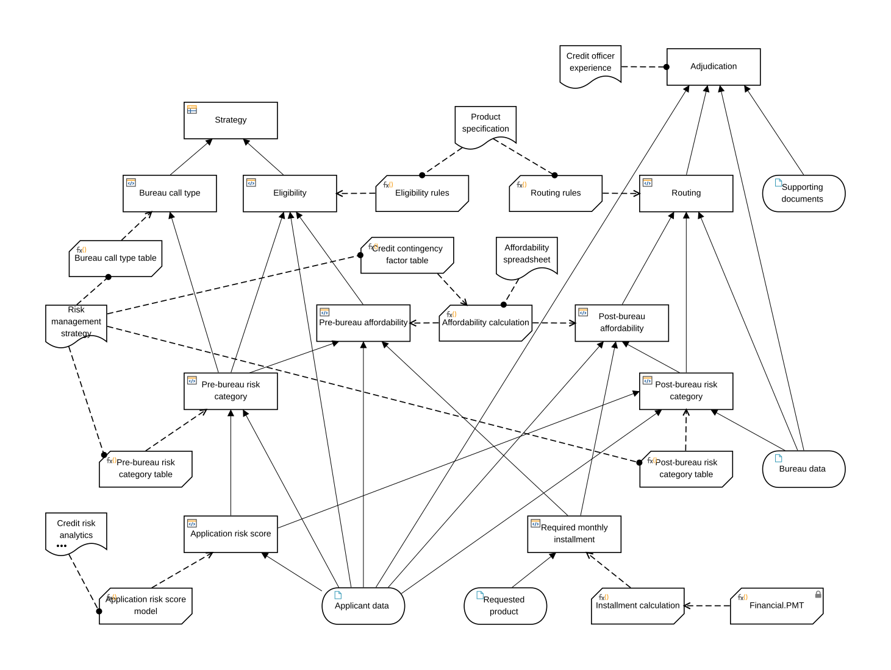

It might be considered more convenient to draw separate (but overlapping) DRDs for the three decision points:

- [DRD for Decide bureau strategy decision point](Images/drd-for-decide-bureau-strategy-decision-point.svg) shows the DRD of the decisions required for the Decide bureau strategy decision point, i.e., the requirements subgraph of the Strategy and Bureau call type decisions. These are decisions to be automated through encapsulation in a decision service called at this point and therefore need their logic to be specified completely.

- [DRD for Decide routing decision point](Images/drd-for-decide-routing-decision-point.svg) shows the DRD for the Decide routing decision point, i.e., the requirements subgraph of the Routing decision. These are also decisions automated with a decision service and therefore need their logic to be specified completely. Note that some elements appear in both [DRD for Decide bureau strategy decision point](Images/drd-for-decide-bureau-strategy-decision-point.svg) and [DRD for Decide routing decision point](Images/drd-for-decide-routing-decision-point.svg).

- [DRD for Review application decision point](Images/drd-for-review-application-decision-point.svg) shows the DRD for the Review application decision point, i.e., the requirements subgraph of the Adjudication decision. This is a human decision and has no associated specification of decision logic, but the DRD indicates that the Credit officer takes into account the results of the automated Routing decision along with the case data, including the Supporting documents. (The requirements subgraph of the Routing decision has been hidden in this DRD as shown by the ellipsis (...) marker.)

- [DRD for Credit Risk Analytics Knowledge Source](Images/drd-for-credit-risk-analytics-knowledge-source.svg) shows an additional DRD for the Credit Risk Analytics Knowledge Source i.e., the requirements linking this Knowledge Source to other elements. DRDs can be used to provide views other than for a specific decision.

All four DRDs – [DRD of all automated decision-making](Images/drd-of-all-automated-decision-making.svg), [DRD for Decide bureau strategy decision point](Images/drd-for-decide-bureau-strategy-decision-point.svg), [DRD for Decide routing decision point](Images/drd-for-decide-routing-decision-point.svg), [DRD for Review application decision point](Images/drd-for-review-application-decision-point.svg) and [DRD for Credit Risk Analytics Knowledge Source](Images/drd-for-credit-risk-analytics-knowledge-source.svg) – are views of the same DRG.

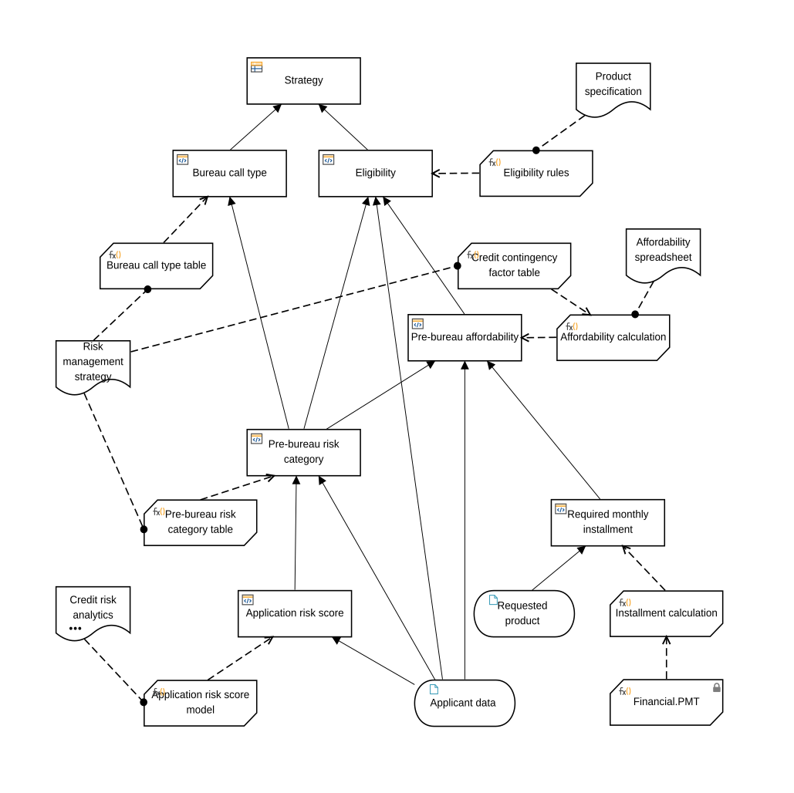

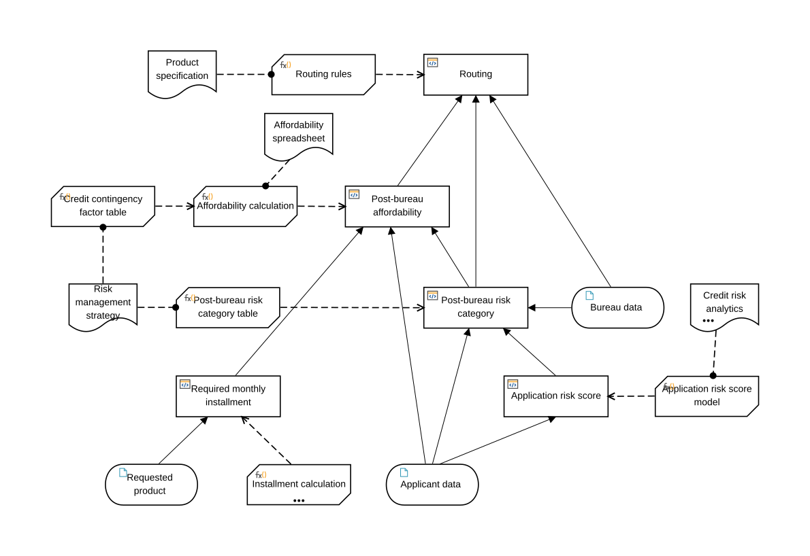

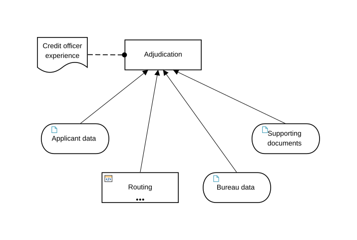

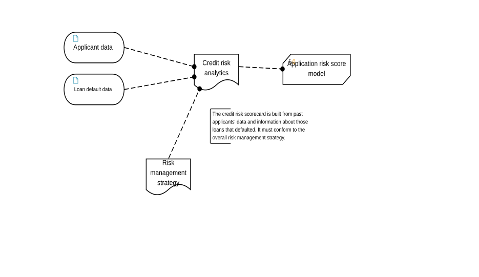

#### DRG Elements

##### Decisions

The DRG depicted in these DRDs shows dependencies between the following decisions:

- The **Strategy** decision, requiring the Bureau call type and Pre-bureau eligibility decisions, invokes the Strategy table shown in [Strategy decision logic](#table-strategy-decision-logic) (without that table being encapsulated in a business knowledge model).

- The **Bureau call type** decision, requiring the Pre-bureau risk category decision, invokes the Bureau call type table shown in [Bureau call type table decision logic](#table-bureau-call-type-table-decision-logic).

- The **Eligibility** decision, requiring Applicant data and the Pre-bureau risk category and Pre-bureau affordability decisions, invokes the Eligibility rules shown in [Eligibility rules decision logic](#table-eligibility-rules-decision-logic).

- The **Pre-bureau affordability** decision, requiring Applicant data and the Pre-bureau risk category and Required monthly installment decisions, invokes the Affordability calculation boxed expression shown in [Affordability calculation decision logic](#table-affordability-calculation-decision-logic), which in turn invokes the Credit contingency factor table shown in [Credit contingency factor table decision logic](#table-credit-contingency-factor-table-decision-logic).

- The **Pre-bureau risk category** decision, requiring Applicant data and the Application risk score decision, invokes the Pre-bureau risk category table shown in [Pre-bureau risk category table decision logic](#table-pre-bureau-risk-category-table-decision-logic).

- The **Application risk score** decision, requiring Applicant data, invokes the Application risk score model shown in [Application risk score model decision logic](#table-application-risk-score-model-decision-logic).

- The **Routing** decision, requiring Bureau data and the Post-bureau affordability and Post-bureau risk category decisions, invokes the Routing rules shown in [Routing rules decision logic](#table-routing-rules-decision-logic).

- The **Post-bureau affordability** decision, requiring Applicant data and the Post-bureau risk score and Required monthly installment decisions, invokes the Affordability calculation boxed expression shown in [Affordability calculation decision logic](#table-affordability-calculation-decision-logic), which in turn invokes the Credit contingency factor table shown in [Credit contingency factor table decision logic](#table-credit-contingency-factor-table-decision-logic).

- The **Post-bureau risk category** decision, requiring Applicant and Bureau data and the Application risk score decision, invokes the Post-bureau risk category table shown in [Post-bureau risk category table decision logic](#table-post-bureau-risk-category-table-decision-logic).

- The **Required monthly installment** decision, requiring Requested product data, invokes the Installment calculation boxed expression shown in [Installment calculation decision logic](#table-installment-calculation-decision-logic).

- The **Adjudication** decision, requiring Applicant data, Bureau data, Supporting documents, and the Routing decision, has no associated decision logic.

Questions and allowed answers are specified for these decisions. These are typically used when modeling decisions for which no logic will be specified and for other decisions before it is appropriate to describe the decision logic in detail. The description and Question/Allowed Answers for each decision follow.

#### Adjudication {-}

Question: Should this application that has been referred for adjudication be accepted? Allowed Answers: Yes/No

Description: Determine if an application requiring adjudication should be accepted or declined given the available application data and supporting documents.

#### Application risk score {-}

Question: What is the risk score for this applicant?

Allowed Answers: A number greater than 70 and less than 150

Description: The **Application Risk Score** decision logic invokes the Application risk score model business knowledge model, passing `Applicant data.Age` as the Age parameter, `Applicant data.MaritalStatus` as the Marital Status parameter and `Applicant data.EmploymentStatus` as the Employment Status parameter.

#### Bureau call type {-}

Question: How much data should be requested from the credit bureau for this application? Allowed Answers: A value from the explicit list `"Full", "Mini", "None"`

Description: The **Bureau call type** decision logic invokes the Bureau call type table, passing the output of the Prebureau risk category decision as the Pre-Bureau Risk Category parameter.

#### Eligibility {-}

Question: Does this applicant appear eligible for the loan they applied for given only their application data? Allowed Answers: Value from the explicit list `"Eligible", "Not Eligible"`

Description: The **Eligibility** decision logic invokes the Eligibility rules business knowledge model, passing `Applicant data.Age` as the Age parameter, the output of the Pre-bureau risk category decision as the Pre-Bureau Risk Category parameter, and the output of the Pre-bureau affordability decision as the Pre-Bureau Affordability parameter.

#### Pre-bureau affordability {-}

Question: Can the applicant afford the loan they applied for given only their application data?

Allowed Answers: Yes/No

Description: The **Pre-bureau affordability** decision logic invokes the Affordability calculation business knowledge model, passing `Applicant data.Monthly.Income` as the Monthly Income parameter, `Applicant data.Monthly.Repayments` as the Monthly Repayments parameter, `Applicant data.Monthly.Expenses` as the Monthly Expenses parameter, the output of the Pre-bureau risk category decision as the Risk Category parameter, and the output of the Required monthly installment decision as the Required Monthly Installment parameter.

#### Post-bureau affordability {-}

Question: Can the applicant afford the loan they applied for given all available data?

Allowed Answers: Yes/No

Description: The **Post-bureau affordability** decision logic invokes the Affordability calculation business knowledge model, passing `Applicant data.Monthly.Income` as the Monthly Income parameter, `Applicant data.Monthly.Repayments` as the Monthly Repayments parameter, `Applicant data.Monthly.Expenses` as the Monthly Expenses parameter, the output of the Post-bureau risk category decision as the Risk Category parameter, and the output of the Required monthly installment decision as the Required Monthly Installment parameter.

#### Pre-bureau risk category {-}

Question: Which risk category is most appropriate for this applicant given only their application data?

Allowed Answers: Value from explicit list `"Decline", "High Risk", "Medium Risk", "Low Risk", "Very Low Risk"`

Description: The Pre-Bureau Risk Category decision logic invokes the Pre-bureau risk category table business knowledge model, passing `Applicant data.ExistingCustomer` as the Existing Customer parameter and the output of the Application risk score decision as the Application Risk Score parameter.

#### Post-bureau risk category {-}

Question: Which risk category is most appropriate for this applicant given all available data?

Allowed Answers: A value from the explicit list `"Decline", "High Risk", "Medium Risk", "Low Risk", "Very Low Risk"`

Description: The **Post-bureau risk category** decision logic invokes the Post-bureau risk category business knowledge model, passing `Applicant data.ExistingCustomer` as the Existing Customer parameter, `Bureau data.CreditScore` as the Credit Score parameter, and the output of the Application risk score decision as the Application Risk Score parameter. Note that if Bureau data is null (due to the THROUGH strategy bypassing the Collect bureau data task) the Credit Score parameter will be null.

#### Required monthly installment {-}

Question: What is the minimum monthly installment payment required for this loan product? Allowed Answers: A dollar amount greater than zero

Description: The **Required monthly installment** decision logic invokes the Installment calculation business knowledge model, passing `Requested product.ProductType` as the Product Type parameter, `Requested product.Rate` as the Rate parameter, `Requested product.Term` as the Term parameter, and `Requested product.Amount` as the Amount parameter.

#### Routing {-}

Question: How this should this applicant be routed given all available data?

Allowed Answers: A value from the explicit list `"Decline", "Refer for Adjudication", "Accept without Review"`

Description: The **Routing** decision logic invokes the Routing rules business knowledge model, passing `Bureau data.Bankrupt` as the Bankrupt parameter, `Bureau data.Credit Score` as the Credit Score parameter, the output of the Post-bureau risk category decision as the Post-Bureau Risk Category parameter, and the output of the Post-bureau affordability decision as the Post-Bureau Affordability parameter. Note that if Bureau data is null (due to the THROUGH strategy bypassing the Collect bureau data task) the Bankrupt and Credit Score parameters will be null.

#### Strategy {-}

Question: What is the appropriate handling strategy for this application?

Allowed Answers: A value from the explicit list `"Decline","Bureau","Through"`

Description: The **Strategy** decision logic defines a complete, unique-hit decision table deriving Strategy from Eligibility and Bureau call type.

##### Knowledge Sources

The DRG contains the following Knowledge Sources:

#### Affordability spreadsheet {-}

Description: Internal spreadsheet showing the relationship of income, payments, expenses, risk, and affordability.

Type: Policy

#### Credit officer experience {-}

Description: The collected wisdom of the credit officers as collected in their best practice wiki. Type: Expertise

#### Credit risk analytics {-}

Description: Credit risk scorecard analysis to determine the relevant factors for application risk scoring

Type: Analytic Insight

#### Product specification {-}

Description: Definitions of the products, their cost structure and eligibility criteria.

Type: Policy

#### Risk management strategy {-}

Description: Overall risk management approach for the financial institution including its approach to application risk, credit contingencies and credit risk scoring.

Type: Policy

##### Input Data

The DRG contains the following Input Data:

#### Applicant data {-}

Description: Information about the applicant including personal information, marital status, and household income/expenses.

**Bureau data**

Description: External credit score and bankruptcy information provided by a bureau.

**Loan default data**

Description: Information about historical loan defaults.

**Requested product**

Description: Details of the loan the applicant has applied for.

#### Supporting documents {-}

Description: Documents associated with a loan that are not processed electronically but are available for manual adjudication.

##### Business Knowledge Models

Finally, the DRG contains the following Business Knowledge Models:

#### Eligibility rules {-}

Description: The Eligibility rules decision logic defines a complete, priority-ordered single hit decision table deriving Eligibility from Pre-Bureau Risk Category, Pre-Bureau Affordability and Age.

#### Routing rules {-}

Description: The Routing Rules decision logic defines a complete, priority-ordered single hit decision table deriving Routing from Post-Bureau Risk Category, Post-Bureau Affordability, Bankrupt and Credit Score.

#### Bureau call type table {-}

Description: The Bureau call type table decision logic defines a complete, unique-hit decision table deriving Bureau Call Type from Pre-Bureau Risk Category.

#### Credit contingency factor table {-}

Description: The Credit contingency factor table decision logic defines a complete, unique-hit decision table deriving Credit contingency factor from Risk Category.

#### Affordability calculation {-}

Description: The Affordability calculation decision logic defines a boxed function deriving Affordability from Monthly Income, Monthly Repayments, Monthly Expenses and Required Monthly Installment. One step in this calculation derives Credit contingency factor by invoking the Credit contingency factor table business.

**Pre-bureau risk category table  **

Description: The Pre-bureau risk category table decision logic defines a complete, unique-hit decision table deriving Pre-bureau risk category from Existing Customer and Application Risk Score.

#### Post-bureau risk category table {-}

Description: The Post-bureau risk category table decision logic defines a complete, unique-hit decision table deriving Post-Bureau Risk Category from Existing Customer, Application Risk Score and Credit Score.

#### Application risk score model {-}

Description: The Application risk score model decision logic defines a complete, no-order multiple-hit table with aggregation, deriving Application risk score from Age, Marital Status and Employment Status, as the sum of the Partial scores of all matching rows (this is therefore a predictive scorecard represented as a decision table).

#### Installment calculation {-}

Description: The Installment calculation decision logic defines a boxed function deriving monthly installment from Product Type, Rate, Term and Amount.

#### Financial.PMT {-}

Description: Standard calculation of monthly installment from Rate, Term and Amount.

#### Business Context

In addition to the information represented in the DRD, the business context of the decision-making can be specified. The Performance Indicators used to track the effectiveness of decision-making, Objectives the organization seeks to meet through its decision-making approach, and the Organizational Units that make decisions or own the decision making approach may all be specified. Decisions are cross-referenced to the performance indicators and objectives they impact and to the organizational units that either make the decision or own the definition of how the decision should be made.

**Performance indicators**

<table>
<tr><td>Monthly bureau costs</td><td>The total cost charged by the bureau for all Bureau Data requested while originating Loans in a calendar month.</td></tr>
<tr><td>Monthly loan accept rate</td><td>The percentage of loans accepted in a calendar month.</td></tr>
<tr><td>Monthly auto-adjudication rate</td><td>The percentage of loans that did not require a credit officer to review the case in a calendar month.</td></tr>
<tr><td>Monthly value of loans written</td><td>The total value of Loans written in a calendar month</td></tr>
<tr><td>Auto adjudication rate 90%</td><td>By end of the current year, have an auto-adjudication rate of at least 90 percent</td></tr>
</table>

Decisions are mapped to the Performance Indicators and Goals that they impact as follows:

<table>
<tr><th></th><th>

Monthly Loan

Accept Rate

</th><th>

Monthly Value

of Loans WrittenCosts

</th><th>

Monthly Bureau

</th><th>

Auto-adjudication rate 90%

</th><th>

Monthly Auto- adjudication

Rate

</th></tr>
<tr><td>

**Adjudication**

</td><td>Yes</td><td>Yes</td><td></td><td></td><td></td></tr>
<tr><td>

**Application risk score**

</td><td></td><td></td><td>Yes</td><td></td><td></td></tr>
<tr><td>

**Bureau Call Type**

</td><td></td><td></td><td>Yes</td><td></td><td></td></tr>
<tr><td>

**Routing**

</td><td>Yes</td><td>Yes</td><td></td><td>Yes</td><td>Yes</td></tr>
<tr><td>

**Strategy**

</td><td>Yes</td><td>Yes</td><td></td><td>Yes</td><td>Yes</td></tr>
</table>

**Organizations**

<table>
<tr><td>Credit officers</td><td>Individuals in the Retail Banking Organization responsible for manual adjudication of loans.</td></tr>
<tr><td>Product management</td><td>Organization responsible for defining loan and other banking products, how those products are priced, sold and tracked for profitability.</td></tr>
<tr><td>Credit risk analytics group</td><td>Organization responsible for credit risk models and the use of data to predict credit risk for customers and loan applicants.</td></tr>
<tr><td>Retail banking</td><td>Overall Organization focused on banking products for consumers.</td></tr>
<tr><td>Credit risk</td><td>Organization within the bank responsible for defining credit risk strategies and policies and providing tools for managing against these.</td></tr>
</table>

Credit officers are likely to be part of the Retail Banking organization, Credit risk analytic and Risk management are part of the Credit risk organization, although these relationships are not managed in DMN.

These organizations own decisions, make decisions and own knowledge sources as follows:

<table>
<tr><th></th><th>

Owns Decisions

</th><th>

Makes Decisions

</th><th>

Knowledge Sources

</th></tr>
<tr><td>

**Credit officers**

</td><td></td><td>Adjudication</td><td>Credit officer experience</td></tr>
<tr><td>

**Credit risk analytics group**

</td><td>Application risk score</td><td></td><td>Credit risk analytics</td></tr>
<tr><td>

**Credit risk**

</td><td>

Adjudication

Bureau call type

Eligibility

Pre-bureau risk category Post-bureau risk category

Routing

</td><td></td><td>Risk management strategy</td></tr>
</table>

#### Decision Services

The two decision services required by the business process model are defined against the decision model. The **Bureau Strategy Decision Service**, called by the **Decide bureau strategy** task, has output decisions {Bureau call type, Strategy}, and is shown in [Bureau Strategy Decision Service](Images/bureau-strategy-decision-service.svg). The **Routing Decision Service**, called by the **Decide routing** task, has output decisions {Routing}, and is shown in [Routing Decision Service](Images/routing-decision-service.svg).

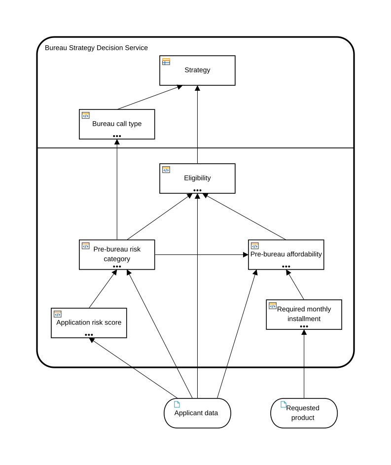

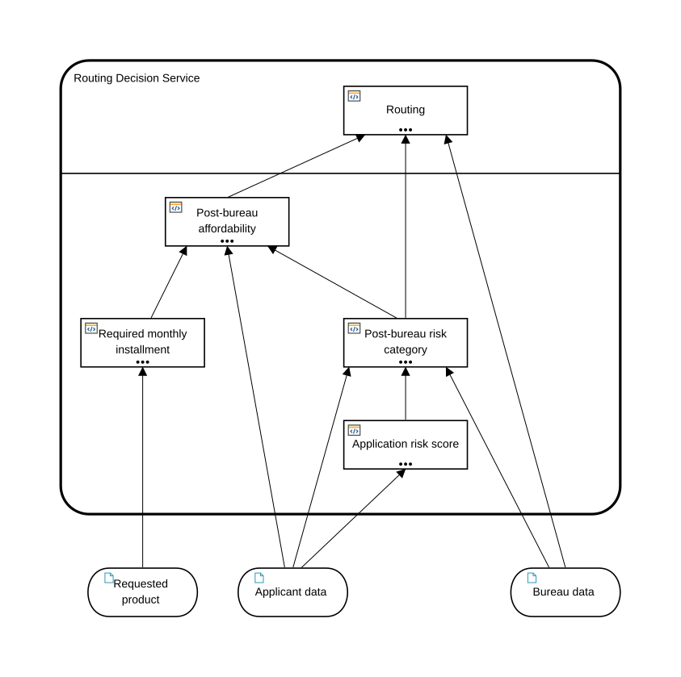

### The decision logic level

The DRG in [DRD of all automated decision-making](Images/drd-of-all-automated-decision-making.svg) is defined in more detail in the following specifications of the value expressions associated with decisions and business knowledge models:

- The **Strategy** decision logic ([Strategy decision logic](#table-strategy-decision-logic)) defines a complete, unique-hit decision table deriving Strategy from Eligibility and Bureau call type.

- The **Bureau call type** decision logic (shown as a boxed invocation in [Bureau call type decision logic](#table-bureau-call-type-decision-logic)) invokes the Bureau call type table, passing the output of the Pre-bureau risk category decision as the Pre-Bureau Risk Category parameter.

- The **Bureau call type table** decision logic ([Bureau call type table decision logic](#table-bureau-call-type-table-decision-logic)) defines a complete, unique-hit decision table deriving Bureau Call Type from Pre-Bureau Risk Category.

- The **Eligibility** decision logic (shown as a boxed invocation in [Eligibility decision logic](#table-eligibility-decision-logic)) invokes the Eligibility rules business knowledge model, passing `Applicant data.Age` as the Age parameter, the output of the Pre-bureau risk category decision as the Pre-Bureau Risk Category parameter, and the output of the Pre-bureau affordability decision as the Pre-Bureau Affordability parameter.

- The **Eligibility rules** decision logic ([Eligibility rules decision logic](#table-eligibility-rules-decision-logic)) defines a complete, priority-ordered single hit decision table deriving Eligibility from Pre-Bureau Risk Category, Pre-Bureau Affordability and Age.

- The **Pre-bureau risk category** decision logic (shown as a boxed invocation in [Pre-bureau risk category decision logic](#table-pre-bureau-risk-category-decision-logic)) invokes the Pre-bureau risk category table business knowledge model, passing `Applicant data.ExistingCustomer` as the Existing Customer parameter and the output of the Application risk score decision as the Application Risk Score parameter.

- The **Pre-bureau risk category table** decision logic ([Pre-bureau risk category table decision logic](#table-pre-bureau-risk-category-table-decision-logic)) defines a complete, unique-hit decision table deriving Pre-Bureau Risk Category from Existing Customer and Application Risk Score.

- The **Application risk score** decision logic (shown as a boxed invocation in [Application risk score decision logic](#table-application-risk-score-decision-logic)) invokes the Application risk score model business knowledge model, passing `Applicant data.Age` as the Age parameter, `Applicant data.MaritalStatus` as the Marital Status parameter and `Applicant data.EmploymentStatus` as the Employment Status parameter.

- The **Application Risk Score Model** decision logic ([Application risk score model decision logic](#table-application-risk-score-model-decision-logic)) defines a complete, no-order multiple-hit table with aggregation, deriving Application risk score from Age, Marital Status and Employment Status, as the sum of the Partial scores of all matching rows (this is therefore a predictive scorecard represented as a decision table).

- The **Routing** decision logic (shown as a boxed invocation in [Routing decision logic](#table-routing-decision-logic)) invokes the Routing rules business knowledge model, passing `Bureau data.Bankrupt` as the Bankrupt parameter, `Bureau data.CreditScore` as the Credit Score parameter, the output of the Post-bureau risk category decision as the Post-Bureau Risk Category parameter, and the output of the Post-bureau affordability decision as the Post-Bureau Affordability parameter. Note that if Bureau data is null (due to the THROUGH strategy bypassing the Collect bureau data task) the Bankrupt and Credit Score parameters will be null.

- The **Routing rules** decision logic ([Routing rules decision logic](#table-routing-rules-decision-logic)) defines a complete, priority-ordered single hit decision table deriving Routing from Post-Bureau Risk Category, Post-Bureau Affordability, Bankrupt and Credit Score.

- The **Post-bureau risk category** decision logic (shown as a boxed invocation in [Post-bureau risk category decision logic](#table-post-bureau-risk-category-decision-logic)) invokes the Post-bureau risk category business knowledge model, passing `Applicant data.ExistingCustomer` as the Existing Customer parameter, `Bureau data.CreditScore` as the Credit Score parameter, and the output of the Application risk score decision as the Application Risk Score parameter. Note that if Bureau data is null (due to the THROUGH strategy bypassing the Collect bureau data task) the Credit Score parameter will be null.

- The **Post-bureau risk category table** decision logic ([Post-bureau risk category table decision logic](#table-post-bureau-risk-category-table-decision-logic)) defines a complete, unique-hit decision table deriving Post-Bureau Risk Category from Existing Customer, Application Risk Score and Credit Score.

- The **Pre-bureau affordability** decision logic (shown as a boxed invocation in [Pre-bureau affordability decision logic](#table-pre-bureau-affordability-decision-logic)) invokes the Affordability calculation business knowledge model, passing `Applicant data.Monthly.Income` as the Monthly Income parameter, `Applicant data.Monthly.Repayments` as the Monthly Repayments parameter, `Applicant data.Monthly.Expenses` as the Monthly Expenses parameter, the output of the Pre-bureau risk category decision as the Risk Category parameter, and the output of the Required monthly installment decision as the Required Monthly Installment parameter.

- The **Post-bureau affordability** decision logic (shown as a boxed invocation in [Post-bureau affordability decision logic](#table-post-bureau-affordability-decision-logic)) invokes the Affordability calculation business knowledge model, passing `Applicant data.Monthly.Income` as the Monthly

> Income parameter, `Applicant data.Monthly.Repayments` as the Monthly Repayments parameter, `Applicant data.Monthly.Expenses` as the Monthly Expenses parameter, the output of the Post-bureau risk category decision as the Risk Category parameter, and the output of the Required monthly installment decision as the Required Monthly Installment parameter.

- The **Affordability calculation** decision logic ([Affordability calculation decision logic](#table-affordability-calculation-decision-logic)) defines a boxed function deriving Affordability from Monthly Income, Monthly Repayments, Monthly Expenses and Required Monthly Installment. One step in this calculation derives Credit contingency factor by invoking the Credit contingency factor table business knowledge model, passing the output of the Risk category decision as the Risk Category parameter.

- The **Credit contingency factor table** decision logic ([Credit contingency factor table decision logic](#table-credit-contingency-factor-table-decision-logic)) defines a complete, unique-hit decision table deriving Credit contingency factor from Risk Category.

- The **Required monthly installment** decision logic (shown as a boxed invocation in [Required monthly installment decision logic](#table-required-monthly-installment-decision-logic)) invokes the Installment calculation business knowledge model, passing `Requested product.ProductType` as the Product Type parameter, `Requested product.Rate` as the Rate parameter, `Requested product.Term` as the Term parameter and `Requested product.Amount` as the Amount parameter.

- The **Installment calculation** decision logic ([Installment calculation decision logic](#table-installment-calculation-decision-logic)) defines a boxed function deriving monthly installment from Product Type, Rate, Term and Amount. One step in this calculation invokes an external function PMT, imported from a DMN XML file as “Financial”. [Financial.PMT decision logic](#table-financialpmt-decision-logic) shows the decision logic of PMT function.

###### Table: Strategy decision logic

<table class="dmn-decision-table">
<colgroup><col class="hit-policy"><col class="input"><col class="input"><col class="output"></colgroup>
<thead>
<tr><th colspan="4">Strategy</th></tr>
<tr><th rowspan="2">U</th><th>Eligibility</th><th>Bureau call type</th><th>Strategy</th></tr>
<tr><td class="values"><em>"INELIGIBLE", "ELIGIBLE"</em></td><td class="values"><em>"FULL", "MINI", "NONE"</em></td><td class="values"><em>"DECLINE", "BUREAU", "THROUGH"</em></td></tr>
</thead>
<tbody>
<tr><td>1</td><td>"INELIGIBLE"</td><td>-</td><td>"DECLINE"</td></tr>
<tr><td>2</td><td rowspan="2">"ELIGIBLE"</td><td>"FULL", "MINI"</td><td>"BUREAU"</td></tr>
<tr><td>3</td><td>"NONE"</td><td>"THROUGH"</td></tr>
</tbody>
</table>

###### Table: Bureau call type decision logic

<table class="dmn-boxed-expression">
<thead><tr><th colspan="2">Bureau call type</th></tr></thead>
<tbody>
<tr><td colspan="2">Bureau call type table</td></tr>
<tr><td class="name">Pre-Bureau Risk Category</td><td>Pre-bureau risk category</td></tr>
</tbody>
</table>

###### Table: Bureau call type table decision logic

<table class="dmn-decision-table">
<colgroup><col class="hit-policy"><col class="input"><col class="output"></colgroup>
<thead>
<tr><th colspan="3">Bureau call type table</th></tr>
<tr><th rowspan="2">U</th><th>Pre-Bureau Risk Category</th><th>Bureau call type table</th></tr>
<tr><td class="values"><em>"DECLINE", "HIGH", "MEDIUM", "LOW", "VERY LOW"</em></td><td class="values"><em>"FULL", "MINI", "NONE"</em></td></tr>
</thead>
<tbody>
<tr><td>1</td><td>"HIGH", "MEDIUM"</td><td>"FULL"</td></tr>
<tr><td>2</td><td>"LOW"</td><td>"MINI"</td></tr>
<tr><td>3</td><td>"VERY LOW", "DECLINE"</td><td>"NONE"</td></tr>
</tbody>
</table>

###### Table: Eligibility decision logic

<table class="dmn-boxed-expression">
<thead><tr><th colspan="2">Eligibility</th></tr></thead>
<tbody>
<tr><td colspan="2">Eligibility rules</td></tr>
<tr><td class="name">Age</td><td>Applicant data.Age</td></tr>
<tr><td class="name">Pre-Bureau Risk Category</td><td>Pre-bureau risk category</td></tr>
<tr><td class="name">Pre-Bureau Affordability</td><td>Pre-bureau affordability</td></tr>
</tbody>
</table>

###### Table: Eligibility rules decision logic

<table class="dmn-decision-table">
<colgroup><col class="hit-policy"><col class="input"><col class="input"><col class="input"><col class="output"></colgroup>
<thead>
<tr><th colspan="5">Eligibility rules</th></tr>
<tr><th rowspan="2">P</th><th>Pre-Bureau Risk Category</th><th>Pre-Bureau Affordability</th><th>Age</th><th>Eligibility rules</th></tr>
<tr><td class="values"><em>"DECLINE", "HIGH", "MEDIUM", "LOW", "VERY LOW"</em></td><td class="values"></td><td class="values"></td><td class="values"><em>"INELIGIBLE", "ELIGIBLE"</em></td></tr>
</thead>
<tbody>
<tr><td>1</td><td>"DECLINE"</td><td>-</td><td>-</td><td>"INELIGIBLE"</td></tr>
<tr><td>2</td><td>-</td><td>false</td><td>-</td><td>"INELIGIBLE"</td></tr>
<tr><td>3</td><td>-</td><td>-</td><td>&lt; 18</td><td>"INELIGIBLE"</td></tr>
<tr><td>4</td><td>-</td><td>-</td><td>-</td><td>"ELIGIBLE"</td></tr>
</tbody>
</table>

###### Table: Pre-bureau risk category decision logic

<table class="dmn-boxed-expression">
<thead><tr><th colspan="2">Pre-bureau risk category</th></tr></thead>
<tbody>
<tr><td colspan="2">Pre-bureau risk category table</td></tr>
<tr><td class="name">Existing Customer</td><td>Applicant data.ExistingCustomer</td></tr>
<tr><td class="name">Application Risk Score</td><td>Application risk score</td></tr>
</tbody>
</table>

###### Table: Pre-bureau risk category table decision logic

<table class="dmn-decision-table">
<colgroup><col class="hit-policy"><col class="input"><col class="input"><col class="output"></colgroup>
<thead>
<tr><th colspan="4">Pre-bureau risk category table</th></tr>
<tr><th rowspan="2">U</th><th>Existing Customer</th><th>Application Risk Score</th><th>Pre-bureau risk category table</th></tr>
<tr><td class="values"></td><td class="values"></td><td class="values"><em>"DECLINE", "HIGH", "MEDIUM", "LOW", "VERY LOW"</em></td></tr>
</thead>
<tbody>
<tr><td>1</td><td rowspan="4">false</td><td>&lt; 100</td><td>"HIGH"</td></tr>
<tr><td>2</td><td>[100..120)</td><td>"MEDIUM"</td></tr>
<tr><td>3</td><td>[120..130]</td><td>"LOW"</td></tr>
<tr><td>4</td><td>&gt; 130</td><td>"VERY LOW"</td></tr>
<tr><td>5</td><td rowspan="4">true</td><td>&lt; 80</td><td>"DECLINE"</td></tr>
<tr><td>6</td><td>[80..90)</td><td>"HIGH"</td></tr>
<tr><td>7</td><td>[90..110]</td><td>"MEDIUM"</td></tr>
<tr><td>8</td><td>&gt; 110</td><td>"LOW"</td></tr>
</tbody>
</table>

###### Table: Application risk score decision logic

<table class="dmn-boxed-expression">
<thead><tr><th colspan="2">Application risk score</th></tr></thead>
<tbody>
<tr><td colspan="2">Application risk score model</td></tr>
<tr><td class="name">Age</td><td>Applicant data.Age</td></tr>
<tr><td class="name">Marital Status</td><td>Applicant data.MartitalStatus</td></tr>
<tr><td class="name">Employment Status</td><td>Applicant data.EmploymentStatus</td></tr>
</tbody>
</table>

###### Table: Application risk score model decision logic

<table class="dmn-decision-table">
<colgroup><col class="hit-policy"><col class="input"><col class="input"><col class="input"><col class="output"></colgroup>
<thead>
<tr><th colspan="5">Application risk score model</th></tr>
<tr><th rowspan="2">C+</th><th>Age</th><th>Marital Status</th><th>Employment Status</th><th>Application risk score model</th></tr>
<tr><td class="values"><em>[18..120]</em></td><td class="values"><em>"S", "M"</em></td><td class="values"><em>"UNEMPLOYED", "STUDENT", "EMPLOYED", "SELF-EMPLOYED"</em></td><td class="values"></td></tr>
</thead>
<tbody>
<tr><td>1</td><td>[18..22)</td><td>-</td><td>-</td><td>32</td></tr>
<tr><td>2</td><td>[22..26)</td><td>-</td><td>-</td><td>35</td></tr>
<tr><td>3</td><td>[26..36)</td><td>-</td><td>-</td><td>40</td></tr>
<tr><td>4</td><td>[36..50)</td><td>-</td><td>-</td><td>43</td></tr>
<tr><td>5</td><td>&gt;=50</td><td>-</td><td>-</td><td>48</td></tr>
<tr><td>6</td><td>-</td><td>"S"</td><td>-</td><td>25</td></tr>
<tr><td>7</td><td>-</td><td>"M"</td><td>-</td><td>45</td></tr>
<tr><td>8</td><td>-</td><td>-</td><td>"UNEMPLOYED"</td><td>15</td></tr>
<tr><td>9</td><td>-</td><td>-</td><td>"STUDENT"</td><td>18</td></tr>
<tr><td>10</td><td>-</td><td>-</td><td>"EMPLOYED"</td><td>45</td></tr>
<tr><td>11</td><td>-</td><td>-</td><td>"SELF-EMPLOYED"</td><td>36</td></tr>
</tbody>
</table>

###### Table: Routing decision logic

<table class="dmn-boxed-expression">
<thead><tr><th colspan="2">Routing</th></tr></thead>
<tbody>
<tr><td colspan="2">Routing rules</td></tr>
<tr><td class="name">Bankrupt</td><td>Bureau data.Bankrupt</td></tr>
<tr><td class="name">Credit score</td><td>Bureau data.CreditScore</td></tr>
<tr><td class="name">Post-bureau risk category</td><td>Post-bureau risk category</td></tr>
<tr><td class="name">Post-bureau affordability</td><td>Post-bureau affordability</td></tr>
</tbody>
</table>

###### Table: Routing rules decision logic

<table class="dmn-decision-table">
<colgroup><col class="hit-policy"><col class="input"><col class="input"><col class="input"><col class="input"><col class="output"></colgroup>
<thead>
<tr><th colspan="6">Routing rules</th></tr>
<tr><th rowspan="2">P</th><th>Post-bureau risk category</th><th>Post-bureau affordability</th><th>Bankrupt</th><th>Credit score</th><th>Routing rules</th></tr>
<tr><td class="values"><em>"DECLINE", "HIGH", "MEDIUM", "LOW", "VERY LOW"</em></td><td class="values"></td><td class="values"></td><td class="values"><em>null, [0..999]</em></td><td class="values"><em>"DECLINE", "REFER", "ACCEPT"</em></td></tr>
</thead>
<tbody>
<tr><td>1</td><td>-</td><td>false</td><td>-</td><td>-</td><td>"DECLINE"</td></tr>
<tr><td>2</td><td>-</td><td>-</td><td>true</td><td>-</td><td>"DECLINE"</td></tr>
<tr><td>3</td><td>"HIGH"</td><td>-</td><td>-</td><td>-</td><td>"REFER"</td></tr>
<tr><td>4</td><td>-</td><td>-</td><td>-</td><td>&lt; 580</td><td>"REFER"</td></tr>
<tr><td>5</td><td>-</td><td>-</td><td>-</td><td>-</td><td>"ACCEPT"</td></tr>
</tbody>
</table>

###### Table: Post-bureau risk category decision logic

<table class="dmn-boxed-expression">
<thead><tr><th colspan="2">Post-bureau risk category</th></tr></thead>
<tbody>
<tr><td colspan="2">Post-bureau risk category table</td></tr>
<tr><td class="name">Existing Customer</td><td>Applicant data.ExistingCustomer</td></tr>
<tr><td class="name">Credit Score</td><td>Bureau data.CreditScore</td></tr>
<tr><td class="name">Application Risk Score</td><td>Application risk score</td></tr>
</tbody>
</table>

###### Table: Post-bureau risk category table decision logic

<table class="dmn-decision-table">
<colgroup><col class="hit-policy"><col class="input"><col class="input"><col class="input"><col class="output"></colgroup>
<thead>
<tr><th colspan="5">Post-bureau risk category table</th></tr>
<tr><th rowspan="2">U</th><th>Existing Customer</th><th>Application Risk Score</th><th>Credit Score</th><th>Post-bureau risk category table</th></tr>
<tr><td class="values"></td><td class="values"></td><td class="values"></td><td class="values"><em>"DECLINE", "HIGH", "MEDIUM", "LOW", "VERY LOW"</em></td></tr>
</thead>
<tbody>
<tr><td>1</td><td rowspan="7">false</td><td rowspan="3">&lt; 120</td><td>&lt; 590</td><td>"HIGH"</td></tr>
<tr><td>2</td><td>[590..610]</td><td>"MEDIUM"</td></tr>
<tr><td>3</td><td>&gt; 610</td><td>"LOW"</td></tr>
<tr><td>4</td><td rowspan="3">[120..130]</td><td>&lt; 600</td><td>"HIGH"</td></tr>
<tr><td>5</td><td>[600..625]</td><td>"MEDIUM"</td></tr>
<tr><td>6</td><td>&gt; 625</td><td>"LOW"</td></tr>
<tr><td>7</td><td>&gt; 130</td><td>-</td><td>"VERY LOW"</td></tr>
<tr><td>8</td><td rowspan="6">true</td><td rowspan="3">&lt;= 100</td><td>&lt; 580</td><td>"HIGH"</td></tr>
<tr><td>9</td><td>[580..600]</td><td>"MEDIUM"</td></tr>
<tr><td>10</td><td>&gt; 600</td><td>"LOW"</td></tr>
<tr><td>11</td><td rowspan="3">&gt; 100</td><td>&lt; 590</td><td>"HIGH"</td></tr>
<tr><td>12</td><td>[590..615]</td><td>"MEDIUM"</td></tr>
<tr><td>13</td><td>&gt; 615</td><td>"LOW"</td></tr>
</tbody>
</table>

###### Table: Pre-bureau affordability decision logic

<table class="dmn-boxed-expression">
<thead><tr><th colspan="2">Pre-bureau affordability</th></tr></thead>
<tbody>
<tr><td colspan="2">Affordability calculation</td></tr>
<tr><td class="name">Monthly Income</td><td>Applicant data.Monthly.Income</td></tr>
<tr><td class="name">Monthly Repayments</td><td>Applicant data.Monthly.Repayments</td></tr>
<tr><td class="name">Monthly Expenses</td><td>Applicant data.Monthly.Expenses</td></tr>
<tr><td class="name">Risk Category</td><td>Pre-bureau risk category</td></tr>
<tr><td class="name">Required Monthly Installment</td><td>Required monthly installment</td></tr>
</tbody>
</table>

###### Table: Post-bureau affordability decision logic

<table class="dmn-boxed-expression">
<thead><tr><th colspan="2">Post-bureau affordability</th></tr></thead>
<tbody>
<tr><td colspan="2">Affordability calculation</td></tr>
<tr><td class="name">Monthly Income</td><td>Applicant data.Monthly.Income</td></tr>
<tr><td class="name">Monthly Repayments</td><td>Applicant data.Monthly.Repayments</td></tr>
<tr><td class="name">Monthly Expenses</td><td>Applicant data.Monthly.Expenses</td></tr>
<tr><td class="name">Risk Category</td><td>Post-bureau risk category</td></tr>
<tr><td class="name">Required Monthly Installment</td><td>Required monthly installment</td></tr>
</tbody>
</table>

###### Table: Affordability calculation decision logic

<table class="dmn-boxed-expression">
<thead><tr><th colspan="4">Affordability calculation</th></tr></thead>
<tbody>
<tr><td><strong>F</strong></td><td colspan="3">(Monthly Income, Monthly Repayments, Monthly Expenses, Risk Category, Required Monthly Installment)</td></tr>
<tr><td class="name" colspan="2">Disposable Income</td><td colspan="2">Monthly Income - (Monthly Repayments + Monthly Expenses)</td></tr>
<tr><td class="name" rowspan="2" colspan="2">Credit Contingency Factor</td><td colspan="2">Credit contingency factor table</td></tr>
<tr><td class="name">Risk Category</td><td>Risk Category</td></tr>
<tr><td class="name" colspan="2">Affordability</td><td colspan="2">if Disposable Income * Credit Contingency Factor &gt; Required Monthly Installment<br>then true<br>else false</td></tr>
<tr><td colspan="4">Affordability</td></tr>
</tbody>
</table>

###### Table: Credit contingency factor table decision logic

<table class="dmn-decision-table">
<colgroup><col class="hit-policy"><col class="input"><col class="output"></colgroup>
<thead>
<tr><th colspan="3">Credit contingency factor table</th></tr>
<tr><th rowspan="2">U</th><th>Risk Category</th><th>Credit contingency factor table</th></tr>
<tr><td class="values"><em>"DECLINE", "HIGH", "MEDIUM", "LOW", "VERY LOW"</em></td><td class="values"></td></tr>
</thead>
<tbody>
<tr><td>1</td><td>"HIGH", "DECLINE"</td><td>0.6</td></tr>
<tr><td>2</td><td>"MEDIUM"</td><td>0.7</td></tr>
<tr><td>3</td><td>"LOW", "VERY LOW"</td><td>0.8</td></tr>
</tbody>
</table>

###### Table: Required monthly installment decision logic

<table class="dmn-boxed-expression">
<thead><tr><th colspan="2">Required monthly installment</th></tr></thead>
<tbody>
<tr><td colspan="2">Installment calculation</td></tr>
<tr><td class="name">Product Type</td><td>Requested product.ProductType</td></tr>
<tr><td class="name">Rate</td><td>Requested product.Rate</td></tr>
<tr><td class="name">Term</td><td>Requested product.Term</td></tr>
<tr><td class="name">Amount</td><td>Requested product.Amount</td></tr>
</tbody>
</table>

###### Table: Installment calculation decision logic

<table class="dmn-boxed-expression">
<thead><tr><th colspan="3">Installment calculation</th></tr></thead>
<tbody>
<tr><td><strong>F</strong></td><td colspan="2">(Product Type, Rate, Term, Amount)</td></tr>
<tr><td class="name" colspan="2">Monthly Fee</td><td>if Product Type = "STANDARD LOAN"<br>then 20.00<br>else if Product Type = "SPECIAL LOAN"<br>then 25.00<br>else null</td></tr>
<tr><td class="name" colspan="2">Monthly Repayment</td><td>Financial.PMT(Rate, Term, Amount)</td></tr>
<tr><td colspan="3">Monthly Repayment + Monthly Fee</td></tr>
</tbody>
</table>

###### Table: Financial.PMT decision logic

<table class="dmn-boxed-expression">
<thead><tr><th colspan="2">Financial.PMT</th></tr></thead>
<tbody>
<tr><td><strong>F</strong></td><td>(Rate, Term, Amount)</td></tr>
<tr><td colspan="2">(Amount *Rate/12) / (1 - (1 + Rate/12)**-Term)</td></tr>
</tbody>
</table>

### Executing the Decision Model

In order to execute a decision model (in this case, by calling two decision services), case data must be bound to the input data, much as an invocation binds arguments to function parameters. The binding of case data to input data, however, is not part of the decision model, unlike the invocation that specifies how a decision’s requirement inputs bind to the parameters of that decision’s required knowledge.

FEEL allows contexts and other expressions to be used to represent case data (see also clauses 0 and [Context](10_Expression_Language_FEEL.md#context-1)). Input data is associated with an item definition (clause [UnaryTests Metamodel](07_Relating_Decision_Logic_to_Decision_Requirements.md#unarytests-metamodel)) and the case data must have the same type and other constraints specified by the item definition. Case data must be mapped to the FEEL domain. For example, XML instance data is mapped to the FEEL domain as described in clause [XML Data](10_Expression_Language_FEEL.md#xml-data).

For convenience, we will specify case data using boxed expressions instead of XML. [Applicant data input data sample](#table-applicant-data-input-data-sample), [Requested Product input data sample](#table-requested-product-input-data-sample), and [Bureau Data input data sample](#table-bureau-data-input-data-sample) show boxed contexts defining case data for Applicant data, Requested product and Bureau data.

###### Table: Applicant data input data sample

<table class="dmn-boxed-expression">
<thead><tr><th colspan="3">Applicant data</th></tr></thead>
<tbody>
<tr><td class="name">Age</td><td colspan="2">51</td></tr>
<tr><td class="name">MartitalStatus</td><td colspan="2">"M"</td></tr>
<tr><td class="name">EmploymentStatus</td><td colspan="2">"EMPLOYED"</td></tr>
<tr><td class="name">ExistingCustomer</td><td colspan="2">false</td></tr>
<tr><td class="name" rowspan="3">Monthly</td><td class="name">Income</td><td>10000</td></tr>
<tr><td class="name">Repayments</td><td>2500</td></tr>
<tr><td class="name">Expenses</td><td>100000</td></tr>
</tbody>
</table>

###### Table: Requested Product input data sample

<table class="dmn-boxed-expression">
<thead><tr><th colspan="2">Requested product</th></tr></thead>
<tbody>
<tr><td class="name">ProductType</td><td>"STANDARD LOAN"</td></tr>
<tr><td class="name">Rate</td><td>0.08</td></tr>
<tr><td class="name">Term</td><td>36</td></tr>
<tr><td class="name">Amount</td><td>100000</td></tr>
</tbody>
</table>

###### Table: Bureau Data input data sample

<table class="dmn-boxed-expression">
<thead><tr><th colspan="2">Bureau data</th></tr></thead>
<tbody>
<tr><td class="name">Bankrupt</td><td>false</td></tr>
<tr><td class="name">CreditScore</td><td>600</td></tr>
</tbody>
</table>

When the Bureau Strategy Decision Service is called with the Applicant data and Requested product case data, it returns the context shown in [Output of the Bureau Strategy Decision Service](#table-output-of-the-bureau-strategy-decision-service):

###### Table: Output of the Bureau Strategy Decision Service

<table class="dmn-boxed-expression">
<tbody>
<tr><td class="name">Stragegy</td><td>"THROUGH"</td></tr>
<tr><td class="name">Bureau call type</td><td>"NONE"</td></tr>
</tbody>
</table>

When the Routing Decision Service is called with the Applicant data, Requested product and Bureau data case data, it returns the context shown in [Output of the Routing decision Service](#table-output-of-the-routing-decision-service).

###### Table: Output of the Routing decision Service

<table class="dmn-boxed-expression">
<tbody>
<tr><td class="name">Routing</td><td>"ACCEPT"</td></tr>
</tbody>
</table>

## Example 2: Ranked Loan Products

The second example considers eligibility for various mortgage loan products based on the Borrower’s income, assets, liabilities, and credit score, and ranks them based on specified sort criteria. It illustrates the wide variety of DMN expression types, including context, invocation, relation, and function definition, as well as some of the newer FEEL functions and operators, including import, service invocation, enhanced iteration, generalized unary tests, and Java binding. The logic represented here is just one of many different ways to model the scenario.

The DRD for the decision model is shown in [DRD for Recommended Loan Products](Images/drd-for-recommended-loan-products.svg).

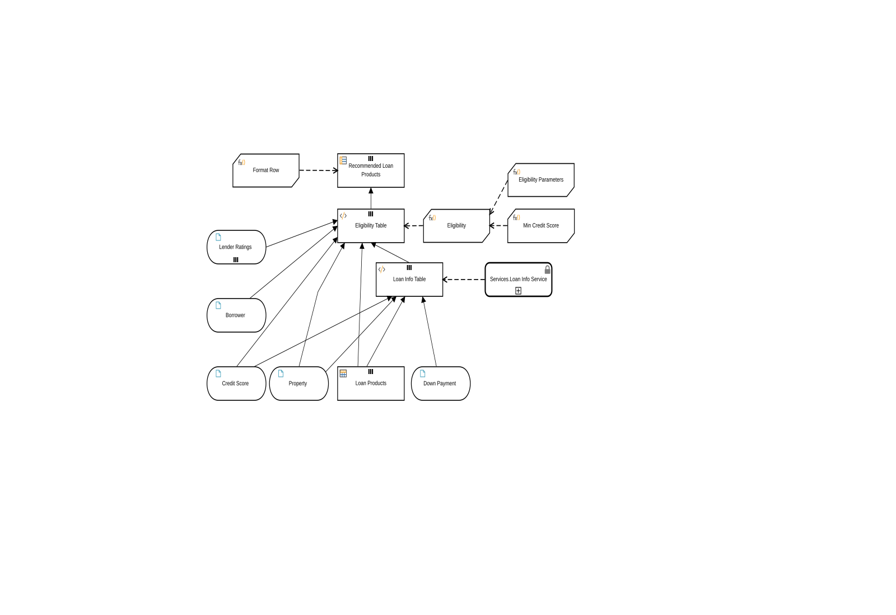

The input data elements include:

- **Credit Score**, a number from 300 to 850 inclusive

- **Down Payment**, a number

- **Property**, a structure of type *tProperty* ([Type tProperty (non-normative representation)](#table-type-tproperty-non-normative-representation))

- **Borrower**, a structure of type *tBorrower* ([Type tBorrower](#table-type-tborrower)), and

- **Lender Ratings,** a structure of type *tLenderRatings* ([Type tLenderRatings, a collection of tLenderRating](#table-type-tlenderratings-a-collection-of-tlenderrating))

The boxed expression format for the datatype definitions in [Type tProperty (non-normative representation)](#table-type-tproperty-non-normative-representation), [Type tBorrower](#table-type-tborrower), and [Type tLenderRatings, a collection of tLenderRating](#table-type-tlenderratings-a-collection-of-tlenderrating) is non-normative. [Type tProperty (non-normative representation)](#table-type-tproperty-non-normative-representation), for example, is a visualization of the XML representation of [Type tProperty (XML representation)](#example-2-ranked-loan-products).

###### Table: Type tProperty (non-normative representation)

<table class="dmn-boxed-expression">
<tbody>
<tr><td rowspan="9">tProperty</td><td rowspan="5">1</td><td rowspan="5">Address</td><td>1</td><td>Street</td><td>Text</td></tr>
<tr><td>2</td><td>Unit</td><td>Text</td></tr>
<tr><td>3</td><td>City</td><td>Text</td></tr>
<tr><td>4</td><td>State</td><td>Text</td></tr>
<tr><td>5</td><td>ZIP</td><td>Text</td></tr>
<tr><td>2</td><td>Purchase Price</td><td colspan="3">Number</td></tr>
<tr><td>3</td><td>Monthly Tax Payment</td><td colspan="3">Number</td></tr>
<tr><td>4</td><td>Monthly Insurance Payment</td><td colspan="3">Number</td></tr>
<tr><td>5</td><td>Monthly HOA Condo Fee</td><td colspan="3">Number</td></tr>
</tbody>
</table>

**Type tProperty (XML representation)**

```xml
<semantic:itemDefinition name="tProperty" label="tProperty">
  <semantic:itemComponent id="_5e820b14-1f14-44e2-bee1-a35fbedc477f" name="Address">
    <semantic:itemComponent id="_d40919e3-168d-46dc-a7da-ccefeead8a49" name="Street">
      <semantic:typeRef>string</semantic:typeRef>
    </semantic:itemComponent>
    <semantic:itemComponent id="_a03ae467-fb6a-46f0-ab1a-dc0992d81095" name="Unit">
      <semantic:typeRef>string</semantic:typeRef>
    </semantic:itemComponent>
    <semantic:itemComponent id="_f902cd87-2c95-4b90-95cf-a2c6b1b87a1e" name="City">
      <semantic:typeRef>string</semantic:typeRef>
    </semantic:itemComponent>
    <semantic:itemComponent id="_97f12b0d-be5c-4d42-abb5-d565599fee87" name="State">
      <semantic:typeRef>string</semantic:typeRef>
    </semantic:itemComponent>
    <semantic:itemComponent id="_2fdc92bc-55da-4ff7-8a9d-c5213b69a0a8" name="ZIP">
      <semantic:typeRef>string</semantic:typeRef>
    </semantic:itemComponent>
  </semantic:itemComponent>
  <semantic:itemComponent id="_cc0e8c3f-ae44-4080-88db-555d8a2f8560" name="Purchase Price">
    <semantic:typeRef>number</semantic:typeRef>
  </semantic:itemComponent>
  <semantic:itemComponent id="_ce17ee0b-f1e1-43cf-8a5e-4a18390fc6d6" name="Monthly Tax Payment">
    <semantic:typeRef>number</semantic:typeRef>
  </semantic:itemComponent>
  <semantic:itemComponent id="_338c3f84-8ff7-404d-9b61-d211a5cebe4b" name="Monthly Insurance Payment">
    <semantic:typeRef>number</semantic:typeRef>
  </semantic:itemComponent>
  <semantic:itemComponent id="_fe427d63-1cf3-4d2d-b268-f7e01dccad59" name="Monthly HOA Condo Fee">
    <semantic:typeRef>number</semantic:typeRef>
  </semantic:itemComponent>
</semantic:itemDefinition>
```

###### Table: Type tBorrower

<table class="dmn-boxed-expression">
<tbody>
<tr><td rowspan="12">tBorrower</td><td>1</td><td>Full Name</td><td colspan="3">Text</td></tr>
<tr><td>2</td><td>Tax ID</td><td colspan="3">Text</td></tr>
<tr><td>3</td><td>Employment Income</td><td colspan="3">Number</td></tr>
<tr><td>4</td><td>Other Income</td><td colspan="3">Number</td></tr>
<tr><td rowspan="3">5</td><td rowspan="3">Assets<br><em>tAssets</em><br><em>tAsset</em></td><td>1</td><td>Type</td><td>tAssetType<br><em>Text</em><br><em>"Checking Savings Brokerage account", "Real Estate", "Other Liquid", "Other Non-Liquid"</em></td></tr>
<tr><td>2</td><td>Institution Account or Description</td><td>Text</td></tr>
<tr><td>3</td><td>Value</td><td>Number</td></tr>
<tr><td rowspan="5">6</td><td rowspan="5">Liabilities<br><em>tLiabilities</em><br><em>tLiability</em></td><td>1</td><td>Type</td><td>tLiabilityType<br><em>Text</em><br><em>"Credit card", "Auto loan", "Student loan", "Lease", "Lien", "Real estate loan", "Alimony child support", "Other"</em></td></tr>
<tr><td>2</td><td>Payee</td><td>Text</td></tr>
<tr><td>3</td><td>Monthly payment</td><td>Number</td></tr>
<tr><td>4</td><td>Balance</td><td>Number</td></tr>
<tr><td>5</td><td>To be paid off</td><td>Boolean</td></tr>
</tbody>
</table>

###### Table: Type tLenderRatings, a collection of tLenderRating

<table class="dmn-boxed-expression">
<tbody>
<tr><td rowspan="2">tLenderRatings<br><strong>|||</strong><br><em>tLenderRating</em></td><td>1</td><td>Lender Name</td><td>Text</td></tr>
<tr><td>2</td><td>Customer Rating</td><td>Number<br><em>[1..5]</em></td></tr>
</tbody>
</table>

In addition, the zero-input decision Loan Products, a structure of type tLoanProducts, is a relation ([Loan Products](#table-loan-products)). Cells in a relation are FEEL expressions but often contain literal values as a way to embed static data tables inside a decision model. In this case it represents a list of mortgage loan products available from various lenders, specifying the best interest rate offered to lowest risk borrowers and loan origination costs specified as “points”, a percentage of the loan amount, and “fees”, a constant value.

###### Table: Loan Products

<table class="dmn-boxed-expression">
<thead><tr><th class="gap"></th><th class="name">Lender Name</th><th class="name">Product Name</th><th class="name">Type</th><th class="name">Best Rate Pct</th><th class="name">Points Pct</th><th class="name">Fees Amount</th><th class="name">Term</th></tr></thead>
<tbody>
<tr><td class="gap"></td><td><em>Text</em></td><td><em>tProductName<br>"Fixed30-NoPoints", "Fixed30-Standard", "Fixed15-NoPoints", "Fixed15-Standard", "ARM5/1-NoPoints", "ARM5/1-Standard"</em></td><td><em>tAmortizationType<br>"Fixed rate", "Variable rate"</em></td><td><em>tPercent</em></td><td><em>tPercent</em></td><td><em>Number</em></td><td><em>Number</em></td></tr>
<tr><td>1</td><td>"Lender A"</td><td>"Fixed30-NoPoints"</td><td>"Fixed rate"</td><td>3.95</td><td>0</td><td>1925</td><td>360</td></tr>
<tr><td>2</td><td>"Lender C"</td><td>"Fixed30-Standard"</td><td>"Fixed rate"</td><td>3.75</td><td>0.972</td><td>1975</td><td>360</td></tr>
<tr><td>3</td><td>"Lender A"</td><td>"Fixed15-NoPoints"</td><td>"Fixed rate"</td><td>3.625</td><td>0</td><td>816</td><td>180</td></tr>
<tr><td>4</td><td>"Lender C"</td><td>"Fixed15-Standard"</td><td>"Fixed rate"</td><td>3.25</td><td>0.767</td><td>1975</td><td>180</td></tr>
<tr><td>5</td><td>"Lender B"</td><td>"ARM5/1-NoPoints"</td><td>"Variable rate"</td><td>3.875</td><td>0</td><td>1776</td><td>360</td></tr>
<tr><td>6</td><td>"Lender B"</td><td>"ARM5/1-Standard"</td><td>"Variable rate"</td><td>3.625</td><td>0.667</td><td>1975</td><td>360</td></tr>
</tbody>
</table>

###### Table: Type tLoanProducts, a collection of tLoanProduct

<table class="dmn-boxed-expression">
<tbody>
<tr><td rowspan="7">tLoanProducts<br><strong>|||</strong><br><em>tLoanProduct</em></td><td>1</td><td>Lender Name</td><td>Text</td></tr>
<tr><td>2</td><td>Product Name</td><td>tProductName<br><em>Text</em><br><em>"Fixed30-NoPoints", "Fixed30-Standard", "Fixed15-NoPoints", "Fixed15-Standard", "ARM5/1-NoPoints", "ARM5/1-Standard"</em></td></tr>
<tr><td>3</td><td>Type</td><td>tAmortizationType<br><em>Text</em><br><em>"Fixed rate", "Variable rate"</em></td></tr>
<tr><td>4</td><td>Best Rate Pct</td><td>tPercent<br><em>Number</em></td></tr>
<tr><td>5</td><td>Points Pct</td><td>tPercent<br><em>Number</em></td></tr>
<tr><td>6</td><td>Fees Amount</td><td>Number</td></tr>
<tr><td>7</td><td>Term</td><td>Number</td></tr>
</tbody>
</table>

The **Recommended Loan Products** model imports another decision model **Loan Info**, with the DRD shown in [DRD of imported Loan Info Service](Images/drd-of-imported-loan-info-service.svg), defining a decision service **Loan Info Service**. Imported models are assigned a modeler-chosen prefix, here *Services*, to distinguish its namespace from that of the importing model. In the importing DRD ([DRD for Recommended Loan Products](Images/drd-for-recommended-loan-products.svg)), the imported service **Services.Loan Info Service** is depicted with the non-normative lock icon, indicating that its logic may not be edited within the importing model. The service parameters are the input data shown in [DRD of imported Loan Info Service](Images/drd-of-imported-loan-info-service.svg): **Credit Score, Property, Loan Product,** and **Down Payment**, with types identical to those defined in the importing model.

**Services**.**Loan Info Service** populates a row of the decision **Loan Info Table**, a collection of type **tLoanInfoRow** ([Loan Products](#table-loan-products)), calculating the details of the selected loan product for the given property value (purchase price) and down payment.

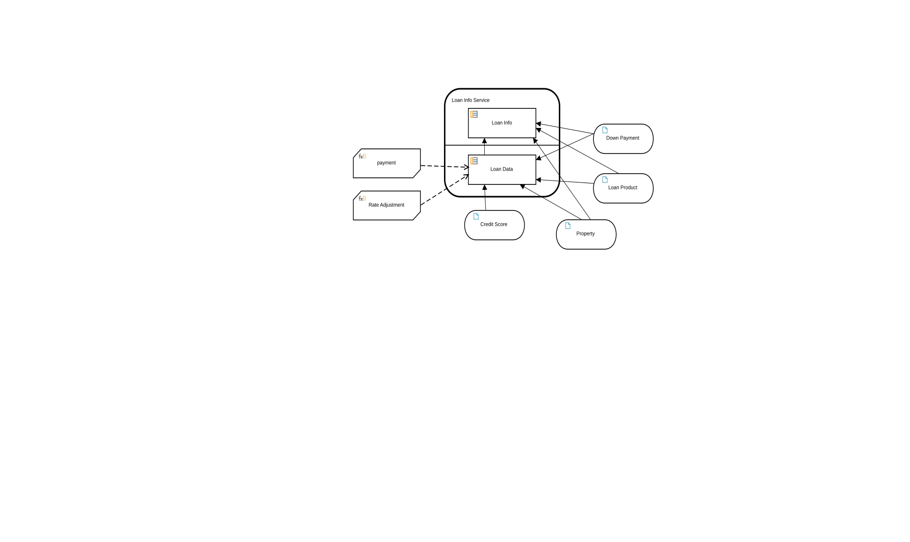

###### Table: Type tLoanInfoTable, a collection of tLoanInfoRow

<table class="dmn-boxed-expression">
<tbody>
<tr><td rowspan="14">tLoanInfoTable<br><strong>|||</strong><br><em>tLoanInfoRow</em></td><td>1</td><td>Product</td><td>tProductName<br><em>Text</em><br><em>"Fixed30-NoPoints", "Fixed30-Standard", "Fixed15-NoPoints", "Fixed15-Standard", "ARM5/1-NoPoints", "ARM5/1-Standard"</em></td></tr>
<tr><td>2</td><td>Amortization Type</td><td>tAmortizationType<br><em>Text</em><br><em>"Fixed rate", "Variable rate"</em></td></tr>
<tr><td>3</td><td>LTV</td><td>tPercent<br><em>Number</em></td></tr>
<tr><td>4</td><td>Note Amount</td><td>Number</td></tr>
<tr><td>5</td><td>Initial Rate Pct</td><td>tPercent<br><em>Number</em></td></tr>
<tr><td>6</td><td>Qualifying Rate Pct</td><td>tPercent<br><em>Number</em></td></tr>
<tr><td>7</td><td>Initial Monthly Payment</td><td>Number</td></tr>
<tr><td>8</td><td>Qualifying Monthly Payment</td><td>Number</td></tr>
<tr><td>9</td><td>Points Amount</td><td>Number</td></tr>
<tr><td>10</td><td>Fees Amount</td><td>Number</td></tr>
<tr><td>11</td><td>Funds Toward Purchase</td><td>Number</td></tr>
<tr><td>12</td><td>Down Payment</td><td>Number</td></tr>
<tr><td>13</td><td>Closing Costs</td><td>Number</td></tr>
<tr><td>14</td><td>Cash to Close</td><td>Number</td></tr>
</tbody>
</table>

###### Table: Loan Data

<table class="dmn-boxed-expression">
<thead><tr><th colspan="3">Loan Data<br><em>tLoanData</em></th></tr></thead>
<tbody>
<tr><td>1</td><td class="name">Points Amount<br><em>Number</em></td><td>decimal((Property.Purchase Price - Down Payment)*Loan Product.Points Pct/100,2)</td></tr>
<tr><td>2</td><td class="name">Note Amount<br><em>Number</em></td><td>Property.Purchase Price - Down Payment + Loan Product.Fees Amount + Points Amount</td></tr>
<tr><td>3</td><td class="name">LTV<br><em>tPercent</em></td><td>decimal(100*Note Amount/Property.Purchase Price,2)</td></tr>
<tr><td>4</td><td class="name">Closing Costs<br><em>Number</em></td><td>decimal(0.02*Note Amount,2)</td></tr>
<tr><td>5</td><td class="name">Funds Toward Purchase<br><em>Number</em></td><td>Note Amount - Loan Product.Fees Amount - Points Amount - Closing Costs</td></tr>
<tr><td>6</td><td class="name">Interest Rate Percent<br><em>tPercent</em></td><td>Loan Product.Best Rate Pct + Rate Adjustment(Credit Score, LTV)</td></tr>
<tr><td>7</td><td class="name">Qualifying Rate Percent<br><em>tPercent</em></td><td>if Loan Product.Type="Variable rate" then Interest Rate Percent+2 else Interest Rate Percent</td></tr>
<tr><td>8</td><td class="name">Monthly Payment<br><em>Number</em></td><td><table class="dmn-boxed-expression"><tbody><tr><td colspan="3">payment</td></tr><tr><td>1</td><td class="name">p<br><em>Number</em></td><td>Note Amount</td></tr><tr><td>2</td><td class="name">r<br><em>Number</em></td><td>Interest Rate Percent/100</td></tr><tr><td>3</td><td class="name">n<br><em>Number</em></td><td>Loan Product.Term</td></tr></tbody></table></td></tr>
<tr><td>9</td><td class="name">Qualifying Payment<br><em>Number</em></td><td><table class="dmn-boxed-expression"><tbody><tr><td colspan="3">payment</td></tr><tr><td>1</td><td class="name">p<br><em>Number</em></td><td>Note Amount</td></tr><tr><td>2</td><td class="name">r<br><em>Number</em></td><td>Qualifying Rate Percent/100</td></tr><tr><td>3</td><td class="name">n<br><em>Number</em></td><td>Loan Product.Term</td></tr></tbody></table></td></tr>
<tr><td colspan="3">Result</td></tr>
</tbody>
</table>

Within the service, **Loan Data** performs calculations used in the presentation decision, **Loan Info**. It is modeled as a context with no final result box, meaning every context entry creates a component of the result. (The text “Result” in the final result box is a tool artifact not in the spec, overwritten by a literal expression if the context has a final result box value.) A few things to note about the logic shown in [Loan Data](#table-loan-data):

- FEEL arithmetic can create values with many digits following the decimal point. The function `decimal(x, 2)` rounds value x to 2 decimal places.

- Context entry Interest Rate Percent invokes the BKM **Rate Adjustment** ([BKM Rate Adjustment](#table-bkm-rate-adjustment)), a function of the borrower’s **Credit Score** and the loan-to-value ratio **LTV**. This increments the Loan Product’s interest rate by a small amount based on the loan risk.

- **Credit Score** values less than 620 are ineligible for a loan. In that case, **Rate Adjustment** could return null, but then all expressions using **Rate Adjustment** would also be null, complicating the logic. To simplify the downstream logic, it is better in this case to return a number, since ultimately the loan will not be approved if the **Credit Score** is less than 620.

- For loans with variable interest rate, the debt-to-income ratio uses a *Qualifying Payment* amount based on an interest rate 2 percent higher than the rate used in the initial *Monthly Payment*.

- *Monthly Payment* and *Qualifying Payment* are modeled as boxed invocations of the BKM **payment**, the amortization formula ([BKM payment](#table-bkm-payment)). The parameters of payment are the loan amount *p*, the interest rate *r*, and the term in months, *n*.

The decision **Loan Info** ([Loan Info](#table-loan-info)), the output of **Services.Loan Info**, returns a row of **Loan Info Table**. It is also modeled as a context with no final result box, meaning each context entry represents a column of **Loan Info Table.**

###### Table: BKM Rate Adjustment

<table class="dmn-decision-table">
<colgroup><col class="hit-policy"><col class="input"><col class="input"><col class="output"></colgroup>
<thead>
<tr><th colspan="4">Rate Adjustment<br><em>tPercent</em></th></tr>
<tr><th></th><th colspan="2">inputs</th><th>outputs</th></tr>
<tr><th rowspan="2">U</th><th>Credit Score</th><th>LTV</th><th>Rate Adjustment</th></tr>
<tr><td class="values"><em>tCreditScore<br>[300..850]</em></td><td class="values"><em>tPercent</em></td><td class="values"><em>tPercent</em></td></tr>
</thead>
<tbody>
<tr><td>1</td><td>&gt;=660</td><td>&lt;=60</td><td>0</td></tr>
<tr><td>2</td><td>[620..660)</td><td>&lt;=60</td><td>0.125</td></tr>
<tr><td>3</td><td>&gt;=700</td><td>&gt;60</td><td>0.125</td></tr>
<tr><td>4</td><td>[660..700)</td><td>(60..70]</td><td>0.125</td></tr>
<tr><td>5</td><td>[620..660)</td><td>(60..70]</td><td>0.25</td></tr>
<tr><td>6</td><td>[680..700)</td><td>&gt;70</td><td>0.25</td></tr>
<tr><td>7</td><td>[640..680)</td><td>&gt;70</td><td>0.375</td></tr>
<tr><td>8</td><td>[620..640)</td><td>(70..80]</td><td>0.375</td></tr>
<tr><td>9</td><td>[620..640)</td><td>&gt;80</td><td>0.5</td></tr>
<tr><td>10</td><td>&lt;620</td><td>-</td><td>0.5</td></tr>
</tbody>
</table>

###### Table: BKM payment

<table class="dmn-boxed-expression">
<thead><tr><th colspan="2">payment<br><em>Number</em></th></tr></thead>
<tbody>
<tr><td><strong>F</strong></td><td>(p <em>Number</em>, r <em>Number</em>, n <em>Number</em>)</td></tr>
<tr><td colspan="2">decimal(p*r/12/(1-(1+r/12)**-n),2)</td></tr>
</tbody>
</table>

###### Table: Loan Info

<table class="dmn-boxed-expression">
<thead><tr><th colspan="3">Loan Info<br><em>tLoanInfo</em></th></tr></thead>
<tbody>
<tr><td>1</td><td class="name">Product<br><em>tProductName</em><br><em>"Fixed30-NoPoints", "Fixed30-Standard", "Fixed15-NoPoints", "Fixed15-Standard", "ARM5/1-NoPoints", "ARM5/1-Standard"</em></td><td>Loan Product.Name</td></tr>
<tr><td>2</td><td class="name">Amortization Type<br><em>tAmortizationType</em><br><em>"Fixed rate", "Variable rate"</em></td><td>Loan Product.Type</td></tr>
<tr><td>3</td><td class="name">LTV<br><em>tPercent</em></td><td>Loan Data.LTV</td></tr>
<tr><td>4</td><td class="name">Note Amount<br><em>Number</em></td><td>Loan Data.Note Amount</td></tr>
<tr><td>5</td><td class="name">Initial Rate Pct<br><em>tPercent</em></td><td>Loan Data.Interest Rate Percent</td></tr>
<tr><td>6</td><td class="name">Qualifying Rate Pct<br><em>tPercent</em></td><td>Loan Data.Qualifying Rate Percent</td></tr>
<tr><td>7</td><td class="name">Initial Monthly Payment<br><em>Number</em></td><td>Loan Data.Monthly Payment</td></tr>
<tr><td>8</td><td class="name">Qualifying Monthly Payment<br><em>Number</em></td><td>Loan Data.Qualifying Payment</td></tr>
<tr><td>9</td><td class="name">Points Amount<br><em>Number</em></td><td>Loan Data.Points Amount</td></tr>
<tr><td>10</td><td class="name">Fees Amount<br><em>Number</em></td><td>Loan Product.Fees Amount</td></tr>
<tr><td>11</td><td class="name">Funds Toward Purchase<br><em>Number</em></td><td>Loan Data.Funds Toward Purchase</td></tr>
<tr><td>12</td><td class="name">Down Payment<br><em>Number</em></td><td>Down Payment</td></tr>
<tr><td>13</td><td class="name">Closing Costs<br><em>Number</em></td><td>Loan Data.Closing Costs</td></tr>
<tr><td>14</td><td class="name">Cash to Close<br><em>Number</em></td><td>Property.Purchase Price - Funds Toward Purchase</td></tr>
<tr><td colspan="3">Result</td></tr>
</tbody>
</table>

In the importing model, the decision **Loan Info Table** ([Loan Info Table](#table-loan-info-table)) iterates invocation of **Loan Info** over rows of **Loan Products.** It is modeled as a literal expression using the FEEL `for..in..return` operator. Here *x* is a range variable meaning one item in a list – one **Loan Product** in **Loan Products** – producing an argument of the function call.

###### Table: Loan Info Table

<table class="dmn-boxed-expression">
<thead><tr><th colspan="1">Loan Info Table<br><em>tLoanInfoTable</em></th></tr></thead>
<tbody>
<tr><td>for x in Loan Products return Services.Loan Info(x,Down Payment,Property,Credit Score)</td></tr>
</tbody>
</table>

**Loan Info Table** now provides values for each **Loan Product** used to determine whether the Borrower’s income, assets, liabilities, and credit score qualify for loan approval.

At the heart of the logic for determining eligibility for a particular loan is the BKM **Min Credit Score** ([Min Credit Score](#table-min-credit-score)), a decision table that calculates the minimum credit score required based on three parameters: *DTI*, the borrower’s debt-toincome ratio; *LTV,* the loan-to-value ratio; and *Reserves*, a measure of the Borrower’s liquid assets after closing in units of monthly *Housing Costs*. The table is modeled as hit policy *Collect* with aggregation *Minimum*, meaning when multiple rules match the lowest value output is returned. When *DTI* is greater than 95%, the loan is automatically ineligible. In that case, no rule matches and **Min Credit Score** returns the value null. Downstream logic referencing this variable must account for the possibility of null value.

###### Table: Min Credit Score

<table class="dmn-decision-table">
<colgroup><col class="hit-policy"><col class="input"><col class="input"><col class="input"><col class="output"></colgroup>
<thead>
<tr><th colspan="5">Min Credit Score<br><em>tCreditScore<br>[300..850]</em></th></tr>
<tr><th></th><th colspan="3">inputs</th><th>outputs</th></tr>
<tr><th rowspan="2">C&lt;</th><th>DTI</th><th>LTV</th><th>Reserves</th><th>Min Credit Score</th></tr>
<tr><td class="values"><em>tPercent</em></td><td class="values"><em>tPercent</em></td><td class="values"><em>Number</em></td><td class="values"><em>tCreditScore<br>[300..850]</em></td></tr>
</thead>
<tbody>
<tr><td>1</td><td>&lt;=36</td><td>&lt;=75</td><td>&gt;2</td><td>620</td></tr>
<tr><td>2</td><td>&lt;=36</td><td>&lt;=75</td><td>&gt;0</td><td>640</td></tr>
<tr><td>3</td><td>&lt;=36</td><td>(75..95]</td><td>&gt;6</td><td>660</td></tr>
<tr><td>4</td><td>&lt;=36</td><td>(75..95]</td><td>&gt;0</td><td>680</td></tr>
<tr><td>5</td><td>(36..45]</td><td>&lt;=75</td><td>&gt;6</td><td>660</td></tr>
<tr><td>6</td><td>(36..45]</td><td>&lt;=75</td><td>&gt;0</td><td>680</td></tr>
<tr><td>7</td><td>(36..45]</td><td>(75..95]</td><td>&gt;6</td><td>700</td></tr>
<tr><td>8</td><td>(36..45]</td><td>(75..95]</td><td>&gt;0</td><td>720</td></tr>
</tbody>
</table>

**Min Credit Score** is called by the BKM **Eligibility,** which in turn calls the BKM **Eligibility Parameters** ([Eligibility Parameters](#table-eligibility-parameters)). **Eligibility Parameters** calculates the two key parameters of **Min Credit Score**, the debt-to-income ratio *DTI Pct*, and the liquid assets after closing, called *Reserves*. Note that context entry *Housing Expense*, which sums the loan payment, tax and insurance payments, and homeowner association/condo fee, must account for the possibility that the latter is left blank, i.e., null, in the input data **Property**, since adding null to a number gives null. To prevent this, instead of the `+` operator we use the `sum()` function on a list filtered by the condition `item != null`. We use this technique also on context entry *Income*.

###### Table: Eligibility Parameters

<table class="dmn-boxed-expression">
<thead><tr><th colspan="3">Eligibility Parameters<br><em>tEligibilityParameters</em></th></tr></thead>
<tbody>
<tr><td><strong>F</strong></td><td colspan="2">(Loan Product <em>tLoanProduct</em>, Borrower <em>tBorrower</em>, Loan Info <em>tLoanInfoRow</em>,<br>Property <em>tProperty</em>, Credit Score <em>tCreditScore [300..850]</em>)</td></tr>
<tr><td>1</td><td class="name">Housing Expense<br><em>Number</em></td><td>sum([Loan Info.Qualifying Monthly Payment, Property.Monthly Tax Payment, Property.Monthly Insurance Payment, Property.Monthly HOA Condo Fee][item != null])</td></tr>
<tr><td>2</td><td class="name">Non-Housing Debt Payments<br><em>Number</em></td><td>sum(Borrower.Liabilities[Type!="Real estate loan" and To be paid off =false].Monthly payment)</td></tr>
<tr><td>3</td><td class="name">Income<br><em>Number</em></td><td>sum([Borrower.Employment Income, Borrower.Other Income][item != null])</td></tr>
<tr><td>4</td><td class="name">DTI Pct<br><em>tPercent</em></td><td>decimal((Housing Expense+Non-Housing Debt Payments)/Income*100,2)</td></tr>
<tr><td>5</td><td class="name">Liquid Assets Before Closing<br><em>Number</em></td><td>sum(Borrower.Assets[Type="Checking Savings Brokerage account"<br>or Type="Other Liquid"].Value)</td></tr>
<tr><td>6</td><td class="name">Debts Paid Off By Closing<br><em>Number</em></td><td>sum(Borrower.Liabilities[Type!="Real estate loan"<br>and To be paid off=true].Balance[item!=null])</td></tr>
<tr><td>7</td><td class="name">Liquid Assets After Closing<br><em>Number</em></td><td>Liquid Assets Before Closing - Debts Paid Off By Closing - Loan Info.Cash to Close</td></tr>
<tr><td>8</td><td class="name">Reserves<br><em>Number</em></td><td>decimal(Liquid Assets After Closing/Housing Expense,2)</td></tr>
<tr><td colspan="3">Result</td></tr>
</tbody>
</table>

For legibility, the BKM **Eligibility** is shown in two pieces ([Eligibility (top)](#table-eligibility-top) and [Eligibility (bottom)](#table-eligibility-bottom)). This BKM creates a row of type *tTableRow* for the decision **Eligibility Table**. It is modeled as a context, where the first four context entries ([Eligibility (bottom)](#table-eligibility-bottom)) call BKMs to determine values to populate the *Table Row* components.

- *Params* calls the BKM **Eligibility Parameters** for a given **Loan Product**.

- *Required Credit Score* uses Params to call the BKM **Min Credit Score**, returning the minimum credit score required by that **Loan Product** for the Borrower to be eligible.

- *Eligible* is a Boolean comparing the Borrower’s credit score to **Min Credit Score.** *Recommendation* uses the input data **Lender Ratings** in combination with **Eligible** to return a recommendation value for the **Loan Product**. *Recommendation* illustrates an alternative decision table syntax introduced in DMN 1.2 called generalized unary test. With generalized unary tests, a decision table input entry may be any FEEL expression, substituting `?` for the input expression. For example, in the first column of this decision table the rules filter the **Lender Ratings** table for an item with *Lender Name* matching that of the **Loan Product** and *Customer Rating* in a specified range, returning true if that filter returns any values.

###### Table: Eligibility (top)

<table class="dmn-boxed-expression">
<thead><tr><th colspan="6">Eligibility</th></tr></thead>
<tbody>
<tr><td><strong>F</strong></td><td colspan="5">(Loan Product <em>tLoanProduct</em>, Borrower <em>tBorrower</em>, Loan Info <em>tLoanInfoRow</em>,<br>Property <em>tProperty</em>, Credit Score <em>tCreditScore [300..850]</em>, Ratings <em>tLenderRatings</em>)</td></tr>
<tr><td>1</td><td class="name">Params<br><em>tEligibilityParameters</em></td><td colspan="4">Eligibility Parameters(Loan Product, Borrower, Loan Info,<br>Property, Credit Score)</td></tr>
<tr><td>2</td><td class="name">Required Credit Score<br><em>tCreditScore<br>[300..850]</em></td><td colspan="4">Min Credit Score(Params.DTI Pct, Loan Info.LTV, Params.Reserves)</td></tr>
<tr><td>3</td><td class="name">Eligible<br><em>Boolean</em></td><td colspan="4">if Required Credit Score != null then<br>Credit Score &gt;= Required Credit Score else false</td></tr>
<tr><td rowspan="7">4</td><td class="name" rowspan="7">Recommendation<br><em>tRecommendation</em><br><em>"Best", "Good", "Not Recommended", "Ineligible"</em></td><td class="gap"></td><td colspan="2">inputs</td><td>outputs</td></tr>
<tr><td rowspan="2">P</td><td class="input">Loan Product</td><td class="input">Eligible</td><td class="output">Recommendation</td></tr>
<tr><td><em>tLoanProduct</em></td><td><em>Boolean</em></td><td><em>tRecommendation<br>"Best", "Good", "Not Recommended", "Ineligible"</em></td></tr>
<tr><td>1</td><td>count(Ratings[Lender Name=?.Lender Name and Customer Rating &gt; 4] )&gt;0</td><td>true</td><td>"Best"</td></tr>
<tr><td>2</td><td>count(Ratings[Lender Name=?.Lender Name and Customer Rating in [3..4]] )&gt;0</td><td>true</td><td>"Good"</td></tr>
<tr><td>3</td><td>count(Ratings[Lender Name=?.Lender Name and Customer Rating &lt;3] )&gt;0</td><td>true</td><td>"Not Recommended"</td></tr>
<tr><td>4</td><td>-</td><td>-</td><td>"Ineligible"</td></tr>
</tbody>
</table>

The rest of **Eligibility** is shown in [Eligibility (bottom)](#table-eligibility-bottom).

- *Table Row* is a nested context with no final result box value. Each context entry represents a column in the row.

- The DMN spec allows the final result box to be a context, but in this example, we use a context entry to create the result value and return it in the result box. Here context entry *Table Row* creates the row structure, and the final result box simply selects this context entry.

###### Table: Eligibility (bottom)

<table class="dmn-boxed-expression">
<tbody>
<tr><td rowspan="12">5</td><td class="name" rowspan="12">Table Row<br><em>tTableRow</em></td><td>1</td><td class="name">Product<br><em>Text</em></td><td>Loan Product.Lender Name + " - " + Loan Product.Product Name</td></tr>
<tr><td>2</td><td class="name">Note Amount<br><em>Number</em></td><td>Loan Info.Note Amount</td></tr>
<tr><td>3</td><td class="name">Interest Rate Pct<br><em>tPercent</em></td><td>Loan Info.Initial Rate Pct</td></tr>
<tr><td>4</td><td class="name">Monthly Payment<br><em>Number</em></td><td>Loan Info.Initial Monthly Payment</td></tr>
<tr><td>5</td><td class="name">LTV<br><em>tPercent</em></td><td>Loan Info.LTV</td></tr>
<tr><td>6</td><td class="name">DTI<br><em>tPercent</em></td><td>Params.DTI Pct</td></tr>
<tr><td>7</td><td class="name">Cash to Close<br><em>Number</em></td><td>Loan Info.Cash to Close</td></tr>
<tr><td>8</td><td class="name">Liquid Assets After Closing<br><em>Number</em></td><td>Params.Liquid Assets After Closing</td></tr>
<tr><td>9</td><td class="name">Reserves<br><em>Number</em></td><td>Params.Reserves</td></tr>
<tr><td>10</td><td class="name">Required Credit Score<br><em>tCreditScore<br>[300..850]</em></td><td>Required Credit Score</td></tr>
<tr><td>11</td><td class="name">Recommendation<br><em>tRecommendation<br>"Best", "Good", "Not Recommended", "Ineligible"</em></td><td>Recommendation</td></tr>
<tr><td colspan="3">Result</td></tr>
<tr><td colspan="5">Table Row</td></tr>
</tbody>
</table>

The decision **Eligibility Table** ([Eligibility Table](#table-eligibility-table)) uses an alternative form of the `for..in..return` operator to iterate over an index rather than iterate over list item values. This alterative format allows the returned expression to involve corresponding items in multiple lists, in this case **Loan Products** and **Loan Info Table**.

###### Table: Eligibility Table

<table class="dmn-boxed-expression">
<thead><tr><th colspan="1">Eligibility Table<br><em>tEligibilityTable</em></th></tr></thead>
<tbody>
<tr><td>for i in 1..count(Loan Products) return Eligibility(Loan Products[i], Borrower, Loan Info Table[i], Property, Credit Score)</td></tr>
</tbody>
</table>

The top-level decision **Recommended Loan Products** ([Recommended Loan Products](#table-recommended-loan-products)) first sorts **Eligibility Table** based on *Recommendation* and *Monthly Payment* and then calls a Java method to format number values as strings for final presentation.

###### Table: Recommended Loan Products

<table class="dmn-boxed-expression">
<thead><tr><th colspan="4">Recommended Loan Products<br><em>tRecommendedTable</em></th></tr></thead>
<tbody>
<tr><td rowspan="2">1</td><td class="name" rowspan="2">precedes<br><em>Boolean</em></td><td><strong>F</strong></td><td>(x <em>tTableRow</em>, y <em>tTableRow</em>)</td></tr>
<tr><td colspan="2">if x.Recommendation != "Ineligible" and y.Recommendation != "Ineligible"<br>then x.Monthly Payment&lt;y.Monthly Payment<br>else if x.Recommendation != "Ineligible" and y.Recommendation = "Ineligible"<br>then true else false</td></tr>
<tr><td>2</td><td class="name">Sorted Table<br><em>tEligibilityTable</em></td><td colspan="2">sort(Eligibility Table, precedes)</td></tr>
<tr><td colspan="4">for row in Sorted Table return Format Row(row)</td></tr>
</tbody>
</table>

- The first context entry *precedes* is a function definition used by the FEEL `sort()` function. The second parameter of `sort()`, called the *precedes function*, is a Boolean function with two arguments representing list items. It returns true if the first argument precedes the second in the sorted list.

- The context entry *Sorted Table* performs the sort. With simple sort criteria, the precedes function is typically defined inline as an anonymous function using the keyword `function`, as in `sort(myTable, function(x, y) x.Amount < y.Amount)`
>
> which sorts the rows of *myTable* in ascending order of the column *Amount*. However, in **Recommended Loan Products** we instead use a named precedes function, the context entry *precedes*. In that case, the name of the function provides the second argument of `sort()`.

- The final result box iterates a call to the BKM **Format Row**, which executes a static Java method to format number values in *Sorted Table* as strings with a currency symbol and two digits following the decimal point.

**Format Row** ([Format Row](#table-format-row)) operates on a single row of *Sorted Table*. It is modeled as a context.

- The first context entry *string format* is a Java function definition, indicated by the code J. DMN specifies such a function definition as a context with two context entries, *class,* and *method signature*. This example applies a mask string to a number, returning a formatted number string.

- The second context entry *formatted row* generates a row of **Recommended Loan Products** in final presentation format, calling *string format* to format amount and percent values.

- The final result box returns *formatted row*.

###### Table: Format Row

<table class="dmn-boxed-expression">
<thead><tr><th colspan="5">Format Row<br><em>tformattedrow_1</em></th></tr></thead>
<tbody>
<tr><td><strong>F</strong></td><td colspan="4">(row <em>tTableRow</em>)</td></tr>
<tr><td rowspan="3">1</td><td class="name" rowspan="3">string format<br><em>Text</em></td><td><strong>J</strong></td><td colspan="2">(mask <em>Text</em>, value <em>Number</em>)</td></tr>
<tr><td class="name" colspan="2">class</td><td>"java.lang.String"</td></tr>
<tr><td class="name" colspan="2">method signature</td><td>"format( java.lang.String, [Ljava.lang.Object; )"</td></tr>
<tr><td rowspan="8">2</td><td class="name" rowspan="8">formatted row<br><em>tformattedrow_1</em></td><td>1</td><td class="name">Product<br><em>Text</em></td><td>row.Product</td></tr>
<tr><td>2</td><td class="name">Note Amount<br><em>Text</em></td><td>string format("$%,4.2f", row.Note Amount)</td></tr>
<tr><td>3</td><td class="name">Interest Rate Pct<br><em>Text</em></td><td>string format(" %,4.2f", row.Interest Rate Pct)</td></tr>
<tr><td>4</td><td class="name">Monthly Payment<br><em>Text</em></td><td>string format("$%,4.2f", row.Monthly Payment)</td></tr>
<tr><td>5</td><td class="name">Cash to Close<br><em>Text</em></td><td>string format("$%,4.2f", row.Cash to Close)</td></tr>
<tr><td>6</td><td class="name">Required Credit Score<br><em>tCreditScore<br>[300..850]</em></td><td>row.Required Credit Score</td></tr>
<tr><td>7</td><td class="name">Recommendation<br><em>Text</em></td><td>row.Recommendation</td></tr>
<tr><td colspan="3">Result</td></tr>
<tr><td colspan="5">formatted row</td></tr>
</tbody>
</table>

[Test Case output of Recommended Loan Products](#table-test-case-output-of-recommended-loan-products) shows the output of **Recommended Loan Products** based on the Test Case input data of [Test Case Input Data (partial)](Images/test-case-input-data-partial.svg).

###### Table: Test Case output of Recommended Loan Products

<table class="dmn-boxed-expression">
<thead><tr><th class="name">Product</th><th class="name">Note Amount</th><th class="name">Interest Rate Pct</th><th class="name">Monthly Payment</th><th class="name">Cash to Close</th><th class="name">Required Credit Score</th><th class="name">Recommendation</th></tr></thead>
<tbody>
<tr><td>Lender B - ARM5/1-Standard</td><td>$273,775.90</td><td>3.75</td><td>$1,267.90</td><td>$75,475.52</td><td>720</td><td>Good</td></tr>
<tr><td>Lender C - Fixed30-Standard</td><td>$274,599.40</td><td>3.88</td><td>$1,291.27</td><td>$75,491.99</td><td>680</td><td>Best</td></tr>
<tr><td>Lender B - ARM5/1-NoPoints</td><td>$271,776.00</td><td>4.00</td><td>$1,297.50</td><td>$75,435.52</td><td>720</td><td>Good</td></tr>
<tr><td>Lender A - Fixed30-NoPoints</td><td>$271,925.00</td><td>4.08</td><td>$1,310.00</td><td>$75,438.50</td><td>680</td><td>Best</td></tr>
<tr><td>Lender C - Fixed15-Standard</td><td>$274,045.90</td><td>3.38</td><td>$1,942.33</td><td>$75,480.92</td><td>720</td><td>Best</td></tr>
<tr><td>Lender A - Fixed15-NoPoints</td><td>$270,816.00</td><td>3.75</td><td>$1,969.43</td><td>$75,416.32</td><td>720</td><td>Best</td></tr>
</tbody>
</table>

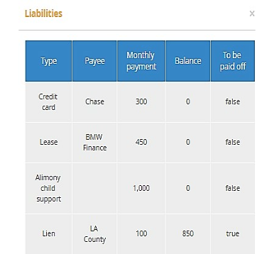
