# Expression Language (FEEL)

## Introduction

In **DMN**, all decision logic is represented as *boxed expressions*. Clause
[Notation](09_Relating_Decision_Logic_to_Decision_Requirements.md#notation)
introduced the concept of the boxed expression and defined two simple kinds:
boxed literal expressions and boxed invocations. [Decision
Table](10_Decision_Table.md#decision-table) defined decision tables, a very
important kind of boxed expression*.* This section completes the graphical
notation for decision logic, by defining other kinds of boxed expressions.

The expressions 'in the boxes' are FEEL expressions. FEEL stands for Friendly
Enough Expression Language, and it has the following features:

- Side-effect free

- Simple data model with numbers, dates, strings, lists, and contexts

- Simple syntax designed for a wide audience

- Three-valued logic (**true, false, null**)

This section also completely specifies the syntax and semantics of FEEL. The
syntax is specified as a grammar ([Syntax](#syntax)). The subset of the syntax
intended to be rendered graphically as a boxed expression is also specified as a
meta-model ([Metamodel](#metamodel)).

FEEL has two roles in **DMN**:

1.  As a textual notation in the boxes of boxed expressions such as decision
    tables.

2.  As a slightly larger language to represent the logic of expressions and DRGs
    for the main purpose of composing the semantics in a simple and uniform way.

## Notation

### Boxed Expressions

This section builds on the generic notation for decision logic and boxed
expressions defined in clause
[Notation](09_Relating_Decision_Logic_to_Decision_Requirements.md#notation).

We define a graphical notation for decision logic called **boxed expressions**.
This notation serves to decompose the decision logic model into small pieces
that can be associated with DRG artifacts. The DRG plus the boxed expressions
form a complete, mostly graphical language that completely specifies Decision
Models.

A boxed expression is either:

- a decision table

- a boxed FEEL expression

- a boxed invocation

- a boxed context

- a boxed list

- a relation

- a boxed function

- a boxed conditional

- a boxed filter, or

- a boxed iterator

Boxed expressions are defined recursively, i.e., boxed expressions can contain
other boxed expressions. The top-level boxed expression corresponds to the
decision logic of a single DRG artifact. This boxed expression SHALL have a name
box that contains the name of the DRG artifact. The name box may be attached in
a single box on top, as shown in
[Boxed expression](Images/boxed-expression-2.svg):

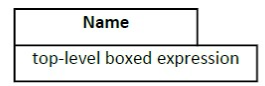

Alternatively, the name box and expression box can be separated by white space
and connected on the left side with a line, as shown in
[Boxed expression with separated name and expression boxes](Images/boxed-expression-with-separated-name-and-expression-boxes-2.svg):

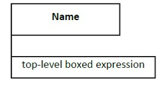

Graphical tools are expected to support appropriate graphical links, for
example, clicking on a decision shape opens a decision table.

#### Decision Tables

The executable decision tables defined here use the same notation as the
decision tables defined in [Decision
Table](10_Decision_Table.md#decision-table). Their execution semantics is
defined in clause [Decision Table](#decision-table).

#### Boxed FEEL expression

A **boxed FEEL expression** is any FEEL expression *e,* as defined by the FEEL
grammar (clause [Syntax](#syntax)), in a table cell, as shown in
[Boxed FEEL expression](Images/boxed-feel-expression.svg):

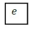

The meaning of a boxed expression containing *e* is **FEEL(***e,* **s)**, where
**s** is the scope. The scope includes the context derived from the containing
DRD as described in [Execution Semantics of Decision
Services](#execution-semantics-of-decision-services), and any boxed contexts
containing *e*.

It is usually good practice to make *e* relatively simple and compose small
boxed expressions into larger boxed expressions.

#### Boxed Invocation

The syntax for boxed invocation is described in clause [Boxed
invocation](09_Relating_Decision_Logic_to_Decision_Requirements.md#boxed-invocation).
This syntax may be used to invoke any function (e.g., business knowledge model,
FEEL built-in function, boxed function definition).

The box labeled 'invoked business knowledge model' can be any boxed expression
whose value is a function, as shown in
[Boxed invocation](Images/boxed-invocation-2.svg):

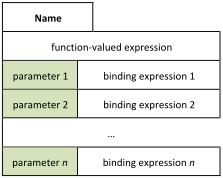

The boxed syntax maps to the textual syntax defined by grammar rules 38, 39, 40,
41. Boxed invocation uses named parameters. Positional invocation can be
achieved using a boxed expression containing a textual positional invocation.

The boxed syntax requires at least one parameter. A parameterless function must
be invoked using the textual syntax, e.g., as shown in
[Parameterless function](Images/parameterless-function.svg).

Formally, the meaning of a boxed invocation is given by the semantics of the
equivalent textual invocation, *e.g.,* **function-valued expression
(**parameter1**: binding expression1,** parameter2**: binding expression2,
...)**.

#### Boxed Context

A **boxed context** is a collection of *n* (name, value) pairs with an optional
result value. The names SHALL be distinct within a context. Each pair is called
a context entry. Context entries may be separated by whitespace and connected
with a line on the left (top). The intent is that all the entries of a context
should be easily identified by looking down the left edge of a vertical context
or across the top edge of a horizontal context. Cells SHALL be arranged in one
of the following ways (see [Vertical context](Images/vertical-context.svg),
[Horizontal context](Images/horizontal-context.svg)):

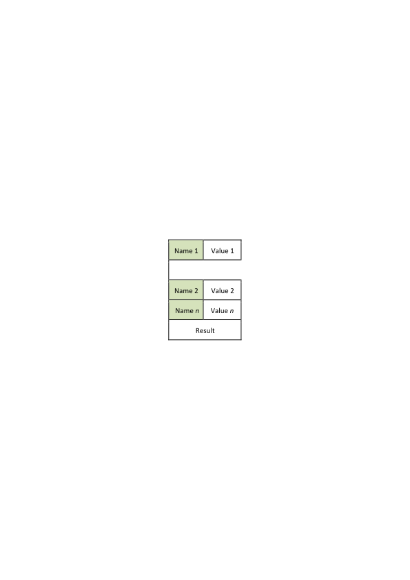

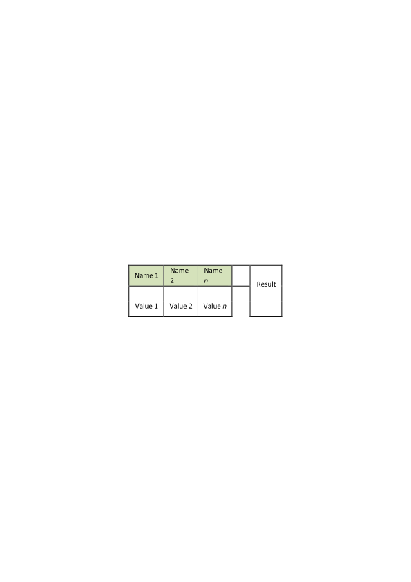

The context entries in a context are often used to decompose a complex
expression into simpler expressions, each with a name. These context entries may
be thought of as intermediate results. For example, contexts without a final
Result box are useful for representing case data (see
[Use of context entries](Images/use-of-context-entries.svg)).

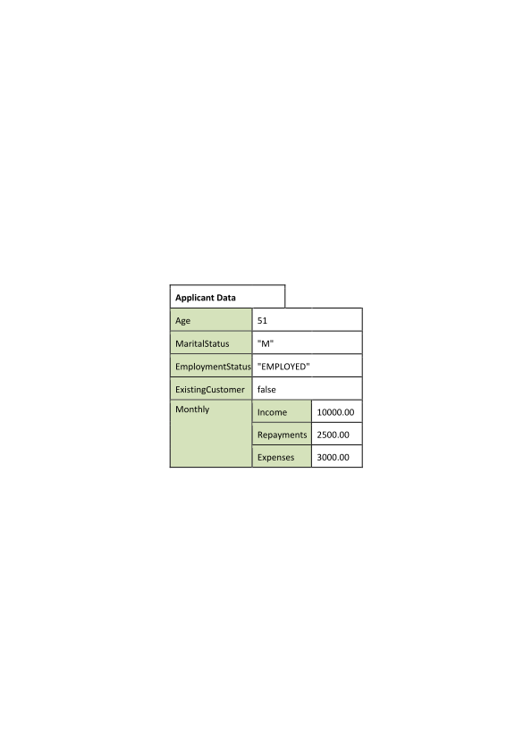

Contexts with a final result box are useful for representing calculations (see
[Use of final result box](Images/use-of-final-result-box.svg)).

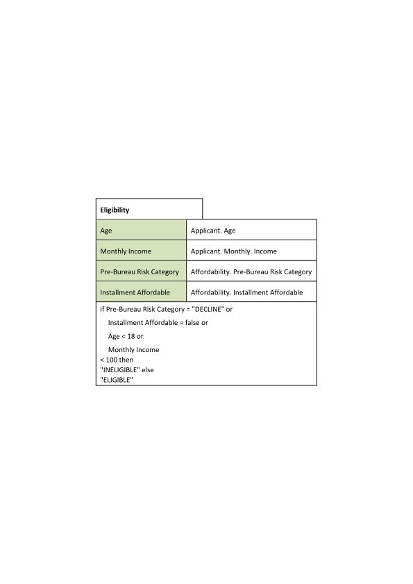

When decision tables are (non-result) context entries, the output cell can be
used to name the entry, thus saving space. Any format decision table can be used
in a vertical context. A jagged right edge is allowed. Whitespace between
context entries may be helpful. See
[Vertical context with decision table entry](Images/vertical-context-with-decision-table-entry.svg).

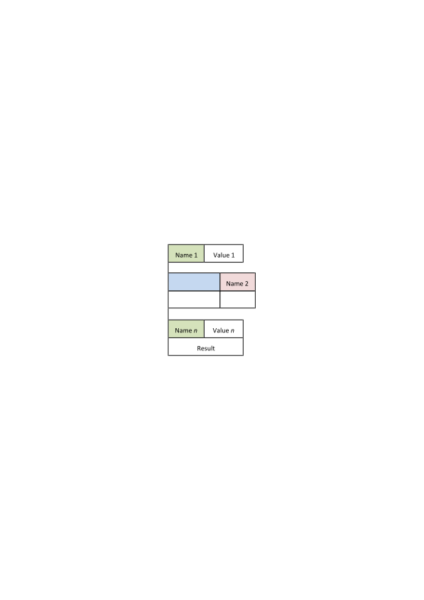

Color is suggested. The names SHALL be legal FEEL names. The values and optional
result are boxed expressions.

Boxed contexts may have a decision table as the result and use the named context
entries to compute the inputs and give them names. For example (see
[Use of boxed expressions with a decision table](Images/use-of-boxed-expressions-with-a-decision-table.svg)):

> **Post-Bureau Risk Category**

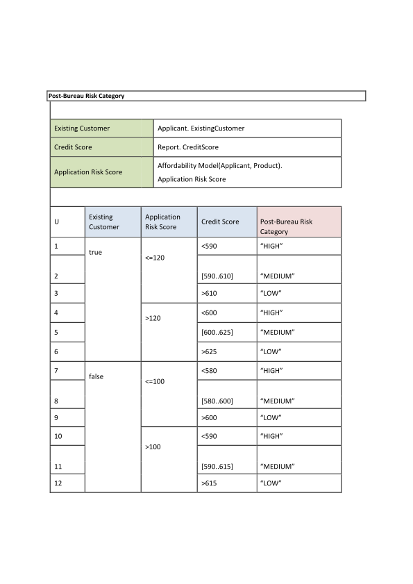

Formally, the meaning of a boxed context is { “Name 1”: Value 1, “Name 2”: Value
2, ..., “Name *n”*: Value *n* } if no Result is specified. Otherwise, the
meaning is { “Name 1”: Value 1, “Name 2”: Value 2, ..., “Name *n”*: Value *n*,
“result”: Result }.result. Recall that the bold face indicates elements in the
FEEL Semantic Domain. The scope includes the context derived from the containing
DRG as described in [Execution Semantics of Decision
Services](#execution-semantics-of-decision-services).

Boxed context entries for contexts that do not have a result box are accessible
outside the context (as QNs), subject to the scope rules defined in clause
[Scope and context stack](#scope-and-context-stack). Boxed context entries for
contexts that have a result box are not accessible outside the context.

#### Boxed List

A **boxed list** is a list of *n* items. Cells SHALL be arranged in one of the
following ways (see [Vertical list](Images/vertical-list.svg),
[Horizontal list](Images/horizontal-list.svg)):

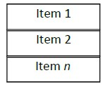

Line styles are normative. The items are boxed expressions. Formally, the
meaning of a boxed list is just the meaning of the list, i.e., **\[ Item 1, Item
2, ..., Item *n* \]**. The scope includes the context derived from the
containing DRG as described in [Execution Semantics of Decision
Services](#execution-semantics-of-decision-services).

#### Relation

A vertical list of homogeneous horizontal contexts (with no result cells) can be
displayed with the names appearing just once at the top of the list, like a
relational table, as shown in [Relation](Images/relation.svg):

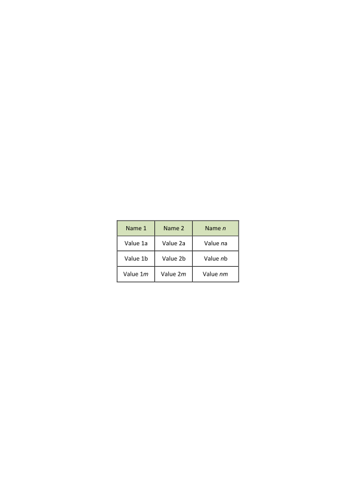

#### Boxed Function

A Boxed Function Definition is the notation for parameterized boxed expressions.

The boxed expression associated with a Business Knowledge Model SHALL be a boxed
function definition or a decision table whose input expressions are assumed to
be the parameter names.

A boxed function has 3 cells:

1.  **Kind**, containing the initial letter of one of the following:

    - **F**EEL

    - **O**NNX

    - **P**MML

    - **J**ava

The **Kind** box can be omitted for FEEL functions, including decision tables.

2.  Parameters: 0 or more comma-separated names, in parentheses

3.  Body: a boxed expression

The 3 cells SHALL be arranged as shown in
[Boxed function definition](Images/boxed-function-definition.svg):

For FEEL functions, denoted by **Kind** FEEL or by omission of **Kind**, the
Body SHALL be a FEEL expression that references the parameters. For externally
defined functions denoted by **Kind** Java, the Body SHALL be a context as
described in [Externally-defined functions](#externally-defined-functions) and
the form of the mapping information SHALL be the *java* form. For externally
defined functions denoted by **Kind** PMML, the Body SHALL be a context as
described in [Externally-defined functions](#externally-defined-functions) and
the form of the mapping information SHALL be the *pmml* form. For externally
defined functions denoted by **Kind** ONNX, the Body SHALL be a context as
described in [Externally-defined functions](#externally-defined-functions) and
the form of the mapping information SHALL be the *onnx* form.

Formally, the meaning of a boxed function is just the meaning of the function,
*i.e.*, FEEL(*funcion(Parameter1, Parameter2, ...) Body*) if the **Kind** is
FEEL, and FEEL(*funcion(Parameter1, Parameter2, ...) external Body*) otherwise.
The scope includes the context derived from the containing DRG as described in
[Execution Semantics of Decision
Services](#execution-semantics-of-decision-services).

#### Boxed conditional

Boxed conditional offers a visual representation of an **if** statement using
three rows. The first one is labelled “if”; the second one is labelled “then”
and the last one is labelled “else”. In the right part, another FEEL expression
is expected. The expression in the “if” part MUST resolve to a boolean.

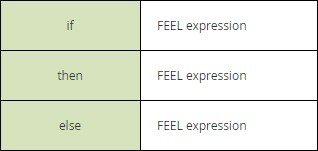

Color is suggested.

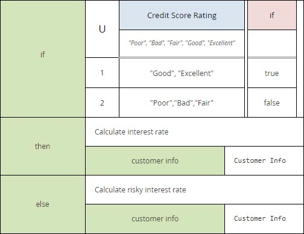

#### Boxed filter

Boxed filter offers a visual representation of collection filtering. The top
part is an expression that is the collection to be filtered. The bottom part,
between the square brackets, holds the filter expression. The expression in the
top part MUST resolve to a collection including implicit conversion to singleton
list as defined in section [Type conversions](#type-conversions). The expression
in the bottom part MUST resolve to a Boolean.

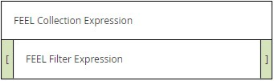

Color is suggested but it is considered a good practice to have a different
color for the square brackets, so the filtering expression is easier to see.

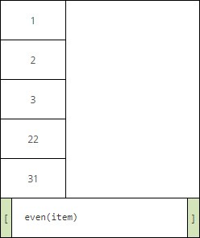

#### Boxed iterator

Boxed iterator offers a visual representation of an iterator statement. There
are three flavors to it: **for** loop and quantified expression **some** and
**every**.

For the **for** loop, the three rows are labelled “for”, “in” and “return”. The
right part of the “for” displays the iterator variable name. The second row
holds an expression representing the collection that will be iterated over. The
expression in the in row MUST resolve to a collection including implicit
conversion to singleton list as defined in section [Type
conversions](#type-conversions). The last row contains the expression that will
process each element of the collection.

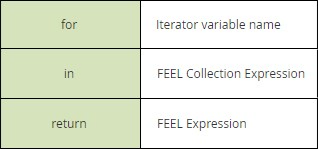

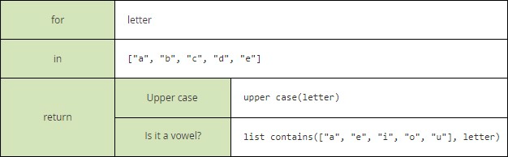

**Every** and **some** expression have a similar structure. The only difference
between the two is the caption on the first line which is “every” or “some”. The
second line is labelled “in” and the last one “satisfies”. The right part of the
first line is the iterator variable name. The expression defined in the second
row is the collection that will be tested. The expression in the in row MUST
resolve to a collection including implicit conversion to singleton list as
defined in section [Type conversions](#type-conversions). The last line is an
expression that will be evaluated on each item. The expression defined in the
satisfies MUST resolve to a boolean.

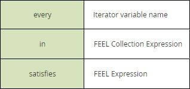

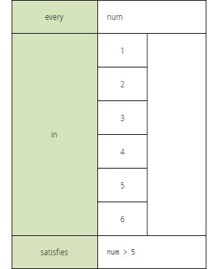

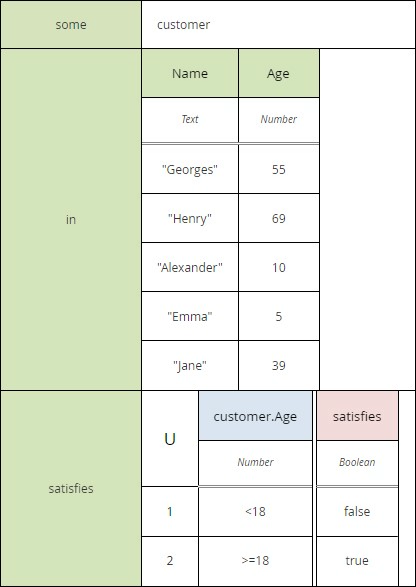

### FEEL

A subset of FEEL, defined in the next section, serves as the notation "in the
boxes" of boxed expressions. A FEEL object is a number, a string, a date, a
time, a duration, a function, a context, or a list of FEEL objects (including
nested lists).

Note: A JSON object is a number, a string, a context (JSON calls them maps) or a
list of JSON objects. So, FEEL is an extension of JSON in this regard. In
addition, FEEL provides friendlier syntax for literal values and does not
require context keys to be quoted.

Here we give a "feel" for the language by starting with some simple examples.

#### Comparison of ranges

Ranges and lists of ranges appear in decision table input entry, input value,
and output value cells. In the examples in
[FEEL range comparisons](#table-feel-range-comparisons), this portion of the
syntax is shown underlined. Strings, dates, times, and durations also may be
compared, using typographical literals defined in section [Typographical string
literals](09_Relating_Decision_Logic_to_Decision_Requirements.md#typographical-string-literals).

###### Table: FEEL range comparisons

| **FEEL Expression**                                           | **Value** |
|---------------------------------------------------------------|-----------|
| 5 in (\<=5 )                                                  | true      |
| 5 in ( (5..10\] )                                             | false     |
| 5 in ( \[5..10\] )                                            | true      |
| 5 in (4, 5, 6)                                                | true      |
| 5 in (\<5, \>5)                                               | false     |
| ***2012-12-31*** in ( (***2012-12-*** ***25..2013-02-14***) ) | true      |

#### Numbers

FEEL numbers and calculations are exemplified in
[FEEL numbers and calculations](#table-feel-numbers-and-calculations).

###### Table: FEEL numbers and calculations

| **FEEL Expression** | **Value**                            |
|---------------------|--------------------------------------|
| decimal(1, 2)       | 1.00                                 |
| .25 + .2            | 0.45                                 |
| .10 \* 30.00        | 3.0000                               |
| 1 + 3/2\*2 - 2\*\*3 | -4.0                                 |
| 1/3                 | 0.3333333333333333333333333333333333 |
| decimal(1/3, 2)     | 0.33                                 |
| 1 = 1.000           | true                                 |
| 1.01/2              | 0.505                                |
| decimal(0.505, 2)   | 0.50                                 |
| decimal(0.515, 2)   | 0.52                                 |
| 1.0\*10\*\*3        | 1000.0                               |

## Full FEEL Syntax and Semantics

[Simple Expression Language
(S-FEEL)](11_Simple_Expression_Language_S-FEEL.md#simple-expression-language-s-feel)
introduced a subset of FEEL sufficient to support decision tables for
Conformance Level 2 (see clause 2). The full **DMN** friendly-enough expression
language (FEEL) required for Conformance Level 3 is specified here.

FEEL is a simple language with inspiration drawn from Java, JavaScript, XPath,
SQL, PMML, Lisp, and many others.

The syntax is defined using grammar rules that show how complex expressions are
composed of simpler expressions. Likewise, the semantic rules show how the
meaning of a complex expression is composed from the meaning of constituent
simper expressions.

**DMN** completely defines the meaning of FEEL expressions that do not invoke
externally-defined functions. There are no implementation-defined semantics.
FEEL expressions (that do not invoke externally-defined functions) have no side-
effects and have the same interpretation in every conformant implementation.
Externally-defined functions SHOULD be deterministic and side-effect free.

### Syntax

FEEL syntax is defined as grammar here and equivalently as a UML Class diagram
in the meta-model ([Metamodel](#metamodel))

#### Grammar notation

The grammar rules use the ISO EBNF notation. Each rule defines a non-terminal
symbol *S* in terms of some other symbols *S1, S2, ...* The following table
summarizes the EBNF notation.

###### Table: EBNF notation

| **Example** | **Meaning**                                   |
|-------------|-----------------------------------------------|
| *S = S1 ;*  | Symbol *S* is defined in terms of symbol *S1* |
| *S1 \| S2*  | Either *S1* or *S2*                           |
| *S1, S2*    | *S1* followed by *S2*                         |
| *\[S1\]*    | *S1* occurring 0 or 1 time                    |
| *{S1}*      | *S1* repeated 0 or more times                 |
| *k \* S1*   | *S1* repeated k times                         |
| "and"       | literal terminal symbol                       |

We extend the ISO notation with character ranges for brevity, as follows:

A character range has the following EBNF syntax:

character range = "\[", low character, "-", high character, "\]" ; low character
= unicode character ; high character = unicode character ; unicode character =
simple character \| code point ; code point = "\\u", 4 \* hexadecimal digit \|
"\\U", 6 \* hexadecimal digit; hexadecimal digit = "0" \| "1" \| "2" \| "3" \|
"4" \| "5" \| "6" \| "7" \| "8" \| "9" \|

"a" \| "A" \| "b" \| "B" \| "c" \| "C" \| "d" \| "D" \| "e" \| "E" \| "f" \| "F"
;

A simple character is a single Unicode character, *e.g.,* a, 1, \$, *etc.*
Alternatively, a character may be specified by its hexadecimal code point value,
prefixed with *\\u*.

Every Unicode character has a numeric code point value. The low character in a
range must have numeric value less than the numeric value of the high character.

For example, hexadecimal digit can be described more succinctly using character
ranges as follows:

> hexadecimal digit = \[0-9\] \| \[a-i \| \[A-F\] ;

Note that the character range that includes all Unicode characters is
*\[\\u0-\\u10FFFF\]*.

#### Grammar rules

The complete FEEL grammar is specified below. Grammar rules are numbered, and in
some cases, alternatives are lettered, for later reference. Boxed expression
syntax (rule 53) is used to give execution semantics to boxed expressions.

    1. expression =
       a. boxed expression |
       b. textual expression ;
    2. textual expression =
       a. for expression | if expression | quantified expression |
       b. disjunction |
       c. conjunction |
       d. comparison |
       e. arithmetic expression |
       f. instance of |
       g. path expression | descendant expression | filter expression | function invocation |
       h. literal | simple positive unary test | name | "(" , expression , ")" ;
    3. textual expressions = textual expression , { "," , textual expression } ;
    4. arithmetic expression =
       a. addition | subtraction |
       b. multiplication | division |
       c. exponentiation |
       d. arithmetic negation ;
    5. simple expression = arithmetic expression | simple value ;
    6. simple expressions = simple expression , { "," , simple expression } ;
    7. simple positive unary test =
       a. ( "<" | "<=" | ">" | ">=" | "=" | "!=" ) , endpoint |
       b. interval ;
    8. interval = ( open interval start | closed interval start ) , endpoint , ".." , endpoint , ( open interval end | closed interval end ) ;
    9. open interval start = "(" | "]" ;
    10. closed interval start = "[" ;
    11. open interval end = ")" | "[" ;
    12. closed interval end = "]" ;
    13. positive unary test = expression ;
    14. positive unary tests = positive unary test , { "," , positive unary test } ;
    15. unary tests =
        a. positive unary tests |
        b. "not", " (", positive unary tests, ")" |
        c. "-"
    16. endpoint = expression ;
    17. simple value = qualified name | simple literal ;
    18. qualified name = name , { "." , name } ;
    19. addition = expression , "+" , expression ;
    20. subtraction = expression , "-" , expression ;
    21. multiplication = expression , "*" , expression ;
    22. division = expression , "/" , expression ;
    23. exponentiation = expression, "**", expression ;
    24. arithmetic negation = "-" , expression ;
    25. name = name start , { name part | additional name symbols } ;
    26. name start = name start char, { name part char } ;
    27. name part = name part char , { name part char } ;
    28. name start char = "?" | [A-Z] | "_" | [a-z] | [\uC0-\uD6] | [\uD8-\uF6] | [\uF8-\u2FF] | [\u370-\u37D] | [\u37F-\u1FFF] |

> \[\\u200C-\\u200D\] \| \[\\u2070-\\u21 8F\] \| \[\\u2C00-\\u2FEF\] \|
> \[\\u3001 -\\uD7FF\] \| \[\\uF900-\\uFDCF\] \| \[\\uFDF0-\\uFFFD\] \|
> \[\\u10000-\\uEFFFF\] ;

    29. name part char = name start char | digit | \uB7 | [\u0300-\u036F] | [\u203F-\u2040] ;
    30. additional name symbols = "." | "/" | "-" | """'" | "+" | "*" ;
    31. literal = simple literal | "null" ;
    32. simple literal = numeric literal | string literal | boolean literal | date time literal ;
    33. string literal = """, { character ""- (""" | vertical space) | string escape sequence}, """ ;
    34. boolean literal = "true" | "false" ;
    35. numeric literal = [ "-" ] , ( digits , [ ".", digits ] | "." , digits ), [ ( "e" | "E" ) , [ "+" | "-" ] , digits ] ;
    36. digit = [0-9] ;
    37. digits = digit , {digit} ;
    38. function invocation = expression , parameters ;
    39. parameters = "(" , ( named parameters | positional parameters ) , ")" ;
    40. named parameters = parameter name , ":" , expression , { "," , parameter name , ":" , expression } ;
    41. parameter name = name ;
    42. positional parameters = [ expression , { "," , expression } ] ;
    43. path expression = expression , "." , name ;
    44. for expression = "for" , name , "in" , iteration context { "," , name , "in" , iteration context } , "return" , expression

;

    45. if expression = "if" , expression , "then" , expression , "else" expression ;
    46. quantified expression = ("some" | "every") , name , "in" , iteration context , { "," , name , "in" , iteration context } , "satisfies", expression ;
    47. disjunction = expression , "or" , expression ;
    48. conjunction = expression , "and" , expression ;
    49. comparison =
        a. expression , ( "=" | "!=" | "<" | "<=" | ">" | ">=" ) , expression |
        b. expression , "between" , expression , "and" , expression |
        c. expression , "in" , positive unary test |
        d. expression , "in" , " (", positive unary tests, ")" ;
    50. filter expression = expression , "[" , expression , "]" ;
    51. instance of = expression , "instance" , "of" , type | expression , "as" , type ;
    52. type =

> qualified name \|
>
> "range" "\<" type "\>" \|
>
> "list" "\<" type "\>" \|
>
> "context" "\<" \[ name ":" type { "," name ":" type } \] "\>" \| "function"
> "\<" \[ type { ", " type } \] "\>" "-\>" type
>
> ;

    53. boxed expression = list | function definition | context ;
    54. list = "[" , [ expression , { "," , expression } ] , "]" ;
    55. function definition = "function" , "(" , [ formal parameter { "," , formal parameter } ] , ")" , [ "external" ] , expression ;
    56. formal parameter = parameter name [":" type ] [ "?" | "..." ] ;
    57. context = "{" , [context entry , { "," , context entry } ] , "}" ;
    58. context entry = key , ":" , expression ;
    59. key = name | string literal ;
    60. date time literal = at literal | function invocation;
    61. white space = vertical space | \u0009 | \u0020 | \u0085 | \u00A0 | \u1 680 | \u1 80E | [\u2000-\u200B] | \u2028 |

> \\u2029 \| \\u202F \| \\u205F \| \\u3000 \| \\uFEFF ;

    62. vertical space = [\u000A-\u000D]
    63. iteration context = expression, [ """..""", expression ];
    64. string escape sequence = "\'" | "\"" | "\\" | "\n" | "\r" | "\t" | code point;
    65. at literal = """@""", string literal
    66. range literal =

> a\. ( open range start \| closed range start ) , range endpoint , ".." , range
> endpoint ( open range end \| closed range end ) \|
>
> b\. open range start , ".." , range endpoint ( open range end \| closed range
> end ) \|
>
> c\. ( open range start \| closed range start ) , range endpoint , ".." , open
> range end ;

    67. range endpoint = numeric literal | string literal | date time literal ;
    68. descendant expression = expression , "..." , name ;

Additional syntax rules:

- Operator precedence is given by the order of the alternatives in grammar rules
  1, 2 and 4, in order from lowest to highest. *E.g.,* (boxed) invocation has
  higher precedence than multiplication, multiplication has higher precedence
  than addition, and addition has higher precedence than comparison. Addition
  and subtraction have equal precedence, and like all FEEL infix binary
  operators, are left associative. Note that FEEL’s order of operations
  regarding arithmetic negation and exponentiation differs from standard
  mathematical precedence, e.g., the FEEL expression -4 \*\* 2 is interpreted as
  (-4)\*(-4) and evaluates to 16. In standard mathematics, -4 \*\* 2 is
  interpreted as -(4\*4) and evaluates to -16 instead. To avoid any ambiguity,
  users are recommended to use explicit parentheses, e.g., instead of -4 \*\* 2
  specify -(4 \*\* 2) = -16 or (-4) \*\* 2 = 16 as appropriate. Tools MAY
  present a warning to users to inform about the potentially unexpected
  precedence of the combination of these two operators.

- Java-style comments can be used, *i.e.,* '//' to end of line and /\* ... \*/.

- In rule 60 ("date time literal"), for the "function invocation" alternative,
  the only permitted functions are the builtins *date*, *time*, *date and time*,
  *duration*, *days and time duration*, and *years and months duration*.

- The string in rule 65 must follow the date string, time string, date and time
  string or duration string syntax, as detailed in section [Conversion
  functions](#conversion-functions).

- In rule 56 ("formal parameter"), the symbols "?" and "..." are used to define
  type qualifiers. The symbol "?" denotes an optional parameter and "..." that
  the enclosing function definition has a variable number of parameters.
  Parameters with these qualifiers must come after the ones without qualifiers.
  A function definition can have at most one optional parameter and at most one
  variable argument parameter. A function definition cannot have both optional
  and variable argument qualifiers.

#### Literals, data types, built-in functions

FEEL supports literal syntax for numbers, strings, booleans, date, time, date
and time, duration, and *null*. (See grammar rules, clause [Grammar
rules](#grammar-rules)). Literals can be mapped directly to values in the FEEL
semantic domain (clause [Semantic Domain](#semantic-domain)).

FEEL supports the following datatypes:

- number

- string

- boolean

- days and time duration

- years and months duration

- date

- time

- date and time

- list

- range

- context

- function

#### Tokens, Names and White space

A FEEL expression consists of a sequence of tokens, possibly separated with
white space (grammar rule 63). A token is a sequence of Unicode characters,
either:

- A literal terminal symbol in any grammar rule other than grammar rule 30.
  Literal terminal symbols are enclosed in double quotes in the grammar rules,
  e.g., “and”, “+”, “=”, or

- A sequence conforming to grammar rule 28, 29, 35, or 37

For backward compatibility reasons, “list”, “context” and “range” from grammar
rule 52 are not considered literal terminal symbols.

White space (except inside strings) acts as token separators. Most grammar rules
act on tokens and thus ignore white space (which is not a token).

A name (grammar rule 27) is defined as a sequence of tokens. I.e., the name
IncomeTaxesAmount is defined as the list of tokens **\[ Income, Taxes, Amount
\]**. The name Income+Expenses is defined as the list of tokens  
**\[ Income, + , Expenses \]**. A consequence of this is that a name like Phone
Number with one space in between the tokens is the same as Phone Number with
several spaces in between the tokens.

A name start (grammar rule 26) SHALL NOT be a literal terminal symbol.

A name part (grammar rule 27) MAY be a literal terminal symbol.

#### Contexts, Lists, Qualified Names, and Context Lists

A context is a map of key-value pairs called context entries and is written
using curly braces to delimit the context, commas to separate the entries, and a
colon to separate key and value (grammar rule 57). The key can be a string or a
name. The value is an expression.

A list is written using square brackets to delimit the list, and commas to
separate the list items (grammar rule 54).

Contexts and lists can reference other contexts and lists, giving rise to a
directed acyclic graph. Naming is path based. The *qualified name* (QN) of a
context entry is of the form *N1*.*N2 ... Nₙ* where *N1* is the name of an
in-scope context.

Nested lists encountered in the interpretation of *N1*.*N2 ... Nₙ* are
preserved. *E.g.,*

> *\[{a: {b: \[1\]}}, {a: {b: \[2.1, 2.2\]}}, {a: {b: \[3\]}}, {a: {b: \[4,
> 5\]}}\].a.b =*
>
> *\[{b: \[1\]}, {b: \[2.1,2.2\]}, {b: \[3\]}, {b: \[4, 5\]}\].b =*
>
> *\[\[1\], \[2.1, 2.2\], \[3\], \[4, 5\]\]*

Nested lists can be flattened using the *flatten()* built-in function ([Built-in
functions](#built-in-functions-1)).

#### Ambiguity

FEEL expressions reference InformationItems by their qualified name (QN), in
which name parts are separated by a period. For example, variables containing
components are referenced as \[varName\].\[componentName\]. Imported elements
such as InformationItems and ItemDefinitions are referenced by
namespace-qualified name, in which the first name part is the name specified by
the Import element importing the element. For example, an imported variable
containing components is referenced as \[import
name\].\[varName\].\[componentName\].

Because names are a sequence of tokens, and some of those tokens can be FEEL
operators and keywords, context is required to resolve ambiguity. For example,
the following could be names or other expressions:

- a-b

- a – b

- what if?

- Profit and loss

Ambiguity is resolved using the scope. Name tokens are matched from left to
right against the names in-scope, and the longest match is preferred. In the
case where the longest match is not desired, parenthesis or other punctuation
(that is not allowed in a name) can be used to disambiguate a FEEL expression.
For example, to subtract b from a if a-b is the name of an in-scope context
entry, one could write (a)-(b). Notice that it does not help to write a - b,
using space to separate the tokens, because the space is not part of the token
sequence and thus not part of the name.

### Semantics

FEEL semantics is specified by mapping syntax -fragments to values in the FEEL
semantic domain. Literals (clause [Literals, data types, built-in
functions](#literals-data-types-built-in-functions)) can be mapped directly.
Expressions composed of literals are mapped to values in the semantic domain
using simple logical and arithmetic operations on the mapped literal values. In
general, the semantics of any FEEL expression are composed from the semantics of
its sub-expressions.

#### Semantic Domain

The FEEL semantic domain **D** consists of an infinite number of typed values.
The types are organized into a lattice called **L**.

The types include:

- simple datatypes such as number, boolean, string, date, time, and duration

- constructed datatypes such as functions, lists, and contexts

- the Null type, which includes only the **null** value

- the special type Any, which includes all values in **D**

A function is a lambda expression with lexical closure or is externally defined
by Java, ONNX or PMML. A list is an ordered collection of domain elements, and a
context is a partially ordered collection of (string, value) pairs called
context entries.

We use *italics* to denote syntactic elements and **boldface** to denote
semantic elements. For example, FEEL**(***\[1+ 1, 2+2\]***) is \[2, 4\]** .

Note that we use bold **\[\]** to denote a list in the FEEL semantic domain, and
bold numbers **2, 4** to denote those decimal values in the FEEL semantic
domain.

#### Equality, Identity and Equivalence

The semantics of equality are specified in the semantic mappings in clause
[Semantic mappings](#semantic-mappings). In general, the values to be compared
must be of the same kind, for example, both numbers, to obtain a non-null
result.

Identity simply compares whether two objects in the semantic domain are the same
object. We denote the test for identity using infix **is**, and its negation
using infix **is not**. For example, FEEL( *"1" = 1*) **is null**. Note that
**is** never results in **null**.

Every FEEL expression *e* in scope s can be mapped to an element **e** in the
FEEL semantic domain. This mapping defines the meaning of *e* in s. The mapping
may be written **e is** FEEL(*e*,s). Two FEEL expressions *e₁* and *e₂* are
equivalent in scope s if and only if FEEL(*e₁*,s) **is** FEEL(*e₂*,s). When s is
understood from context (or not important), we may abbreviate the equivalence as
**e₁ is e₂**.

#### Semantics of literals and datatypes

FEEL datatypes are described in the following sub-sections. The meaning of the
datatypes includes:

1.  A mapping from a literal form (which in some cases is a string) to a value
    in the semantic domain.

2.  A precise definition of the set of semantic domain values belonging to the
    datatype, and the operations on them.

Each datatype describes a (possibly infinite) set of values. The sets for the
datatypes defined below are disjoint. We use *italics* to indicate a literal and
**boldface** to indicate a value in the semantic domain.

##### number

FEEL Numbers are based on IEEE 754-2008 Decimal128 format, with 34 decimal
digits of precision and rounding toward the nearest neighbor with ties favoring
the even neighbor.

Grammar rule 35 defines literal numbers. Literals consist of base 10 digits, an
optional decimal point, and an optional exponent. –INF, +INF, and NaN literals
are not supported. There is no distinction between -0 and 0. The number(from,
grouping separator, decimal separator) built-in function supports a richer
literal format. E.g., FEEL(number("1.000.000,01 ", ". ", ",")) = **1000000.01**.

FEEL supports literal scientific notation, e.g., 1.2e3, which is equivalent to
1.2\*10\*\*3.

A FEEL number is represented in the semantic domain as a pair of integers
**(p,s)** such that **p** is a signed 34 digit integer carrying the precision
information, and **s** is the scale, in the range \[−611 1..6176\]. Each such
pair represents the number **p**/10**ˢ**. To indicate the numeric value, we
write **value(p,s)**. *E.g.,* **value(100,2) = 1.** If precision is not of
concern, we may write the value as simply **1**. Note that many different pairs
have the same value. For example, **value(1,0) = value(10,1) = value(100,2)**.

There is no value for notANumber, positiveInfinity, or negativeInfinity. Use
**null** instead.

##### string

Grammar rule 33 defines literal strings as a double-quoted sequence of Unicode
characters (see

<https://unicode.org/glossary/#character),> e.g., "abc". The supported Unicode
character range is \[\\u0-\\u10FFFF\]. The string literals are described by rule
33. The corresponding Unicode code points are used to encode a string literal.

The literal string *"abc"* is mapped to the semantic domain as a sequence of
three Unicode characters **a**, **b**, and **c**, written **"abc"**. The literal
*"\\ U01F4 0E"* is mapped to a sequence of one Unicode character written **"ὀ"**
corresponding to the code point U+1F40E. 

##### boolean

The Boolean literals are given by grammar rule 34. The values in the semantic
domain are **true** and **false**.

##### time

Times in FEEL can be expressed using either a time literal (see grammar rule 65)
or the *time()* built-in function (See [Conversion
functions](#conversion-functions)). We use boldface time literals to represent
values in the semantic domain.

A time in the semantic domain is a value of the XML Schema time datatype. It can
be represented by a sequence of numbers for the hour, minute, second, and an
optional time offset from Universal Coordinated Time (UTC). If a time offset is
specified, including time offset = 00:00, the time value has a UTC form and is
comparable to all time values that have UTC forms. If no time offset is
specified, the time is interpreted as a local time of day at some location,
whose relationship to UTC time is dependent on time zone rules for that location
and may vary from day to day. A local time of day value is only sometimes
comparable to UTC time values, as described in XML Schema Part 2 Datatypes.

A time **t** can also be represented as the number of seconds since midnight. We
write this as **valuet(t)**. *E.g.,* **valuet(01:01:01) = 3661**.

The **valuet** function is one-to-one, but its range is restricted to
\[0..86400\]. So, it has an inverse function **valuet ⁻¹**(x) that returns: the
corresponding time value for x, if x is in \[0..86400\]; and **valuet ⁻¹**(y),
where y = x – floor(x/86400) \* 86400, if x is not in \[0..86400\].

Note: That is, **valuet ⁻¹**(x) is always actually applied to x modulo 86400.
For example, **valuet ⁻¹**(3600) will return the time of day that is “01:00:00”,
**valuet ⁻¹**(90000) will also return “T01 :00:00”, and **valuet ⁻¹**(-3600)
will return the time of day that is “23 :00:00”, treating -3600 seconds as one
hour *before* midnight.

##### date

Dates in FEEL can be expressed using either a date literal (see grammar rule 65)
or the date() built-in function (See [Conversion
functions](#conversion-functions)). A date in the semantic domain is a sequence
of numbers for the year, month, day of the month. The year must be in the range
\[-999,999,999. .999,999,999\]. We use boldface date literals to represent
values in the semantic domain.

When a date value is subject to implicit conversions ([Type
conversions](#type-conversions)) it is considered to be equivalent to a date
time  
value in which the time of day is UTC midnight (00:00:00).

##### date-time

*Date and time* in FEEL can be expressed using either a *date time literal* (see
grammar rule 65) or the *date and time()* built-in function (See
[date-time](#date-time)). We use boldface *date and time literals* to represent
values in the semantic domain.

A date and time in the semantic domain is a sequence of numbers for the year,
month, day, hour, minute, second, and optional time offset from Universal
Coordinated Time (UTC). The year must be in the range \[-

999,999,999..999,999,999\]. If there is an associated time offset, including
00:00, the date-time value has a UTC form and is comparable to all other
date-time values that have UTC forms. If there is no associated time offset, the
time is taken to be a local time of day at some location, according to the time
zone rules for that location. When the time zone is specified, e.g., using the
IANA tz form (see [Conversion functions](#conversion-functions)), the date-time
value may be converted to a UTC form using the time zone rules for that
location, if applicable.

Note: projecting time zone rules into the future may only be safe for near-term
date-time values.

A date and time **d** that has a UTC form can be represented as a number of
seconds since a reference date and time (called the epoch). We write
**valuedt(d)** to represent the number of seconds between **d** and the epoch.
The **valuedt** function is one- to-one and so it has an inverse function
**valuedt ⁻¹**. *E.g.,* **valuedt⁻¹(valuedt(d)) = d. valuedt ⁻¹** returns
**null** rather than a date with a year outside the legal range.

##### days and time duration

Days and time durations in FEEL can be expressed using either a duration literal
(see grammar rule 65) or the duration() and days and time duration() builtin
functions (See [Conversion functions](#conversion-functions)). We use boldface
days and time duration literals to represent values in the semantic domain. The
literal format of the characters within the quotes of the string literal is
defined by the lexical space of the XPath Data Model dayTimeDuration datatype. A
days and time duration in the semantic domain is a sequence of numbers for the
days, hours, minutes, and seconds of duration, normalized such that the sum of
these numbers is minimized. For example, FEEL(*duration("P0DT25H")*) =
**P1DT1H**.

The value of a days and time duration can be expressed as a number of seconds.
*E.g.*, **valuedtd(P1DT1H) = 90000.** The **valuedtd** function is one-to-one
and so it has an inverse function **valuedtd ₋₁**. *E.g.,* **valuedtd ⁻¹(90000)
= P1DT1H.**

##### years and months duration

Years and months durations in FEEL can be expressed using either a duration
literal (see grammar rule 65) or the duration() and years and months duration()
builtin functions (See [Conversion functions](#conversion-functions)). We use
boldface years and month duration literals to represent values in the semantic
domain. The literal format of the characters within the quotes of the string
literal is defined by the lexical space of the XPath Data Model
yearMonthDuration datatype. A years and months duration in the semantic domain
is a pair of numbers for the years and months of duration, normalized such that
the sum of these numbers is minimized. For example, FEEL(*duration("P0Y13M")*) =
**P1Y1M**.

The value of a years and months duration can be expressed as a number of months.
*E.g.*, **value\_ymd(P1Y1M) = 13.** The **valueymd** function is one-to-one and
so it has an inverse function **valueymd ₋₁**. *E.g.,* **valueymd ⁻¹(13) =
P1Y1M.**

#### Ternary logic

FEEL, like SQL and PMML, uses of ternary logic for truth values. This makes
**and** and **or** complete functions from ***D** x **D** → **D***. Ternary
logic is used in Predictive Modeling Markup Language to model missing data
values.

#### Lists and filters

Lists are immutable and may be nested. The *first* element of a list *L* can be
accessed using *L\[1\]* and the *last* element can be accessed using *L\[-1\]*.
The *nth* element from the beginning can be accessed using *L\[n\],* and the
*nth* element from the end can be accessed using *L\[-n\]*.

If FEEL(*L*) = **L** is a list in the FEEL semantic domain, the first element is
FEEL(*L\[1\]*) = **L\[1\]**. If **L** does not contain **n** items, then
**L\[n\] is null**.

**L** can be filtered with a Boolean expression in square brackets. The
expression in square brackets can reference a list element using the name
*item*, unless the list element is a context that contains the key **"item"**.
If the list element is a context, then its context entries may be referenced
within the filter expression without the *'item.'* prefix. For example: *\[1, 2,
3, 4\]\[item \> 2\] = \[3, 4\]*

> *\[ {x:1, y:2}, {x:2, y:3} \]\[x=1\] = \[{x:1, y:2}\]*

The filter expression is evaluated for each item in list, and a list containing
only items where the filter expression is **true** is returned. E.g.:

\[ {x:1, y:2}, {x:null, y:3} \]\[x \< 2\] = \[{x:1, y:2}\]

The expression to be filtered is subject to implicit conversions ([Type
conversions](#type-conversions)) before the entire expression is evaluated.

For convenience, a selection using the "." operator with a list of contexts on
its left hand side returns a list of selections, *i.e.* FEEL(*e.f,* **c**) =
**\[** FEEL(*f*, **c'**)**,** FEEL(*f*, **c"**)**, ... \]** where FEEL(*e*) =
**\[ e', e", ... \]** and **c'** is **c** augmented with the context entries of
**e'**, **c"** is **c** augmented with the context entries of **e"**, etc. For
example:

*\[ {x:1, y:2}, {x:2, y:3} \].y = \[2,3\]*

*\[ {x:1, y:2}, {x:2} \].y = \[ 2, null \]*

#### Context

A FEEL context is a partially ordered collection of (key, expression) pairs
called context entries. In the syntax, keys can be either names or strings. Keys
are mapped to strings in the semantic domain. These strings are distinct within
a context. A context in the domain is denoted using bold FEEL syntax with string
keys, *e.g.* **{ "key1" : expr1, "key2" : expr2, ... }**.

The syntax for selecting the value of the entry named *key1* from context-valued
expression *m* is *m.key1.*

If *key1* is not a legal name or for whatever reason one wishes to treat the key
as a string, the following syntax is allowed: *get value(m, "key1 ").* Selecting
a value by key from context **m** in the semantic domain is denoted as
**m.key1** or **get value(m, "key1")**

To retrieve a list of key, value pairs from a context *m*, the following
built-in function may be used*: get entries(m).* For example, the following is
true: *get entries({key1: "value1 "})\[key= "key1 "\].value = "value1"*

An expression in a context entry may not reference the key of the same context
entry but may reference keys (as QNs) from previous context entries in the same
context, as well as other values (as QNs) in scope.

These references SHALL be acyclic and form a partial order. The expressions in a
context SHALL be evaluated consistent with this partial order.

#### Ranges

FEEL supports a compact syntax for a range of values, useful in decision table
test cells and elsewhere. Ranges can be syntactically represented either:

a\) as a comparison operator and a single endpoint (grammar rule 7.a.)

b\) or a pair of endpoints and endpoint inclusivity flags that indicate whether
one or both endpoints are included in the range (grammar rule 7.b.); on this
case, endpoints must be of equivalent types (see section [Type
Equivalence](#type-equivalence)for the definition of type equivalence) and the
endpoints must be ordered such that range start \<= range end.

Endpoints can be expressions (grammar rule 16) of the following types: number,
string, date, time, date and time, or duration. The following are examples of
valid ranges:

- \< 10

- \>= date(“2019-03-31”)

- \>= @”2019-03-31”

- \<= duration(“PT01H”)

- \<= @”PT01H”

- \[ 5 .. 10 \]

- ( birthday .. @”2019-01-01” )

Ranges are mapped into the semantic domain as a typed instance of the *range*
type. If the syntax with a single endpoint and an operator is used, then the
other endpoint is undefined, and the inclusivity flag is set to false. E.g.:

###### Table: Examples of range properties values

| **range** | **start included** | **start** | **end**   | **end included** |
|-----------|--------------------|-----------|-----------|------------------|
| \[1..10\] | true               | 1         | 10        | true             |
| (1..10\]  | false              | 1         | 10        | true             |
| \<= 10    | false              | undefined | 10        | true             |
| \> 1      | false              | 1         | undefined | false            |

The semantics of comparison expressions involving ranges (grammar rules 49c and
49d) is defined in
[Semantics of decision table syntax](#table-semantics-of-decision-table-syntax),
[Specific semantics of inequality](#table-specific-semantics-of-inequality),
[General semantics of equality and inequality](#table-general-semantics-of-equality-and-inequality),
and
[Semantics of conjunction and disjunction](#table-semantics-of-conjunction-and-disjunction).
The same rules apply when ranges are created programmatically, e.g., using the
range function.

#### Functions

The FEEL function literal is given by grammar rule 55. Functions can also be
specified in **DMN** via Function Definitions (see [Business Knowledge Model
metamodel](08_Requirements_DRG_and_DRD.md#business-knowledge-model-metamodel)).
The constructed type (*T*1, . . . , *Tn*) → *U* contains the function values
that take arguments of types *T1, . . . , Tn* and yield results of type *U,*
regardless of the way the function syntax (e.g., FEEL literal or **DMN**
Function Definition). In the case of exactly one argument type *T* → *U* is a
shorthand for (*T* ) → *U*.

#### Relations between types

Every FEEL expression executed in a certain context has a value in **D**, and
every value has a type. The FEEL types are organized as a lattice (see
[FEEL type lattice](Images/feel-type-lattice.svg)), with upper type *Any* and
lower type *Null*. The lattice determines the conformance of the different types
to each other. For example, because comparison is defined only between values
with conforming types, you cannot compare a number with a boolean or a string.

The FEEL lattice contains several inner abstract types (e.g. *comparable*,
*temporal*, *duration* and *context*) to represent unions of concrete types
(e.g. *number* and *string*). For example, *duration* is the union of the *years
and months duration* and *days and time duration* types. The *context* type is
the union of all context types and is equivalent to context\<\>.

We define **type(***e***)** as the type of the domain element **FEEL(***e,*
**c),** where *e* is an expression defined by grammar rule 1. Literals for
numbers, strings, booleans, null, date, time, date and time and duration
literals are mapped to the corresponding node in lattice **L**. Complex
expression such as list, contexts and functions are mapped to the corresponding
parameterized nodes in lattice **L**. For example, see
[Examples of types of domain elements](#table-examples-of-types-of-domain-elements).

###### Table: Examples of types of domain elements

| *e*                                    | **type(***e***)**                       |
|----------------------------------------|-----------------------------------------|
| *123*                                  | number                                  |
| *true*                                 | boolean                                 |
| *"abc"*                                | string                                  |
| *date("2017-01-01 ")*                  | date                                    |
| *\["a", "b", "c"\]*                    | list\<string\>                          |
| *\["a", true, 123\]*                   | list\<Any\>                             |
| \[1..10)                               | range\<number\>                         |
| \>= @”201 9-01-01”                     | range\<date\>                           |
| e                                      | type(e)                                 |
| {"name": "Peter", age: 30}             | context\<”age”: number, “name”:string\> |
| function f(x: number, y: number) x + y | (number, number) → number               |
| DecisionA                              | context\<”id”:number, “name”:string\>   |
| BkmA                                   | (number, number) → number               |

A type expression *e* defined by grammar rule 54 is mapped to the nodes in the
lattice **L** by function **type(***e***)** as follows: primitive data type
names are mapped to the node with the same name (e.g., *string* is mapped the
**string** node)

• *Any* is mapped to the node **Any**

- *Null* is mapped to the node **Null**

- *list\< T\>* is mapped to the **list** node with the parameter
  **type(***T***)**

- *context(k1:T1, ..., kₙ:Tₙ\> where n≥1* is mapped to the **context** node with
  parameters k1: **type(***T1***)**, ..., kₙ: **type(***Tₙ***)**

- *function\< T1, ... Tₙ\> -\> T* is mapped to the **function** node with
  signature **type(***T1***)**, ..., **type(***Tₙ***)** -\> **type(***T***)**

- Type names defined in the *itemDefinitions* section are mapped similarly to
  the context types (see rule above).

If none of the above rules can be applied (e.g., type name does not exist in the
decision model) the type expression is semantically incorrect.  
We define two relations between types:

- Equivalence (T ≡ S): Types T and S are interchangeable in all contexts.

Conformance (T \<:S): An instance of type T can be substituted at each place
where an instance of type S is expected.

##### Type Equivalence

The equivalence relationship (≡) between types is defined as follows:

- Primitive datatypes are equivalent to themselves, e.g., string ≡ string.

- Two list types *list\< T\>* and *list\<S\>* are equivalent iff *T* is
  equivalent to *S*. For example, the types of \[“a”, “b”\] and \[“c”\] are
  equivalent.

- Two context types *context\<k₁: T₁, ..., kₙ: Tₙ\>* and *context\<l₁: S ₁, ...,
  lₘ: Sₘ\>* are equivalent iff n = m and for every *kᵢ :Tᵢ* there is a unique
  *lⱼ :Sⱼ* such that *kᵢ = lⱼ* and *Tᵢ* ≡ *Sⱼ* for i = 1, n. Context types are
  the types defined via ItemDefinitions or the types associated to FEEL context
  literals such as { “name”: “John”, “age”: 25}.

- Two function types (*T₁, ..., Tₙ) →U* and (*S₁, ..., Sₘ) →V* are equivalent
  iff n = m, *Tᵢ* ≡ *Sⱼ* and *Tᵢ* and *Sⱼ* have the same type qualifiers for i =
  1, n and *U* ≡ *V*.

- Two range types *range\< T\>* and *range\<S\>* are equivalent iff *T* is
  equivalent to *S*. For example, the types of \[1..10\] and \[30..40\] are
  equivalent.

Type equivalence is transitive: if *type1* is equivalent to *type2*, and *type2
is equivalent to type3*, then *type1* is equivalent to *type3*.

##### Type Conformance

The conformance relation (\<:) is defined as follows:

- Conformance includes equivalence. If *T* ≡ *S* then *T* \<: *S*

- For every type *T*, *Null* \<: *T* \<: *Any,* where *Null* is the lower type
  in the lattice and *Any* the upper type in the lattice.

- The list type *list\< T\>* conforms to *list\<S\>* iff *T* conforms to *S.*

- The context type *context\<k₁: T₁, ..., kₙ: Tₙ\>* conforms to *context\<l₁: S
  ₁, ..., lₘ: Sₘ\>* iff n ≥ m and for every *li : Sᵢ* there is a unique
  *\_kj:Tj* such that *lᵢ = kⱼ* and *Tⱼ* \<: *Sᵢ* for i = 1, m

- The function type (*T₁, ..., Tₙ) →U* conforms to type (*S₁, ..., Sₘ) →V* if
  *Tᵢ* has no type qualifiers for i = 1, n and one of the following is
  satisfied:

- if n = m, *Sᵢ* \<: *Tᵢ* for i = 1, n and *U* \<: *V*.

- if n = m - 1 and second function type has an optional parameter, *Sᵢ* \<: *Tᵢ*
  for i = 1, m-1 and *U* \<: *V*

- if n \< m and second function type has a variable argument parameter, *Sᵢ* \<:
  *Tᵢ* for i = 1, n-1, *Sₙ* \<: *Tᵢ* for i = n, m and *U* \<: *V*

- The FEEL functions follow the “contravariant function argument type” and
  “covariant function return type” principles to provide type safety.

- The range type *range\< T\>* conforms to *range\< S\>* iff T conforms to S.
  Type conformance is transitive: if *type1* conforms to *type2*, and *type2*
  conforms to *type3*, then *type1* conforms to *type3*.

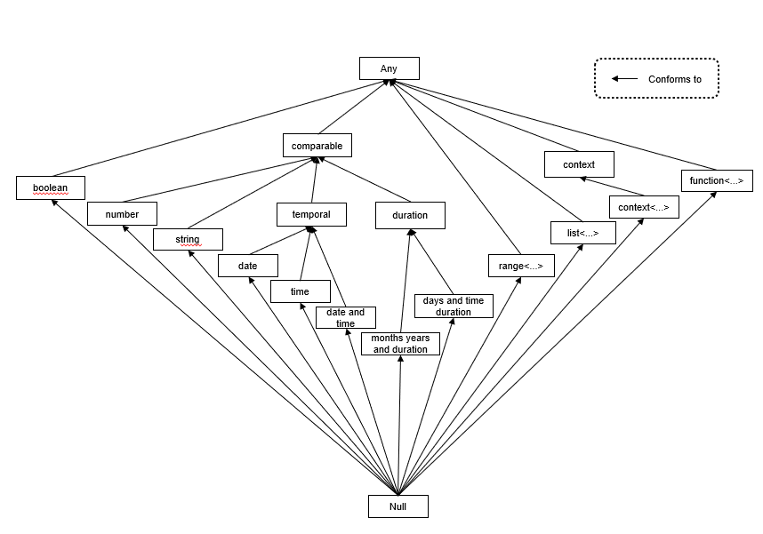

##### Examples

Let us consider the following ItemDefinitions:

\<itemDefinition name="Employee1"\>

> \<itemComponent name="id"\>
>
> \<typeRef\>number\</typeRef\>
>
> \</itemComponent\>
>
> \<itemComponent name="name"\>
>
> \<typeRef\>string\</typeRef\>
>
> \</itemComponent\>

\</itemDefinition\>

\<itemDefinition name="Employee2"\>

> \<itemComponent name="name"\>
>
> \<typeRef\>string\</typeRef\>
>
> \</itemComponent\>
>
> \<itemComponent name="id"\>
>
> \<typeRef\>number\</typeRef\>
>
> \</itemComponent\>
>
> \</itemDefinition\>

\<itemDefinition name="Employee3"\>

> \<itemComponent name="id"\>
>
> \<typeRef\>number\</typeRef\>
>
> \</itemComponent\>
>
> \<itemComponent name="name"\>
>
> \<typeRef\>string\</typeRef\>
>
> \</itemComponent\>
>
> \<itemComponent name="age"\>
>
> \<typeRef\>number\</typeRef\>
>
> \</itemComponent\>

\</itemDefinition\>

\<itemDefinition isCollection=”true” name="Employee3List"\>

> \<itemComponent name="id"\>
>
> \<typeRef\>number\</typeRef\>
>
> \</itemComponent\>
>
> \<itemComponent name="name"\>
>
> \<typeRef\>string\</typeRef\>
>
> \</itemComponent\>
>
> \<itemComponent name="age"\>
>
> \<typeRef\>number\</typeRef\>
>
> \</itemComponent\>

\</itemDefinition\>

> and the decisions *Decision1*, *Decision2, Decision3 and Decision4* with
> corresponding *typeRefs Employee1*, *Employee2,* *Employee3* and
> *Employee3List*.

[Examples of equivalence and conformance relations](#table-examples-of-equivalence-and-conformance-relations)
provides examples for *equivalence to* and *conforms to* relations.

###### Table: Examples of equivalence and conformance relations

| **type1** | **type2** | **equivalent to** | **conforms to** |
|--------------------|--------------------|--------------------|--------------------|
| number | number | True | True |
| string | string | True | True |
| string | date | False | False |
| date | date and time | False | False |
| **type(***Decision 1***)** | **type(***Decision2***)** | True | True |
| **type(***Decision1***)** | **type(***Decision3***)** | False | False |
| **type(***Decision3***)** | **type(***Decision1***)** | False | True |
| **type(***Decision 1***)** | **type(***{"id": 1,* *"name " :"Peter"}***)** | True | True |
| **type(***{"id": 1,* *"name " :"Peter"}***)** | **type(***Decision3***)** | False | False |
| **type(***{"id": 1,* *"name":"Peter", "age": 45}***)** | **type(***Decision1***)** | False | True |
| **type(***{"id": 1,* *"name":"Peter", "age": 45}***)** | **type(***Decision3***)** | True | True |
| **type***(\[1, 2, 3\]**)*** | **type***(\["1", "2", "3"\]**)*** | False | False |
| **type***(\[1, 2, 3\]**)*** | **type(***Decision3***)** | False | False |
| **type(***\[{"id": 1,* *"name":"Peter", "age": 45}\]***)** | **type(***Decision4***)** | True | True |
| **type(***Decision4***)** | **type(***Decision3***)** | False | False |
| **type(***function(x:Employee* *1 ) →Employee1***)** | **type(***function(x:Employee* *1 ) →Employee1***)** | True | True |
| **type(***function(x:Employee* *1 ) →Employee1***)** | **type(***function(x:Employee* *1 ) →Employee2***)** | True | True |
| **type(***function(x:Employee* *1 ) →Employee3***)** | **type(***function(x:Employee* *1 ) →Employee1***)** | False | True |
| **type(***function(x:Employee* *1 ) →Employee1***)** | **type(***function(x:Employee* *1 ) →Employee1***)** | False | False |
| **type(** \[1..10\] **)** | **type(** (20..100) **)** | True | True |
| **type1** | **type2** | equivalent to | conforms to |
| **type( \[1..10\] )** | **type( \[“a”..”x”\] )** | False | False |

##### Type conversions

The type of a FEEL expression *e* is determined from the value **e** = FEEL(*e*,
***s***) in the semantic domain, where ***s*** is a set of variable bindings
(see [Scope and context stack](#scope-and-context-stack)and [Mapping between
FEEL and other domains](#mapping-between-feel-and-other-domains)). When an
expression appears in a certain context it must be compatible with a type
expected in that context, called the *target type*. After the type of the
expression is deduced, an implicit conversion from the type of the expression to
the target type can be performed sometimes. If an implicit conversion is
mandatory but it cannot be performed the result is **null**.

In implicit type conversions, the data type is converted automatically without
loss of information. There are several possible implicit type conversions:

- *to singleton list*:  
  When the type of the expression is T and the target type is List\<T\> the
  expression is converted to a singleton list.

- *from singleton list*:  
  When the type of the expression is List\<T\>, the value of the expression is a
  singleton list and the target type is T, the expression is converted by
  unwrapping the first element.

- *from date to date and time*:  
  When the type of the expression is date and the target type is date and time,
  the expression is converted to a date time value in which the time of day is
  UTC midnight (00:00:00).

- *from decimal to integer*:

> When the type of an expression is number and the expected value in the context
> is an integer (e.g. arguments of built-in functions substring and decimal) any
> fractional part of this number will be discarded.

There is one type of conversion to handle semantic errors:

- *conforms to* (as defined in [Type Conformance](#type-conformance) Type
  Conformance):  
  When the type of the expression is S, the target type is T, and S conforms to
  T the value of expression remains unchanged. Otherwise, the result is
  **null**.

There are several kinds of contexts in which conversions may occur:

- Filter context ([Lists and filters](#lists-and-filters)) in which a filter
  expression is present. The expression to be filtered is subject to implicit
  conversion *to singleton list*.

- Invocation context ([Semantics of invocation](#table-semantics-of-invocation))
  in which an actual parameter is bound to a formal parameter of a function. The
  actual parameter is subject to implicit conversions.

- Binding contexts in which the result of a DRG Element’s logic is bound to the
  output variable. If after applying the implicit conversions the converted
  value and the target type do not conform, the *conforms to* conversion is
  applied.

###### Examples

The table below contains several examples for singleton list conversions.

###### Table: Examples of singleton list conversions

| **Expression** | **Conversion** | **Result** |
|---------------------------|---------------------------|---------------------------|
| *3\[item \> 2\]* | *3* is converted to *\[3\]* as this a filter context, and an *to singleton list* is applied | **\[3\]** |
| *contains(\["foobar"\], "of")* | *\["foobar"\]* is converted to *"foobar"*, as this is an invocation context and *from singleton list* is applied | **false** |

In the example below, before binding variable *decision_003* to value *"123"*
the conversion to the target type (number) fails, hence the variable is bound to
*null*.

\<decision name="decision_003" id="\_decision_003"\>

> \<variable name="decision_003" typeRef="number"/\>
>
> \<literalExpression\>
>
> \<text\>*”123*”\</text\>
>
> \</literalExpression\>

\</decision\>

#### Decision Table

The normative notation for decision tables is specified in [Decision
Table](10_Decision_Table.md#decision-table). Each input expression SHALL be a
textual expression (grammar rule 2). Each list of input values SHALL be an
instance of unary tests (grammar rule 15). The value that is tested is the value
of the input expression of the containing InputClause. Each list of output
values SHALL be an instance of unary tests (grammar rule 15).  
The value that is tested is the value of a selected output entry of the
containing OutputClause. Each input entry SHALL be an instance of unary tests
(grammar rule 15). Rule annotations are ignored in the execution semantics.

The decision table components are shown in
[Rules as rows - schematic layout](Images/rules-as-rows-schematic-layout.svg):
Rules as rows – schematic layout, and also correspond to the metamodel in clause
[Metamodel](10_Decision_Table.md#metamodel) For convenience,
[Rules as rows - schematic layout](Images/rules-as-rows-schematic-layout.svg) is
reproduced here.

| **information item name** |  |  |  |
|-------|-------------------------|--------------------------|-----------------------|
| H | input expression 1 | input expression 2 | Output label |
|  | input value 1a, input value 1b | input value 2a, input value 2b | output value 1a, output value 1b |
| 1 | input entry 1.1 | input entry 2.1 | output entry 1.1 |
| 2 |  | input entry 2.2 | output entry 1.2 |
| 3 | input entry 1.2 | \- | output entry 1.3 |

The semantics of a decision table is specified by first composing its literal
expressions and unary tests into Boolean expressions that are mapped to the
semantic domain and composed into rule matches then rule hits. Finally, some of
the decision table output expressions are mapped to the semantic domain and
comprise the result of the decision table interpretation. Decision table
components are detailed in
[Semantics of decision table](#table-semantics-of-decision-table).

###### Table: Semantics of decision table

| **Component name (\* means optional)** | **Description** |
|----------------------------------------|----------------------------------------|
| input expression | One of the N\>=0 input expressions, each a literal expression |
| input values\* | One of the N input values, corresponding to the N input expressions. Each is a unary tests literal (see below). |
| output values\* | A unary tests literal for the output. (In the event of M\>1 output components (see [Horizontal table with multiple output components](Images/horizontal-table-with-multiple-output-components.svg)), each output component may have its own output values) |
| rules | a list of R\>0 rules. A rule is a list of N input entries followed by M output entries. An input entry is a unary tests literal. An output entry is a literal expression. |
| hit policy\* | one of: "U", "A", “P”, “F”, "R", "O", "C", "C+", "C#", "C\<", “C\>” (default is "U") |
| default output value\* | The default output value is one of the output values. If M\>1, then default output value is a context with entries composed of output component names and output values. |

Unary tests (grammar rule 15) are used to represent both input values and input
entries. An input expression *e* is said to *satisfy* an input entry *t* (with
optional input values *v*), depending on the syntax of *t*, as follows:

- grammar rule 15.a: FEEL(*e in (t)*)**=true**

- grammar rule 15.b: FEEL(*e in (t)*)**=false**

- grammar rule 15.c when *v* is not provided: **e != null**

- grammar rule 15.c when *v* is provided: FEEL(*e in (v)*)**=true**

A rule with input entries *t1,t2,...,tN* is said to *match* the input expression
list *\[e1,e2,...,eN\]* (with optional input values list *\[v1,v2, ...vN\]*) if
*ei satisfies ti* (with optional input values *vi*) for all *i* in 1..N.

A rule is *hit* if it is matched, and the hit policy indicates that the matched
rule's output value should be included in the decision table result. Each hit
results in one output value (multiple outputs are collected into a single
context value). Therefore, multiple hits require aggregation.

The hit policy is specified using the initial letter of one of the following
boldface policy names.

Single hit policies:

- **Unique** – only a single rule can be matched.

- **Any** – multiple rules can match, but they all have the same output,

- **Priority** – multiple rules can match, with different outputs. The output
  that comes first in the supplied *output values* list is returned,

- **First** – return the first match in rule order,

Multiple hit policies:

- **Collect** – return a list of the outputs in arbitrary order,

- **Rule order** – return a list of outputs in rule order,

- **Output order** – return a list of outputs in the order of the *output
  values* list

The Collect policy may optionally specify an *aggregation*, as follows:

- **C+** – return the sum of the outputs

- **C#** – return the count of the outputs

- **C\<** – return the minimum-valued output

- **C\>** – return the maximum-valued output

The *aggregation* is defined using the following built-in functions specified in
clause [List functions](#list-functions): *sum, count, minimum, maximum*. To
reduce complexity, decision tables with compound outputs do not support
aggregation and support only the following hit policies: *Unique*, *Any*,
*Priority, First*, *Collect without operator*, and *Rule order*.

A decision table may have no rule hit for a set of input values. In this case,
the result is given by the default output value, or **null** if no default
output value is specified. A complete decision table SHALL NOT specify a default
output value.

The semantics of a decision table invocation **DTI** are as follows:

1.  Every rule in the rule list is matched with the input expression list.
    Matching is unordered.

2.  If no rules match,

    a\) if a default output value *d* is specified, **DTI=**FEEL(*d*)

    b\) else **DTI=null**.

3.  Else let *m* be the sublist of rules that match the input expression list.
    If the hit policy is "First" or "Rule order", order *m* by rule number.

    a\) Let *o* be a list of output expressions, where the expression at index
    *i* is the output expression from rule *m\[i\]*. The output expression of a
    rule in a single output decision table is simply the rule's output entry.
    The output expression of a multiple output decision table is a context with
    entries composed from the output names and the rule's corresponding output
    entries. If the hit policy is "Output order", the decision table SHALL be
    single output, and *o* is ordered consistent with the order of the *output
    values*. Rule annotations are ignored for purposes of determining the
    expression value of a decision table.

    b\) If a multiple hit policy is specified, DTI=FEEL(aggregation(o)), where
    aggregation is one of the built-in functions *sum, count, minimum* as
    specified in clause [List functions](#list-functions).

    c\) else **DTI=**FEEL(*o\[1\]*).

#### Scope and context stack

A FEEL expression *e* is always evaluated in a well-defined set of name bindings
that are used to resolve QNs in *e*. This set of name bindings is called the
scope of *e*. Scope is modeled as a list of contexts. A scope **s** contains the
contexts with entries that are in scope for *e*. The last context in **s** is
the *built-in* context. Next to last in **s** is the *global* context. The first
context in **s** is the context immediately containing *e* (if any). Next are
enclosing contexts of *e* (if any).

The QN of *e* is the QN of the first context in **s** appended with .N, where N
is the name of entry in the first context of **s** containing *e.* QNs in *e*
are resolved by looking through the contexts in **s** from first to last.

##### Local context

If *e* denotes the value of a context entry of context **m**, then **m** is the
local context for *e*, and **m** is the first element of **s.** Otherwise, *e*
has no local context and the first element of **s** is the global context, or in
some cases explained later, the first element of **s** is a special context.

All of the entries of **m** are in-scope for *e*, but the *depends on* graph
SHALL be acyclic. This provides a simple solution to the problem of the
confusing definition above: if **m** is the result of evaluating the context
expression *m* that contains *e*, how can we know it in order to evaluate *e*?
Simply evaluate the context entries in *depends on* order.

##### Global context

The global context is a context created before the evaluation of *e* and
contains names and values for the variables defined outside expression *e* that
are accessible in *e*. For example, when *e* is the body of a decision *D*, the
global context contains entries for the information requirements and knowledge
requirements of *D* (i.e., names and logic of the business knowledge models,
decisions and decision services required by *D)*.

##### Built-in context

The built-in context contains all the built-in functions.

##### Special context

Some FEEL expressions are interpreted in a *special* context that is pushed on
the front of **s**. For example, a filter expression is repeatedly executed with
special first context containing the name 'item' bound to successive list
elements. A function is executed with a special first context containing
argument name-\>value mappings.

Qualified names (QNs) in FEEL expressions are interpreted relative to **s**. The
meaning of a FEEL expression *e* in scope **s** is denoted as **FEEL(***e,*
**s)**. We can also say that *e* evaluates to **e** in scope **s**, or **e** =
**FEEL(***e,* **s)**. Note that **e** and **s** are elements of the FEEL domain.
**s** is a list of contexts.

#### Mapping between FEEL and other domains

A FEEL expression *e* denotes a value **e** in the semantic domain. Some kinds
of values can be passed between FEEL and external Java methods, between FEEL and
external PMML or ONNX models, and between FEEL and XML, as summarized in
[Mapping between FEEL and other domains](#table-mapping-between-feel-and-other-domains).
An empty cell means that no mapping is defined.

###### Table: Mapping between FEEL and other domains

| ***FEEL value*** | ***Java*** | ***XML*** | ***PMML*** | ***ONNX*** |
|----------|--------------------|-----------------|----------------|------------------|
| number | java.math.BigDecimal | decimal | decimal, PROB-NUMBER, PERCENTAGE-NUMBER | FLOAT, UINT8, INT8, UINT16, INT16, INT32, INT64, FLOAT16, DOUBLE, UINT32, UINT64, COMPLEX64, COMPLEX128, BFLOAT16, FLOAT8E4M3FN, FLOAT8E4M3FNUZ, FLOAT8E5M2, FLOAT8E5M2FNUZ, UINT4, INT4 |
|  |  | integer | integer , INT-NUMBER |  |
|  |  | double | double, REAL-NUMBER |  |
| string | java.lang.String | string | string, FIELD-NAME | STRING |
| date, time, date and time | javax.xml.datatype. XMLGregorianCalendar | date, dateTime, time, dateTimestamp | date, dateTime, time conversion required for dateDaysSince, *et. al.* |  |
| duration | javax.xml.datatype. Duration | yearMonthDuration, dayTimeDuration |  |  |
| boolean | java.lang.Boolean | boolean | boolean | BOOL |
| list | java.util.List | contain multiple child elements | array (homogeneous) | contiguous array |
| context | java.util.Map | contain attributes and child elements |  | Tensor |

For ONNX, each tensor is a context consisting of a string containing an ONNX
type name, a list containing the dimension(s) of the tensor and a list of
values.

Some kinds of values can also be passed between FEEL and JSON, as summarized in
[Mapping between FEEL and JSON domains](#table-mapping-between-feel-and-json-domains):

###### Table: Mapping between FEEL and JSON domains

| *FEEL type* | *JSON type* | *Notes* |
|-----------------|-----------------------|-----------------------------------------|
| number | number |   |
| string | string |   |
| date, time, date and time | string | A string representation conforming to an ISO 8601 Date, Time or Date and Time combination. If the FEEL date and time contains an IANA timezone id, the ISO 8601 Date and Time is suffixed by the IANA timezone id in rectangular brackets, e.g. 2007-12-03T10:15:30+01:00\[Europe/Paris\] |
| years and months duration, days and time duration | string | A string representation conforming to an ISO 8601 Duration |
| boolean | The JSON literal "true" or the JSON literal "false" |   |
| list | array |   |
| context | object |   |
| range | string | A string conforming to grammar rule 66 “range literal" as defined in chapter [Grammar rules](#grammar-rules). |
| null | The JSON literal "null" |   |

Sometimes we do not want to evaluate a FEEL expression *e*, we just want to know
the type of **e***.* Note that if *e* has QNs, then a context may be needed for
type inference. We write **type(***e***)** as the type of the domain element
**FEEL(***e,* **c)**.

#### Functions Semantics

FEEL functions can be:

- built-in, *e.g.*, *sum* (see clause [List functions](#list-functions)), or

- user-defined, *e.g., function(age) age \< 21*, or

- externally defined, *e.g.*, *function(angle) external {*

> *java: {*
>
> *class: “java.lang.Math ”, method signature: “cos(double)” }}*

##### Built-in Functions

The built-in functions are described in detail in section [Built-in
functions](#built-in-functions-1). In particular, function signatures and
parameter domains are specified. Some functions have more than one signature.

Built-in functions are invoked using the same syntax as other functions (grammar
rule 40). The actual parameters must conform to the parameter domains in at
least one signature before or after applying implicit conversions, or the result
of the invocation is **null**.

##### User-defined functions

User-defined functions (grammar rule 55) have the form *function(X1, ... Xn)
body*

The terms *X1, ... Xn* are formal parameters. Each formal parameter has the form
*ni* or *ni* :*ti*, where the *ni* are the parameter names and *ti* are their
types. If the type isn’t specified, *Any* is assumed. The meaning of

FEEL(*function(X1, ... Xₙ) body*, **s**) is an element in the FEEL semantic
domain that we denote as **function(argument list: \[***X1, ... Xₙ***\], body:**
*body***, scope: s)** (shortened to **f** below). FEEL functions are lexical
closures, i.e.*,* the *body* is an expression that references the formal
parameters and any other names in scope **s**.

User-defined functions are invoked using the same syntax as other functions
(grammar rule 38). The meaning of an invocation *f(n1:e1,*...*,nn:en)* in scope
**s** is FEEL(*f,* **s**) applied to arguments *n1:*FEEL(*e1,* **s**)...
*,nn:*FEEL(*en,* **s**). This can also be written as **f(n**1:**e**1...
*,***n**ₙ:**e**ₙ).

The arguments **n**₁:**e**₁... ,**n**ₘ:**e**ₘ conform to the argument list
\[*X₁, ... Xₙ*\] if the function type (**type(e₁)**, ..., **type(eₘ)**) → *U*
conforms to (*X₁, ..., Xₙ*) → *U* where *U* is the return type of function *f*
(see [Type Conformance](#type-conformance)). The result of applying **f** to the
interpreted arguments **n**1:**e**1... *,***n**ₙ:**e**ₙ is determined as
follows. If **f** is not a function, or if the arguments do not conform to the
argument list, the result of the invocation is **null**. Otherwise, let **c** be
a context with entries **n**1:**e**1... *,***n**ₙ:**e**ₙ. The result of the
invocation is FEEL(*body, **s’***), where **s'** = insert before(**s**, 1,
**c**) (see [List functions](#list-functions)).

Invocable elements (Business Knowledge Models or Decision Services) are invoked
using the same syntax as other functions (grammar rule 38). An Invocable is
equivalent to a FEEL function whose parameters are the invocable’s inputs (see
[Execution Semantics of Decision
Services](#execution-semantics-of-decision-services))

##### Externally-defined functions

FEEL externally-defined functions have the following form *function (X1, ... Xₙ)
external mapping-information*

Mapping-information is a context that SHALL have one of the following forms:

> *{*
>
> *java: {class: class-name, method signature: method-signature}*
>
> *}*

or

> *{*
>
> *onnx: {file: IRI, function signature: function-signature}*
>
> *}*

or

> *{*
>
> *pmml: {document: IRI, model: model-name}*
>
> *}*

The meaning of an externally defined function is an element in the semantic
domain that we denote as **function(argument list: \[***X1, ... Xₙ***\],
external: mapping-information)**.

The *java* form of the mapping information indicates that the external function
is to be accessed as a method on a Java class. The *class-name* SHALL be the
string name of a Java class on the classpath. Classpath configuration is
implementation-defined. The *method-signature* SHALL be a string consisting of
the name of a public static method in the named class, followed by an argument
list containing only Java argument type names. The argument type information
SHOULD be used to resolve overloaded methods and MAY be used to detect
out-of-domain errors before runtime.

The *pmml* form of the mapping information indicates that the external function
is to be accessed as a PMML model. The *IRI* SHALL be the resource identifier
for a PMML document. The *model-name* is optional. If the *model-name* is
specified, it SHALL be the name of a model in the document to which the *IRI*
refers. If no *model-name* is specified, the external function SHALL be the
first model in the document.

The *onnx* form of the mapping information indicates that the external function
is to be accessed as a ONNX model. The *IRI* SHALL be the resource identifier
for a ONNX file. The *function-signature* SHALL be a string containing only one
or more tensor definitions, each consisting of a ONNX type and the tensor
dimensions in the form \[a,b,c\]. The tensor information SHOULD be passed to the
ONNX implementation at runtime along with the data and MAY be used to detect
errors before runtime.

When an externally-defined function is invoked, actual argument values and
result value are converted when possible, using the type mapping table for Java,
ONNX or PMML (see
[Mapping between FEEL and other domains](#table-mapping-between-feel-and-other-domains)).
When a conversion is not possible, **null** is substituted. If a result cannot
be obtained, *e.g.,* an exception is thrown, the result of the invocation is
**null**. If the externally-defined function is of type PMML or ONNX, and
invocation results in a single predictor output, the result of the
externally-defined function is the single predictor output's value.

Passing parameter values to the external method or model requires knowing the
expected parameter types. For Java, this information is obtained using
reflection. For PMML, this information is obtained from the mining schema and
data dictionary elements associated with independent variables of the selected
model. For ONNX this is determined by analysis of the protobuf data structure
which contains a list of all the inputs and their (tensor) types.

Note that **DMN** does not completely define the semantics of a Decision Model
that uses externally-defined functions. Externally-defined functions SHOULD have
no side-effects and be deterministic.

##### Function name

To name a function, define it as a context entry. For example:

> *{ isPositive : function(x) x \> 0,*
>
> *isNotNegative : function(x) isPositive(x+*
>
> *1), result: isNotNegative(0)*

*}*

##### Positional and named parameters

An invocation of any FEEL function (built-in, user-defined, or
externally-defined) can use positional parameters or named parameters. If
positional, all parameters SHALL be supplied. If named, unsupplied parameters
are bound to **null**.

#### For loop expression

The for loop expression iterates over lists of elements or ranges of numbers or
dates. The general syntax is:

> *for i₁ in ic₁ \[, i₂ in ic₂ \[, ...\]\] return e*

where:

- *ic₁, ic₂, ..., icₙ* are *iteration contexts*

- *i₁, i₂, ..., iₙ* are variables bound to each element in the *iteration
  context*

- *e* is the **return** expression

An *iteration context* may either be an expression that returns a list of
elements, or two expressions that return integers connected by “..”. Examples of
valid iteration contexts are:

- \[ 1, 2, 3\]

- a list

- 1..10

- 50..40

- x..x+10

- @”2021-01-01”..@”2022-01-01”

A *for loop expression* will iterate over each element in the *iteration
context*, binding the element to the corresponding variable *iₙ* and evaluating
the expression *e* in that scope.

When the *iteration context* is a range of numbers, the *for loop expression*
will iterate over the range incrementing or decrementing the value of *iₙ* by 1,
depending if the range is ascendant (when the resulting integer from the first
expression is lower than the second) or descendant (when the resulting integer
from the first expression is higher than the second).

When the iteration context is a range of dates, the for loop expression will
iterate over the range incrementing or decrementing the value of i ₙ by 1 day,
depending if the range is ascendant (when the resulting date from the first
expression is lower than the second) or descendant (when the resulting date from
the first expression is higher than the second).

The result of the *for loop expression* is a list containing the result of the
evaluation of the expression *e* for each individual iteration in order.

The expression *e* may also reference an implicitly defined variable called
“***partial***” that is a list containing all the results of the previous
iterations of the expression. The variable “***partial***” is immutable. E.g.:
to calculate the factorial list of numbers, from 0 to N, where N is a
non-negative integer, one may write:

> *for i in 0..N return if i = 0 then 1 else i \* partial\[-1\]*

When multiple *iteration contexts* are defined in the same *for loop
expression*, the resulting iteration is a cross product of the elements of the
*iteration contexts*. The iteration order is from the inner *iteration context*
to the outer *iteration context*.

E.g., the result of the following *for loop expression* is:

> *for i in \[i₁,i₂\], j in \[j₁j₂\] return e **= \[ r₁, r₂, r₃, r₄ \]***

Where:

> ***r₁ = FEEL( e, { i: i₁, j: j₁, partial:\[\], ... } ) r₂ = FEEL( e, { i: i₁,
> j: j₂, partial:\[r₁\], ... ) r₃ = FEEL( e, { i: i₂, j: j₁, partial:\[r₁,r₂\],
> ... } )***

***r₄ = FEEL( e, { i: i₂, j: j₂, partial:\[r₁,r₂,r₃\], ... } )***

#### Semantic mappings

The meaning of each substantive grammar rule is given below by mapping the
syntax to a value in the semantic domain. The value may depend on certain input
values, themselves having been mapped to the semantic domain. The input values
may have to obey additional constraints. The input domain(s) may be a subset of
the semantic domain. Inputs outside of their domain result in a **null** value
unless the implicit conversion *from singleton list* ([Type
conversions](#type-conversions)) can be applied.

###### Table: Semantics of FEEL functions

| **Grammar Rule** | **FEEL Syntax** | **Mapped to Domain** |
|--------------|-------------------------|------------------------------------------|
| 55 | *function(n1, ...nN) e* | **function(argument list: \[***n1, ... nN***\], body:** *e***, scope: s)** |
| 55 | *function(n1, ...nN) external e* | **function(argument list: \[***n1, ... nN***\], external: e)** |

See [Ranges](#ranges).

###### Table: Semantics of other FEEL expressions

| **Grammar** **Rule** | **FEEL Syntax** | **Mapped to Domain** |
|--------------|-------------------------|------------------------------------------|
| 44 | *for i₁ in ic₁, i₂ in ic₂, ... return e* | **\[ FEEL(***e*, **s'), FEEL(***e*, **si, ... \]** |
| 45 | *if e1 then e2 else e3* | **if FEEL(***e1***) is true then FEEL(***e2***) else FEEL(***e3***)** |
| 46 | *some n1 in e1, n2 in e2, ...* *satisfies e* | **false or FEEL(***e,* **s') or FEEL(***e,* **s") or ...** |
| 46 | *every n 1 in e 1, n2 in e2, ...* *satisfies e* | **true and FEEL(***e,* **s') and FEEL(***e,* **s") and ...** |
| 47 | *e1 or e2 or ...* | **FEEL(***e1***) or FEEL(***e2***) or** ... |
| 48 | *e1 and e2 and ...* | **FEEL(***e1***) and FEEL(***e2***) and** ... |
| 49.a | *e = null* | **FEEL(***e***) is null** |
| 49.a | *null = e* | **FEEL(***e***) is null** |
| 49.a | *e != null* | **FEEL(***e***) is not null** |
| 49.a | *null != e* | **FEEL(e) is not null** |

Notice that we use bold syntax to denote contexts, lists, conjunctions,
disjunctions, conditional expressions, true, false, and null in the FEEL domain.

The meaning of the conjunction **a and b** and the disjunction **a or b** is
defined by ternary logic. Because these are total functions, the input can be
**true**, **false**, or **otherwise** (meaning any element of **D** other than
**true** or **false**).

A conditional **if a then b else c** is equal to **b** if **a** is **true**, and
equal to **c** otherwise.

**s'** is the scope **s** with a special first context containing keys n1, n2,
etc. bound to the first element of the Cartesian product of FEEL**(***e1***) x**
FEEL**(***e2***) x ..., s"** is **s** with a special first context containing
keys bound to the second element of the Cartesian product, *etc*. When the
Cartesian product is empty, the *some ... satisfies* quantifier returns
**false** and the *every ... satisfies* quantifier returns **true**.

###### Table: Semantics of conjunction and disjunction

| **a**     | **b**     | **a and b** | **a or b** |
|-----------|-----------|-------------|------------|
| true      | true      | true        | true       |
| true      | false     | false       | true       |
| true      | otherwise | null        | true       |
| false     | true      | false       | true       |
| false     | false     | false       | false      |
| false     | otherwise | false       | null       |
| otherwise | true      | null        | true       |
| otherwise | false     | false       | null       |
| otherwise | otherwise | null        | null       |

Negation is accomplished using the built-in function **not**. The ternary logic
is as shown in [Semantics of negation](#table-semantics-of-negation).

###### Table: Semantics of negation

| **a**     | **not(a)** |
|-----------|------------|
| true      | false      |
| false     | true       |
| otherwise | null       |

Equality and inequality map to several kind- and datatype-specific tests, as
shown in
[General semantics of equality and inequality](#table-general-semantics-of-equality-and-inequality),
[Specific semantics of equality](#table-specific-semantics-of-equality) and
[Specific semantics of inequality](#table-specific-semantics-of-inequality). By
definition, FEEL(*e1 != e2*) is FEEL(*not(e 1= e2)*). The other comparison
operators are defined only for the datatypes listed in
[Specific semantics of inequality](#table-specific-semantics-of-inequality).
Note that
[Specific semantics of inequality](#table-specific-semantics-of-inequality)
defines only ‘\<’; ‘\>’ is similar to ‘\<’ and is omitted for brevity; *e1\<=e2*
is defined as *e1\< e2 or e1= e2.*

###### Table: General semantics of equality and inequality

| **Grammar Rule** | **FEEL Syntax** | **Input Domain** | **Result** |
|-------------|-----------------|------------------------|--------------------------|
| 49.a | *e1 = e2* | **e1 and e2 must both be of the same kind/datatype – both numbers, both strings, etc.** | *See below* |
| 49.a | *e1 \< e2* | **e1** and **e2** must both be of the same kind/datatype – both numbers, both strings, *etc.* | *See below* |

###### Table: Specific semantics of equality

| **kind/datatype** | ***e1 = e2*** |
|------------------------------|--------------------------------------------------|
| list | lists must be same length N and **e1\[i\] = e2\[i\]** for 1 ≤ **i** ≤ N. |
| context | contexts must have same set of keys K and **e1.k = e2.k** for every k in K |
| range | the ranges must specify the same endpoint(s) and the same comparison operator or endpoint inclusivity flag. |
| function | internal functions must have the same parameters, body, and scope. Externally defined functions must have the same parameters and external mapping information. |
| number | **value(e1) = value(e2)**. Value is defined in [number](#number). Precision is not considered. |
| string | **e1** is the same sequence of characters as **e2** |
| date | **value(e1) = value(e2)**. Value is defined in [date](#date) |
| date and time | **value(e1) = value(e2)**. Value is defined in [date-time](#date-time) |
| time | **value(e1) = value(e2)**. Value is defined in [time](#time). |
| days and time duration | **value(e1) = value(e2)**. Value is defined in [days and time duration](#days-and-time-duration) |
| years and months duration | **value(e1) = value(e2)**. Value is defined in [years and months duration](#years-and-months-duration). |
| boolean | **e1** and **e2** must both be **true** or both be **false** |

###### Table: Specific semantics of inequality

| **datatype** | ***e1 \< e2*** |
|------------------------------|--------------------------------------------------|
| number | **value(e1) \< value(e2)**. **value** is defined in [number](#number). Precision is not considered. |
| string | sequence of characters **e1** is lexicographically less than the sequence of characters **e2**. *I.e.,* the sequences are padded to the same length if needed with *\\u0* characters, stripped of common prefix characters, and then the first character in each sequence is compared. |
| date | e1 \< e2 if the year value of e1 \< the year value of e2 e1 \< e2 if the year values are equal and the month value of e1 \< the month value of e2 e1 \< e2 if the year and month values are equal and the day value of e1 \< the day value of e2 |
| date and time | **valuedt(e1) \< valuedt(e2)**. **valuedt** is defined in [date](#date). If one input has a null timezone offset, that input uses the timezone offset of the other input. |
| time | **valuet(e1) \< valuet(e2)**. **valuet** is defined in [time](#time). If one input has a null timezone offset, that input uses the timezone offset of the other input. |
| days and time duration | **valuedtd(e1) \< valuedtd(e2)**. **valuedtd** is defined in [days and time duration](#days-and-time-duration). |
| years and months duration | **valueymd(e1) \< valueymd(e2)**. **valueymd** is defined in [years and months duration](#years-and-months-duration). |

FEEL supports additional syntactic sugar for comparison. Note that Grammar Rules
(clause [Grammar rules](#grammar-rules)) are used in decision table condition
cells. These decision table syntaxes are defined in
[Semantics of decision table syntax](#table-semantics-of-decision-table-syntax).

###### Table: Semantics of decision table syntax

| **Grammar** **Rule** | **FEEL Syntax** | **Equivalent FEEL Syntax** | **applicability** |
|-------------|--------------------|-------------------------|------------------------|
| 49.b | *e1 between e2 and e3* | *e1 \>= e2 and e1 \<= e3* |  |
| 49.c | *e1 in \[e2,e3, ... \]* | *e1 = e2 or e1 = e3 or...* | e2 and e3 are endpoints |
| 49.c | *e1 in \[e2,e3, ... \]* | *e1 in e2 or e1 in e3 or...* | e2 and e3 are ranges |
| 49.c | *e1 in \<=e2* | *e1 \<= e2* |  |
| 49.c | *e1 in \<e2* | *e1 \< e2* |  |
| 49.c | *e1 in \>=e2* | *e1 \>= e2* |  |
| 49.c | *e1 in \>e2* | *e1 \> e2* |  |
| 49.c | *e1 in (e2..e3)* | *e1 \> e2 and e1\<e3* |  |
| 49.c | *e1 in (e2..e3\]* | *e1 \> e2 and e1\<=e3* |  |
| 49.c | *e1 in \[e2..e3)* | *e1 \>= e2 and e1\<e3* |  |
| 49.c | *e1 in \[e2..e3\]* | *e1 \>= e2 and e1\<=e3* |  |
| 49.c | *e1 in e2* | *e1 = e2* | e2 is a qualified name that does *not* evaluate to a list |
| 49.c | *e1 in e2* | *list contains( e2, e1 )* | e1 is a simple value that is not a list and e2 is a qualified name that evaluates to a list |
| 49.c | *e1 in e2* | *{ ? : e1, r : e2 }.r* | e2 is a boolean expression that uses the special |

Addition and subtraction are defined in
[General semantics of addition and subtraction](#table-general-semantics-of-addition-and-subtraction)
and
[Specific semantics of addition and subtraction](#table-specific-semantics-of-addition-and-subtraction).
Note that if input values are not of the listed types, the result is **null**.

###### Table: General semantics of addition and subtraction

| **Grammar Rule** | **FEEL**  | **Input Domain and Result** |
|------------------|-----------|-----------------------------|
| 19               | *e1 + e2* | *See below*                 |
| 20               | *e1 – e2* | *See below*                 |

###### Table: Specific semantics of addition and subtraction

| **type(e1)** | **type(e2)** | ***e1 + e2, e1 – e2*** | **result type** |
|-------------|-------------|------------------------------------------|--------------|
| number | number | Let **e1=(p1,s1)** and **e2=(p2,s2)** as defined in [number](#number). If **value(p1,s1) +/- value(p2,s2)** requires a scale outside the range of valid scales, the result is **null**. Else the result is **(p,s)** such that • **value(p,s) = value(p1,s1) +/- value(p2,s2) + ε** • **s ≤ max(s1,s2)** • **s** is maximized subject to the limitation that **p** has 34 digits or less • **ε** is a possible rounding error. | number |
| date and time | date and time | Addition is undefined. Subtraction is defined as **valuedtj¹ (valuedt(e1)-valuedt(e2))**, where **valuedt** is defined in [date](#date) and **valuedtj¹** is defined in [days and time duration](#days-and-time-duration). In case either value is of type date, it is implicitly converted into a date and time with time of day of UTC midnight ("00:00:00") as defined in [date-time](#date-time). Subtraction requires either both values to have a timezone or both not to have a timezone. Subtraction is undefined for the case where only one of the values has a timezone. | days and time duration |
| time | time | Addition is undefined. Subtraction is defined as **valuedtd⁻¹ (valuet(e1)-valuet(e2))** where **valuet** is defined in [time](#time) and **valuedtd ₋₁** is defined in [days and time duration](#days-and-time-duration). | days and time duration |
| years and months duration | years and months duration | **valueymd⁻¹(valueymd(e1) +/- valueymd(e2))** where **valueymd** and **valueymd ₋₁** is defined in [years and months duration](#years-and-months-duration). | years and months duration |
| days and time duration | days and time duration | **valuedtd ⁻¹(valuedtd(e1) +/- valuedtd(e2))** where **valuedtd** and **valuedtd⁻¹** is defined in [days and time duration](#days-and-time-duration). | days and time duration |
| date and time | years and months duration | date and time (date(**e1**.year +/– **e2**.years + floor((**e1**.month +/– **e2**.months)/12), **e1**.month +/– **e2**.months – floor((**e1**.month +/– **e2**.months)/12) \* 12, **e1**.day), time(**e1**)), where the named properties are as defined in **[List of properties per type](#table-list-of-properties-per-type)** below, and the date, date and time, time and floor functions are as defined in [Built-in functions](#built-in-functions-1), **valuedt** and **valuedt ⁻¹** is defined in [date](#date) and **valueymd** is defined in [years and months duration](#years-and-months-duration). | date and time |
| years and months duration | date and time | Subtraction is undefined. Addition is commutative and is defined by the previous rule. | date and time |
| date and time | days and time duration | **valuedt ⁻¹(valuedt(e1) +/- valuedtd(e2))** where **valuedt** and **valuedt ⁻¹** is defined in [date](#date) and **valuedtd** is defined in [days and time duration](#days-and-time-duration). | date and time |
| days and time duration | date and time | Subtraction is undefined. Addition is commutative and is defined by the previous rule. | date and time |
| time | days and time duration | **valuet ⁻¹(valuet(e1) +/- valuedtd(e2))** where **valuet** and **valuet ⁻¹** are defined in [time](#time) and **valuedtd** is defined in [days and time duration](#days-and-time-duration). | time |
| days and time duration | time | Subtraction is undefined. Addition is commutative and is defined by the previous rule. | time |
| string | string | Subtraction is undefined. Addition concatenates the strings. The result is a string containing the sequence of characters in e1 followed by the sequence of characters in e2. | string |
| date | years and months duration | **date( e1.year +/– e2.years + floor((e1.month +/– e2.months)/12), e1.month +/– e2.months – floor((e1.month +/– e2.months)/12) \* 12, e1.day )**, where the named properties are as defined in **[List of properties per type](#table-list-of-properties-per-type)** below, and the date and floor functions are as defined in [Built-in functions](#built-in-functions-1). | date |
| years and months duration | date | Subtraction is undefined. Addition is commutative and is defined by the previous rule. | date |
| date | days and time duration | date(valuedt⁻¹ (valuedt(e1) +/- valuedtd(e2))) where valuedt and valuedt⁻¹ is defined in [date](#date) and valuedtd is defined in [days and time duration](#days-and-time-duration). | date |
| days and time duration | date | Subtraction is undefined. Addition is commutative and is defined by the previous rule. | date |

Multiplication and division are defined in
[General semantics of multiplication and division](#table-general-semantics-of-multiplication-and-division)
and
[Specific semantics of multiplication and division](#table-specific-semantics-of-multiplication-and-division).
Note that if input values are not of the listed types, the result is **null**.

###### Table: General semantics of multiplication and division

| **Grammar Rule** | **FEEL**   | **Input Domain and Result** |
|------------------|------------|-----------------------------|
| 21               | *e1 \* e2* | *See below*                 |
| 22               | *e1 / e2*  | *See below*                 |

###### Table: Specific semantics of multiplication and division

| **type(e1)** | **type(e2)** | ***e1 \* e2*** | ***e1 / e2*** | **result type** |
|-----------|-----------|-----------------------|-----------------------|-------------|
| number **e1=(p1,s1)** | number **e2=(p2,s2)** | If **value(p1,s1) \* value(p2,s2)** requires a scale outside the range of valid scales, the result is **null**. Else the result is **(p,s)** such that • **value(p,s) = value(p1,s1)** **\* value(p2,s2) + ε** • **s ≤ s1+s2** • **s** is maximized subject to the limitation that **p** has 34 digits or less • **ε** is a possible rounding error | If **value(p2,s2)=0** or **value(p1,s1) / value(p2,s2)** requires a scale outside the range of valid scales, the result is **null**. Else the result is **(p,s)** such that • **value(p,s) = value(p1,s1) / value(p2,s2) + ε** • **s ≤ s1-s2** • **s** is maximized subject to the limitation that **p** has 34 digits or less | number |
| years and months duration | number | **valueymd ⁻¹(valueymd(e1) \* value(e2))** where **valueymd** and **valueymd ₋₁** are defined in [years and months duration](#years-and-months-duration) | If **value(e2)=0**, the result is **null**. Else the result is **valueymd⁻ ¹(valueymd(e1) / value(e2))** where **valueymd** and **valueymd⁻¹** are defined in [years and months duration](#years-and-months-duration). | years and months duration |
| number | years and months duration | *See above, reversing e1 and e2* | *Not allowed* | years and months duration |
| years and months duration | years and months duration | *Not allowed* | If **valueymd(e2)=0**, the result is **null**. Else the result is **valueymd(e1) / valueymd(e2)** where **valueymd** is defined in [years and months duration](#years-and-months-duration). | number |
| days and time duration | number | **valuedtd⁻¹(valuedtd(e1) \* value(e2))** where **valuedtd** and **valuedtd ₋₁** are defined in [days and time duration](#days-and-time-duration). | If **value(e2)=0**, the result is **null**. Else the result is **valuedtd ¹(valuedtd(e1) \* value(e2))** where **valuedtd** and **valuedtd ₋₁** are defined in [days and time duration](#days-and-time-duration). | days and time duration |
| number | days and time duration | *See above, reversing e1 and e2* | *Not allowed* | days and time duration |
| days and time duration | days and time duration | *Not allowed* | If **valuedtd(e2)=0**, the result is **null**. Else the result is **valuedtd(e1) / valuedtd(e2)** where **\_valuedtd** is defined in [days and time duration](#days-and-time-duration). | number |

###### Table: Semantics of exponentiation

| **Grammar** **Rule** | **FEEL** **Syntax** | **Input Domain** | **Result** |
|------------|-----------|---------------------------|--------------------------------|
| 23 | *e1 \*\* e2* | **type(e1)** is number. **value(e2)** is a number in the range \[-999,999,999..999,999,999\]. | If **value(e1)value(e2 )** requires a scale that is out of range, the result is **null**. Else the result is **(p,s)** such that • **value(p,s)= value(e1)^value(e₂⁾ + ε** • **p** is limited to 34 digits • **ε** is rounding error |

Type-checking is defined in
[Semantics of type-checking](#table-semantics-of-type-checking). Note that
*type* is not mapped to the domain, and **null** is the only value in the Null
type (see [Semantic Domain](#semantic-domain)).

Before evaluating the *instance of* operator both operands are mapped to the
type lattice **L** (see [Relations between types](#relations-between-types)).

###### Table: Semantics of type-checking

| **Grammar** **Rule** | **FEEL Syntax** | **Mapped to Domain** | **Examples** |
|----------|---------------|-----------------------|--------------------------------|
| 51 | *e1 instance of e2* | If ***e₂*** cannot be mapped to a node in the lattice L, the result is **null.** If **e₁** is **null** and **type(***e₂***)** is *Null*, the result is **true**. If **type(***e₁***)** conforms to **type(***e₂***)** (see section [Relations between types](#relations-between-types)) and **e₁** is not **null,** the result is **true**. Otherwise, the result is **false**. | *\[123\] instance of list\<number\>* is **true** *"abc" instance of string* is **true** *123 instance of string* is **false** *123 instance of list* is **null** as a list type requires parameters (see rule 54). |
| 51 | *e1 as e2* | If **e₁** instance of **e₂** is **false** or **null**, the result is **null.** Otherwise the result is **e₁** and **type(**e₁ instance of e₂**)** is **type(**e₂**)** | *"abc" as string =* "abc"  *123 as string =* **null**  *\[1, 2, 3\] as list\<number\>* = \[1, 2, 3\]  *abs(x as number)* where x is a variable of type Any*.* If x is a number, the function is invoked with that number as argument; otherwise, the function is invoked with null as argument. |

Negative numbers and negation of durations are defined in
[Semantics of negative numbers and negation of durations](#table-semantics-of-negative-numbers-and-negation-of-durations).

###### Table: Semantics of negative numbers and negation of durations

| **Grammar Rule** | **FEEL Syntax** | **Equivalent FEEL Syntax** |
|------------------|-----------------|----------------------------|
| 24               | *-e*            | *e\*-1*                    |

Invocation is defined in
[Semantics of invocation](#table-semantics-of-invocation). An invocation can use
positional arguments or named arguments. If positional, all arguments must be
supplied. If named, unsupplied arguments are bound to **null**. Note that **e**
can be a user-defined function, a user-defined external function, or a built-in
function. The arguments are subject to implicit conversions ([Type
conversions](#type-conversions)). If the argument types before or after
conversion do not conform to the corresponding parameter types, the result of
the invocation is **null**.

###### Table: Semantics of invocation

| **Grammar Rule** | **FEEL** | **Mapped to Domain** | **Applicability** |
|--------------|---------------------|-----------------------|-----------------------|
| 38, 39, 42 | *e(e1,..)* | **e(e1**,...**)** | **e** is a function with matching arity and conforming parameter types |
| 38, 39, 40, 41 | *e(n1:e1,...)* | **e(***n1***:e1,...)** | **e** is a function with matching parameter names and conforming parameter types |

Properties are defined in
[General semantics of properties](#table-general-semantics-of-properties) and
[List of properties per type](#table-list-of-properties-per-type). If
**type(***e***)** is date and time, time, or duration, and **name** is a
property name, then the meaning is given by
[List of properties per type](#table-list-of-properties-per-type) and
[Specific semantics of date, time, and duration properties](#table-specific-semantics-of-date-time-and-duration-properties).
For example, FEEL(*date and time("2012-0307Z").year*) = **2012**.

###### Table: General semantics of properties

| **Grammar Rule** | **FEEL** | **Mapped to Domain** | **Applicability**                   |
|---------------|---------------------|-----------------------|----------------------|
| 18               | *e.name* | **e."name"**         | **type(e)** is a context            |
| 18               | *e.name* | *see below*          | **type(e)** is a date/time/duration |

###### Table: List of properties per type

| **type(*e*)** | ***e .* name** | **name =** |
|-----------------|--------------------------------------|--------------------------|
| date | result is the **name**d component of the date object **e**. Valid names are shown to the right. | year, month, day, weekday, value |
| date and time | result is the **name**d component of the date and time object **e**. Valid names are shown to the right. | year, month, day, weekday, hour, minute, second, time offset, timezone, value |
| time | result is the **name**d component of the time object **e**. Valid names are shown to the right | hour, minute, second, time offset, timezone, value |
| years and months duration | result is the **name**d component of the years and months duration object **e**. Valid names are shown to the right. | years, months, value |
| days and time duration | result is the **name**d component of the days and time duration object **e**. Valid names are shown to the right. | days, hours, minutes, seconds, value |
| range | result is the **name**d component of the range object **e**. Valid names are shown to the right. | start, end, start included, end included |

###### Table: Specific semantics of date, time, and duration properties

| **name** | ***type*(name)** | **description** |
|-----------------|-----------------|----------------------------------------------|
| year | number | The year number as an integer in the interval \[-999,999,999 .. 999,999,999\] |
| month | number | The month number as an integer in the interval \[1..12\], where 1 is January and 12 is December |
| day | number | The day of the month as an integer in the interval \[1..31\] |
| weekday | number | The day of the week as an integer in the interval \[1. .7\] where 1 is Monday and 7 is Sunday (compliant with the definition in ISO 8601) |
| hour | number | The hour of the day as an integer in the interval \[0..23\] |
| minute | number | The minute of the hour as an integer in the interval \[0..59\] |
| second | number | The second of the minute as a decimal in the interval \[0. .60) |
| time offset | days and time duration | The duration offset corresponding to the timezone the date or date and time value represents. The time offset duration must be in the interval **\[duration(“-PT14H”)..duration(“PT14H”)\]** as per the XML Schema Part 2 dateTime datatype. The **time offset** property returns null when the object does not have a time offset set. |
| timezone | string | The timezone identifier as defined in the IANA Time Zones database. The **timezone** property returns null when the object does not have an IANA timezone defined. |
| **name** | ***type*(name)** | **description** |
| years | number | The normalized years component of a years and months duration value as an integer. This property returns null when invoked on a days and time duration value. |
| months | number | The normalized months component of a years and months duration value. Since the value is normalized, this property must return an integer in the interval \[0.. 11\]. This property returns null when invoked on a days and time duration value. |
| days | number | The normalized days component of a days and time duration value as an integer. This property returns null when invoked on a years and months duration value. |
| hours | number | The normalized hours component of a days and time duration value. Since the value is normalized, this property must return an integer in the interval \[0..23\]. This property returns null when invoked on a years and months duration value. |
| minutes | number | The normalized minutes component of a days and time duration value. Since the value is normalized, this property must return an integer in the interval \[0..59\]. This property returns null when invoked on a years and months duration value. |
| seconds | number | The normalized minutes component of a days and time duration value. Since the value is normalized, this property must return a decimal in the interval \[0..60). This property returns null when invoked on a years and months duration value. |
| value | number | The value returned by the value function corresponding to the type as defined in [time](#time), [date](#date), [date-time](#date-time), [days and time duration](#days-and-time-duration) and [years and months duration](#years-and-months-duration). |

###### Table: Specific semantics of range properties

| **name** | **type(name)** | **description** |
|---------------------------|---------------------------|--------------------------|
| start | Type of the start endpoint of the range | the start endpoint of the range |
| end | Type of the end endpoint of the range | the end endpoint of the range |
| start included | boolean | true if the start endpoint is included in the range |
| end included | boolean | true if the end endpoint is included in the range |

In the case of nested contexts, the descendant expression can be used to access
a property name recursively throughout the nested context. For example:

    { a: { b: { b: 1 } } }...b

is evaluated to:

    [ { b: 1 }, 1 ]

because each key contained in the context and all of its nested contexts are
returned as a list of associated values.

| **Grammar** **Rule** | **FEEL** | **Mapped to Domain** | **Applicability**       |
|----------------------|----------|----------------------|-------------------------|
| 68                   | *e…name* | **e…”name”**         | **type e is a context** |

Lists are defined in [Semantics of lists](#table-semantics-of-lists).

###### Table: Semantics of lists

| **Grammar** **Rule** | **FEEL** **Syntax** | **Mapped to Domain (scope s)** | **Applicability** |
|------------|-----------|-----------------------------|-----------------------------|
| 54 | *e1\[e2\]* | **e1\[e2\]** | **e1** is a list and **e2** is an integer (0 scale number) |
| 54 | *e1\[e2\]* | **e 1** | **e1** is not a list and not **null** and **value(e2)** = **1** |
| 54 | *e1\[e2\]* | list of items **e** such that **i** is in **e** iff **i** is in **e1** and FEEL(*e2,* **s'**) is **true**, where **s'** is the scope **s** with a special first context containing the context entry ("**item**", **i**) and if **i** is a context, the special context also contains all the context entries of **i**. | **e1** is a list and **type(**FEEL(*e2,* **s'**)**)** is boolean |
| 54 | *e1\[e2\]* | **\[e1\]** if FEEL(*e2,* **s'**) is **true**, where **s'** is the scope **s** with a special first context containing the context entry ("**item**", **e1**) and if **e1** is a context, the special context also contains all the context entries of **e1**. Else **\[\]**. | **e1** is not a list and not **null** and **type(**FEEL(*e2,* **s'**)**)** is boolean |

Contexts are defined in [Semantics of contexts](#table-semantics-of-contexts).

###### Table: Semantics of contexts

| **Grammar Rule** | **FEEL Syntax** | **Mapped to Domain (scope s)** |
|--------------|------------------------|------------------------------------------|
|  | *{ n1 : e1, n2 : e2, ...}* | **{** "**n1**"**:** FEEL(*e1*, **s1**)**,** "**n2**"**:** FEEL(*e2*, **s2**)**, ...}** such that the **si** are all **s** with a special first context **ci** containing a subset of the entries of this result context. If **ci** contains the entry for **nj**, then **cj** does not contain the entry for **ni**. |
|  | *{ "n1" : e1, "n2" : e2, ...}* |  |
| 57 |  |  |
| 54 | *\[e1, e2, ...\]* | **\[** FEEL(*e1*)**,** FEEL(*e2*)**, ...\]** |

#### Error Handling

Errors in FEEL expressions are handled according to section [Error
Handling](09_Relating_Decision_Logic_to_Decision_Requirements.md#error-handling).

### XML Data

FEEL supports XML Data in the FEEL context by mapping XML Data into the FEEL
Semantic Domain. Let XE(*e*, **p**) be a function mapping an XML element *e* and
a parent FEEL context **p** to a FEEL context , as defined in the following
tables. XE makes use of another mapping function, XV(*v*), that maps an XML
value *v* to the FEEL semantic domain.

XML namespace semantics are not supported by the mappings. For example, given
the namespace prefix declarations *xmlns:p1=
"*http://example.org/foobar*["](http://example.org/foobar)* and *xmlns:p2=
"*http://example. org/foobar[*"*](http://example.org/foobar), the tags
*p1:myElement* and *p2:myElement* are the same element using XML namespace
semantics but are different using XML without namespace semantics.

#### Semantic mapping for XML elements (XE)

[Semantics of XML elements](#table-semantics-of-xml-elements), *e* is the name
of an XML element, *a* is the name of one of its attributes, *c* is a child
element, and *v* is a value. The parent context **p** is initially empty.

###### Table: Semantics of XML elements

| **XML** | **context entry in p** | **Remark** |
|----------------------------|---------------------------|-------------------------|
| *\<e /\>* | "**e**" **: null** | empty element → **null**-valued entry in **p** |
| *\<q:e /\>* | "**e**" **: null** | namespaces are ignored. |
| *\<e\>v\</e\>* | "**e**"**:**XV(*v*) | unrepeated element without attributes |
| *\<e\>v1\</e\> \<e\>v2\</e\>* | "**e**"**: \[** XV(*v1*)**,** XV(*v2*) **\]** | repeating element without attributes |
| *\<e a="v"/\>* *\<c1\>v1\</c1\>* | **"e": { "a":** XV(*v*), **"c1":** XV(*v1*), | An element containing attributes or child elements → context |
| *\<e a="v1"\>v2\</e\>* | "**e**"**: {** "**\@a**"**:** XV(*v1*), "**\$content**"**:** XV(*v2*) **}** | *v2* is contained in a generated \$content entry |

An entry in the **context entry in p** column such as **"e" : null** indicates a
context entry with string key **"e"** and value **null**. The context entries
are contained by context **p** that corresponds to the containing XML element,
or to the XML document itself.

The mapping does not replace namespace prefixes with the namespace IRIs. FEEL
requires only that keys within a context be distinct, and the namespace prefixes
are sufficient.

#### Semantic mapping for XML values (XV)

If an XML document was parsed with a schema, then some atomic values may have a
datatype other than string.
[Semantics of XML values](#table-semantics-of-xml-values) defines how a typed
XML value *v* is mapped to FEEL.

###### Table: Semantics of XML values

| **Type of *v***    | **FEEL Semantic Domain**   |
|--------------------|----------------------------|
| number             | FEEL(*v*)                  |
| string             | FEEL(*"v"*)                |
| date               | FEEL(*date("v")*)          |
| dateTime           | FEEL(*date and time("v")*) |
| time               | FEEL(*time("v")*)          |
| duration           | FEEL(duration("v"))        |
| list, e.g. "v1 v2" | \[ XV(v1), XV(v2) \]       |
| element            | XE(v)                      |

#### XML example

The following schema and instance are equivalent to the following FEEL:

##### schema

\<xsd:schema
xmlns:xsd="http://www.w3.org/2001/XMLSchema["](http://www.w3.org/2001/XMLSchema)
xmlns="http://www.example.org["](http://www.example.org/)
targetNamespace=["](http://www.example.org/)http://www.example.org["](http://www.example.org/)
elementFormDefault="qualified"\>

> \<xsd:element name="Context"\>
>
> \<xsd:complexType\> \<xsd:sequence\>
>
> \<xsd:element name="Employee"\>
>
> \<xsd:complexType\> \<xsd:sequence\>
>
> \<xsd:element name="salary" type="xsd:decimal"/\>
>
> \</xsd:sequence\> \</xsd:complexType\>
>
> \</xsd:element\>
>
> \<xsd:element name="Customer" maxOccurs="unbounded"\>
>
> \<xsd:complexType\> \<xsd:sequence\>
>
> \<xsd:element name="loyalty_level" type="xsd:string"/\>
>
> \<xsd:element name="credit_limit" type="xsd:decimal"/\>
>
> \</xsd:sequence\> \</xsd:complexType\>
>
> \</xsd:element\>
>
> \</xsd:sequence\> \</xsd:complexType\>
>
> \</xsd:element\>

\</xsd:schema\>

##### instance

\<Context xmlns:tns="http://www.example.org["](http://www.example.org/)
xmlns="http://www.example.org["](http://www.example.org/)\>

> \<tns:Employee\>
>
> \<tns:salary\>13000\</tns:salary\>
>
> \</tns:Employee\>
>
> \<Customer\>
>
> \<loyalty_level\>gold\</loyalty_level\>
>
> \<credit_limit\>10000\</credit_limit\>
>
> \</Customer\>
>
> \<Customer\>
>
> \<loyalty_level\>gold\</loyalty_level\>
>
> \<credit_limit\>20000\</credit_limit\>
>
> \</Customer\>
>
> \<Customer\>
>
> \<loyalty_level\>silver\</loyalty_level\>
>
> \<credit_limit\>5000\</credit_limit\>
>
> \</Customer\>

\</Context\>

##### equivalent FEEL boxed context

| **Context** |               |              |
|-------------|---------------|--------------|
| Employee    | salary        | 13000        |
| Customer    | loyalty_level | credit_limit |
|             | *gold*        | 10000        |
|             | *gold*        | 20000        |
|             | *silver*      | 5000         |

When a decision model is evaluated, its input data described by an item
definition such as an XML Schema element

(clause [UnaryTests
Metamodel](09_Relating_Decision_Logic_to_Decision_Requirements.md#unarytests-metamodel))
is bound to case data mapped to the FEEL domain. The case data can be in various
formats, such as XML. We can notate case data as an equivalent boxed context, as
above. Decision logic can reference entries in the context using expressions
such as *Context.tns\$Employee.tns\$salary*, which has a value of 13000.

### Built-in functions

To promote interoperability, FEEL includes a library of built-in functions. The
syntax and semantics of the built-ins are required for a conformant FEEL
implementation.

In all of the tables in this section, a superscript refers to an additional
domain constraint stated in the corresponding footnote to the table. Whenever a
parameter is outside its domain, the result of the built-in is **null**.

#### Conversion functions

FEEL supports many conversions between values of different types. Of particular
importance is the conversion from strings to dates, times, and durations. There
is no literal representation for date, time, or duration. Also, formatted
numbers such as *1,000.00* must be converted from a string by specifying the
grouping separator and the decimal separator.

Built-ins are summarized in
[Semantics of conversion functions](#table-semantics-of-conversion-functions).
The first column shows the name and parameters. A question mark (*?*) denotes an
optional parameter. The second column specifies the domain for the parameters.
The parameter domain is specified as one of:

- a type, *e.g.,* number, string

- any – any element from the semantic domain, including **null**

- not null – any element from the semantic domain, excluding **null**

- date string – a string value in the lexical space of the date datatype
  specified by XML Schema Part 2 Datatypes

- time string – a string value that is the extended form of a local time
  representation as specified by ISO 8601, followed by the character "@",
  followed by a string value that is a time zone identifier in the IANA Time
  Zones Database (<http://www.iana.org/time-zones>). The usage of the IANA Time
  Zones identifiers has been deprecated as of DMN 1.6 for time literals only.
  The FEEL function date and time(date, time, timezone) SHOULD be used instead
  of date and time(date, time). The use of IANA Time Zones identifiers for date
  and time literals is NOT deprecated.

- date time string – a string value consisting of a date string value, as
  specified above, optionally followed by the character "T" followed by a time
  string value as specified above.

- duration string – a string value in the lexical space of the
  xs:dayTimeDuration or xs:yearMonthDuration datatypes specified by the XQuery
  3.1 and XPath 3.1 Data Model.

- range string – a string value conforming to grammar rule 66 “range literal" as
  defined in chapter [Grammar rules](#grammar-rules).

###### Table: Semantics of conversion functions

| **Name(parameters)** | **Parameter** **Domain** | **Description** | **Example** |
|-------------------|------------------|---------------|-----------------------------|
| date(*from*) | date string | convert *from* to a date | *date("2012-12-25") – date("2012-12-24") = duration("P1D ")* |
| date(*from*) | date and time | convert *from* to a date (set time components to null) | *date( date and time("2012-12-25T11:00:00Z")) =* *date("2012-12-25")* |
| date(*year*, *month*, *day*) | *year*, *month*, *day* are numbers² | creates a date from year, month, day component values | *date (2012, 12, 25) = date("2012-12-25")* |
| date and time(*date*, *time*) | *date* is a date or date time; *time* is a time | creates a date time from the given date (ignoring any time component) and the given time | *date and time ("2012-12-24T23:59:00") = date and time (date("2012-12-24”), time (“23:59:00"))* |
| date and time(*date*, *time*, *timezone*) | *date* is a date or date time; *time* is a time without timezone; *timezone* is a string denoting a timezone offset or a IANA zone identifier | creates a date time from the given date, time and timezone | *date and time (date("2024-12-24"), time("23:59:00"), "Z") = date and time ("2024-12-24T23:59:00Z")* *date and time (date("2024-12-24"), time("23:59:00"), "America/Costa_Rica") = date and time ("2024-12-24T23:59:00@America/Costa_Rica")* |
| date and time(*from*) | date time string | convert *from* to a date and time | *date and time("2012-12-24T23:59:00") + duration("PT1M") = date and time("2012-* *12-25T00:00:00")* |
| time(*from*) | time string | convert *from* to time | *time("23:59:00z") + duration("PT2M") = time("00:01:00@Etc/UTC")* |
| time(*from*) | time, date and time | convert *from* to time (ignoring date components) | *time( date and time("2012-12-25T11:00:00Z")) = time("1 1:00:00Z")* |
| time(*hour*, *minute*, *second*, *offset?*) | *hour*, *minute*, *second*, are numbers², *offset* is a days and time duration, or null | creates a time from the given component values | *time (“23:59:00z") =* *time (23, 59, 0, duration(“PT0H”))* |
| number(*from, grouping separator, decimal separator*) | string¹, string¹, string¹ | convert *from* to a number | *number("1 000,0", " ", ",") = number("1,000.0", " ,", ".")* |
| number(*from*) | string¹ | convert *from* to a number | *number("1.1") = number("1.1", null, null) = 1.1* |
| number(*from*) | number | return *from* | *number(5) = 5* |
| string(*from*) | non-null | convert *from* to a string | *string(1.1) = "1.1" string(null) = null* |
| duration(*from*) | duration string | convert *from* to a days and time or years and months duration | *date and time("2012-12-24T23:59:00") - date and time("2012-12-22T03:45:00") = duration("P2DT20H14M") duration("P2Y2M") = duration("P26M")* |
| days and time duration(*from*) | duration string | convert *from* to a days and time duration | *date and time("2012-12-24T23:59:00") - date and time("2012-12-22T03:45:00") = days and time duration("P2DT20H14M")* |
| years and months duration(*from*) | duration string | convert *from* to a years and months duration | *years and months duration("P2Y2M") = years and months duration("P26M")* |
| years and months duration(*from, to*) | both are date or both are date and time | return years and months duration between *from* and *to* | *years and months duration (date("2011-12-22"), date("2013-08-24") ) = duration("P1Y8M")* |
| range (*from*) | range string | Convert from a range string to a range, according to the definitions of chapter [Ranges](#ranges) “Ranges”. Please notice that in range string, only literal range endpoints are allowed as defined in grammar rule 67 “range endpoint" in chapter [Grammar rules](#grammar-rules). If range string does not conform with grammar rule 66, the result is **null**. | *range("\[18..21)")* is *\[18..21)* *range("\[2..)")* is *\>=2* *range("(..2)")* is *\<2* *range("") is* **null** *range("\[..\]") is* **null** |

> 1\. *grouping separator* SHALL be one of space (' '), comma (','), period
> ('.'), or null.
>
> *Decimal separator* SHALL be one of period, comma, or null, but SHALL NOT be
> the same as the grouping separator unless both are null.
>
> *from* SHALL conform to grammar rule 37, after removing all occurrences of the
> grouping separator, if any, and after changing the decimal separator, if
> present, to a period.
>
> 2\. If year. month, day, hour, minute or second are decimal numbers, the
> implicit conversion *from* *decimal* *to* *integer* is applied.
>
> 3\. The *duration()* function has been deprecated as of DMN 1.7 and replaced
> with *days and time duration()* and *years and months duration()*.

#### Boolean function

[Semantics of Boolean functions](#table-semantics-of-boolean-functions) defines
Boolean functions.

###### Table: Semantics of Boolean functions

| **Name(parameters)** | **Parameter** **Domain** | **Description** | **Example** |
|-------------------|---------------|------------------|-----------------------------|
| not(*negand*) | boolean | logical negation | *not(true) = false not(null) = null* |

#### String functions

[Semantics of string functions](#table-semantics-of-string-functions) defines
string functions.

###### Table: Semantics of string functions

| **Name(parameters)** | **Parameter** **Domain** | **Description** | **Example** |
|-----------------|---------------|------------------|--------------------------------|
| substring(*string, start position, length?*) | string, number¹ | return *length* (or all) characters in *string*, starting at *start* *position*. 1st position is 1, last position is -1 | *substring("foobar",3) = "obar" substring("foobar",3,3) = "oba" substring("foobar", -2, 1) = "a"* *substring("\\U01F40Eab", 2) = "ab" where "\\U01F40Eab" is the representation of* 🐎***ab*** |
| string length(string) | string | return number of characters (or code points) in string. | *string length("foo") = 3 string length("\\U01F40Eab") = 3* |
| upper case(string) | string | return uppercased string | *upper case("aBc4") = "ABC4"* |
| lower case(string) | string | return lowercased string | *lower case("aBc4") = "abc4"* |
| substring before (string, match) | string, string | return substring of string before the match in string | *Substring before("foobar","bar") =* *"foo" substring before("foobar","xyz") = ""* |
| substring after (string, match) | string, string | return substring of string after the match in string | *substring after("foobar", "ob") = "ar" substring after("", "a") = ""* |
| replace(input, pattern, replacement, flags?) | string2 | regular expression pattern matching and replacement | *replace("banana","a","o") = "bonono"* *replace("abcd", "(ab)\|(a)",* *"\[1=\$1\]\[2=\$2\]") = "\[1=ab\]\[2=\]cd"* |
| contains(string, match) | string | does the string contain the match? | *contains("foobar", "of") = false* |
| starts with(string, match) | string | does the string start with the match? | *starts with("foobar", "fo") = true* |
| ends with( string, match) | string | does the string end with the match? | *ends with("foobar", "r") = true* |
| matches(input, pattern, flags?) | string2 | does the input match the regexp pattern? | *matches("foobar", "^fo\*b") = true* |
| split( string, delimiter ) | *string* is a string, *delimiter* is a pattern2 | Splits the string into a list of substrings, breaking at each occurrence of the delimiter pattern. | *split( “John Doe”, “\\\\s” ) = \[“John”, “Doe”\] split( “a;b;c;;”, “;” ) =* *\[“a”,”b”,”c”,””,””\]* |
| string join(list, delimiter) | *list* is a list of strings, *delimiter* is a string | return a string which is composed by joining all the string elements from the list parameter, separated by the delimiter. The delimiter can be an empty string. Null elements in the list parameter are ignored. If ***list*** is empty, the result is the empty string. If ***delimiter*** is null, the string elements are joined without a separator. | *string join(\["a","b","c"\], "\_and\_") =* *"a_and_b_and_c"* *string join(\["a","b","c"\], "") = "abc" string join(\["a","b","c"\], null) = "abc" string join(\["a"\], "X") = "a" string join(\["a",null,"c"\], "X") = "aXc" string join(\[\], "X") = ""* |
| string join(list) | *list* is a list of strings | return a string which is composed by joining all the string elements from the list parameter Null elements in the list parameter are ignored. If ***list*** is empty, the result is the empty string. | *string join(\["a","b","c"\]) = "abc" string join(\["a",null,"c"\]) = "ac" string join(\[\]) = ""* |
| trim(string) | *string* | return a string with white spaces (see rule 61 of the grammar) removed from the beginning and the end | *trim(" abc ") = "abc" trim("x ") = "x" trim("") = "" trim(null) = null* |

1.  *start position* must be a non-zero integer (0 scale number) in the range
    \[-L..L\], where L is the length of the string. *length* must be in the
    range \[1..E\], where E is L – *start position* + 1 if *start position* is
    positive, and *–start position* otherwise.

2.  *pattern*, *replacement*, and *flags* SHALL conform to the syntax and
    constraints specified in clause 7.6 of XQuery 3.1 and XPath 3.1 Functions
    and Operators. Note that where XPath specifies an error result, FEEL
    specifies a null result.

#### List functions

[Semantics of list functions](#table-semantics-of-list-functions) defines list
functions.

###### Table: Semantics of list functions

| **Name(parameters)** | **Parameter** **Domain** | **Description** | **Example** |
|------------------|---------------|------------------------|-----------------------|
| list contains(*list, element*) | list, any element of the semantic domain including **null** | does the *list* contain the *element*? | *list contains(\[1,2,3\], 2) = true* |
| count(*list*) | list | return size of *list*, or zero if *list* is empty | *count(\[1,2,3\]) = 3 count(\[\]) = 0 count(\[1,\[2,3\]\]) =* *2* |
| min(*list*) min(*c1,..., cN*), *N* \>0 max(*list*) max(*c1,..., cN*), *N* \>0 | non-empy list of comparable items or argument list of one or more comparable items | return minimum(maximum) item, or **null** if *list* is empty | *min(\[1,2,3\]) = 1 max(1,2,3) = 3 min(1) = min(\[1\]) = 1 max(\[\]) = null* |
| sum(*list*) sum(*n1,..., nN*), *N* \>0 | list of 0 or more numbers or argument list of one or more numbers | return sum of numbers, or **null** if *list* is empty | *sum(\[1,2,3\]) = 6 sum(1,2,3) = 6 sum(1) = 1 sum(\[\]) = **null*** |
| mean(*list*) mean(*n1,..., nN*), *N* \>0 | non-empty list of numbers or argument list of one or more numbers | return arithmetic mean (average) of numbers | *mean (\[1,2,3\]) = 2 mean(1,2,3) = 2 mean(1) = 1 mean(\[\]) = null* |
| all(*list*) all(*b1,..., bN*), *N* \>0 | list of Boolean items or argument list of one or more Boolean items | return *false* if any item is *false*, else *true* if empty or all items are *true*, else *null* | *all(\[false,null,true\]) = false all(true) = all(\[true\]) = true all(\[\]) = true all(0) = null* |
| any(*list*) any(*b1,..., bN*), *N* \>0 | list of Boolean items or argument list of one or more Boolean items | return *true* if any item is *true*, else *false* if empty or all items are *false*, else *null* | *any(\[false,null,true\]) = true any(false) = false any(\[\]) = false any(0) = null* |
| sublist(*list, start position, length?*) | list, number¹, number² | return list of *length* (or all) elements of *list,* starting with *list\[start position\]*. 1st position is 1, last position is -1 | *sublist(\[4,5,6\], 1, 2) = \[4,5\]* |
| append(*list, item...*) | list, any element including **null** | return new *list* with *item*s appended | *append(\[1\], 2, 3) = \[1,2,3\]* |
| concatenate(*list...*) | list | return new *list* that is a concatenation of the arguments | *concatenate(\[1,2\],\[3\]) = \[1,2,3\]* |
| insert before(*list, position,* *newItem*) | list, number¹, any element including **null** | return new *list* with *newItem* inserted at *position* | *insert before (\[1,3\], 1,2) = \[2,1,3\]* |
| insert after(*list, position, newItem*) | list, number¹, any element including **null** | return new *list* with *newItem* inserted after *position* | *insert after(\[1,3\],1,2) = \[1,2,3\] insert after(\[1,3\], null, 2) = null insert after(\[1,3\], 1, null) = \[1, null, 3\] insert after(\[1,3\], 1, "2") = \[1,"2",3\]* |
| remove(*list, position*) | list, number¹ | *list* with item at *position* removed | *remove (\[1,2,3\], 2) = \[1,3\]* |
| list replace(*list, position, newItem*) list replace(*list, match, newItem*) | list, number¹ or boolean function(item, newItem), any element including null | return new list with *newItem* replaced at *position* (if *position* is a number) or return a new list where *newItem* replaced at all positions where the *match* function returned *true* | *list replace( \[2, 4, 7, 8\], 3, 6) = \[2, 4, 6, 8\]* *list replace ( \[2, 4, 7, 8\], function(item, newItem) item \< newItem, 5) = \[5, 5, 7, 8\]* |
| reverse(*list*) | list | reverse the *list* | *reverse (\[1,2,3\]) = \[3,2,1\]* |
| index of(*list, match*) | list, any element including **null** | return ascending list of *list* positions containing *match* | *index of(\[1,2,3,2\],2) = \[2,4\]* |
| union(*list...*) | list | return a list containing all the elements in the lists in no particular order with duplicate removal | *union (\[1,2\],\[2,3\]) = \[1,2,3\]* |
| intersection(*list*...) | list | return the common elements of the lists in no particular order with duplicate removal | *intersection(\[1,2\],\[2,3\], \[2,3,4\]) = \[2\] intersection(\["a”,"b","c"\],\["a”,"b"\]) = \["a", "b"\] intersection(\[1\],\[2\]) = \[\] intersection(\[1,2,3\], null) = null* |
| distinct values(*list*) | list | duplicate removal | *distinct values(\[1,2,3,2, 1\]) =* *\[1,2,3\]* |
| flatten(*list*) | list | flatten nested lists | *flatten (\[\[1,2\],\[\[3\]\], 4\]) = \[1,2,3,4\]* |
| product( *list* ) product( *n₁, ..., nₙ*) | *list* is a list of numbers. *n₁ ... nₙ* are numbers. | Returns the product of the numbers | *product(\[2, 3, 4\]) = 24 product(\[\]) = null product(2, 3, 4) = 24* |
| median( *list* ) median( *n₁, ..., nₙ* ) | *list* is a list of number. *n₁ ... nₙ* are numbers. | Returns the median element of the list of numbers. I.e., after sorting the list, if the list has an odd number of elements, it returns the middle element. If the list has an even number of elements, returns the average of the two middle elements. If the list is empty, returns null. | *median( 8, 2, 5, 3, 4 ) = 4 median( \[6, 1, 2, 3\] ) = 2.5 median( \[ \] ) = null* |
| stddev( *list* ) stddev( *n₁, ..., nₙ* ) | *list* is a list of number. *n₁ ... nₙ* are numbers. | Returns the **sample standard** **deviation** of the list of numbers. If the *list* is empty or if the *list* contains only one element, the function returns null. | *stddev( 2, 4, 7, 5 ) =* *2.08166599946613273528229 7706979931* *stddev( \[ 47 \] ) = null stddev( 47 ) = null* |
| mode( *list* ) mode( *n₁, ..., nₙ* ) | *list* is a list of number. *n₁ ... nₙ* are numbers. | Returns the mode of the list of numbers. If the result contains multiple elements, they are returned in ascending order. If the list is empty, an empty list is returned. | *mode( 6, 3, 9, 6, 6 ) = \[ 6 \] stddev( \[ \] ) = null* *mode( \[6, 1, 9, 6, 1\] ) = \[ 1, 6 \]* *mode( \[ \] ) = \[ \]* |

1.  *position* must be a non-zero integer (0 scale number) in the range
    \[-L..L\], where L is the length of the list

2.  *length* must be in the range \[1..E\], where E is L – *start position* + 1
    if *start position* is positive, and *–start position* otherwise.

3.  If position or length are decimal numbers, the implicit conversion *from*
    *decimal* *to* *integer* is applied.

#### Numeric functions

[Semantics of numeric functions](#table-semantics-of-numeric-functions) defines
numeric functions.

###### Table: Semantics of numeric functions

| **Name(parameters)** | **Parameter Domain** | **Description** | **Example** |
|---------------|--------------------|---------------------|------------------------|
| decimal(*n, scale*) | number, number¹ | return *n* with given *scale* | *decimal(1/3, 2) = .33 decimal(1.5, 0) = 2 decimal(2. 5, 0) = 2* |
| floor(*n*) floor(*n*, *scale*) | number number, number1 | Return n with given scale and rounding mode flooring. If at least one of n or scale is **null** the result is **null**. | *floor(1.5) = 1 floor(-1.56, 1) = -1.6* |
| ceiling(*n*) ceiling(*n*, *scale*) | number number, number1 | Return n with given scale and rounding mode ceiling. If at least one of n or scale is **null** the result is **null**. | *ceiling(1.5) = 2 ceiling(-1.56, 1) = -1.5* |
| round up(*n*) round up(*n*, *scale*) | number, number1 | Return n with given scale and rounding mode round up. If at least one of n or scale is **null** the result is **null**. | *round up(5.5) = 6 round up(-5.5, 0) = -6 round up(1.121, 2) = 1.13 round up(-1.126, 2) = -1.13* |
| round down(*n*) round down(*n*, *scale*) | number, number1 | Return n with given scale and rounding mode round down. If at least one of n or scale is **null** the result is **null**. | *round down(5.5) = 5 round down (-5.5, 0) = -5 round down (1.121, 2) = 1.12 round down (-1.126, 2) = -1.12* |
| round half up(*n*) round half up(*n*, *scale*) | number, number1 | Return n with given scale and rounding mode round half up. If at least one of n or scale is **null** the result is **null**. | *round half up(5.5) = 6 round half up(-5.5, 0) = -6 round half up(1.121, 2) = 1.12 round half up(-1.126, 2) = -1.13* |
| round half down(*n*) round half down(*n*, *scale*) | number, number1 | Return n with given scale and rounding mode round up. If at least one of n or scale is **null** the result is **null**. | *round half down (5.5) = 5 round half down (-5.5, 0) = -5 round half down (1.121, 2) = 1.12 round half down (-1.126, 2) = -* *1.13* |
| abs( *n* ) | *n i*s a number, a days and time duration or a year and month duration | Returns the absolute value of *n*. | *abs( 10 ) = 10 abs( -10 ) = 10 abs(@”PT5H”) = @”PT5H” abs(@”-PT5H”) = @”PT5H”* |
| modulo( *dividend*, *divisor* ) | *dividend* and *divisor* are numbers, where *divisor* must not be 0 (zero). Returns the remainder of the division of *dividend* by *divisor*. In case either *dividend* or *divisor* is negative, the result has the same sign of the *divisor*. The modulo function can be expressed as follows: modulo (dividend, divisor) = dividend - divisor\*floor (dividend/divisor). | Returns the remainder of the division of dividend by divisor. | *modulo( 12, 5 ) = 2 modulo(-12,5)= 3 modulo(12,-5)= -3 modulo(-12,-5)= -2 modulo(10. 1, 4.5)= 1.1 modulo(-10.1, 4.5)= 3.4 modulo(10.1, -4.5)= -3.4 modulo(-10.1, -4.5)= -1.1* |
| sqrt( *number* ) | *number* is a number. | Returns the square root of the given number. If *number* is negative it returns null. | *sqrt( 16 ) = 4* |
| log( *number* ) | *number* is a number | Returns the natural logarithm (base *e*) of the *number* parameter. | *log( 10 ) = 2.30258509299* |
| exp( *number* ) | *number* is a number | Returns the Euler’s number *e* raised to the power of *number*. | *exp( 5 ) = 148.413159102577* |
| odd( *number* ) | *number* is a number | Returns true if *number* is odd, false if it is even. | *odd( 5 ) = true* odd( 2 ) = *false* |
| even( *number* ) | *number* is a number | Returns true if *number* is even, false if it is odd. | *even( 5 ) = false* even ( 2 ) = *true* |

1.  Scale is in the range \[−6111..6176\]

2.  If scale is decimal numbers, the implicit conversion *from* *decimal* *to*
    *integer* is applied.

#### Date and time functions

[Semantics of date and time functions](#table-semantics-of-date-and-time-functions)
defines date and time functions.

###### Table: Semantics of date and time functions

| **Name(parameters)** | **Parameter Domain** | **Description** | **Example** |
|--------------------|--------------------|--------------------|--------------------|
| is(*value1*, *value2*) | Both are elements of the **D** | Returns **true** if both values are the same element in the FEEL semantic domain **D** (see 10.3.2.2) | *is(date("2012-12-25"), time("23:00:50”))* is **false** *is(date("2012-12-25"), date("2012-12-25"))* is **true** *is(time("23:00:50z"), time("23:00:50”))* is **false** *is(time("23:00:50z"), time("23:00:50+00:00”))* is **true** |

#### Range Functions

The following set of functions establish relationships between single scalar
values and ranges of such values. All functions in this list take two arguments
and return True if the relationship between the argument holds, or False
otherwise.

The specification of these functions is heavily inspired by the equivalent
functions in the HL7 CQL (Clinical Quality Language) standard version 1.4.

*The following table intuitively depicts the relationships defined by the
functions in this chapter, but the full semantics of the functions are listed
in* [Semantics of range functions](#table-semantics-of-range-functions).

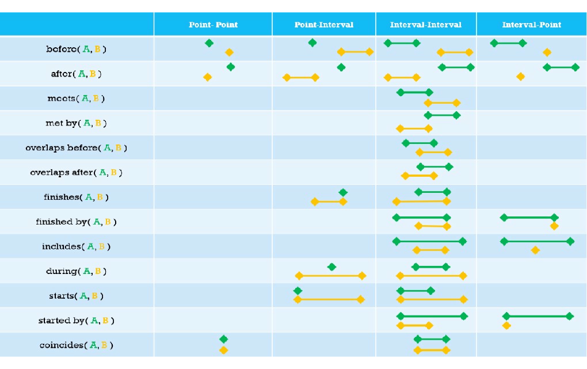

###### Table: Semantics of range functions

| **Name(parameters)** | **Evaluates to true if and only if (for each signature, respectively)** | **Example** |
|---------------------------|---------------------------|---------------------------|
| \(a\) before(*point1*, *point2*) | \(a\) point1 \< point2 | before( 1, 10 ) = true before( 10, 1 ) = false |
| \(b\) before(*point*, *range*) | \(b\) point \< range.start or (point = range.start and not(range.start included) ) | before( 1, \[1..10\] ) = false before( 1, (1.10\] ) = true before( 1, \[5..10\] ) = true |
| \(c\) before(*range*, *point*) | \(c\) range.end \< point or (range.end = point and not(range.end included) ) | before( \[1..10\], 10 ) = false before( \[1..10), 10 ) = true before( \[1..10\], 15 ) = true |
| \(d\) before(*range1*,*range2*) | \(d\) range 1 .end \< range2.start or (( not(range1 .end included) or not(range2.start included)) and range 1 .end = range2.start) | before( \[1..10\], \[15..20\] ) = true before( \[1..10\], \[10..20\] ) = false before( \[1..10), \[10..20\] ) = true before( \[1..10\], (10..20\] ) = true |
| \(a\) after(*point1*, *point2*) | \(a\) point1 \> point2 | after( 10, 5 ) = true after( 5, 10 ) = false |
| \(b\) after(*point*, *range*) | \(b\) point \> range.end or (point = range.end and not(range.end included) ) | after( 12, \[1..10\] ) = true after( 10, \[1..10) ) = true after( 10, \[1..10\] ) = false |
| \(c\) after(range, point) | \(c\) range.start \> point or (range.start = point and not(range.start included) ) | after( \[11..20\], 12 ) = false after( \[11..20\], 10 ) = true after( (11..20\], 11 ) = true after( \[11..20\], 11 ) = false |
| \(d\) after(*range1*, *range2*) | \(d\) range 1 .start \> range2.end or (( not(range1 .start included) or not(range2.end included) ) and range 1 .start = range2.end) | after( \[11..20\], \[1..10\] ) = true after( \[1..1 0\], \[11..20\] ) = false after( \[11..20\], \[1.. 11) ) = true after( (11..20\], \[1..11\] ) = true |
| \(a\) meets(*range1*, *range2*) | \(a\) range1.end included and range2.start included and range 1 .end = range2.start | meets( \[1..5\], \[5..10\] ) = true meets( \[1..5), \[5..10\] ) = false meets( \[1..5\], (5..10\] ) = false meets( \[1..5\], \[6..10\] ) = false |
| \(a\) met by(*range1*, *range2*) | \(a\) range1.start included and range2.end included and range 1 .start = range2.end | met by( \[5..10\], \[1..5\] ) = true met by( \[5..10\], \[1..5) ) = false met by( (5..10\], \[1..5\] ) = false met by( \[6..10\], \[1..5\] ) = false |
| \(a\) overlaps(*range1*, *range2*) | \(a\) (range1.end \> range2.start or (range1.end = range2.start and range1.end included and range2.start included)) and (range1.start \< range2.end or (range1.start = range2.end and range1.start included and range2.end included)) | overlaps( \[1..5\], \[3..8\] ) = true overlaps( \[3..8\], \[1..5\] ) = true overlaps( \[1..8\], \[3..5\] ) = true overlaps( \[3..5\], \[1..8\] ) = true overlaps( \[1..5\], \[6..8\] ) = false overlaps( \[6..8\], \[1..5\] ) = false overlaps( \[1..5\], \[5..8\] ) = true overlaps( \[1..5\], (5..8\] ) = false overlaps( \[1..5), \[5..8\] ) = false overlaps( \[1..5), (5. .8\] ) = false overlaps( \[5..8\], \[1..5\] ) = true overlaps( (5..8\], \[1..5\] ) = false overlaps( \[5..8\], \[1..5) ) = false overlaps( (5..8\], \[1..5) ) = false |

| \(a\) overlaps before(*range1*, *range2*) | \(a\) (range1.start \< range2.start or (range1.start = range2.start and range1.start included and not(range2.start included))) and (range1.end \> range2.start or (range1.end = range2.start and range1.end included and range2.start included)) and (range1.end \< range2.end or (range1.end = range2.end and (not(range1.end included) or range2.end included ))) | overlaps before( \[1..5\], \[3..8\] ) = true overlaps before( \[1..5\], \[6..8\] ) = false overlaps before( \[1..5\], \[5..8\] ) = true overlaps before( \[1..5\], (5..8\] ) = false overlaps before( \[1..5), \[5..8\] ) = false overlaps before( \[1..5), (1. .5\] ) = true overlaps before( \[1..5\], (1..5\] ) = true overlaps before( \[1..5), \[1..5\] ) = false overlaps before( \[1..5\], \[1..5\] ) = false |
|---------------------------|---------------------------|---------------------------|
| \(a\) overlaps after(*range1*, *range2*) | \(a\) (range2.start \< range1.start or (range2.start = range1.start and range2.start included and not( range 1.start included))) and (range2.end \> range 1.start or (range2.end = range 1.start and range2.end included and range 1.start included )) and (range2.end \< range1.end or (range2.end = range1.end and (not(range2.end included) or range1.end included))) | overlaps after( \[3..8\], \[1..5\]) = true overlaps after( \[6..8\], \[1..5\]) = false overlaps after( \[5..8\], \[1..5\]) = true overlaps after( (5..8\], \[1..5\]) = false overlaps after( \[5..8\], \[1..5)) = false overlaps after( (1..5\], \[1..5) ) = true overlaps after( (1..5\], \[1..5\] ) = true overlaps after( \[1..5\], \[1..5) ) = false overlaps after( \[1..5\], \[1..5\] ) = false |
| \(a\) finishes(*point, range*) | \(a\) range.end included and range.end = point | finishes( 10, \[1..10\] ) = true finishes( 10, \[1..10) ) = false |
| \(b\) finishes(*range1*, *range2*) | \(b\) range1.end included = range2.end included and range1.end = range2.end and (range1.start \> range2.start or (range1.start = range2.start and (not(range1.start included) or range2.start included))) | finishes( \[5..10\], \[1..10\] ) = true finishes( \[5..10), \[1..10\] ) = false finishes( \[5..10), \[1..10) ) = true finishes( \[1..10\], \[1..10\] ) = true finishes( (1..10\], \[1..10\] ) = true |
| \(a\) finished by(*range, point*) | \(a\) range.end included and range.end = point | finished by( \[1..10\], 10 ) = true finished by( \[1..10), 10 ) = false |
| \(b\) finished by(*range1*, *range2*) | \(b\) range1.end included = range2.end included and range1.end = range2.end and (range1.start \< range2.start or (range1.start = range2.start and (range1.start included or not(range2.start included)))) | finished by( \[1..10\], \[5..10\] ) = true finished by( \[1..10\], \[5..10) ) = false finished by( \[1..10), \[5..10) ) = true finished by( \[1..10\], \[1..10\] ) = true finished by( \[1..10\], (1..10\] ) = true |
| \(a\) includes(*range*, *point*) | \(a\) (range.start \< point and range.end \> point) or (range.start = point and range.start included) or (range.end = point and range.end included) | includes( \[1..10\], 5 ) = true includes( \[1..10\], 12 ) = false includes( \[1..10\], 1 ) = true includes( \[1..10\], 10 ) = true includes( (1..10\], 1 ) = false includes( \[1..10), 10 ) = false |
| \(b\) includes(*range1*, *range2*) | \(b\) (range1.start \< range2.start or (range1.start = range2.start and (range1.start included or not(range2.start included)))) and (range1.end \> range2.end or (range1.end = range2.end and (range1.end included or not(range2.end included)))) | includes( \[1..10\], \[4..6\] ) = true includes( \[1..10\], \[1..5\] ) = true includes( (1..10\], (1..5\] ) = true includes( \[1..10\], (1..10) ) = true includes( \[1..10), \[5..10) ) = true includes( \[1..10\], \[1..10) ) = true includes( \[1..10\], (1..10\] ) = true includes( \[1..10\], \[1..10\] ) = true |
| \(a\) during(*point*, *range*) | \(a\) (range.start \< point and range.end \> point) or (range.start = point and range.start included) or (range.end = point and range.end included) | during( 5, \[1..10\] ) = true during( 12, \[1..10\] ) = false during( 1, \[1..10\] ) = true during( 10, \[1..10\] ) = true during( 1, (1..10\] ) = false during( 10, \[1..10) ) = false |
| \(b\) during(*range1*, *range2*) | \(b\) (range2.start \< range1.start or (range2.start = range1.start and (range2.start included or not(range1.start included)))) and (range2.end \> range1.end or (range2.end = range1.end and (range2.end included or not(range1.end included)))) | during( \[4..6\], \[1..10\] ) = true during( \[1..5\], \[1..10\] ) = true during( (1..5\], (1..10\] ) = true during( (1..10), \[1..10\] ) = true during( \[5..10), \[1..10) ) = true during( \[1..10), \[1..10\] ) = true during( (1..10\], \[1..10\] ) = true during( \[1..10\], \[1..10\] ) = true |
| \(a\) starts(*point*, *range*) | \(a\) range.start = point and range.start included | starts( 1, \[1..10\] ) = true starts( 1, (1..10\] ) = false starts( 2, \[1..10\] ) = false |
| \(b\) starts(*range1*, *range2*) | \(b\) range1.start = range2.start and range1.start included = range2.start included and (range1.end \< range2.end or (range1.end = range2.end and (not(range1.end included) or range2.end included))) | starts( \[1..5\], \[1..10\] ) = true starts( (1..5\], (1..10\] ) = true starts( (1..5\], \[1..10\] ) = false starts( \[1..5\], (1..10\] ) = false starts( \[1..10\], \[1..10\] ) = true starts( \[1..10), \[1..10\] ) = true starts( (1..10), (1..10) ) = true |
| \(a\) started by(*range*, *point*) | \(a\) range.start = point and range.start included | started by( \[1..10\], 1 ) = true started by( (1..10\], 1 ) = false started by( \[1..10\], 2 ) = false |
| \(b\) started by(*range1*, *range2*) | \(b\) range1.start = range2.start and range1.start included = range2.start included and (range2.end \< range1.end or (range2.end = range1.end and (not(range2.end included) or range1.end included))) | started by( \[1..10\], \[1..5\] ) = true started by( (1..10\], (1..5\] ) = true started by( \[1..10\], (1..5\] ) = false started by( (1..10\], \[1..5\] ) = false started by( \[1..10\], \[1..10\] ) = true started by( \[1..10\], \[1..10) ) = true started by( (1..10), (1..10) ) = true |
| \(a\) coincides(*point1*, *point2*) | \(a\) point1 = point2 | coincides( 5, 5 ) = true coincides( 3, 4 ) = false |
| \(b\) coincides(*range1*, *range2*) | \(b\) range1.start = range2.start and range1.start included = range2.start included and range1.end = range2.end and range1.end included = range2.end included | coincides( \[1..5\], \[1..5\] ) = true coincides( (1..5), \[1..5\] ) = false coincides( \[1..5\], \[2..6\] ) = false |

#### Temporal built-in functions

The following set of functions provide common support utilities when dealing
with date or date and time values; listed in
[Temporal built-in functions](#table-temporal-built-in-functions).

###### Table: Temporal built-in functions

| **Name(parameters)** | **Parameter Domain** | **Description** | **Example** |
|--------------------|--------------------|--------------------|---------------------|
| day of year( date ) | date or date and time | returns the Gregorian number of the day within the year | day of year( date(2019, 9, 17) ) = 260 |
| day of week( date ) | date or date and time | returns the day of the week according to the Gregorian calendar enumeration: “Monday”, “Tuesday”, “Wednesday”, “Thursday”, “Friday”, “Saturday”, “Sunday” | day of week( date(2019, 9, 17) ) = "Tuesday" |
| month of year( date ) | date or date and time | returns the month of the year according to the Gregorian calendar enumeration: “January”, “February”, “March”, “April”, “May”, “June”, “July”, “August”, “September”, “October”, “November”, “December” | month of year( date(2019, 9, 17) ) = "September" |
| week of year( date ) | date or date and time | returns the Gregorian number of the week within the year, accordingly to ISO 8601 | week of year( date(2019, 9, 17) ) = 38 week of year( date(2003, 12, 29) ) = 1 week of year( date(2004, 1, 4) ) = 1 week of year( date(2005, 1, 1) ) = 53 week of year( date(2005, 1, 3) ) = 1 week of year( date(2005, 1, 9) ) = 1 |

#### Sort

Sort a list using an ordering function. The initial order of equal items is not
guaranteed to be preserved i.e., no stability guarantee. For example,

> sort(list: \[3,1,4,5,2\], precedes: function(x,y) x \< y) = \[1,2,3,4,5\]

###### Table: Semantics of sort functions

| **Parameter name** (\* means optional) | **Domain** |
|------------------------------------|--------------------------------------------|
| list | list of any element, be careful with nulls |
| precedes | boolean function of 2 arguments defined on every pair of list elements. This function should return **true** if the first argument precedes the second and **false** if they are equal or the second precedes the first argument. |

#### Context function

###### Table: Context functions

| **Name(parameters)** | **Parameter domain** | **Description** | **Example** |
|--------------------|--------------------|--------------------|--------------------|
| get value(m, key) | context, string | select the value of the entry named key from context m | *get value ({key1 : "value1"}, "key1 ") = "value1" get value ({key1 : "value 1"}, "unexistent-key") = null* |
| get entries(m) | context | produces a list of key,value pairs from a context m | *get entries({key1 : "value 1 ", key2 : "value2"}) = \[ { key : "key1 ", value : "value 1" }, {key : "key2", value :* *"value2"} \]* |
| context(entries) | *entries* is a list of contexts; each context item SHALL have two entries having keys: "key" and "value", respectively. | Returns a new context that includes all specified entries. If a context item contains additional entries beyond the required "key" and "value" entries, the additional entries are ignored. If a context item is missing the required "key" and "value" entries, the final result is null. See also: *get entries()* builtin function. | *context(\[{key:"a", value:1}, {key:"b", value:2}\]) = {a:1, b:2}* *context(\[{key:"a", value:1},* *{key:"b", value:2, something:* *"else"}\]) = {a:1, b:2}* *context(\[{key:"a", value:1},* *{key:"b"}\]) = null* |
| \(a\) context put(context, key, value) | \(a\) *context* is a context, *key* is a string, *value* is Any type | \(a\) Returns a new context that includes the new entry or overriding the existing value if an entry for the same key already exists in the supplied context parameter. A new entry is added as the last entry of the new context. If overriding an existing entry, the order of the keys maintains the same order as in the original context. | *context put({x:1}, "y", 2) = {x:1, y:2} context put({x:1, y:0}, "y", 2) =* *{x:1, y:2} context put({x:1, y:0, z:0}, "y",* *2) = {x:1, y:2, z:0}* *context put({x:1}, \["y"\], 2) = context put({x:1}, "y", 2) = {x:1, y:2}* |
| \(b\) context put(context, keys, value) | \(b\) *context* is a context, *keys* is a list of string, *value* is Any type | \(b\) Returns the composite of nested invocations to *context put()* for each item in *keys* hierarchy in *context*. If keys is a list of 1 element, this is equivalent to *context put(context, key', value)*, where *key'* is the only element in the list *keys*. If keys is a list of 2 or more elements, this is equivalent of calling *context put(context, key', value')*, with: *key'* is the head element in the list *keys*, *value'* is the result of invocation of *context put(context', keys', value)*, where: *context'* is the result of context.key', *keys'* is the remainder of the list *keys* without the head element *key'*. If keys is an empty list or null, the result is null. | *context put({x:1, y: {a: 0} }, \["y", "a"\], 2)* *= context put({x:1, y: {a: 0} },* *"y", context put({a: 0}, \["a"\], 2))* *= {x:1, y: {a: 2} }* *context put({x:1, y: {a: 0} }, \[\], 2) = null* |
| context merge(contexts) | *contexts* is a list of contexts | Returns a new context that includes all entries from the given contexts; if some of the keys are equal, the entries are overriden. The entries are overridden in the same order as specified by the supplied parameter, with new entries added as the last entry in the new context. | *context merge(\[{x:1}, {y:2}\]) =* *{x:1, y:2}* *context merge(\[{x:1, y:0},* *{y:2}\]) = {x:1, y:2}* |

#### Miscellaneous functions

The following set of functions provide support utilities for several
miscellaneous use-cases. For example, when a decision depends on the current
date, like deciding the support SLA over the weekends, additional charges for
weekend delivery, etc.

It is important to note that the functions in this section are intended to be
side-effect-free, but they are not deterministic and not idempotent from the
perspective of an external observer.

Vendors are encouraged to guide end-users in ensuring deterministic behavior of
the DMN model during testing, for example, through specific configuration.

Users are encouraged to isolate decision logic that uses these functions in
specific DRG elements, such as Decisions. This encapsulation enables them to be
overridden with synthetic values that remain constant across executions of the
DMN model's test cases.

###### Table: Miscellaneous functions

| **Name(parameters)** | **Parameter domain** | **Description**               |
|----------------------|----------------------|-------------------------------|
| now()                | (none)               | returns current date and time |
| today()              | (none)               | returns current date          |

### FEEL Libraries

A library has a name, is defined in a namespace, and contains a list of function
declarations. The syntax of a library is defined below:

    library =
    "namespace" , qualified name , ";"
    name , "{" , functions , "}"
    ;
    functions =
    function , { ";" , function }
    function =
    "function" , name, "(" , [ formal parameter { "," , formal parameter } ] , ")" , ":" , type
    ;

where

- name is described in section [Grammar rules](#grammar-rules), rule 25

- qualified name is described in section [Grammar rules](#grammar-rules), rule
  18

- formal parameter is described in section [Grammar rules](#grammar-rules), rule
  56

- type is described in section [Grammar rules](#grammar-rules), rule 52

- name, qualified name and formal parameter contain only symbols that are
  classified as letters and digits in the Unicode standard

- the libraries are uniquely identified by the namespace and library name pair

The definitions of the FEEL libraries are platform-independent, they do not
contain any information about the execution platform (e.g. Java). The discovery
mechanism of the definitions of the libraries and the artifacts needed to
execute the functions (e.g. Java jars or Python modules) is vendor-specific. The
mapping of the FEEL types to the native platforms (e.g. Java) is defined in
[Mapping between FEEL and other domains](#table-mapping-between-feel-and-other-domains):
Mapping between FEEL and other domains.

The functions defined in a library become visible in the scope of the evaluation
(see 10.3.2.11) once they are imported in a DMN file (see 6.3.3) with the import
type equal to the FEEL namespace (e.g.
<https://www.omg.org/spec/DMN/20240513/FEEL/> ).

The functions defined in a library are invoked in the same way as the imported
BKMs or Decision Services (e.g. prefix.f(a, b, c)).

For example, for the following library

    namespace org.omg.feel.stringUtil;
    stringLib {
    // Checks if str is empty ("") or null.
    function isEmpty(str: string) : boolean ;
    ...
    // The capitalized str, null if str is null
    function capitalize(str: string) : string
    }

once the library is imported with

    <import namespace="org.omg.feel.stringUtil"
    name="myLib"
    importType="https://www.omg.org/spec/DMN/20240513/FEEL/"
    />

the function isEmpty can be invoked by myLib.isEmpty("abc").

## Execution Semantics of Decision Services

FEEL gives execution semantics to decision services defined in decision models
where FEEL is the expression language. A decision service is semantically
equivalent to a FEEL function whose parameters are the decision service inputs,
and whose logic is a context assembled from the decision service's decisions and
knowledge requirements.

Decision service implementations SHALL return a result as described above, and
MAY return additional information such as intermediate results, log records,
debugging information, error messages, rule annotations, etc. The format of any
additional information is left unspecified.

Every FEEL expression in a decision model has execution semantics.
LiteralExpression (FEEL text) semantics is defined in [Full FEEL Syntax and
Semantics](#full-feel-syntax-and-semantics). Boxed expressions described in
[FEEL](#feel) can be mapped to FEEL text and thus also have execution semantics.

Recall that a DecisionService is defined by four lists: inputData,
inputDecisions, outputDecisions, and encapsulatedDecisions. The lists are not
independent and thus not all required to be specified, e.g., each required
decision (direct and indirect) of the outputDecisions must be an
encapsulatedDecision, an inputDecision, or required by an inputDecision. For
simplicity in the following, we assume that all four lists are correctly and
completely specified.

A DecisionService is given execution semantics by mapping it to a FEEL function
*F*. Let S be a

DecisionService with input data *id1*, *id2*, ..., input decisions *di1*, *di2*,
..., encapsulated decisions *de1*, *de2*, ..., and output decisions *do1*,
*do2*, .... Each input data *idi* has a qualified name *nidᵢ*. Each decision
*di* has a qualified name *ndᵢ*and a decision logic expression *ed*. The
decisions may have knowledge requirements. In particular the decisions may
require BusinessKnowledgeModels *bkm1*, *bkm2*, ... and DecisionServices *s1*,
*s2*, .... BusinessKnowledgeModels have qualified names *nbkmᵢ*and
encapsulatedLogic *f\_bkmi*. DecisionServices have qualified names *nsi* and
equivalent logic *fsᵢ*, where the equivalent logic is defined recursively,
binding *si* to S.

The syntax for FEEL function *F* is *funcion(nid₁, nid₂, ..., ndi₁, ndi₂, ... )
C.result*, where *C* is the context *{*

> *ns₁ : fs₁, ns₂ : fs₂, ...,*
>
> *nbkm1 : fbkm1, nbkm2 : fbkm2, ...,*
>
> *nde₁ : ede₁, nde₂ : ede₂, ...,*
>
> *result: { ndo₁ : edo₁, ndo₂ : edo₂, . ..}*

such that *si*, *bkmi*, *dei* and *doi* are partially ordered by requirements
(e.g., the context entry for a required decision comes before a decision that
requires it).

The qualified name of an element named E (decision, input data, decision
service, or BKM) that is defined in the same decision model as S is simply E.
Otherwise, the qualified name is I.E, where I is the name of the import element
that refers to the model where E is defined.

The execution semantics of S is FEEL(*F*): a function that when invoked with
values from the FEEL semantic domain bound to the parameters representing input
data and input decisions, returns:

- In the case of a single output decision(s), the single decision's output
  value.

- In the case of multiple output decisions, a context consisting of all the
  output decisions' output values.

XML elements SHALL map to the FEEL semantic domain as specified in section [XML
Data](#xml-data). Otherwise, details of the syntax of input/output data values
and mapping to/from FEEL are undefined.

## Metamodel

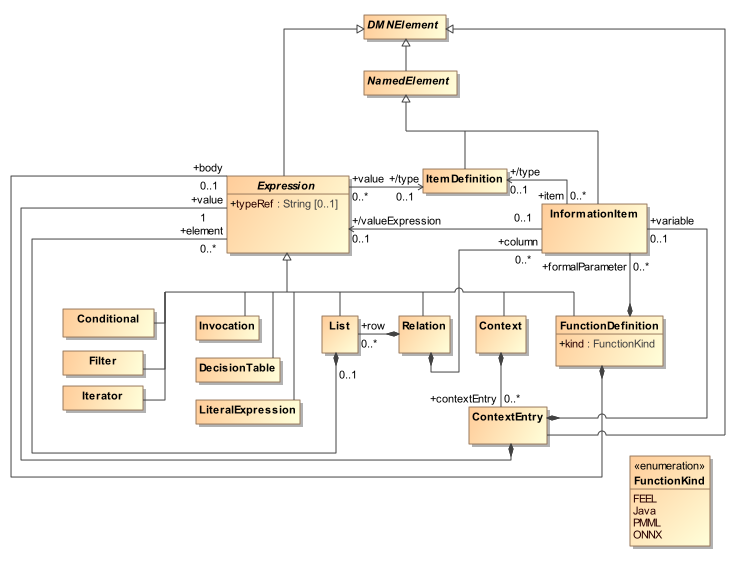

The class Expression is extended to support the four new kinds of boxed
expressions introduced by FEEL, namely: Context, FunctionDefinition, Relation
and List.

Boxed expressions are Expressions that have a standard diagrammatic
representation (see clauses
[Expressions](09_Relating_Decision_Logic_to_Decision_Requirements.md#expressions)
and [Boxed Expressions](#boxed-expressions)). FEEL *contexts*, *function
definitions*, *relations* and *lists* SHOULD be modeled as Context,
FunctionDefinition, Relation and List elements, respectively, and represented as
a boxed expression whenever possible; that is, when they are top-level
expressions, since an instance of LiteralExpression cannot contain another
Expression element.

### Context metamodel

A Context is composed of any number of contextEntrys, which are instances of
ContextEntry.

A Context element is represented diagrammatically as a **boxed context** (clause
[Boxed Context](#boxed-context)). A FEEL *context* (grammar rule 57 and clause
[Context](#context)) SHOULD be modeled as a Context element whenever possible.

Context inherits all the attributes and model associations from Expression.
[Context attributes and model association](#table-context-attributes-and-model-association)
presents the additional attributes and model associations of the Context
element.

###### Table: Context attributes and model association

| **Attribute** | **Description** |
|----------------------------------|----------------------------------------------|
| **contextEntry**: ContextEntry \[\*\] | This attributes lists the instances of ContextEntry that compose this Context. |

### ContextEntry metamodel

The class ContextEntry is used to model FEEL *context entries* when a *context*
is modeled as a Context element. ContextEntry is a specialization of DMNElement,
from which it inherits the optional id, description, and label attributes.

An instance of ContextEntry is composed of an optional variable, which is an
InformationItem element whose name is the *key* in the *context entry*, and of a
value, which is the instance of Expression that models the *expression* in the
*context entry*.

[ContexEntry attributes and model associations](#table-contexentry-attributes-and-model-associations)
presents the attributes and model associations of the ContextEntry element.

###### Table: ContexEntry attributes and model associations

| **Attribute** | **Description** |
|----------------------------------|----------------------------------------------|
| **variable**: InformationItem \[0..1\] | The instance of InformationItem that is contained in this ContextEntry, and whose name is the *key* in the modeled *context* *entry* |
| **value**: Expression | The instance of Expression that is the *expression* in this ContextEntry |

### FunctionDefinition metamodel

A FunctionDefinition has formalParameters and a body. A FunctionDefinition
element is

represented diagrammatically as a **boxed function**, as described in clause. A
FEEL *function definition* (grammar rule 55 and clause [Semantic
mappings](#semantic-mappings)) SHOULD be modeled as a FunctionDefinition element
whenever possible.

FunctionDefinition inherits all the attributes and model associations from
Expression.
[FunctionDefinition attributes and model associations](#table-functiondefinition-attributes-and-model-associations)
presents the additional attributes and model associations of the Function
Definition element.

###### Table: FunctionDefinition attributes and model associations

| **Attribute** | **Description** |
|----------------------------------|----------------------------------------------|
| **FormalParameter**: InformationItem \[\*\] | This attributes lists the instances of InformationItem that are the parameters of this Context. |
| **body**: Expression \[0..1\] | The instance of Expression that is the body in this FunctionDefinition |
| **kind**: FunctionKind = FEEL { FEEL \| Java \| ONNX \| PMML } | The kind attribute defines the type of the FunctionDefinition. The default value is FEEL. Supported values also include Java, ONNX and PMML |

### List metamodel

A List is simply a list of element, which are instances of Expressions. A List
element is represented diagrammatically as a **boxed list**, as described in
clause [Boxed List](#boxed-list). A FEEL *list* (grammar rule 54 and clause
[Semantic mappings](#semantic-mappings)) SHOULD be modeled as a List element
whenever possible.

List inherits all the attributes and model associations from Expression.
[List attributes and model associations](#table-list-attributes-and-model-associations)
presents the additional attributes and model associations of the List element.

###### Table: List attributes and model associations

| **Attribute** | **Description** |
|----------------------------------|----------------------------------------------|
| **element**: Expression \[\*\] | This attributes lists the instances of Expression that are the elements in this List. |

### Relation metamodel

A Relation is convenient shorthand for a list of similar contexts. A Relation
has a column instead of repeated ContextEntrys, and a List is used for every
row, with one of the List’s expression for each column value.

Relation inherits all the attributes and model associations from Expression.
[Relation attributes and model associations](#table-relation-attributes-and-model-associations)
presents the additional attributes and model associations of the Relation
element.

###### Table: Relation attributes and model associations

| **Attribute** | **Description** |
|----------------------------------|----------------------------------------------|
| **row**: List \[\*\] | This attributes lists the instances of List that compose the rows of this Relation. |
| **column**: InformationItem \[\*\] | This attributes lists the instances of InformationItem that define the columns in this Relation. |

### Conditional metamodel

A Conditional is a visual way to express an if statement.

Conditional inherits all the attributes and model associations from Expression.
[Conditional attributes and model associations](#table-conditional-attributes-and-model-associations)
presents the additional attributes and model associations of the Conditional
element.

###### Table: Conditional attributes and model associations

| **Attribute** | **Description** |
|--------------------------|------------------------------------------------------|
| **if**: ChildExpression | This attribute holds the expression that is evaluate by the conditional expression. |
| **then**: ChildExpression | This attribute holds the expression that will be evaluated when the condition in the if statement evaluates to **true**. |
| **else**: ChildExpression | This attribute holds the expression that will be evaluated when the condition in the if statement evaluates to **false**. |

### ChildExpression metamodel

A ChildExpression is used to hold an expression inside a node.
[ChildExpression attributes and model associations](#table-childexpression-attributes-and-model-associations)
presents the attributes of a

ChildExpression.

###### Table: ChildExpression attributes and model associations

| **Attribute** | **Description** |
|----------------------------------------|----------------------------------------|
| **id**: ID\[0..1\] | Optional identifier for this element. SHALL be unique within its containing Definitions element. |
| **value**: Expression | The instance of Expression that is the expression in this ChildExpression |

### Filter metamodel

A Filter is a visual way to express list filtering.

Filter inherits all the attributes and model associations from Expression.
[ChildExpression attributes and model associations](#table-childexpression-attributes-and-model-associations)
presents the additional attributes and model associations of the Filter element.

###### Table: Filter attributes and model associations

| **Attribute** | **Description** |
|----------------------------------------|----------------------------------------|
| **in**: ChildExpression | This attribute holds the expression that is evaluate as the collection to be filtered. |
| **match**: ChildExpression | This attribute holds the expression that is used to filter the collection. |

### Iterator metamodel

An Iterator is the abstract class for all boxed iteration.

Iterator inherits all the attributes and model associations from Expression.
[Iterator attributes and model associations](#table-iterator-attributes-and-model-associations)
presents the additional attributes and model associations of the Iterator
element.

###### Table: Iterator attributes and model associations

| **Attribute** | **Description** |
|----------------------------------------|----------------------------------------|
| **iteratorVariable**: String | This attribute holds name of the iterator variable that will be populated at each iteration. |
| **in**: TypedChildExpression | This attribute holds the expression that is evaluated as the collection to be processed. |

### For metamodel

A For is a representation of a loop.

For inherits all the attributes and model associations from Iterator.
[For attributes and model associations](#table-for-attributes-and-model-associations)
presents the additional attributes and model associations of the For element.

###### Table: For attributes and model associations

| **Attribute** | **Description** |
|----------------------------------------|----------------------------------------|
| **return**: ChildExpression | This attribute holds the expression that is evaluated to create the new collection that will be returned. |

### Quantified metamodel

A Quantified is an abstraction of an expression that is evaluated on each item
of a collection.

Quantified inherits all the attributes and model associations from Iterator.
[For attributes and model associations](#table-for-attributes-and-model-associations)
presents the additional attributes and model associations of Quantified.

###### Table: Quantified attributes and model associations

| **Attribute** | **Description** |
|----------------------------------------|----------------------------------------|
| **satisfies**: ChildExpression | This attribute holds the expression that is evaluated to determine if the current item satisfies a condition. |

### Every metamodel

Every is an expression where all “satisfies” needs to be true for it to return
true.

Every inherits all the attributes and model associations of Quantified.

### Some metamodel

Some is an expression where at least one of the “satisfies” needs to be true for
it to return true.

Some inherits all the attributes and model associations of Quantified.

## Examples

A good way to get a quick overview of FEEL is by example.

FEEL expressions may reference other FEEL expressions by name. Named expressions
are contained in a context. Expressions are evaluated in a scope, which is a
list of contexts in which to resolve names. The result of the evaluation is an
element in the FEEL semantic domain.

### Context

[Example context](Images/example-context.svg) shows the boxed context used for
the examples. Such a context could arise in several ways. It could be part of
the decision logic for a single, complex decision. Or it could be a context that
is equivalent to part of a DRG as defined in clause [Execution Semantics of
Decision Services](#execution-semantics-of-decision-services), where *applicant,
requested product,* and *credit history* are input data instances, *monthly
income* and *monthly outgoings* are the results of other decisions linked
through information requirements, and *PMT* is a business knowledge model.

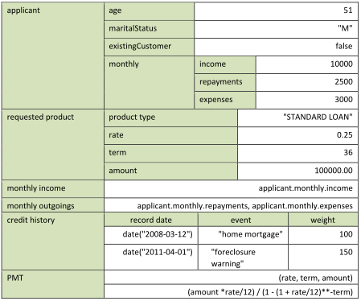

Notice that there are 6 top-level context entries, represented by the six rows
of the table. The value of the context entry named 'applicant' is itself a
context, and the value of the context entry named 'monthly' is itself a context.
The value of the context entry named 'monthly outgoings' is a list, the value of
the context entry named 'credit history' is a relation, *i.e.,* a list of two
contexts, one context per row. The value of the context entry named 'PMT' is a
function with parameters 'rate', 'term', and 'amount'.

The following examples use the above context. Each example has a pair of
equivalent FEEL expressions separated by a horizontal line. Both expressions
denote the same element in the semantic domain. The second expression, the
‘answer’, is a literal value.

### Calculation

monthly income \* 12 120000

The context defines *monthly income* as *applicant.monthly.income*, which is
also defined in the context as 10,000. Twelve times the *monthly income* is
120,000.

### If, In

if applicant.maritalStatus in (“M”, “S”) then “valid” else “not valid” “valid”

The *in* test determines if the left-hand side expression satisfies the list of
values or ranges on the right-hand side. If satisfied, the *if* expression
returns the value of the *then* expression. Otherwise, the value of the *else*
expression is returned.

### Sum entries of a list

sum (monthly outgoings) 5500

*Monthly outgoings* is computed in the context as the list
\[*applicant.monthly.repayments, applicant.monthly.expenses*\], or \[2500,
3000\]. The square brackets are not required to be written in the boxed context.

### Invocation of user-defined PMT function

The PMT function defined in the context computes the monthly payments for a
given interest rate, number of months, and loan amount.

PMT (requested product . rate,  
requested product . term,  
requested product .
amount)\_\_\_\_\_\_\_\_\_\_\_\_\_\_\_\_\_\_\_\_\_\_\_\_\_\_\_\_\_\_  
3975.982590125552338278440100112431

A function is invoked textually using a parenthesized argument list after the
function name. The arguments are defined in the context, and are 0.25, 36, and
100,000, respectively.

### Sum weights of a recent credit history

sum (credit history\[record date \> date (“2011-01-01”)\].weight  
150

This is a complex "one-liner" that will be useful to expand into constituent
sub-expressions:

> • built-in: *sum*
>
> o path expression ending in *.weight*
>
> ▪ filter: *\[record date \> date("2011-01-01 ")\]*
>
> • name resolved in context: *credit history*

An expression in square brackets following a list expression filters the list.
*Credit history* is defined in the context as a relation, that is, a list of
similar contexts. Only the last item in the relation satisfies the filter. The
first item is too old. The path expression ending in *.weight* selects the value
of the *weight* entry from the context or list of contexts satisfied by the
filter. The *weight* of the last item in the credit history is 150. This is the
only item that satisfies the filter, so the sum is 150 as well.

### Determine if credit history contain a bankruptcy event

Some ch in credit history satisfies ch.event = “bankruptcy” false

The *some* expression determines if at least one element in a list or relation
satisfies a test. There are no bankruptcy events in the credit history in the
context.
