# DMN Examples

## Example 1: Originations

### Introduction

In this clause we present an example of the use of **DMN** to model and execute
decision-making in a simple business process modeled in **BPMN**, including
decisions to be automated in decision services called from the business process
management system.

### The business process model

[Example business process](Images/example-business-process.svg) shows a simple
process for loan originations, modeled in **BPMN 2.0**. The process handles as
application for a loan, obtaining data from a credit bureau only if required for
the case, and automatically deciding whether the application should be accepted,
declined, or referred for human review. If referred, documents are collected
from the applicant and a credit officer adjudicates the case. It consists of the
following components:

- The **Collect application data** task collects data describing the Requested
  product and the Applicant (e.g., through an on-line application form).

- The Decide **bureau Strategy** task calls a decision service, passing
  Requested product and Applicant data. The service returns two decisions:
  Strategy and Bureau call type.

- A **gateway** uses the value of Strategy to route the case to Decline
  application, Collect bureau data or Decide routing.

- The **Collect bureau data** task collects data from a credit bureau according
  to the Bureau call type decision, then the case is passed to Decide routing.

- The **Decide routing** task calls a decision service, passing Requested
  product, Applicant data and Bureau data (if the Collect bureau data task was
  not performed, the Bureau data are set to null). The service returns a single
  decision: Routing.

- A **gateway** uses the value of Routing to route the case to Accept
  application, Review application or Decline application.

- The **Collect documents** task requests and uploads documents from the
  applicant in support of their application.

- The **Review application** task allows a credit officer to review the case and
  decide whether it should be accepted or declined.

- A **gateway** uses the credit officer’s Adjudication to route the case to
  Accept application or Decline application.

- The **Accept application** task informs the applicant that their application
  is accepted and initiates the product.

- The **Decline application** task informs the applicant that their application
  is declined.

Note that in this example two decision points (automated as calls to decision
services) are represented in **BPMN 2.0** as business rule tasks; the third
decision point (which is human decision-making) is represented as a user task.

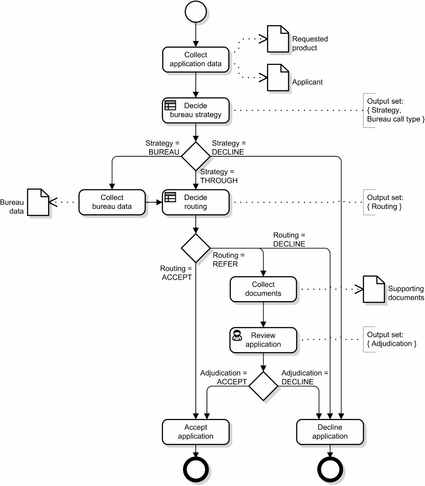

### The decision requirements level

The examples in this chapter were developed using a software that adds icons to
the elements. Although adding these icons is allowable by this document it is
not normative.

#### Decision Requirements Diagrams

[DRD of all automated decision-making](Images/drd-of-all-automated-decision-making.svg)
shows a DRD of all the decision-making in this business process. There are four
sources of input data for the decision-making (Requested product, Applicant
data, Bureau data and Supporting documents), and four decisions whose results
are used in the business process (Strategy, Bureau call type, Routing and
Adjudication). Between the two are intermediate decisions: evaluations of risk,
affordability, and eligibility.

Notable features of this DRD include:

- It covers both automated and human decision-making.

- Some decisions (e.g., Pre-bureau risk category) and input data (e.g.,
  Applicant data) are required by multiple decisions, i.e., the information
  requirements network is not a tree.

- Business knowledge models (see Affordability calculation) may be invoked by
  multiple decisions.

- Business knowledge models (see Credit contingency factor) may be invoked by
  other business knowledge models.

- Some decisions do not have associated business knowledge models.

Knowledge sources may provide authority for multiple decisions and/or business
knowledge models.

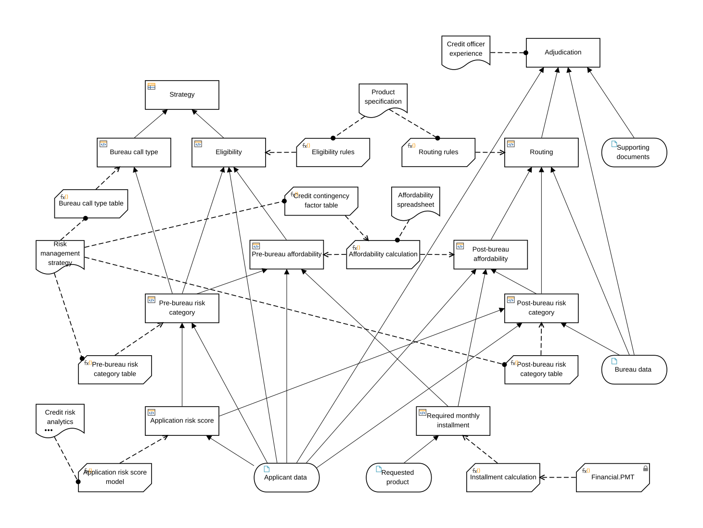

It might be considered more convenient to draw separate (but overlapping) DRDs
for the three decision points:

- [DRD for Decide bureau strategy decision point](Images/drd-for-decide-bureau-strategy-decision-point.svg)
  shows the DRD of the decisions required for the Decide bureau strategy
  decision point, i.e., the requirements subgraph of the Strategy and Bureau
  call type decisions. These are decisions to be automated through encapsulation
  in a decision service called at this point and therefore need their logic to
  be specified completely.

- [DRD for Decide routing decision point](Images/drd-for-decide-routing-decision-point.svg)
  shows the DRD for the Decide routing decision point, i.e., the requirements
  subgraph of the Routing decision. These are also decisions automated with a
  decision service and therefore need their logic to be specified completely.
  Note that some elements appear in both
  [DRD for Decide bureau strategy decision point](Images/drd-for-decide-bureau-strategy-decision-point.svg)
  and
  [DRD for Decide routing decision point](Images/drd-for-decide-routing-decision-point.svg).

- [DRD for Review application decision point](Images/drd-for-review-application-decision-point.svg)
  shows the DRD for the Review application decision point, i.e., the
  requirements subgraph of the Adjudication decision. This is a human decision
  and has no associated specification of decision logic, but the DRD indicates
  that the Credit officer takes into account the results of the automated
  Routing decision along with the case data, including the Supporting documents.
  (The requirements subgraph of the Routing decision has been hidden in this DRD
  as shown by the ellipsis (...) marker.)

- [DRD for Credit Risk Analytics Knowledge Source](Images/drd-for-credit-risk-analytics-knowledge-source.svg)
  shows an additional DRD for the Credit Risk Analytics Knowledge Source i.e.,
  the requirements linking this Knowledge Source to other elements. DRDs can be
  used to provide views other than for a specific decision.

All four DRDs –
[DRD of all automated decision-making](Images/drd-of-all-automated-decision-making.svg),
[DRD for Decide bureau strategy decision point](Images/drd-for-decide-bureau-strategy-decision-point.svg),
[DRD for Decide routing decision point](Images/drd-for-decide-routing-decision-point.svg),
[DRD for Review application decision point](Images/drd-for-review-application-decision-point.svg)
and
[DRD for Credit Risk Analytics Knowledge Source](Images/drd-for-credit-risk-analytics-knowledge-source.svg)
– are views of the same DRG.

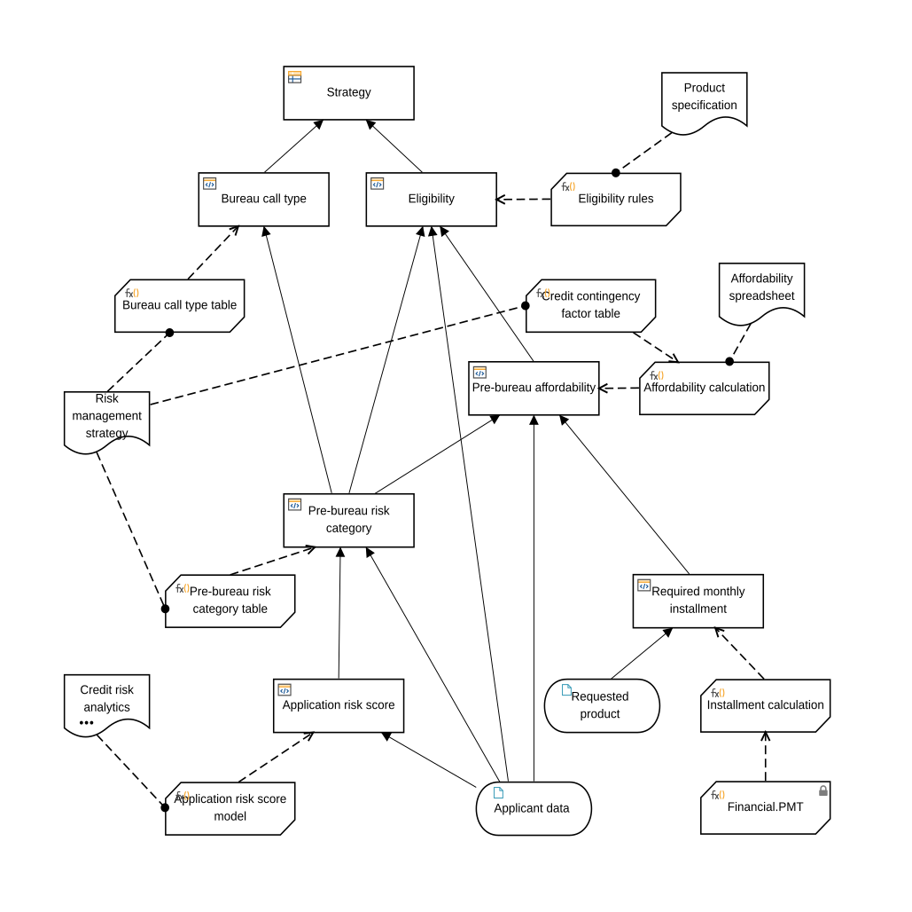

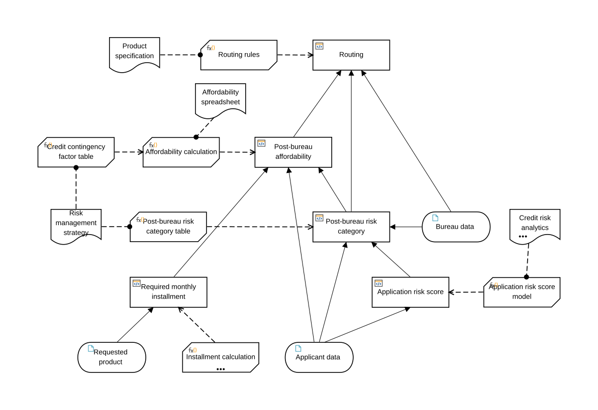

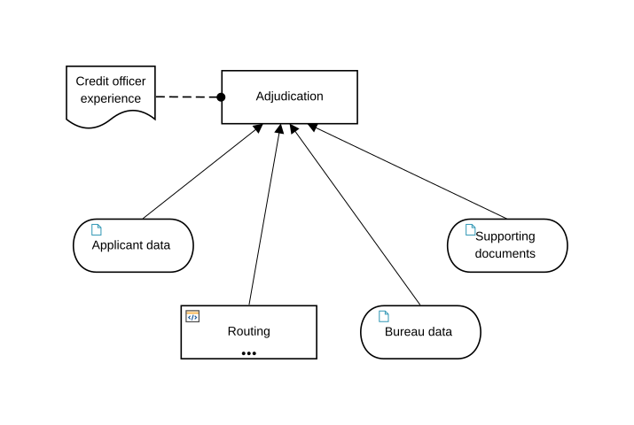

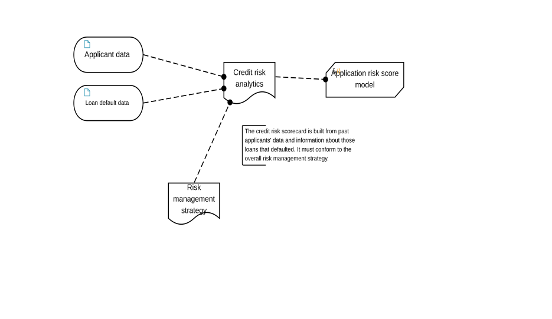

#### DRG Elements

##### Decisions

The DRG depicted in these DRDs shows dependencies between the following
decisions:

- The **Strategy** decision, requiring the Bureau call type and Pre-bureau
  eligibility decisions, invokes the Strategy table shown in
  [Strategy decision logic](Images/strategy-decision-logic.svg) (without that
  table being encapsulated in a business knowledge model).

- The **Bureau call type** decision, requiring the Pre-bureau risk category
  decision, invokes the Bureau call type table shown in
  [Bureau call type table decision logic](Images/bureau-call-type-table-decision-logic.svg).

- The **Eligibility** decision, requiring Applicant data and the Pre-bureau risk
  category and Pre-bureau affordability decisions, invokes the Eligibility rules
  shown in
  [Eligibility rules decision logic](Images/eligibility-rules-decision-logic.svg).

- The **Pre-bureau affordability** decision, requiring Applicant data and the
  Pre-bureau risk category and Required monthly installment decisions, invokes
  the Affordability calculation boxed expression shown in
  [Affordability calculation decision logic](Images/affordability-calculation-decision-logic.svg),
  which in turn invokes the Credit contingency factor table shown in
  [Credit contingency factor table decision logic](Images/credit-contingency-factor-table-decision-logic.svg).

- The **Pre-bureau risk category** decision, requiring Applicant data and the
  Application risk score decision, invokes the Pre-bureau risk category table
  shown in
  [Pre-bureau risk category table decision logic](Images/pre-bureau-risk-category-table-decision-logic.svg).

- The **Application risk score** decision, requiring Applicant data, invokes the
  Application risk score model shown in
  [Application risk score model decision logic](Images/application-risk-score-model-decision-logic.svg).

- The **Routing** decision, requiring Bureau data and the Post-bureau
  affordability and Post-bureau risk category decisions, invokes the Routing
  rules shown in
  [Routing rules decision logic](Images/routing-rules-decision-logic.svg).

- The **Post-bureau affordability** decision, requiring Applicant data and the
  Post-bureau risk score and Required monthly installment decisions, invokes the
  Affordability calculation boxed expression shown in
  [Affordability calculation decision logic](Images/affordability-calculation-decision-logic.svg),
  which in turn invokes the Credit contingency factor table shown in
  [Credit contingency factor table decision logic](Images/credit-contingency-factor-table-decision-logic.svg).

- The **Post-bureau risk category** decision, requiring Applicant and Bureau
  data and the Application risk score decision, invokes the Post-bureau risk
  category table shown in
  [Post-bureau risk category table decision logic](Images/post-bureau-risk-category-table-decision-logic.svg).

- The **Required monthly installment** decision, requiring Requested product
  data, invokes the Installment calculation boxed expression shown in
  [Installment calculation decision logic](Images/installment-calculation-decision-logic.svg).

- The **Adjudication** decision, requiring Applicant data, Bureau data,
  Supporting documents, and the Routing decision, has no associated decision
  logic.

Questions and allowed answers are specified for these decisions. These are
typically used when modeling decisions for which no logic will be specified and
for other decisions before it is appropriate to describe the decision logic in
detail. The description and Question/Allowed Answers for each decision follow.

#### Adjudication

Question: Should this application that has been referred for adjudication be
accepted? Allowed Answers: Yes/No

Description: Determine if an application requiring adjudication should be
accepted or declined given the available application data and supporting
documents.

#### Application risk score

Question: What is the risk score for this applicant?

Allowed Answers: A number greater than 70 and less than 150

Description: The **Application Risk Score** decision logic invokes the
Application risk score model business knowledge model, passing Applicant
data.Age as the Age parameter, Applicant data.MaritalStatus as the Marital
Status parameter and Applicant data.EmploymentStatus as the Employment Status
parameter.

#### Bureau call type

Question: How much data should be requested from the credit bureau for this
application? Allowed Answers: A value from the explicit list "Full", "Mini",
"None"

Description: The **Bureau call type** decision logic invokes the Bureau call
type table, passing the output of the Prebureau risk category decision as the
Pre-Bureau Risk Category parameter.

#### Eligibility

Question: Does this applicant appear eligible for the loan they applied for
given only their application data? Allowed Answers: Value from the explicit list
"Eligible", "Not Eligible"

Description: The **Eligibility** decision logic invokes the Eligibility rules
business knowledge model, passing

Applicant data.Age as the Age parameter, the output of the Pre-bureau risk
category decision as the Pre-Bureau Risk Category parameter, and the output of
the Pre-bureau affordability decision as the Pre-Bureau Affordability parameter.

#### Pre-bureau affordability

Question: Can the applicant afford the loan they applied for given only their
application data?

Allowed Answers: Yes/No

Description: The **Pre-bureau affordability** decision logic invokes the
Affordability calculation business knowledge model, passing Applicant
data.Monthly.Income as the Monthly Income parameter, Applicant
data.Monthly.Repayments as the Monthly Repayments parameter, Applicant
data.Monthly.Expenses as the Monthly Expenses parameter, the output of the
Pre-bureau risk category decision as the Risk Category parameter, and the output
of the Required monthly installment decision as the Required Monthly Installment
parameter.

#### Post-bureau affordability

Question: Can the applicant afford the loan they applied for given all available
data?

Allowed Answers: Yes/No

Description: The **Post-bureau affordability** decision logic invokes the
Affordability calculation business knowledge model, passing Applicant
data.Monthly.Income as the Monthly Income parameter, Applicant

data.Monthly.Repayments as the Monthly Repayments parameter, Applicant
data.Monthly.Expenses as the Monthly Expenses parameter, the output of the
Post-bureau risk category decision as the Risk Category parameter, and the
output of the Required monthly installment decision as the Required Monthly
Installment parameter.

#### Pre-bureau risk category

Question: Which risk category is most appropriate for this applicant given only
their application data?

Allowed Answers: Value from explicit list "Decline", "High Risk", "Medium Risk",
"Low Risk", "Very Low Risk"

Description: The Pre-Bureau Risk Category decision logic invokes the Pre-bureau
risk category table business knowledge model, passing Applicant
data.ExistingCustomer as the Existing Customer parameter and the output of the
Application risk score decision as the Application Risk Score parameter.

#### Post-bureau risk category

Question: Which risk category is most appropriate for this applicant given all
available data?

Allowed Answers: A value from the explicit list "Decline", "High Risk", "Medium
Risk", "Low Risk", "Very Low Risk"

Description: The **Post-bureau risk category** decision logic invokes the
Post-bureau risk category business knowledge model, passing Applicant
data.ExistingCustomer as the Existing Customer parameter, Bureau
data.CreditScore as the Credit Score parameter, and the output of the
Application risk score decision as the Application Risk Score parameter. Note
that if Bureau data is null (due to the THROUGH strategy bypassing the Collect
bureau data task) the Credit Score parameter will be null.

#### Required monthly installment

Question: What is the minimum monthly installment payment required for this loan
product? Allowed Answers: A dollar amount greater than zero

Description: The **Required monthly installment** decision logic invokes the
Installment calculation business knowledge model, passing Requested
product.ProductType as the Product Type parameter, Requested product.Rate as the
Rate parameter, Requested product.Term as the Term parameter, and Requested
product.Amount as the Amount parameter.

#### Routing

Question: How this should this applicant be routed given all available data?

Allowed Answers: A value from the explicit list "Decline", "Refer for
Adjudication", "Accept without Review"

Description: The **Routing** decision logic invokes the Routing rules business
knowledge model, passing Bureau data.

Bankrupt as the Bankrupt parameter, Bureau data. Credit Score as the Credit
Score parameter, the output of the Post- bureau risk category decision as the
Post-Bureau Risk Category parameter, and the output of the Post-bureau
affordability decision as the Post-Bureau Affordability parameter. Note that if
Bureau data is null (due to the

THROUGH strategy bypassing the Collect bureau data task) the Bankrupt and Credit
Score parameters will be null.

#### Strategy

Question: What is the appropriate handling strategy for this application?

Allowed Answers: A value from the explicit list "Decline","Bureau”,“Through"

Description: The **Strategy** decision logic defines a complete, unique-hit
decision table deriving Strategy from Eligibility and Bureau call type.

##### Knowledge Sources

The DRG contains the following Knowledge Sources:

#### Affordability spreadsheet

Description: Internal spreadsheet showing the relationship of income, payments,
expenses, risk, and affordability.

Type: Policy

#### Credit officer experience

Description: The collected wisdom of the credit officers as collected in their
best practice wiki. Type: Expertise

#### Credit risk analytics

Description: Credit risk scorecard analysis to determine the relevant factors
for application risk scoring

Type: Analytic Insight

#### Product specification

Description: Definitions of the products, their cost structure and eligibility
criteria.

Type: Policy

#### Risk management strategy

Description: Overall risk management approach for the financial institution
including its approach to application risk, credit contingencies and credit risk
scoring.

Type: Policy

##### Input Data

The DRG contains the following Input Data:

#### Applicant data

Description: Information about the applicant including personal information,
marital status, and household income/expenses.

**Bureau data**

Description: External credit score and bankruptcy information provided by a
bureau.

**Loan default data**

Description: Information about historical loan defaults.

**Requested product**

Description: Details of the loan the applicant has applied for.

#### Supporting documents

Description: Documents associated with a loan that are not processed
electronically but are available for manual adjudication.

##### Business Knowledge Models

Finally, the DRG contains the following Business Knowledge Models:

#### Eligibility rules

Description: The Eligibility rules decision logic defines a complete,
priority-ordered single hit decision table deriving Eligibility from Pre-Bureau
Risk Category, Pre-Bureau Affordability and Age.

#### Routing rules

Description: The Routing Rules decision logic defines a complete,
priority-ordered single hit decision table deriving Routing from Post-Bureau
Risk Category, Post-Bureau Affordability, Bankrupt and Credit Score.

#### Bureau call type table

Description: The Bureau call type table decision logic defines a complete,
unique-hit decision table deriving Bureau Call Type from Pre-Bureau Risk
Category.

#### Credit contingency factor table

Description: The Credit contingency factor table decision logic defines a
complete, unique-hit decision table deriving Credit contingency factor from Risk
Category.

#### Affordability calculation

Description: The Affordability calculation decision logic defines a boxed
function deriving Affordability from Monthly Income, Monthly Repayments, Monthly
Expenses and Required Monthly Installment. One step in this calculation derives
Credit contingency factor by invoking the Credit contingency factor table
business.

**Pre-bureau risk category table  **

Description: The Pre-bureau risk category table decision logic defines a
complete, unique-hit decision table deriving Pre- bureau risk category from
Existing Customer and Application Risk Score.

#### Post-bureau risk category table

Description: The Post-bureau risk category table decision logic defines a
complete, unique-hit decision table deriving Post-Bureau Risk Category from
Existing Customer, Application Risk Score and Credit Score.

#### Application risk score model

Description: The Application risk score model decision logic defines a complete,
no-order multiple-hit table with aggregation, deriving Application risk score
from Age, Marital Status and Employment Status, as the sum of the Partial scores
of all matching rows (this is therefore a predictive scorecard represented as a
decision table).

#### Installment calculation

Description: The Installment calculation decision logic defines a boxed function
deriving monthly installment from Product Type, Rate, Term and Amount.

#### Financial.PMT

Description: Standard calculation of monthly installment from Rate, Term and
Amount.

#### Business Context

In addition to the information represented in the DRD, the business context of
the decision-making can be specified. The Performance Indicators used to track
the effectiveness of decision-making, Objectives the organization seeks to meet
through its decision-making approach, and the Organizational Units that make
decisions or own the decision making approach may all be specified. Decisions
are cross-referenced to the performance indicators and objectives they impact
and to the organizational units that either make the decision or own the
definition of how the decision should be made.

**Performance indicators**

| Monthly bureau costs | The total cost charged by the bureau for all Bureau Data requested while originating Loans in a calendar month. |
|--------------------------|------------------------------------------------------|
| Monthly loan accept rate | The percentage of loans accepted in a calendar month. |
| Monthly auto-adjudication rate | The percentage of loans that did not require a credit officer to review the case in a calendar month. |
| Monthly value of loans written | The total value of Loans written in a calendar month |
| Auto adjudication rate 90% | By end of the current year, have an auto-adjudication rate of at least 90 percent |

Decisions are mapped to the Performance Indicators and Goals that they impact as
follows:

|  | **Monthly Loan** **Accept Rate** | **Monthly Value** **of Loans WrittenCosts** | **Monthly Bureau** | **Auto-adjudication rate 90%** | **Monthly Auto- adjudication** **Rate** |
|------------------|------------|------------|--------------|--------------|------------|
| **Adjudication** | Yes | Yes |  |  |  |
| **Application risk score** |  |  | Yes |  |  |
| **Bureau Call Type** |  |  | Yes |  |  |
| **Routing** | Yes | Yes |  | Yes | Yes |
| **Strategy** | Yes | Yes |  | Yes | Yes |

**Organizations**

| Credit officers | Individuals in the Retail Banking Organization responsible for manual adjudication of loans. |
|-------------------|-------------------------------------------------------------|
| Product management | Organization responsible for defining loan and other banking products, how those products are priced, sold and tracked for profitability. |
| Credit risk analytics group | Organization responsible for credit risk models and the use of data to predict credit risk for customers and loan applicants. |
| Retail banking | Overall Organization focused on banking products for consumers. |
| Credit risk | Organization within the bank responsible for defining credit risk strategies and policies and providing tools for managing against these. |

Credit officers are likely to be part of the Retail Banking organization, Credit
risk analytic and Risk management are part of the Credit risk organization,
although these relationships are not managed in DMN.

These organizations own decisions, make decisions and own knowledge sources as
follows:

|  | **Owns Decisions** | **Makes Decisions** | **Knowledge Sources** |
|------------------|-------------------|--------------------|------------------------|
| **Credit officers** |  | Adjudication | Credit officer experience |
| **Credit risk analytics group** | Application risk score |  | Credit risk analytics |
| **Credit risk** | Adjudication Bureau call type Eligibility Pre-bureau risk category Post-bureau risk category Routing |  | Risk management strategy |

#### Decision Services

The two decision services required by the business process model are defined
against the decision model. The **Bureau Strategy Decision Service**, called by
the **Decide bureau strategy** task, has output decisions {Bureau call type,
Strategy}, and is shown in
[Bureau Strategy Decision Service](Images/bureau-strategy-decision-service.svg).
The **Routing Decision Service**, called by the **Decide routing** task, has
output decisions {Routing}, and is shown in
[Routing Decision Service](Images/routing-decision-service.svg).

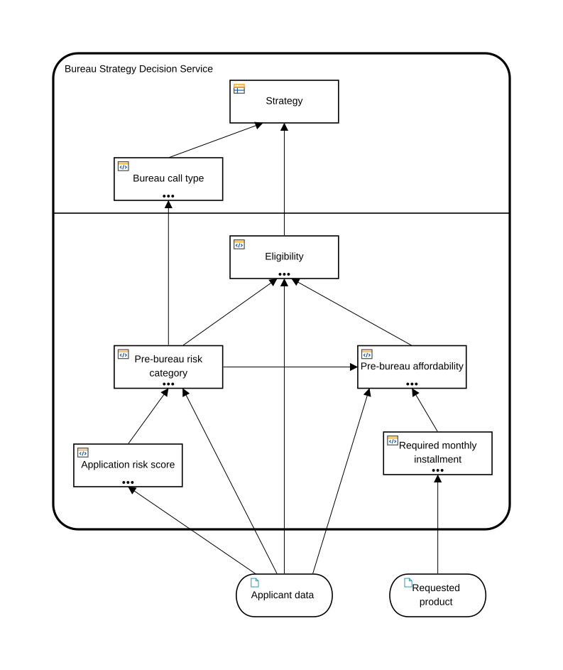

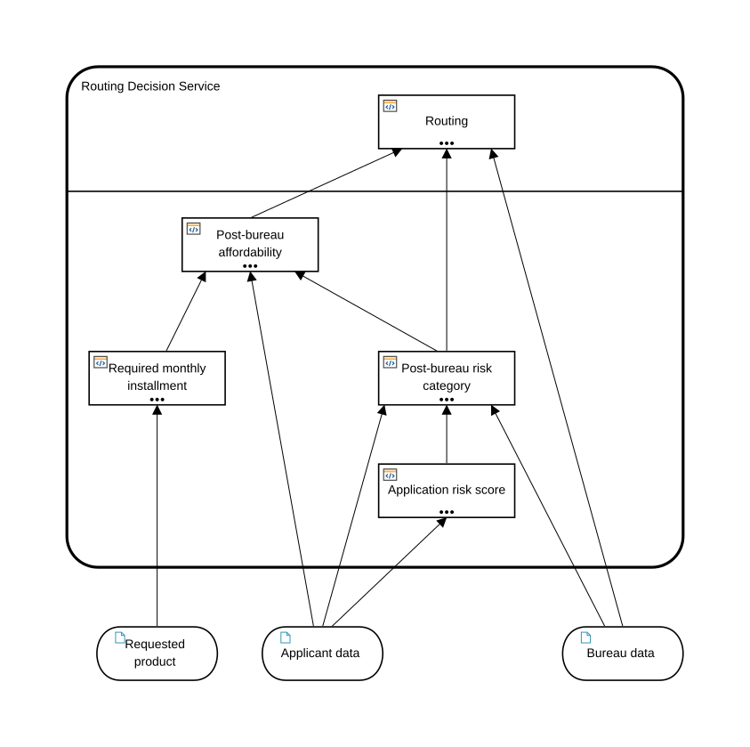

### The decision logic level

The DRG in
[DRD of all automated decision-making](Images/drd-of-all-automated-decision-making.svg)
is defined in more detail in the following specifications of the value
expressions associated with decisions and business knowledge models:

- The **Strategy** decision logic
  ([Strategy decision logic](Images/strategy-decision-logic.svg)) defines a
  complete, unique-hit decision table deriving Strategy from Eligibility and
  Bureau call type.

- The **Bureau call type** decision logic (shown as a boxed invocation in
  [Bureau call type decision logic](Images/bureau-call-type-decision-logic.svg))
  invokes the Bureau call type table, passing the output of the Pre-bureau risk
  category decision as the Pre-Bureau Risk Category parameter.

- The **Bureau call type table** decision logic
  ([Bureau call type table decision logic](Images/bureau-call-type-table-decision-logic.svg))
  defines a complete, unique-hit decision table deriving Bureau Call Type from
  Pre-Bureau Risk Category.

- The **Eligibility** decision logic (shown as a boxed invocation in
  [Eligibility decision logic](Images/eligibility-decision-logic.svg)) invokes
  the Eligibility rules business knowledge model, passing Applicant data. Age as
  the Age parameter, the output of the Pre-bureau risk category decision as the
  Pre-Bureau Risk Category parameter, and the output of the Pre-bureau
  affordability decision as the Pre-Bureau Affordability parameter.

- The **Eligibility rules** decision logic
  ([Eligibility rules decision logic](Images/eligibility-rules-decision-logic.svg))
  defines a complete, priority-ordered single hit decision table deriving
  Eligibility from Pre-Bureau Risk Category, Pre-Bureau Affordability and Age.

- The **Pre-bureau risk category** decision logic (shown as a boxed invocation
  in
  [Pre-bureau risk category decision logic](Images/pre-bureau-risk-category-decision-logic.svg))
  invokes the Pre- bureau risk category table business knowledge model, passing
  Applicant data. ExistingCustomer as the Existing Customer parameter and the
  output of the Application risk score decision as the Application Risk Score
  parameter.

- The **Pre-bureau risk category table** decision logic
  ([Pre-bureau risk category table decision logic](Images/pre-bureau-risk-category-table-decision-logic.svg))
  defines a complete, unique-hit decision table deriving Pre-Bureau Risk
  Category from Existing Customer and Application Risk Score.

- The **Application risk score** decision logic (shown as a boxed invocation in
  [Application risk score decision logic](Images/application-risk-score-decision-logic.svg))
  invokes the Application risk score model business knowledge model, passing
  Applicant data. Age as the Age parameter, Applicant data. MaritalStatus as the
  Marital Status parameter and Applicant data. EmploymentStatus as the
  Employment Status parameter.

- The **Application Risk Score Model** decision logic
  ([Application risk score model decision logic](Images/application-risk-score-model-decision-logic.svg))
  defines a complete, no-order multiple-hit table with aggregation, deriving
  Application risk score from Age, Marital Status and Employment Status, as the
  sum of the Partial scores of all matching rows (this is therefore a predictive
  scorecard represented as a decision table).

- The **Routing** decision logic (shown as a boxed invocation in
  [Routing decision logic](Images/routing-decision-logic.svg)) invokes the
  Routing rules business knowledge model, passing Bureau data. Bankrupt as the
  Bankrupt parameter, Bureau data. CreditScore as the Credit Score parameter,
  the output of the Post-bureau risk category decision as the Post-Bureau Risk
  Category parameter, and the output of the Post-bureau affordability decision
  as the Post-Bureau Affordability parameter. Note that if Bureau data is null
  (due to the THROUGH strategy bypassing the Collect bureau data task) the
  Bankrupt and Credit Score parameters will be null.

- The **Routing rules** decision logic
  ([Routing rules decision logic](Images/routing-rules-decision-logic.svg))
  defines a complete, priority-ordered single hit decision table deriving
  Routing from Post-Bureau Risk Category, Post-Bureau Affordability, Bankrupt
  and Credit Score.

- The **Post-bureau risk category** decision logic (shown as a boxed invocation
  in
  [Post-bureau risk category decision logic](Images/post-bureau-risk-category-decision-logic.svg))
  invokes the Post- bureau risk category business knowledge model, passing
  Applicant data. ExistingCustomer as the Existing Customer parameter, Bureau
  data. CreditScore as the Credit Score parameter, and the output of the

> Application risk score decision as the Application Risk Score parameter. Note
> that if Bureau data is null (due to the THROUGH strategy bypassing the Collect
> bureau data task) the Credit Score parameter will be null.

- The **Post-bureau risk category table** decision logic
  ([Post-bureau risk category table decision logic](Images/post-bureau-risk-category-table-decision-logic.svg))
  defines a complete, unique-hit decision table deriving Post-Bureau Risk
  Category from Existing Customer, Application Risk Score and Credit Score.

- The **Pre-bureau affordability** decision logic (shown as a boxed invocation
  in
  [Pre-bureau affordability decision logic](Images/pre-bureau-affordability-decision-logic.svg))
  invokes the Affordability calculation business knowledge model, passing
  Applicant data. Monthly. Income as the Monthly Income parameter, Applicant
  data. Monthly. Repayments as the Monthly Repayments parameter, Applicant data.
  Monthly. Expenses as the Monthly Expenses parameter, the output of the
  Pre-bureau risk category decision as the Risk Category parameter, and the
  output of the Required monthly installment decision as the Required Monthly
  Installment parameter.

- The **Post-bureau affordability** decision logic (shown as a boxed invocation
  in
  [Post-bureau affordability decision logic](Images/post-bureau-affordability-decision-logic.svg))
  invokes the Affordability calculation business knowledge model, passing
  Applicant data. Monthly. Income as the Monthly

> Income parameter, Applicant data. Monthly. Repayments as the Monthly
> Repayments parameter, Applicant data. Monthly. Expenses as the Monthly
> Expenses parameter, the output of the Post-bureau risk category decision as
> the Risk Category parameter, and the output of the Required monthly
> installment decision as the Required Monthly Installment parameter.

- The **Affordability calculation** decision logic
  ([Affordability calculation decision logic](Images/affordability-calculation-decision-logic.svg))
  defines a boxed function deriving Affordability from Monthly Income, Monthly
  Repayments, Monthly Expenses and Required Monthly Installment. One step in
  this calculation derives Credit contingency factor by invoking the Credit
  contingency factor table business knowledge model, passing the output of the
  Risk category decision as the Risk Category parameter.

- The **Credit contingency factor table** decision logic
  ([Credit contingency factor table decision logic](Images/credit-contingency-factor-table-decision-logic.svg))
  defines a complete, unique-hit decision table deriving Credit contingency
  factor from Risk Category.

- The **Required monthly installment** decision logic (shown as a boxed
  invocation in
  [Required monthly installment decision logic](Images/required-monthly-installment-decision-logic.svg))
  invokes the Installment calculation business knowledge model, passing
  Requested product. ProductType as the Product Type parameter, Requested
  product. Rate as the Rate parameter, Requested product. Term as the Term
  parameter and Requested product. Amount as the Amount parameter.

- The **Installment calculation** decision logic
  ([Installment calculation decision logic](Images/installment-calculation-decision-logic.svg))
  defines a boxed function deriving monthly installment from Product Type, Rate,
  Term and Amount. One step in this calculation invokes an external function
  PMT, imported from a DMN XML file as “Financial”.
  [Financial.PMT decision logic](Images/financial-pmt-decision-logic.svg) shows
  the decision logic of PMT function.

- 

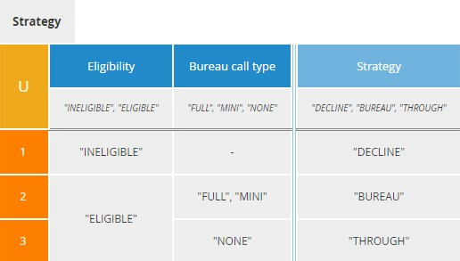

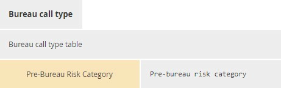

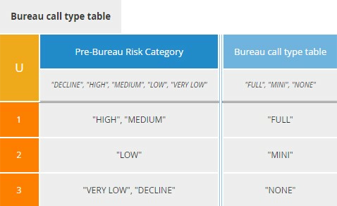

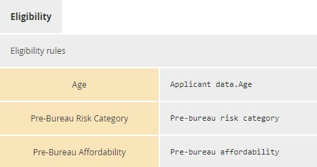

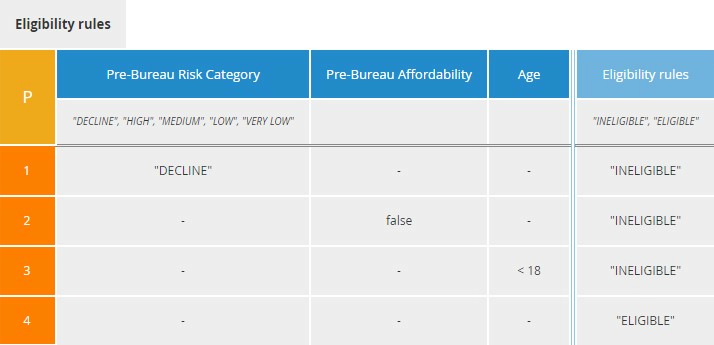

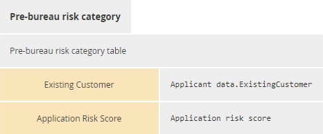

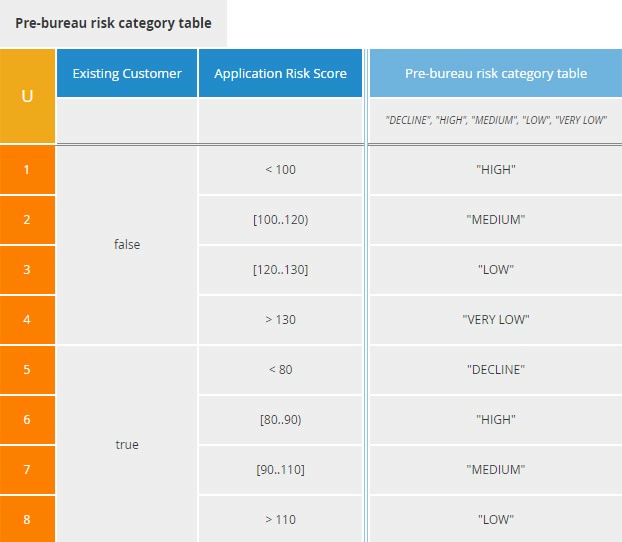

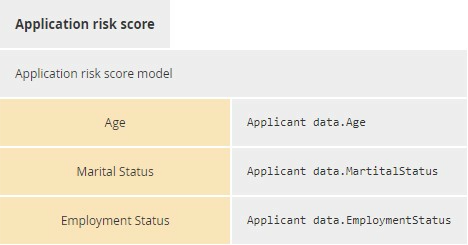

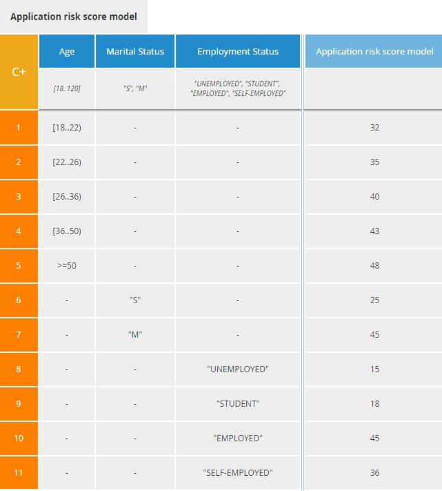

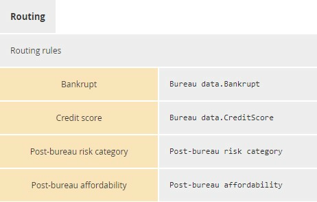

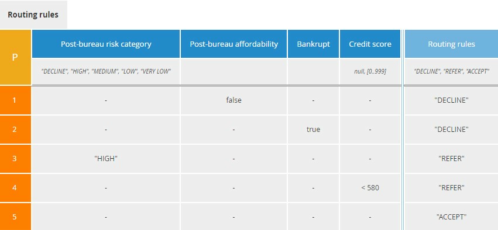

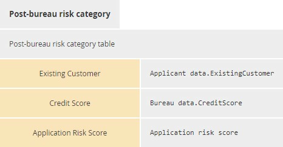

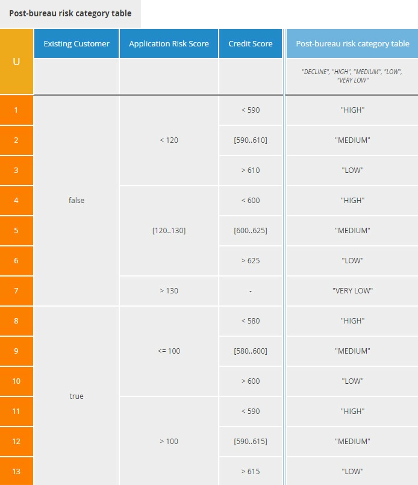

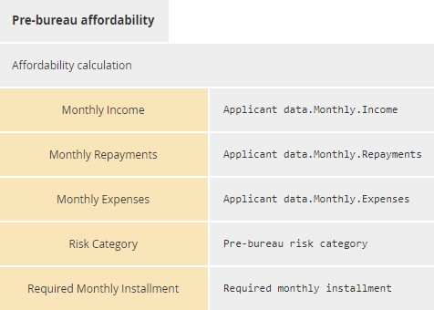

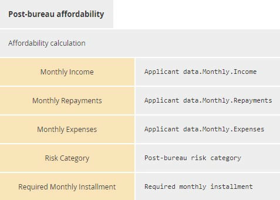

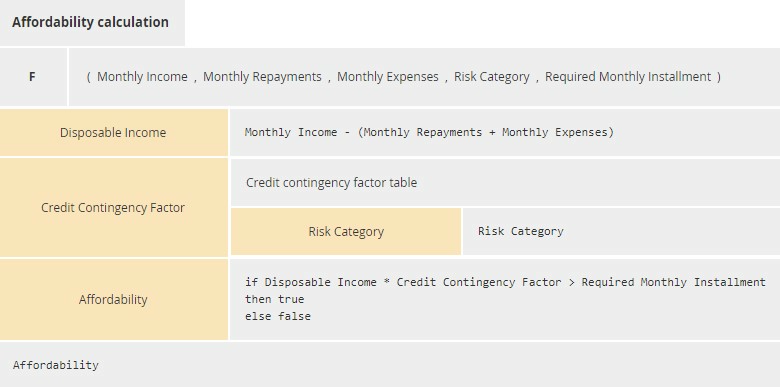

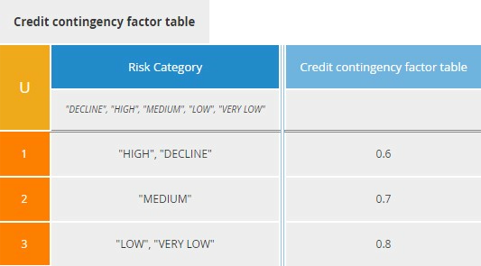

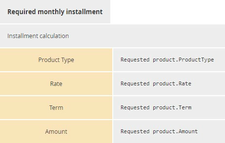

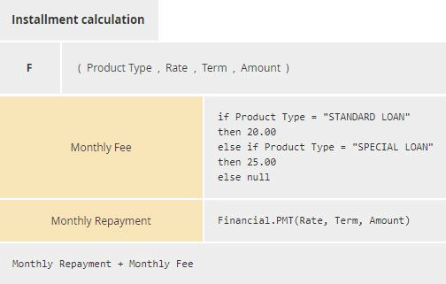

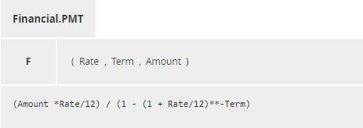

### Executing the Decision Model

In order to execute a decision model (in this case, by calling two decision
services), case data must be bound to the input data, much as an invocation
binds arguments to function parameters. The binding of case data to input data,
however, is not part of the decision model, unlike the invocation that specifies
how a decision’s requirement inputs bind to the parameters of that decision’s
required knowledge.

FEEL allows contexts and other expressions to be used to represent case data
(see also clauses 0 and [Context](12_Expression_Language_FEEL.md#context-1)).
Input data is associated with an item definition (clause [UnaryTests
Metamodel](09_Relating_Decision_Logic_to_Decision_Requirements.md#unarytests-metamodel))
and the case data must have the same type and other constraints specified by the
item definition. Case data must be mapped to the FEEL domain. For example, XML
instance data is mapped to the FEEL domain as described in clause [XML
Data](12_Expression_Language_FEEL.md#xml-data).

For convenience, we will specify case data using boxed expressions instead of
XML.
[Applicant data input data sample](Images/applicant-data-input-data-sample.svg),
[Requested Product input data sample](Images/requested-product-input-data-sample.svg),
and [Bureau Data input data sample](Images/bureau-data-input-data-sample.svg)
show boxed contexts defining case data for Applicant data, Requested product and
Bureau data.

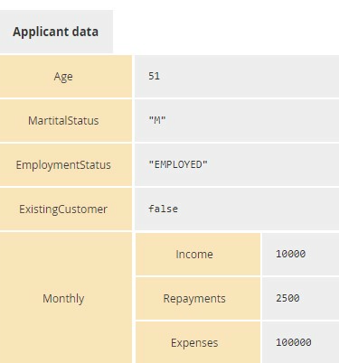

**  **

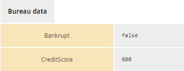

When the Bureau Strategy Decision Service is called with the Applicant data and
Requested product case data, it returns the context shown in
[Output of the Bureau Strategy Decision Service](Images/output-of-the-bureau-strategy-decision-service.svg):

When the Routing Decision Service is called with the Applicant data, Requested
product and Bureau data case data, it returns the context shown in
[Output of the Routing decision Service](Images/output-of-the-routing-decision-service.svg).

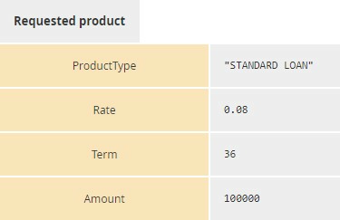

## Example 2: Ranked Loan Products

The second example considers eligibility for various mortgage loan products
based on the Borrower’s income, assets, liabilities, and credit score, and ranks
them based on specified sort criteria. It illustrates the wide variety of DMN
expression types, including context, invocation, relation, and function
definition, as well as some of the newer FEEL functions and operators, including
import, service invocation, enhanced iteration, generalized unary tests, and
Java binding. The logic represented here is just one of many different ways to
model the scenario.

The DRD for the decision model is shown in
[DRD for Recommended Loan Products](Images/drd-for-recommended-loan-products.svg).

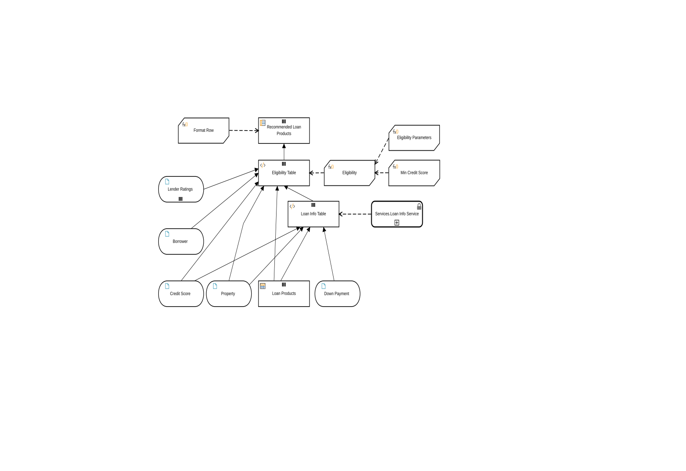

The input data elements include:

- **Credit Score**, a number from 300 to 850 inclusive

- **Down Payment**, a number

- **Property**, a structure of type *tProperty*
  ([Type tProperty (non-normative representation)](Images/type-tproperty-non-normative-representation.svg))

- **Borrower**, a structure of type *tBorrower*
  ([Type tBorrower](Images/type-tborrower.svg)), and

- **Lender Ratings,** a structure of type *tLenderRatings*
  ([Type tLenderRatings, a collection of tLenderRating](Images/type-tlenderratings-a-collection-of-tlenderrating.svg))

The boxed expression format for the datatype definitions in
[Type tProperty (non-normative representation)](Images/type-tproperty-non-normative-representation.svg),
[Type tBorrower](Images/type-tborrower.svg), and
[Type tLenderRatings, a collection of tLenderRating](Images/type-tlenderratings-a-collection-of-tlenderrating.svg)is
non- normative.
[Type tProperty (non-normative representation)](Images/type-tproperty-non-normative-representation.svg),
for example, is a visualization of the XML representation of
[Type tProperty (XML representation)](Images/type-tproperty-xml-representation.svg).

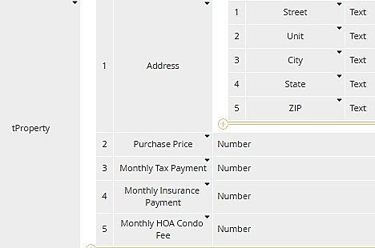

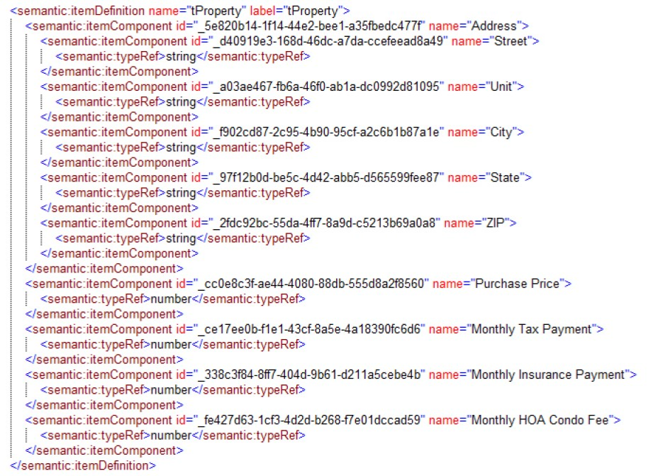

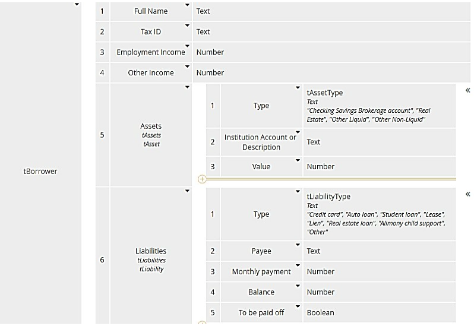

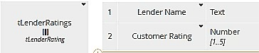

In addition, the zero-input decision Loan Products, a structure of type
tLoanProducts, is a relation ([Loan Products](Images/loan-products.svg)). Cells
in a relation are FEEL expressions but often contain literal values as a way to
embed static data tables inside a decision model. In this case it represents a
list of mortgage loan products available from various lenders, specifying the
best interest rate offered to lowest risk borrowers and loan origination costs
specified as “points”, a percentage of the loan amount, and “fees”, a constant
value.

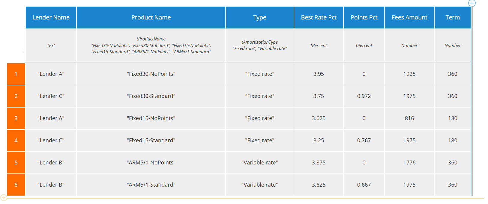

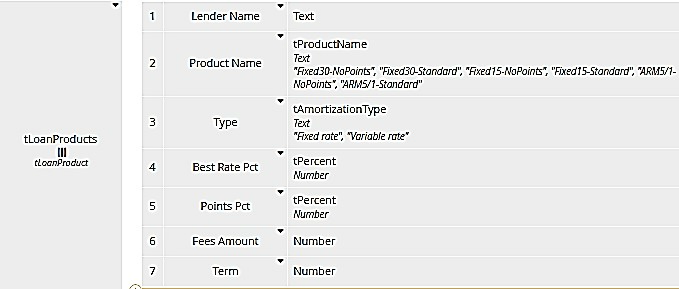

The **Recommended Loan Products** model imports another decision model **Loan
Info**, with the DRD shown in
[DRD of imported Loan Info Service](Images/drd-of-imported-loan-info-service.svg),
defining a decision service **Loan Info Service**. Imported models are assigned
a modeler-chosen prefix, here *Services*, to distinguish its namespace from that
of the importing model. In the importing DRD
([DRD for Recommended Loan Products](Images/drd-for-recommended-loan-products.svg)),
the imported service **Services.Loan Info Service** is depicted with the
non-normative lock icon, indicating that its logic may not be edited within the
importing model. The service parameters are the input data shown in
[DRD of imported Loan Info Service](Images/drd-of-imported-loan-info-service.svg):
**Credit Score, Property, Loan Product,** and **Down Payment**, with types
identical to those defined in the importing model.

**Services**.**Loan Info Service** populates a row of the decision **Loan Info
Table**, a collection of type **tLoanInfoRow**
([Loan Products](Images/loan-products.svg)), calculating the details of the
selected loan product for the given property value (purchase price) and down
payment.

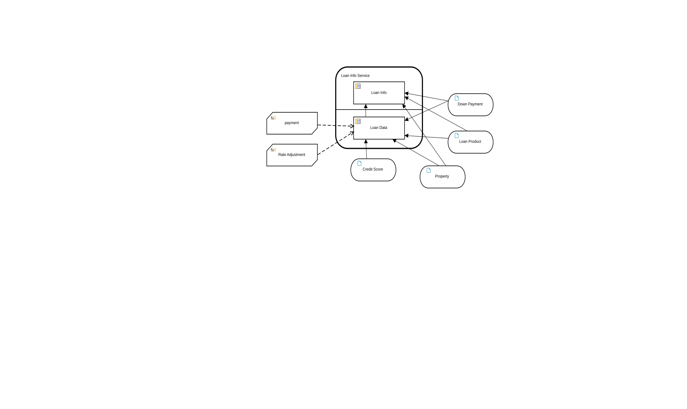

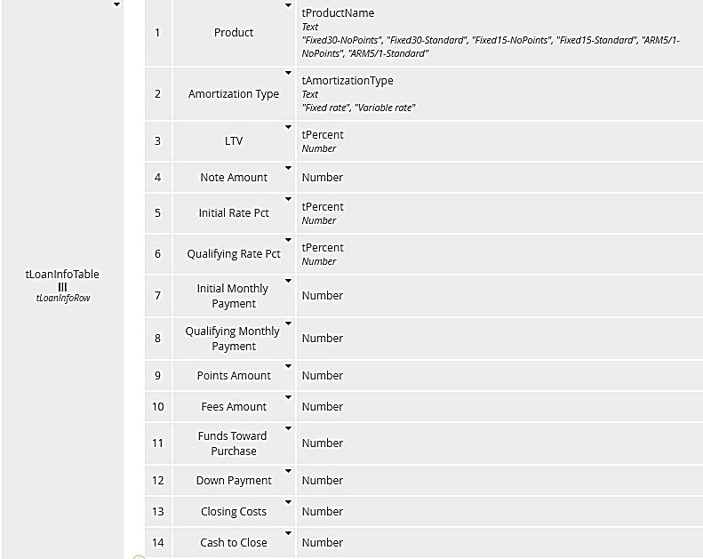

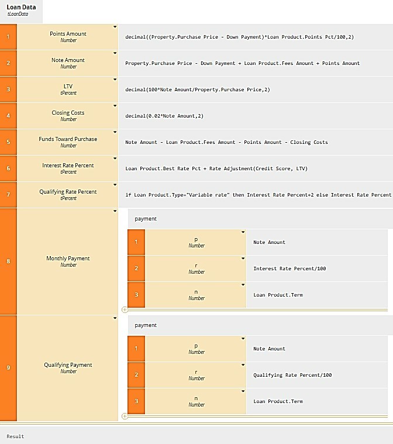

Within the service, **Loan Data** performs calculations used in the presentation
decision, **Loan Info**. It is modeled as a context with no final result box,
meaning every context entry creates a component of the result. (The text
“Result” in the final result box is a tool artifact not in the spec, overwritten
by a literal expression if the context has a final result box value.) A few
things to note about the logic shown in [Loan Data](Images/loan-data.svg):

- FEEL arithmetic can create values with many digits following the decimal
  point. The function decimal(x, 2) rounds value x to 2 decimal places.

- Context entry Interest Rate Percent invokes the BKM **Rate Adjustment**
  ([BKM Rate Adjustment](Images/bkm-rate-adjustment.svg)), a function of the
  borrower’s **Credit Score** and the loan-to-value ratio **LTV**. This
  increments the Loan Product’s interest rate by a small amount based on the
  loan risk.

- **Credit Score** values less than 620 are ineligible for a loan. In that case,
  **Rate Adjustment** could return null, but then all expressions using **Rate
  Adjustment** would also be null, complicating the logic. To simplify the
  downstream logic, it is better in this case to return a number, since
  ultimately the loan will not be approved if the **Credit Score** is less than
  620.

- For loans with variable interest rate, the debt-to-income ratio uses a
  *Qualifying Payment* amount based on an interest rate 2 percent higher than
  the rate used in the initial *Monthly Payment*.

- *Monthly Payment* and *Qualifying Payment* are modeled as boxed invocations of
  the BKM **payment**, the amortization formula
  ([BKM payment](Images/bkm-payment.svg)). The parameters of payment are the
  loan amount *p*, the interest rate *r*, and the term in months, *n*.

The decision **Loan Info** ([Loan Info](Images/loan-info.svg)), the output of
**Services.Loan Info**, returns a row of **Loan Info Table**. It is also modeled
as a context with no final result box, meaning each context entry represents a
column of **Loan Info Table.**

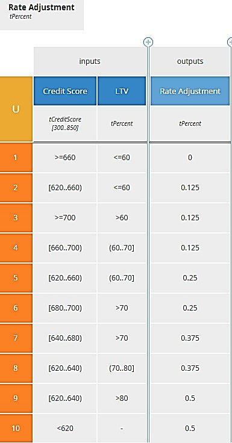

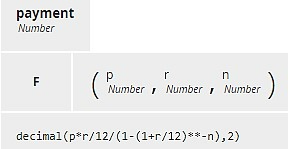

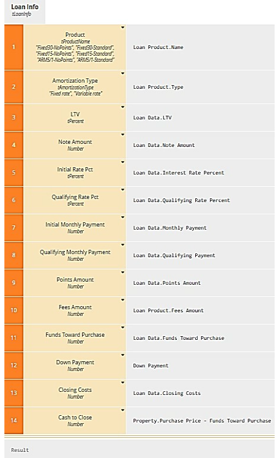

In the importing model, the decision **Loan Info Table**
([Loan Info Table](Images/loan-info-table.svg)) iterates invocation of **Loan
Info** over rows of **Loan Products.** It is modeled as a literal expression
using the FEEL *for. . in. .return* operator. Here *x* is a range variable
meaning one item in a list – one **Loan Product** in **Loan Products** –
producing an argument of the function call.

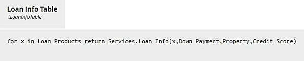

**Loan Info Table** now provides values for each **Loan Product** used to
determine whether the Borrower’s income, assets, liabilities, and credit score
qualify for loan approval.

At the heart of the logic for determining eligibility for a particular loan is
the BKM **Min Credit Score** ([Min Credit Score](Images/min-credit-score.svg)),
a decision table that calculates the minimum credit score required based on
three parameters: *DTI*, the borrower’s debt-toincome ratio; *LTV,* the
loan-to-value ratio; and *Reserves*, a measure of the Borrower’s liquid assets
after closing in units of monthly *Housing Costs*. The table is modeled as hit
policy *Collect* with aggregation *Minimum*, meaning when multiple rules match
the lowest value output is returned. When *DTI* is greater than 95%, the loan is
automatically ineligible. In that case, no rule matches and **Min Credit Score**
returns the value null. Downstream logic referencing this variable must account
for the possibility of null value.

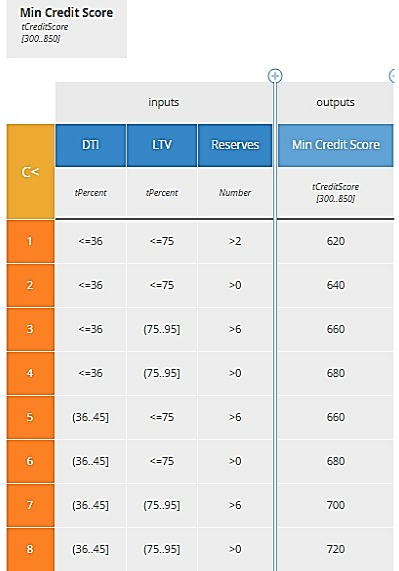

**Min Credit Score** is called by the BKM **Eligibility,** which in turn calls
the BKM **Eligibility Parameters**
([Eligibility Parameters](Images/eligibility-parameters.svg)). **Eligibility
Parameters** calculates the two key parameters of **Min Credit Score**, the
debt-to-income ratio *DTI Pct*, and the liquid assets after closing, called
*Reserves*. Note that context entry *Housing Expense*, which sums the loan
payment, tax and insurance payments, and homeowner association/condo fee, must
account for the possibility that the latter is left blank, i.e., null, in the
input data **Property**, since adding null to a number gives null. To prevent
this, instead of the + operator we use the *sum()* function on a list filtered
by the condition *item != null.* We use this technique also on context entry
*Income*.

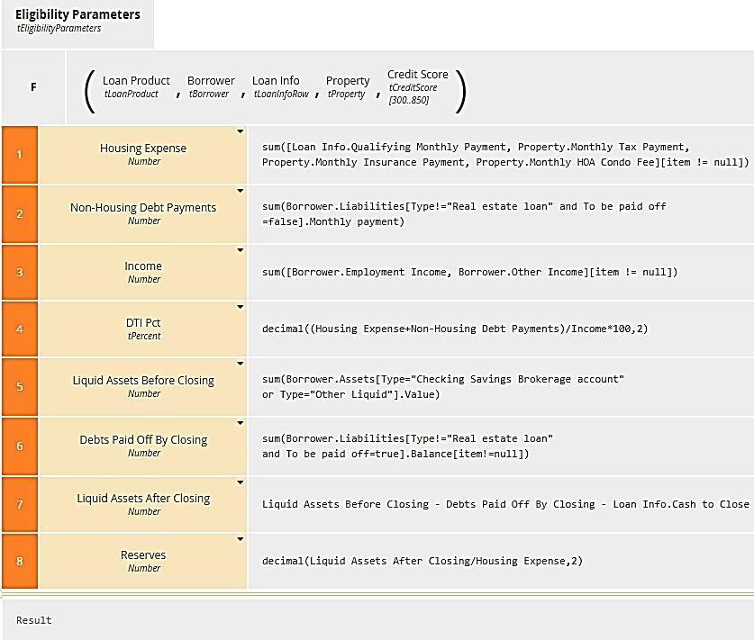

For legibility, the BKM **Eligibility** is shown in two pieces
([Eligibility (top)](Images/eligibility-top.svg)and
[Eligibility (bottom)](Images/eligibility-bottom.svg)). This BKM creates a row
of type *tTableRow* for the decision **Eligibility Table**. It is modeled as a
context, where the first four context entries
([Eligibility (bottom)](Images/eligibility-bottom.svg)) call BKMs to determine
values to populate the *Table Row* components.

- *Params* calls the BKM **Eligibility Parameters** for a given **Loan
  Product**.

- *Required Credit Score* uses Params to call the BKM **Min Credit Score**,
  returning the minimum credit score required by that **Loan Product** for the
  Borrower to be eligible.

- *Eligible* is a Boolean comparing the Borrower’s credit score to **Min Credit
  Score.** *Recommendation* uses the input data **Lender Ratings** in
  combination with **Eligible** to return a recommendation value for the **Loan
  Product**. *Recommendation* illustrates an alternative decision table syntax
  introduced in DMN 1.2 called generalized unary test. With generalized unary
  tests, a decision table input entry may be any FEEL expression, substituting ?
  for the input expression. For example, in the first column of this decision
  table the rules filter the **Lender Ratings** table for an item with *Lender
  Name* matching that of the **Loan Product** and *Customer Rating* in a
  specified range, returning true if that filter returns any values.

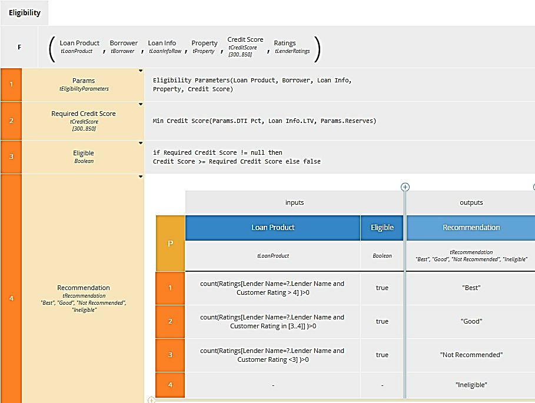

The rest of **Eligibility** is shown
in[Eligibility (bottom)](Images/eligibility-bottom.svg).

- *Table Row* is a nested context with no final result box value. Each context
  entry represents a column in the row.

- The DMN spec allows the final result box to be a context, but in this example,
  we use a context entry to create the result value and return it in the result
  box. Here context entry *Table Row* creates the row structure, and the final
  result box simply selects this context entry.

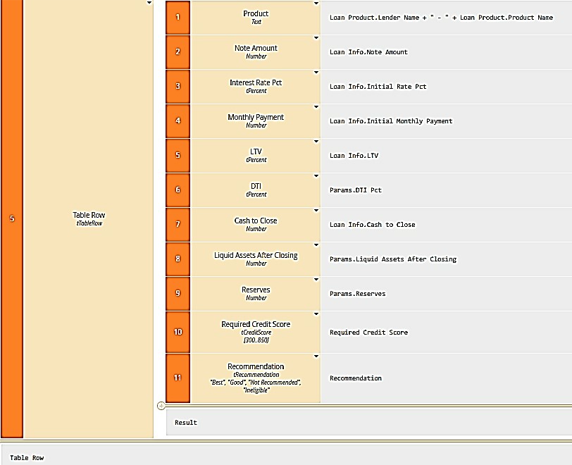

The decision **Eligibility Table**
([Eligibility Table](Images/eligibility-table.svg)) uses an alternative form of
the *for. .in..return* operator to iterate over an index rather than iterate
over list item values. This alterative format allows the returned expression to
involve corresponding items in multiple lists, in this case **Loan Products**
and **Loan Info Table**.

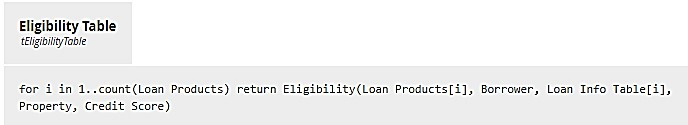

The top-level decision **Recommended Loan Products**
([Recommended Loan Products](Images/recommended-loan-products.svg)) first sorts
**Eligibility Table** based on *Recommendation* and *Monthly Payment* and then
calls a Java method to format number values as strings for final presentation.

- The first context entry *precedes* is a function definition used by the FEEL
  *sort()* function. The second parameter of *sort()*, called the *precedes
  function*, is a Boolean function with two arguments representing list items.
  It returns true if the first argument precedes the second in the sorted list.

- The context entry *Sorted Table* performs the sort. With simple sort criteria,
  the precedes function is typically defined inline as an anonymous function
  using the keyword *function*, as in

> sort(myTable, function(x, y) x.Amount \< y.Amount)
>
> which sorts the rows of *myTable* in ascending order of the column *Amount*.
> However, in **Recommended Loan Products** we instead use a named precedes
> function, the context entry *precedes*. In that case, the name of the function
> provides the second argument of *sort().*

- The final result box iterates a call to the BKM **Format Row**, which executes
  a static Java method to format number values in *Sorted Table* as strings with
  a currency symbol and two digits following the decimal point.

**Format Row** ([Format Row](Images/format-row.svg)) operates on a single row of
*Sorted Table*. It is modeled as a context.

- The first context entry *string format* is a Java function definition,
  indicated by the code J. DMN specifies such a function definition as a context
  with two context entries, *class,* and *method signature*. This example
  applies a mask string to a number, returning a formatted number string.

- The second context entry *formatted row* generates a row of **Recommended Loan
  Products** in final presentation format, calling *string format* to format
  amount and percent values.

- The final result box returns *formatted row*.

[Test Case output of Recommended Loan Products](Images/test-case-output-of-recommended-loan-products.svg)
shows the output of **Recommended Loan Products** based on the Test Case input
data of
[Test Case Input Data (partial)](Images/test-case-input-data-partial.svg).

