# DMN Diagram Interchange (DMN DI)

## Scope

This chapter specifies the meta-model and schema for **DMN** Diagram Interchange (**DMN DI**). The **DMN DI** is meant to facilitate the interchange of **DMN** diagrams between tools rather than being used for internal diagram representation by the tools. The simplest interchange approach to ensure the unambiguous rendering of a **DMN** diagram was chosen for **DMN DI**. As such, **DMN DI** does not aim to preserve or interchange any “tool smarts” between the source and target tools (e.g., layout smarts, efficient styling, etc.).

**DMN DI** does not ascertain that the **DMN** diagram is syntactically or semantically correct.

This version of DMN DI focuses on the interchange of Decision Requirements Diagrams (DRDs). Diagram Interchange for boxed expressions and decision tables might be added in future versions.

## Diagram Definition and Interchange

The **DMN DI** meta-model, similar to the DMN abstract syntax meta-model, is defined as a MOF-based meta-model. As such, its instances can be serialized and interchanged using XMI. DMN DI is also defined by an XML schema. Thus, its instances can also be serialized and interchanged using XML.

Both DMN DI meta-model and schema are harmonized with the OMG Diagram Definition (DD) standard version 1.1. The referenced DD contains two main parts: the Diagram Commons (DC) and the Diagram Interchange (DI). The DC defines common types like bounds and points, while the DI provides a framework for defining domain-specific diagram models. As a domain-specific DI, DMN DI defines a few new meta-model classes that derive from the abstract classes from DI.

The focus of DMN DI is the interchange of laid out shapes and edges that constitute a **DMN** diagram. Each shape and edge reference a particular **DMN** model element. The referenced **DMN** model elements are all part of the actual **DMN** model. As such, DMN DI is meant to only contain information that is neither present nor derivable, from the **DMN** model whenever possible. Simply put, to render a **DMN** diagram both the DMN DI instance(s) and the referenced **DMN** model are REQUIRED.

From the DMN DI perspective, a DMN diagram is a particular snapshot of a **DMN** model at a certain point in time. Multiple **DMN** diagrams can be exchanged referencing model elements from the same **DMN** model. Each diagram may provide an incomplete or partial depiction of the content of the **DMN** model. As described in [DMN Examples](14_DMN_Examples.md#dmn-examples), a **DMN** model package consists of one or more files. Each file may contain any number of **DMN** diagrams. The exporting tool is free to decide how many diagrams are exported and the importing tool is free to decide if and how to present the contained diagrams to the user.

## How to read this chapter

Clause [DMN Diagram Interchange Meta-Model](#dmn-diagram-interchange-meta-model) describes in detail the meta-model used to keep the layout and the look of **DMN** Diagrams. Clause [Notation Depiction Library and Abstract Element Resolutions](#notation-depiction-library-and-abstract-element-resolutions) presents in tables a library of the **DMN** element depictions and an unambiguous resolution between a referenced **DMN** model element and its depiction.

## DMN Diagram Interchange Meta-Model

### Overview

The DMN DI is an instance of the OMG DI meta-model. The basic concept of DMN DI, as with DI in general, is that serializing a diagram \[DMNDiagram\] for interchange requires the specification of a collection of shapes \[DMNShape\] and edges \[DMNEdge\].

The DMN DI classes only define the visual properties used for depiction. All other properties that are REQUIRED for the unambiguous depiction of the **DMN** element are derived from the referenced **DMN** element \[dmnElementRef\].

**DMN** diagrams may be an incomplete or partial depiction of the content of the **DMN** model. Some **DMN** elements from a **DMN** model may not be present in any of the diagram instances being interchanged.

DMN DI does not directly provide for any containment concept. The DMNDiagram is an ordered collection of mixed DMNShape(s) and DMNEdge(s). The order of the DMNShape(s) and DMNEdge(s) inside a DMNDiagram determines their Z-order (i.e., what is in front of what). DMNShape(s) and DMNEdge(s) that are meant to be depicted “on top” of other DMNShape(s) and DMNEdge(s) MUST appear after them in the DMNDiagram. Thus, the exporting tool MUST order all DMNShape(s) and DMNEdge(s) such that the desired depiction can be rendered.Measurement UnitAs per OMG DD, all coordinates and lengths defined by DMN DI are assumed to be in user units, except when specified otherwise. A user unit is a value in the user coordinate system, which initially (before any transformation is applied) aligns with the device’s coordinate system (for example, a pixel grid of a display). A user unit, therefore, represents a logical rather than physical measurement unit. Since some applications might specify a physical dimension for a diagram as well (mainly for printing purposes), a mapping from a user unit to a physical unit can be specified as a diagram’s resolution. Inch is chosen in this specification to avoid variability, but tools can easily convert from/to other preferred physical units. Resolution specifies how many user units fit within one physical unit (for example, a resolution of 300 specifies that 300 user units fit within 1 inch on the device).

### DMNDI \[Class\]

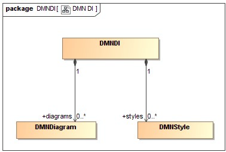

The class DMNDI is a container for the shared DMNStyle and all the DMNDiagram defined in a Definitions.

###### Table: DMNDI attributes

| **Attribute** | **Description** |
|--------------------------|----------------------------------------------|
| **styles**: DMNStyle \[0..\*\] | A list of shared DMNStyle that can be referenced by all DMNDiagram and DMNDiagramElement. |
| **diagrams**: DMNDiagram \[0..\*\] | A list of DMNDiagram. |

### DMNDiagram \[Class\]

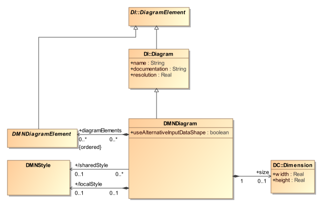

The class DMNDiagram specializes DI::Diagram. It is a kind of Diagram that represents a depiction of all or part of a **DMN** model.

DMNDiagram is the container of DMNDiagramElement (DMNShape(s) and DMNEdge(s)). DMNDiagram cannot include other DMNDiagram.

A DMNDiagram can define a DMNStyle locally and/or it can refer to a shared one defined in the DMNDI. Properties defined in the local style overrides the one in the referenced shared style. That combined style (shared and local) is the default style for all the DMNDiagramElement contained in this DMNDiagram.

The DMNDiagram class represents a two-dimensional surface with an origin of (0, 0) at the top left corner. This means that the x and y axes have increasing coordinates to the right and bottom. Only positive coordinates are allowed for diagram elements that are nested in a DMNDiagram.

The DMNDiagram has the following attributes.

###### Table: DMNDiagram attributes

| **Attribute** | **Description** |
|---------------------------|---------------------------------------------|
| **name**: String | The name of the diagram. Default is empty String. |
| **documentation**: String | The documentation of the diagram. Default is empty String. |
| **resolution**: Real | The resolution of the diagram expressed in user units per inch. Default is 300 |
| **diagramElements**: DMNDiagramElement \[0..\*\] | A list of DMNDiagramElement (DMNShape and DMNEdge) that are depicted in this diagram. |
| **useAlternativeInputDataShape:** Boolean \[0..1\] | If the DMNShape depicts an Input Data element then it is represented either using the paper sheet symbol, harmonized with BPMN and CMMN notations (true) or using the backwards compatible oval symbol (false). |
| **sharedStyle**: DMNStyle\[0.. 1\] | A reference to a DMNStyle defined in the DMNDI that serves as the default styling of the DMNDiagramElement in this DMNDiagram. |
| **localStyle**: DMNStyle \[0..1\] | A DMNStyle that defines the default styling for this diagram. Properties defined in that style override the ones in the sharedStyle. |
| **size**: DC::Dimens ion \[0..1\] | The size of this diagram. If not specified, the DMNDiagram is unbounded. |

### DMNDiagramElement \[Class\]

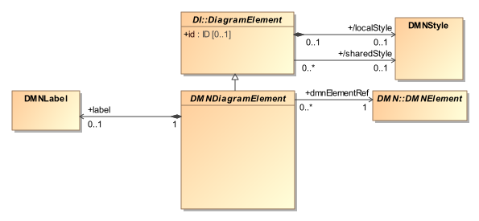

The DMNDiagramElement class is contained by the DMNDiagram and is the base class for DMNShape and DMNEdge.

DMNDiagramElement inherits its styling from its parent DMNDiagram. In addition, it can refer to one of the shared DMNStyle defined in the DMNDI and/or it can define a local style. See clause 13.4.9 for more details on styling.

DMNDiagramElement MAY also contain a DMNLabel when it has a visible text label. If no DMNLabel is defined, the DMNDiagramElement should be depicted without a label.

DMNDiagramElement has the following attributes:

###### Table: DMNDiagramElement attributes

| **Attribute** | **Description** |
|--------------------------|----------------------------------------------|
| **dmnElementRef**: DMNElement \[1\] | A reference to the DMNElement that is being depicted. |
| **sharedStyle**: DMNStyle \[0..1\] | A reference to a DMNStyle defined in the DMNDI. |
| **localStyle**: DMNStyle \[0..1\] | A DMNStyle that defines the styling for this element. |
| **label**: DMNLabel \[0.. 1\] | An optional label when this DMNElement has a visible text label. |

### DMNShape \[Class\]

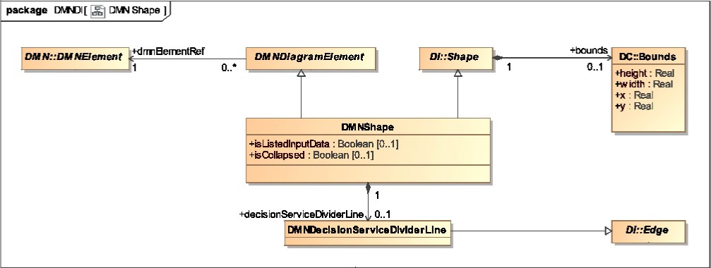

The DMNShape class specializes DI::Shape and DMNDiagramElement. It is a kind of Shape that depicts a DMNElement from the DMN model.

DMNShape represents a Decision, a Business Knowledge Model, an Input Data element, a Knowledge Source, a Decision Service or a Text Annotation that is depicted on the diagram.

DMNShape has three additional properties (isListedInputData, isCollapsed and decisionServiceDividerLine) that are used to further specify the appearance of some shapes that cannot be deduced from the DMN model.

DMNShape extends DI::Shape and DMNDiagramElement and has the following attributes:

###### Table: DMNShape attributes

| **Attribute** | **Description** |
|--------------------------------|----------------------------------------|
| **bounds**: DC::Bounds \[1\] | The Bounds of the shape relative to the origin of its parent DMNDiagram. The Bounds MUST be specified. |
| **dmnElementRef**: DMNElement \[1\] | A reference to a Decision, a Business Knowledge Model, an Input Data element, a Knowledge Source, a Decision Service, a Group or a Text Annotation MUST be specified. |
| **isListedInputData**: Boolean \[0..1\] | If the DMNShape depicts an Input Data element then this attribute is used to determine if the Input Data is listed on the Decision element (true) or drawn as separate notational elements in the DRD (false). |
| **decisionServiceDividerLine**: DMNDecisionServiceDividerLine \[0..1\] | If the DMNShape depicts a Decision Service, this attribute references a DMNDecisionServiceDividerLine which is a DI::Edge that defines s where the DMNShape is divided into two parts by a straight solid line. This can be the case when a DMNShape depicts a Decision Service, where the set of output decisions is smaller than the set of encapsulated decisions. The start and end waypoints of the decisionServiceDividerLine MUST be on the border of the DMNShape. |
| **isCollapsed** Boolean \[0..1\] = false | If the DMNShape depicts a DecisionService, this attribute indicates if it should be depicted expanded (false) or collapsed (true). Default is false. |

### DMNEdge \[Class\]

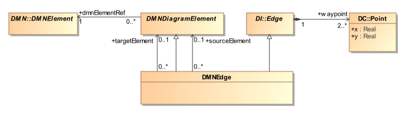

The DMNEdge class specializes DI::Edge and DMNDiagramElement. It is a kind of Edge that can depict a relationship between two **DMN** model elements.

DMNEdge are used to depict Requirements or Associations in the **DMN** model. Since DMNDiagramElement might be depicted more than once, sourceElement and targetElement attributes allow to determine to which depiction a

DMNEdge is connected. When DMNEdge has a source, its sourceModelElement MUST refer to the

DMNDiagramElement it starts from. That DMNDiagramElement MUST resolved to the DMNElement that is the actual source of the Requirement or Association. For Requirement, this is the required DMNElement. When it has a target, its targetModelElement MUST refer to the DMNDiagramElement where it ends. That

DMNDiagramElement MUST resolved to the DMNElement that is the actual target of the Requirement or Association. For Requirement, this is the DMNElement holding it.

DMNEdge extends DI::Edge and has the following properties:

###### Table: DMNEdge attributes

| **Attribute** | **Description** |
|----------------------------|--------------------------------------------|
| **wayPoints**: DC::Point \[2..\*\] | A list of points relative to the origin of its parent DMNDiagram that specifies the connected line segments of the edge. At least two (2) waypoints MUST be specified. |
| **dmnElementRef**: DMNElement \[1\] | A reference to an InformationRequirement, KnowledgeRequirement, AuthorityRequirement or Association. |
| **sourceElement**: DMNDiagramElement\[0.. 1\] | The actual DMNDiagramElement this DMNEdge is connecting from. MUST be specified when the DMNEdge has a source. |
| **targetElement**: DMNDiagramElement\[0.. 1\] | The actual DMNDiagramElement this DMNEdge is connecting to. MUST be specified when the DMNEdge has a target. |

### DMNLabel \[Class\]

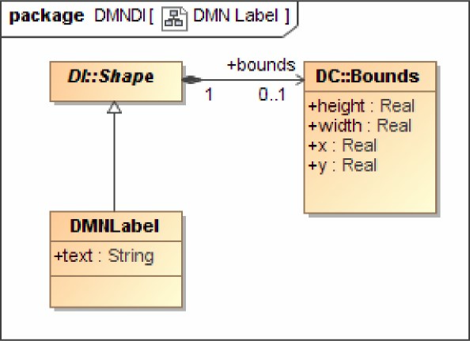

DMNLabel represents the depiction of some textual information about a DMN element.

A DMN label is not a top-level element but is always nested inside either a DMNShape or a DMNEdge. It does not have its own reference to a **DMN** element but rather inherits that reference from its parent DMNShape or DMNEdge. The textual information depicted by the label is derived from the name attribute of the referenced DMNElement.

DMNLabel extends DI::Shape and has the following properties:

###### Table: DMNLabel attributes

| **Attribute** | **Description** |
|------------------------|------------------------------------------------|
| **bounds**: Bounds \[0..1\] | The bounds of the DMNLabel. When not specified, the label is positioned at its default position as determined in clause 13.5 |
| **text**: String\[0..1\] | An optional pretty printed text that MUST be displayed instead of the DMNElement’s name if it is present. |

### DMNStyle \[Class\]

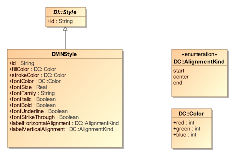

DMNStyle specializes DC::Style. It is a kind of Style that provides appearance options for a

DMNDiagramElement.

DMNStyle is used to keep some non-normative visual attributes such as colors and font. DMN doesn’t give any semantic to color and font styling, but tools can decide to use them and interchange them.

DMNDiagramElement style is calculated by percolating up DMNStyle attributes defined at a different level of the hierarchy. Each attribute is considered independently (meaning that a DMNStyle attribute can be individually overloaded). The precedence rules are as follow:

- The DMNStyle defined by the localStyle attribute of the DMNDiagramElement

- The DMNStyle referenced by the sharedStyle attribute of the DMNDiagramElement

- The DMNStyle defined by the localStyle attribute of the parent DMNDiagram

- The DMNStyle referenced by the sharedStyle attribute of the parent DMNDiagram

The default attribute value defined in [DMNStyle attributes](#table-dmnstyle-attributes) (DMNStyle attributes).

For example, let’s say we have the following:

- DMNDiagramElement has a local DMNStyle that specifies the fillColor and strokeColor

- Its parent DMNDiagram defines a local DMNStyle that specifies the fillColor and fontColor

Then the resulting DMNDiagramElement should use:

- The fillColor and strokeColor defined at the DMNDiagramElement level (as they are defined locally).

- The fontColor defined at the DMNDiagram level (as the fillColor was overloaded locally).

- All other DMNStyle attributes would have their default values.

DMNStyle extends DC::Style and has the following properties:

###### Table: DMNStyle attributes

| **Attribute** | **Description** |
|-------------------------------|-----------------------------------------|
| **id**: String \[0..1\] | A unique id for this style so it can be referenced. Only styles defined in the DMNDI can be referenced by DMNDiagramElement and DMNDiagram. |
| **fillColor**: DC::Color \[0..1\] | The color use to fill the shape. Doesn’t apply to DMNEdge. Default is white. |
| **strokeColor**: DC::Color \[0..1\] | The color use to draw the shape borders. Default is black. |
| **fontColor**: DC::Color \[0..1\] | The color use to write the label. Default is black. |
| **fontFamily**: String \[0..1\] | A comma-separated list of Font Name that can be used to display the text. Default is Arial. |
| **fontSize**: Real \[0..1\] | The size in points of the font to use to display the text. Default is 8. |
| **fontItalic**: Boolean \[0..1\] | If the text should be displayed in Italic. Default is false. |
| **fontBold**: Boolean \[0..1\] | If the text should be displayed in Bold. Default is false. |
| **fontUnderline**: Boolean \[0..1\] | If the text should be underlined. Default is false. |
| **fontStrikeThrough**: Boolean \[0..1\] | If the text should be stroke through. Default is false. |
| **labelHorizontalAlignment**: AlignmentKind \[0..1\] | How text should be positioned horizontally within the Label bounds. Default depends of the DMNDiagramElement the label is attached to (see [Notation Depiction Library and Abstract Element Resolutions](#notation-depiction-library-and-abstract-element-resolutions)). |
| **label VerticalAlignment**: AlignmentKind \[0..1\] | How the text should be positioned vertically inside the Label bounds. Default depends of the DMNDiagramElement the label is attached to (see [Notation Depiction Library and Abstract Element Resolutions](#notation-depiction-library-and-abstract-element-resolutions)). Start means “top” and end means “bottom”. |

## Notation Depiction Library and Abstract Element Resolutions

As a notation, **DMN** specifies the depiction for each of the **DMN** elements.

Serializing a **DMN** diagram for interchange requires the specification of a collection of DMNShape(s) (see [DMNEdge \[Class\]](#dmnedge-class)) and DMNEdge(s) (see [DMNLabel \[Class\]](#dmnlabel-class)) in the DMNDiagram (see [DMNDiagramElement \[Class\]](#dmndiagramelement-class)). The DMNShape(s) and DMNEdge(s) attributes must be populated in such a way as to allow the unambiguous rendering of the DMN diagram by the receiving party. More specifically, the DMNShape(s) and DMNEdge(s) MUST reference **DMN** model elements. If no DMNElement is referenced or if the reference is invalid, it is expected that this shape or edge should not be depicted.

When rendering a **DMN** diagram, the correct depiction of a DMNShape or DMNEdge depends mainly on the referenced **DMN** model element and its particular attributes and/or references. The purpose of this clause is to: provide a library of the **DMN** element depictions, and to provide an unambiguous resolution between the referenced **DMN** model element \[DMNElement\] and their depiction. Depiction resolution tables are provided below for both DMNShape (see [DMNShape Resolution](#dmnshape-resolution)) and DMNEdge (see [DMNEdge Resolution](#dmnedge-resolution)).

### Labels

Both DMNShape and DMNEdge may have labels (its name attribute) placed on the shape/edge, or above or below the shape/edge, in any direction or location, depending on the preference of the modeler or modeling tool vendor.

Labels are optional for DMNShape and DMNEdge. When there is a label, the position of the label is specified by the bounds of the DMNLabel of the DMNShape or DMNEdge. Simply put, label visibility is defined by the presence of the DMNLabel element.

The bounds of the DMNLabel are optional and always relative to the containing DMNDiagram's origin point. The depiction resolution tables provided below exemplify default label positions if no bounds are provided for the DMNLabel (for DMNShape kinds (see [DMNShape Resolution](#dmnshape-resolution)) and DMNEdge kinds (see [DMNEdge Resolution](#dmnedge-resolution))).

When the DMNLabel is contained in a DMNShape, the text to display is the name of the DMNElement.

### DMNShape Resolution

DMNShape can be used to represent a Decision, a Business Knowledge Model, an Input Data element, a Knowledge Source, a Text Annotation, a Group, and a Decision Service.

#### Decision

A Decision is represented in a DRD as a rectangle, normally drawn with solid lines. If the Listed Input Data option is exercised, all the Decisions requirements for Input Data shall be listed beneath the Decisions label and separated from it by a horizontal line. The listed Input Data names shall be clearly inside the shape of the DRD element.

###### Table: Depiction Resolution for Decision

| **DMNElement** | **DMNShape attributes** | **Depiction** |
|------------------------|------------------------|------------------------|
| Decision | None | 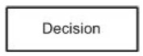 |
| Decision and two Input Data | Shapes of Input Data have inListedInputData=true | 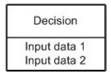 |

#### Business Knowledge Model

###### Table: Depiction Resolution for Business Knowledge Model

| **DMNElement** | **DMNShape attributes** | **Depiction** |
|------------------------|------------------------|------------------------|
| Business Knowledge Model | None | 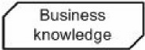 |

#### Input Data Element

An Input Data element is represented in a DRD as a shape with two parallel straight sides and two semi-circular ends, normally drawn with solid lines.

###### Table: Depiction Resolution for Input Data

| **DMNElement** | **DMN Diagram attributes** | **Depiction** |
|------------------------|------------------------|------------------------|
| Input Data | None or useAlternativeInputDataShape = false | 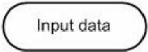 |
| Input Data | useAlternativeInputDataShape = true | 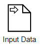 |

#### Knowledge Source

A Knowledge Source is represented as a shape with three straight sides and one wavy one, normally drawn with solid lines.

###### Table: Depiction Resolution for Knowledge Source

| **DMNElement**   | **DMNShape attributes** | **Depiction**                 |
|------------------|-------------------------|-------------------------------|
| Knowledge Source | None                    |  |

#### Artifacts

###### Table: Depiction Resolution of Artifacts

| **DMNElement** | **DMNShape Attributes** | **Depiction**                 |
|----------------|-------------------------|-------------------------------|
| TextAnnotation | None                    | 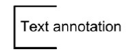 |
| Group          | None                    | 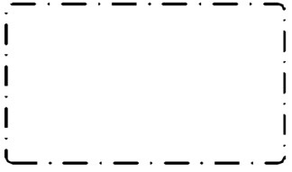 |

#### Decision Service

If the set of output decisions is smaller than the set of encapsulated decisions, the Decision Service shall be divided into two parts with a straight solid line.

###### Table: Depiction Resolution of Decision Service

| **DMNElement** | **DMNShape attributes** | **Depiction** |
|-----------------------|------------------------|-------------------------|
| Decision Service | None or isCollapsed=false | 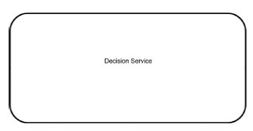 |
| Decision Service | DecisionServiceDividerLine isCollapsed=false | 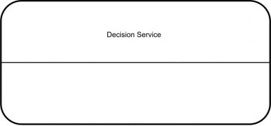 |
| Decision Service | isCollapsed=true | 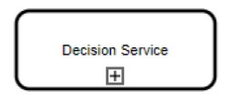 |

### DMNEdge Resolution

#### Information Requirement

###### Table: Depiction Resolution of Information Requirement

| **DMNElement**          | **Depiction**                                  |
|-------------------------|------------------------------------------------|
| Information Requirement | 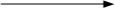 |

#### Knowledge Requirement

###### Table: Depiction Resolution of Knowledge Requirement

| **DMNElement**        | **Depiction**                                  |
|-----------------------|------------------------------------------------|
| Knowledge Requirement | 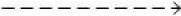 |

#### Authority Requirement

###### Table: Depiction Resolution of Authority Requirement

| **DMNElement**        | **Depiction**                                  |
|-----------------------|------------------------------------------------|
| Authority Requirement | 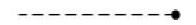 |

#### Association

When the DMNEdge depicts an Association, its DMNElement MUST be specified.

###### Table: Depiction Resolution of Association

| **DMNElement** | **Depiction** |
|---------------------------|---------------------------------------------|
| Association where associationDirection is none. | 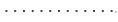 |
| Association where associationDirection is one. | 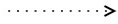 |
| Association where associationDirection is both. | 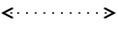 |
