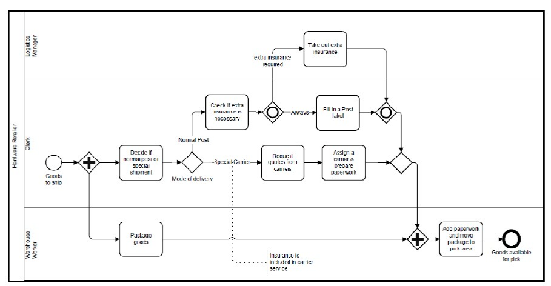
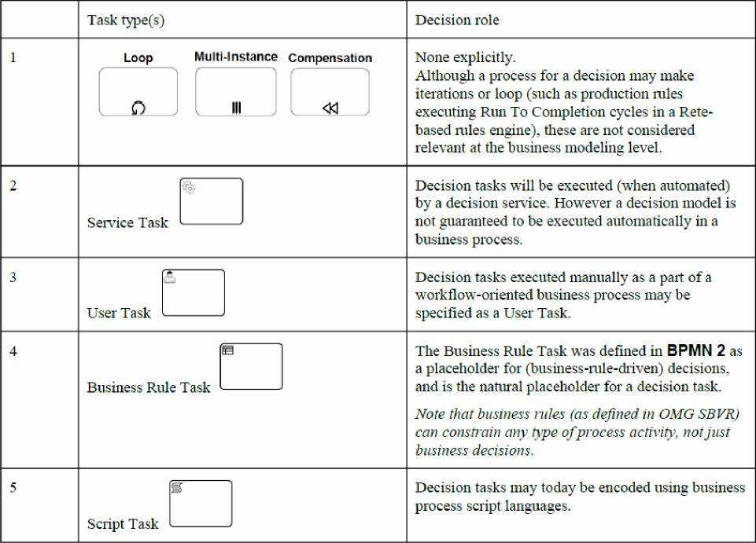

# ANNEXES {-}

All the Annexes are informative.

[Relation to BPMN (informative)](#relation-to-bpmn-informative). discuss issues around the application of **DMN** in combination with **BPMN**. This section is intended to provide some direction to practitioners but is non-normative.

[Glossary (informative)](#glossary-informative). provides a non-normative glossary to aid comprehension of the specification.

# Relation to BPMN (informative)

## Goals of BPMN and DMN

The OMG Business Process Model and Notation Standard provides a standard notation for describing business processes as orchestrations of tasks. The success of **BPMN** has provided a major motivation for **DMN,** and business decisions described using **DMN** are expected to be commonly deployed in business processes described using **BPMN**.

All statements pertaining to **BPMN** below are from the OMG document reference 11-01-03 unless otherwise stated.

**BPMN**’s goals are stated in the specification and provide easy comparisons to **DMN**:

- Goal 1: “*The primary goal of* **BPMN** *is to provide a notation that is readily understandable by all business users, from the business analysts that create the initial drafts of the processes, to the technical developers responsible for implementing the technology that will perform those processes, and finally, to the businesspeople who will manage and monitor those processes. Thus,* **BPMN** *creates a standardized bridge for the gap between the business process design and process implementation.*”. **DMN** users will also be business analysts (designing decisions) and then business users (populating decision models such as decision tables). Technical developers may be responsible for mapping business terms to appropriate data technologies. Therefore, **DMN** can also be said to bridge the decision design by a business analyst, and the decision implementation, typically using some decision execution technology,

- Goal 2: *“... To ensure that XML languages designed for the execution of business processes, such as WSBPEL (Web Services Business Process Execution Language), can be visualized with a businessoriented notation.”* It is not a stated goal of **DMN** to be able to visualize other XML languages (such as W3C RIF or OMG PRR); indeed, it is expected that **DMN** would provide the MDA specification layer for such languages. It does not preclude however the use of **DMN** (such as decision tables) to represent executable forms (such as production rules).

- Goal 3: *“The intent of* **BPMN** *is to standardize a business process model and notation in the face of many different modeling notations and viewpoints. In doing so,* **BPMN** *will provide a simple means of communicating process information to other business users, process implementers, customers, and suppliers.”* Similarly, the intent of **DMN** is to standardize the decision model and notation across the many different implementations of broadly semantically similar models. In so doing, **DMN** will also facilitate the communication of decision information across business communities and tools.

## BPMN Tasks and DMN Decisions

Most **BPMN** diagrams contain some tasks which involve decision-making which can be modeled in **DMN**. These tasks take input data acquired or generated earlier in the process and produce decision outputs which are used later in the process. Decision outputs may be used in two principal ways:

- They may be consumed in another process task.

- They may influence the choice of sequence flows out of a gateway.

In the latter case, decisions are used to determine which subprocesses or tasks are to be executed (in the process sense). As such, **DMN** complements **BPMN** as decision modeling complements process modeling (in the sense of defining orchestrations or work tasks).

For example, [Decision-making in BPMN](Images/decision-making-in-bpmn.svg) shows an example[^1] of a **BPMN**-defined process.

Analyzing this we see:

- A task whose title starts with “Decide...” which makes a decision on (whether to use) normal post or special shipment, and which precedes an exclusive gateway using that decision result.

- A task whose title starts with “Check...” which makes a decision on whether extra insurance is necessary, which precedes an inclusive gateway for which an additional process path may be executed based on the decision result.

- A task whose title starts with “Assign...” which implies a decision to select a carrier based on some selection criteria. The previous task is effectively collecting data for this decision. In an automated system this would probably be a subprocess embedding a decision and some other activities (such as “prepare paperwork”).

From this example we can see that even a simple business process in **BPMN** may have several decision-making tasks.

## Types of BPMN Tasks relevant to DMN

**BPMN** defines[^2] different types of tasks that can be considered for decision-making roles. The relevant tasks are as shown in [BPMN tasks relevant to DMN](#table-bpmn-tasks-relevant-to-dmn):

###### Table: BPMN tasks relevant to DMN

|  |
|--------------------------------------------|

A future version of **BPMN** may choose to clarify and extend the definitions of task to better match decision modeling requirements and **DMN** – to wit, to define a **BPMN** Decision Task as some task used to make a decision modeled with **DMN**. In the meantime, the Business Rule Task is the most natural way to express this functionality. However, as noted in clauses [Modeling requirements for automated decision-making](05_Introduction_to_DMN.md#modeling-requirements-for-automated-decision-making) and [Artifact metamodel](06_Requirements_DRG_and_DRD.md#artifact-metamodel), a Decision in **DMN** can be associated with any Task, allowing for flexibility in implementation.

## Process gateways and Decisions

Process gateways can be considered of 2 types:

1.  A gateway that determines a process route or routes based on existing data

2.  A gateway that determines a process route or routes based on the outcome of one or more decisions that are determined by some previous task within the process.

In the latter case, a Decision Task (task used to make a decision using **DMN**) may need an extended notation to clarify the relationship of the decision task to the gateway(s) that use it.

## Linking BPMN and DMN Models

**DMN** offers two approaches to linking business process models in **BPMN** with decision models: one normative and the other non-normative:

### a) Associating Decisions with Tasks and Processes {-}

As described in clause [Artifact metamodel](06_Requirements_DRG_and_DRD.md#artifact-metamodel), in **DMN**, the process context for an instance of Decision is defined by its association with any number of usingProcesses, which are instances of Process as defined in OMG **BPMN 2**, and any number of usingTasks, which are instances of Task as defined in OMG **BPMN 2**. Each decision may therefore be associated with one or more business processes (to indicate that the decision is taken during those processes), and/or with one or more specific tasks (to indicate that the tasks involve making the decision). An implementation SHALL allow these associations to be defined for each decision.

An implementation MAY perform validation over the two (**BPMN** and **DMN**) models, to check, for example, that:

- A Decision is not associated with Tasks that are part of Processes not also associated with the Decision.

- A Decision is not associated with Tasks that are not part of any Process associated with the Decision.

During development it may be appropriate to associate a Decision only with a Process, but inconsistency between Task and Process associations is not allowed.

Note that this approach allows the relationships between business process models and decision models to be defined and validated but does not of itself permit the decisions modeled in **DMN** to be executed automatically by processes modeled in **BPMN**.

### b) Decision Services {-}

One approach to decision automation is described non-normatively in [Relation to BPMN (informative)](#relation-to-bpmn-informative): the encapsulation of **DMN** Decisions in a “decision service” called from a **BPMN** Task (e.g., a Service Task or Business Rule Task, as discussed in Annex A..3 above). The usingProcesses and usingTasks properties allow definition and validation of associations between **BPMN** and **DMN**; the definition of decision services then provides a detailed specification of the required interface.

# Glossary (informative)

**A**

Aggregation

: The production of a single result from multiple **hits** on a **decision table**. DMN specifies four aggregation operators on the Collect hit policy, namely: + (sum), \< (min), \> (max), \# (count). If no operator is specified, the results of the Collect hit policy are returned without being aggregated.

Any

: A **hit policy** for **single hit decision tables** with overlapping **decision rules**: under this policy any match may be used.

Authority Requirement

: The dependency of one element of a Decision Requirements Graph on another element which provides guidance to it or acts as a source of knowledge for it.

**B**

Binding

: In an **invocation**, the association of the parameters of the invoked expression with the input variables of the invoking expression, using a binding formula.

Boxed Context

: A form of **boxed expression** showing a collection of *n* (name, value) pairs with an optional result value.

Boxed Expression

: A notation serving to decompose **decision** **logic** into small pieces which may be associated graphically with elements of a **DRD**.

Boxed Function

: A form of **boxed expression** showing the kind, parameters, and body of a function.

Boxed Invocation

: A form of **boxed expression** showing the parameter bindings that provide the context for the evaluation of the body of a **business knowledge** **model**.

Boxed List

: A form of **boxed expression** showing a list of *n* items.

Boxed Literal Expression

: A form of **boxed expression** showing a **literal** **expression**.

Business Context Element

: An element representing the business context of a decision: either an **organisational unit** or a **performance indicator**.

Business Knowledge Model

: Some **decision logic** (e.g., a **decision table**) encapsulated as a reusable function, which may be invoked by **decisions** or by other **business** **knowledge models**.

**C**

Clause

: In a **decision table**, a clause specifies a subject, which is defined by an input expression or an output domain, and the finite set of the subdomains of the subject’s domain that are relevant for the piece of **decision logic** that is described by the decision table.

Collect

: A hit policy for multiple hit decision tables with overlapping decision rules: under this policy all matches will be returned as a list in an arbitrary order. An operator can be added to specify a function to be applied to the outputs: see Aggregation.

Context

: In **FEEL**, a map of key-value pairs called **context entries**.

Crosstab Table

: An **orientation** for **decision tables** in which two **input expressions** form the two dimensions of the table, and the **output entries** form a twodimensional grid.

**D**

Decision

: The act of determining an **output value** from a number of **input values**, using **decision logic** defining how the output is determined from the inputs.

Decision Logic

: The logic used to make decisions, defined in DMN as the **value expressions** of **decisions** and **business knowledge** **models** and represented visually as **boxed expressions**.

Decision Logic Level

: The detailed level of modeling in DMN, consisting of the **value** **expressions** associated with **decisions** and **business** **knowledge models**.

Decision Model

: A formal model of an area of decision-making, expressed in DMN as **decision requirements** and **decision logic**.

Decision Point

: A point in a business process at which decisionmaking occurs, modeled in BPMN 2.0 as a business rule task and possibly implemented as a call to a **decision service.**

Decision Requirements Diagram

: A diagram presenting a (possibly filtered) view of a **DRG**.

Decision Requirements Graph

: A graph of **DRG elements** (**decisions**, **business knowledge** **models** and **input data**) connected by **requirements**.

Decision Requirements Level

: The more abstract level of modelling in DMN, consisting of a **DRG** represented in one or more **DRDs**.

Decision Rule

: In a **decision table**, a decision rule specifies associates a set of conclusions or results (**output entries**) with a set of conditions (**input entries**).

Decision Service

: A software component encapsulating a **decision model** and exposing it as a service, which might be consumed (for example) by a task in a BPMN process model.

Decision Table

: A tabular representation of a set of related input and output expressions, organized into **decision rules** indicating which **output entry** applies to a specific set of **input entries**.

Definitions

: A container for all elements of a DMN **decision model**. The interchange of DMN files will always be through one or more Definitions.

DMN Element

: Any element of a DMN **decision model**: a **DRG Element**,**Business** **Context Element**, **Expression**, **Definitions**, **Element Collection**, **Information Item** or **Item Definition**.

DRD

: See **Decision Requirements Diagram**.

DRG

: See **Decision Requirements Graph**.

DRG Element

: Any component of a **DRG**: a **decision**, **business knowledge model**, **input data** or **knowledge source**.

**E**

Element Collection

: Used to define named groups of **DRG elements** within a **Definitions**.

Expression

: A **literal expression**, **decision table, invocation**, list, **context**, function definition, or **relation** used to define part of the **decision logic** for a **decision** **model** in **DMN**. Returns a single value when interpreted.

**F**

FEEL

: The “Friendly Enough Expression Language” which is the default expression language for DMN.

First

: A **hit policy** for **single hit decision tables** with overlapping **decision rules**: under this policy the first match is used, based on the order of the **decision rules**.

Formal Parameter

: A named, typed value used in the invocation of a function to provide an **information item** for use in the body of the function.

**H**

Hit

: In a **decision table**, the successful matching of all **input** **expressions** of a **decision rule**, making the conclusion eligible for inclusion in the results.

Horizontal

: An orientation for **decision tables** in which **decision rules** are presented as rows, **clauses** as columns.

**I**

Information Item

: A **DMN element** used to model either a **variable** or a **parameter** at the **decision logic level** in DMN **decision models**.

Information Requirement

: The dependency of a **decision** on an **input data** element or another **decision** to provide a **variable** used in its **decision logic**.

Input Data

: Denotes information used as an input by one or more **decisions**, whose value is defined outside of the **decision model**.

Input Entry

: An **expression** defining a condition cell in a **decision table** (i.e., the intersection of a **decision rule** and an input **clause**).

Input Expression

: An **expression** defining the item to be compared with the **input entries** of an input **clause** in a **decision table**.

Input Value

: An **expression** defining a limited range of expected values for an input **clause** in a **decision table**.

Invocation

: A mechanism that permits the evaluation of one value expression another, using a number of **bindings**.

Item Definition

: Used to model the structure and the range of values of **input data** and the outcome of **decisions**, using a type language such as **FEEL** or XML Schema.

**K**

Knowledge Requirement

: The dependency of a **decision** or **business knowledge model** on a **business knowledge model** which must be invoked in the evaluation of its **decision logic**.

Knowledge Source

: An authority defined for **decisions** or **business knowledge** **models**, e.g., domain experts responsible for defining or maintaining them, or source documents from which business knowledge models are derived or sets of test cases with which the decisions must be consistent.

**L**

Literal Expression

: Text that represents **decision logic** by describing how an output value is derived from its input values, e.g. in plain English or using the default expression language **FEEL**.

**M**

Multiple Hit

: A type of **decision table** which may return **output entries** from multiple **decision rules**.

**O**

Organisational Unit

: A **business context element** representing the unit of an organization which makes or owns a **decision**.

Orientation

: The style of presentation of a **decision table**: horizontal (decision rules as rows; clauses as columns), vertical (rules as columns; clauses as rows), or crosstab (rules composed from two input dimensions).

Output Entry

: An **expression** defining a conclusion cell in a **decision table** (i.e., the intersection of a **decision rule** and an output **clause**).

Output Order

: A **hit policy** for **multiple hit decision tables** with overlapping **decision rules**: under this policy all matches will be returned as a list in decreasing priority order. Output priorities are specified in an ordered list of values.

Output Value

: An **expression** defining a limited range of domain values for an output **clause** in a **decision table**.

**P**

Performance Indicator

: A **business context element** representing a measure of business performance impacted by a **decision**.

Priority

: A **hit policy** for **single hit decision tables** with overlapping **decision** **rules**: under this policy the match is used that has the highest output priority. Output priorities are specified in an ordered list of values.

**R**

Relation

: A form of **boxed expression** showing a vertical list of homogeneous horizontal **contexts** (with no result cells) with the names appearing just once at the top of the list, like a relational table.

Requirement

: The dependency of one **DRG element** on another: either an **information requirement**, **knowledge requirement** or **authority** **requirement.**

Requirement Subgraph

: The directed graph resulting from the transitive closure of the **requirements** of a **DRG element**; i.e., the sub-graph of the **DRG** representing all the decision-making required by a particular element.

Rule Order

: A **hit policy** for **multiple hit decision tables** with overlapping **decision** **rules**: under this policy all matches will be returned as a list in the order of definition of the **decision rules**.

**S**

S-FEEL

: A simple subset of **FEEL**, for **decision models** that use only simple **expressions**: in particular, **decision models** where the **decision** **logic** is modeled mostly or only using **decision tables**.

Single Hit

: A type of **decision table** which may return the **output entry** of only a single **decision rule**.

**U**

Unique

: A **hit policy** for **single hit decision tables** in which no overlap is possible and all **decision rules** are exclusive. Only a single rule can be matched.

**V**

Variable

: Represents a value that is input to a **decision**, in the description of its **decision logic**, or a value that is passed as a **parameter** to a function.

Vertical

: An **orientation** for **decision tables** in which decision rules are presented as columns; clauses as rows.

**W**

Well-Formed

: Used of a **DRG element** or **requirement** to indicate that it conforms to constraints on referential integrity, acyclicity etc.

[^1]: Shipment Process in a Hardware Retailer example, Ch5.1, BPMN 2.0 By Example, June 2010, OMG reference 10-06-02

[^2]: See ch 10.2.3 in the BPMN Specification.
